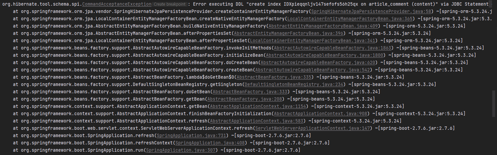

# MySQL에서 댓글 인덱스가 3072바이트 제한을 넘은 이유

게시판의 댓글 본문을 `VARCHAR(2000)`으로 정의하고 전체 컬럼에 인덱스를 만들려다 `Specified key was too long; max key length is 3072 bytes` 오류를 만났다. 댓글의 최대 길이를 2,000자로 유지하면서 인덱스를 어떻게 설계할 수 있을까? [2022년 12월 19일 티스토리 원문](https://to-be-a-artist.tistory.com/288)

원문 스크린샷에서 Hibernate가 `article_comment.content`에 인덱스를 만드는 DDL을 실행하다 실패한 것을 확인할 수 있다.



## 실제 댓글 길이가 짧아도 인덱스 생성은 실패한다

당시 컬럼은 `utf8mb4`였다. 이 문자 집합은 문자 하나에 최대 4바이트를 사용한다. 다음 수치는 컬럼 정의를 바탕으로 계산한 상한이다. 전체 컬럼을 인덱싱하면 `VARCHAR(2000)`의 최대 키 길이는 8,000바이트다. `VARCHAR(1000)`으로 줄여도 4,000바이트라 오류에 나온 3,072바이트를 넘는다.

MySQL 8.0 문서에서 3,072바이트는 페이지 크기가 16 KiB인 InnoDB의 `DYNAMIC` 또는 `COMPRESSED` 행 형식에 해당한다. 페이지 크기가 더 작거나 행 형식이 다르면 제한이 달라진다. [MySQL InnoDB 제한](https://dev.mysql.com/doc/refman/8.0/en/innodb-limits.html)

## 댓글 길이를 유지하며 재현하기

아래는 원문에 나온 컬럼 길이와 문자 집합을 바탕으로 만든 예시다. MySQL 8.0의 16 KiB InnoDB 환경을 가정한다. 당시의 전체 테이블 정의와 서버 버전은 원문에서 확인할 수 없다. 아래 결과는 이 조건에서의 예상 동작이다.

```sql
CREATE TABLE comment_index_demo (
  id BIGINT PRIMARY KEY,
  content VARCHAR(2000) NOT NULL
) ENGINE = InnoDB ROW_FORMAT = DYNAMIC DEFAULT CHARSET = utf8mb4;

-- 전체 컬럼 인덱스는 3,072바이트 제한을 넘는다.
CREATE INDEX idx_body ON comment_index_demo (content);

-- 위 문장과 별도로 실행한다. 앞 100자만 키로 사용한다.
CREATE INDEX idx_body_prefix ON comment_index_demo (content(100));
```

`content(100)`의 100은 문자 수다. `utf8mb4`에서 이 접두부의 키 길이는 최대 400바이트다. 본문은 여전히 2,000자까지 저장할 수 있다. [MySQL CREATE INDEX 문서](https://dev.mysql.com/doc/refman/8.0/en/create-index.html)

## 인덱스가 필요한 조회부터 확인하기

| 대안 | 판단 기준 |
|---|---|
| 컬럼 길이를 줄인다 | 인덱스 크기를 줄일 수 있지만 댓글의 최대 길이도 줄어든다. |
| 문자 집합을 바꾼다 | MySQL 8.0에서 `utf8`은 폐기 예정인 `utf8mb3`의 별칭이다. 표현 가능한 문자가 줄어들고, 2,000자의 최대 키 길이도 6,000바이트라 여전히 한도를 넘는다. [MySQL 문자 집합 문서](https://dev.mysql.com/doc/refman/8.0/en/charset-unicode-utf8.html) |
| 접두부를 인덱싱한다 | 댓글 길이를 유지할 수 있다. 앞부분이 비슷한 댓글이 많으면 후보 행을 충분히 좁히지 못할 수 있다. |

원문에서 검토한 접두부 100자는 인덱스 길이 제한을 피하는 예시다. 실제 길이는 인덱스를 사용할 조회와 댓글의 분포에 맞춰 정해야 한다. 예를 들어 본문 앞부분으로 찾는 조회라면 실제 쿼리의 실행 계획으로 후보 행을 얼마나 줄이는지 확인할 수 있다. 당시 접두부 인덱스를 최종 적용했는지와 조회 성능이 개선됐는지는 원문에 기록되어 있지 않다. [MySQL 컬럼 인덱스 문서](https://dev.mysql.com/doc/refman/8.0/en/column-indexes.html)
