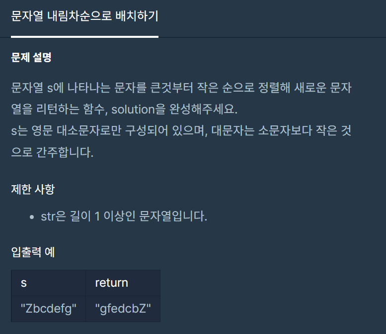

#### **#P. 35: 문자열 내림차순으로 배치하기 (난이도 : 중)**



프로그래머스 - 연습문제 :&nbsp;문자열 내림차순으로 배치하기

* 풀이 방법  
  + 1. Array.sort를 이용한 풀이
  + 2. HashMap을 이용한 방법

```
// 1005200 ns
public static String[] solution(String[] strings, int n) {
    // 문자열 배열에서 해당 인덱스의 문자를 문자열로 받는다.
    // 해당 인덱스의 문자열이 동일할경우, 앞자리로 계산한다.
    Arrays.sort(strings, new Comparator<String>() {
        @Override
        public int compare(String o1, String o2) {
            if(o1.charAt(n)  > o2.charAt(n)) return 1;
            if(o1.charAt(n) == o2.charAt(n)) return o1.compareTo(o2);
            if(o1.charAt(n) < o2.charAt(n)) return -1;
            else return 0;
        }
    });

    return strings;
}

// 2022400 ns
public static String[] solution1(String[] strings, int n) {
    // 문자열 배열에서 해당 인덱스의 문자를 문자열로 받는다.
    // 해당 인덱스의 문자열이 동일할경우, 앞자리로 계산한다.
    HashMap<String, Character> map = new HashMap<>();

    for (int i = 0; i < strings.length; i++) {
        map.put(strings[i], strings[i].charAt(n));
    }

    List<Map.Entry<String, Character>> list_entries = new ArrayList<Map.Entry<String, Character>>(map.entrySet());
    Collections.sort(list_entries, new Comparator<Map.Entry<String, Character>>() {
        @Override
        public int compare(Map.Entry<String, Character> o1, Map.Entry<String, Character> o2) {
            return o1.getValue() == o2.getValue() ? o1.getKey().compareTo(o2.getKey()) : o1.getValue().compareTo(o2.getValue());
        }
    });
    String[] answer = new String[3];
    int idx = 0;
    for (Map.Entry<String, Character> entry : list_entries) {
        answer[idx++] = entry.getKey();
    }

    return answer;
}
```
