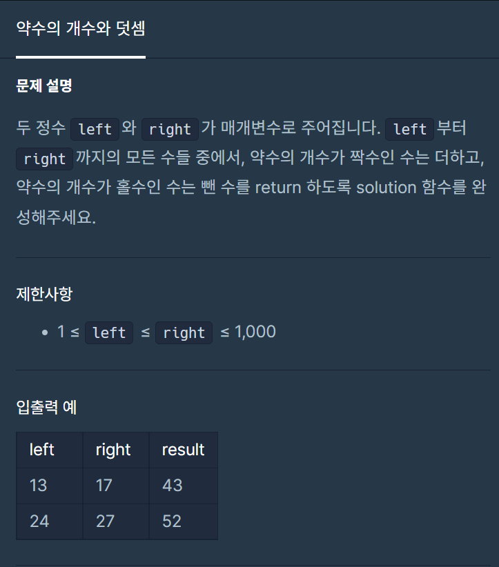
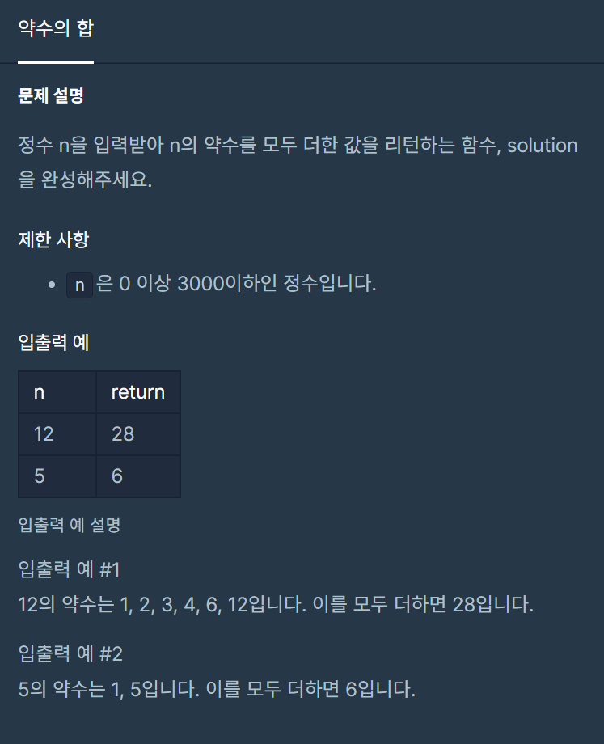
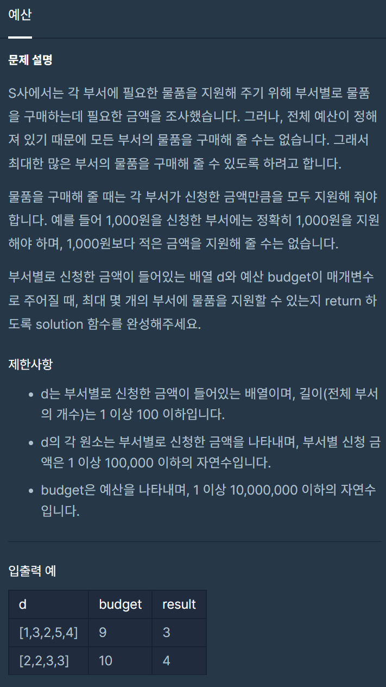
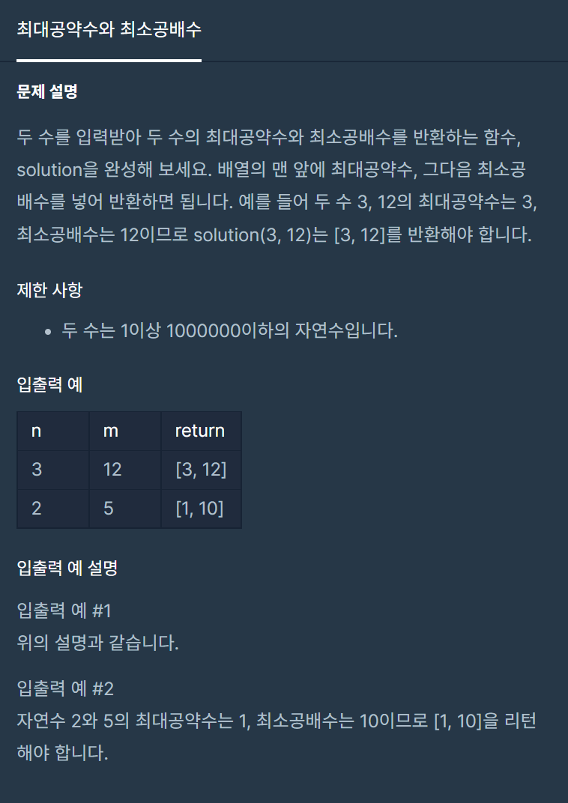
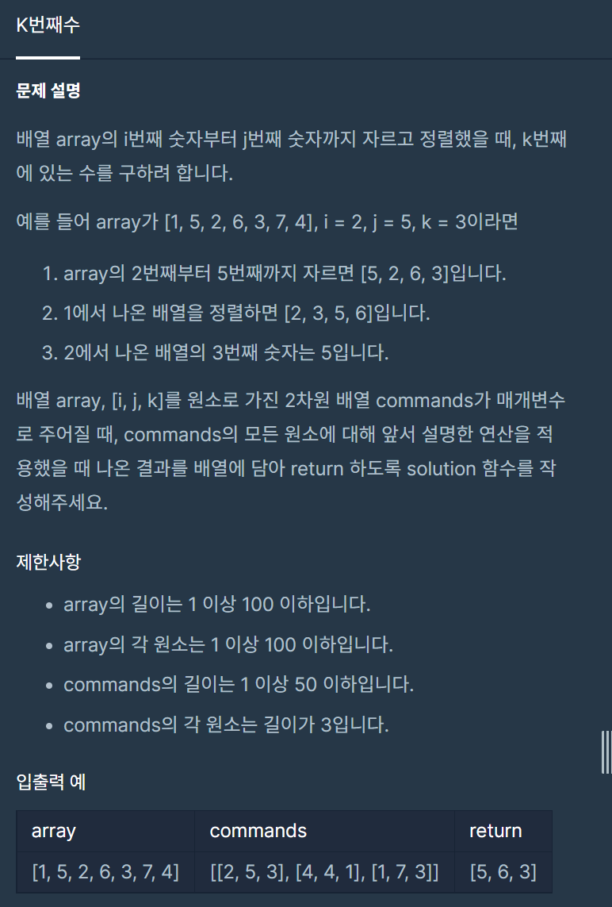
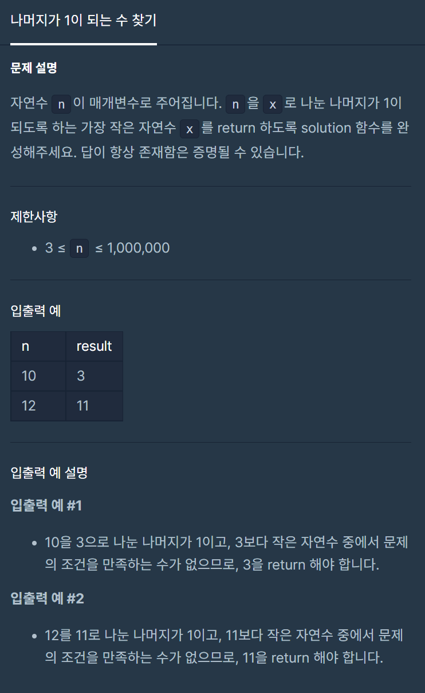
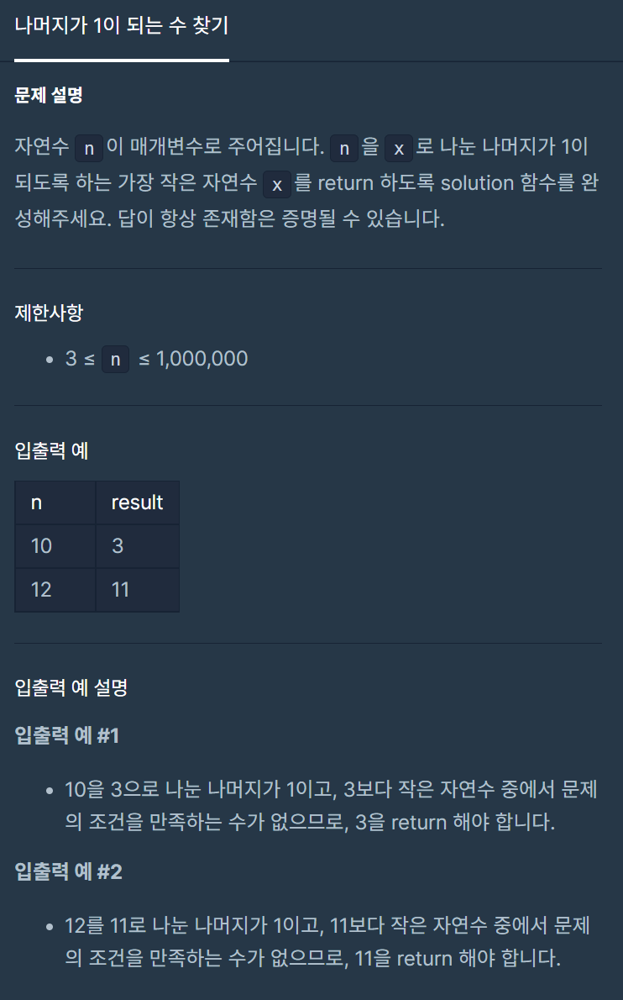

#### 


#### **오늘은 개인적으로 진행한 알고리즘 문제 풀이다.**

#### **Challenge라는 파트로 따로 나눠져 있는 문제들이기 때문에 더 흥미로웠다.**

#### **(사실 프로그래머스 문제를 풀어본적이 있어 몇개는 풀어본적이 있었다...)**

#### 

#### 

---

#### 

#### **#P. Challege 01 : 약수의 개수와 덧셈 (난이도 : 중)**

#### 



프로그래머스 - 약수의 개수와 덧셈

#### **# Solution**

* **에라토스 테네스의 체 활용**

> **동일한 풀이 방식으로 많이 풀어서 설명하도록 하겠다. 에라토스 테네스의 체는 소수를 찾는 방법이다.   
> 소수의 규칙성을 확인해 보면 소수의 배수는 소수가 아니다라는 것이다.   
> 이 원리를 사용하는 것이 에라토스 테네의 체 활용법이라고 생각하면 이해하기 쉬울 것 이다.  
>   
> 이 문제에서 소수라는 것을 활용하면 코드가 간결해질 수 있다. 소수는 약수의 개수를 확인할 과정이 필요없이 2개이다. 그러므로 합하면 되고, 나머지 숫자만 반복문을 통해 약수의 개수를 확인하면 된다.**

```
// 소수를 이용한 풀이(에라토스테네스의 체)
public class Exam41 {
    public static boolean prime[];

    public static void main(String[] args) {
        long start = System.nanoTime();
        System.out.println(solution(13, 17));
        System.out.println(solution(24, 27));
        long end = System.nanoTime();
        System.out.println("수행시간: " + (end - start) + " ns");
    }

    public static int solution(int left, int right) {
        int sum = 0;
        int count = 0;
        prime = new boolean[right + 1];    // 배열 생성
        get_prime();

        for(int i= left; i<=right; i++){
            if(!prime[i]) count = 2;
            else count = divisor(i);

            sum += count % 2 ==0 ? i : -i;
        }

        return sum;
    }

    public static int divisor(int num){
        int count = 0;
        for(int i=1; i<=num;i++){
            if(num % i ==0)
                count++;
        }

        return count;
    }

    public static void get_prime() {
        prime[0] = true;
        prime[1] = true;

        for(int i = 2; i <= Math.sqrt(prime.length); i++) {
            if(prime[i]) continue; // 이미 체크된 배열일 경우 skip
            for(int j = i * i; j < prime.length; j += i) {
                prime[j] = true;
            }
        }

    }
}
```

---

#### **#P. Challege 02 : 약수의 개수와 덧셈 (난이도 : 중)**



프로그래머스 - 연습문제 : 약수의 개수와 덧셈

#### **# Solution**

* **에라토스 테네스의 체 활용**
* **반복문을 이용한 풀이**

```
// 소수를 이용한 풀이(에라토스테네스의 체)
// 반복문을 이용한 풀이
public class Exam42 {
    public static boolean prime[];

    public static void main(String[] args) {
        long start = System.nanoTime();
        System.out.println(solution2(12));
        System.out.println(solution2(5));
        long end = System.nanoTime();
        System.out.println("수행시간: " + (end - start) + " ns");
    }

    public static int solution(int n) {
        prime = new boolean[3000 + 1]; // 3000이하
        get_prime();
        int sum = 0;
        if(!prime[n]) return n+1;
        else{
            for(int i=1; i<=n/2;i++){
                if(n%i==0)
                    sum += i;
            }
            return sum+n;
        }
    }

    public static int solution2(int n){
        int sum = 0;
        for(int i=1; i<=n/2;i++){
            if(n%i==0)
                sum += i;
        }
        return sum+n;
    }

    public static void get_prime() {
        prime[0] = true;
        prime[1] = true;

        for(int i = 2; i <= Math.sqrt(prime.length); i++) {
            if(prime[i]) continue; // 이미 체크된 배열일 경우 skip
            for(int j = i * i; j < prime.length; j += i) {
                prime[j] = true;
            }
        }

    }
}
```

---

#### **#P. Challege 03 : 약수의 개수와 덧셈 (난이도 : 중)**

> **(Tip)** 문제가 길다... 길면 걱정이다.. 내가 한국어를 읽을 수 있을지.. 고민하지 말고 입출력 예시부터 읽으면 이해가 쉬우진다.



프로그래머스 - 예산

#### **# Solution**

* **반복문을 이용한 풀이**

```
public static void main(String[] args) {
    long start = System.nanoTime();
    System.out.println(solution(new int[]{1,3,2,5,4}, 9));
    System.out.println(solution(new int[]{2,2,3,3}, 10));
    long end = System.nanoTime();
    System.out.println("수행시간: " + (end - start) + " ns");
}

public static int solution(int[] d, int budget) {
    Arrays.sort(d);
    int idx=0;
    for(idx=0; idx<d.length;idx++){
        budget = budget - d[idx];
        if(budget < 0) return idx;
    }

    return idx;
}
```

---

#### **#P. Challege 04 : 최대 공약수와 최소 공배수 (난이도 : 중)**



프로그래머스 - 최대공약수와 최소공배수

#### **# Solution**

* **유클리드 호제법을 이용한 풀이법**

```
// 유클리드 호제법
public class Exam44 {
    public static boolean prime[];

    public static void main(String[] args) {
        long start = System.nanoTime();
        System.out.println(solution(3, 12));
        System.out.println(solution(2, 5));
        long end = System.nanoTime();
        System.out.println("수행시간: " + (end - start) + " ns");
    }

    public static int[] solution(int n, int m) {
        int[] result = new int[2];

        // 최대 공약수
        result[0] = gcd(n, m);
        result[1] = (n*m)/result[0];
        return result;
    }

    public static int gcd(int n, int m){
        if(m == 0){
            return n;
        }else{
            return gcd(m, n%m);
        }

    }

}
```

---

#### **#P. Challege 05 : K번째 수 (난이도 : 중)**



프로그래머스 - K번째 수

#### **# Solution**

* **ArrayList + 반복문 사용**

```
public static boolean prime[];

public static void main(String[] args) {
    long start = System.nanoTime();
    System.out.println(solution(new int[]{1, 5, 2, 6, 3, 7, 4}, new int[][]{{2,5,3},{4,4,1},{1,7,3}}));
    long end = System.nanoTime();
    System.out.println("수행시간: " + (end - start) + " ns");
}

public static int[] solution(int[] array, int[][] commands) {
    ArrayList<Integer> list = new ArrayList<>();
    int from = -1;
    int to = -1;
    int k = -1;
    for(int i=0;i<commands.length;i++){
        from = commands[i][0];
        to = commands[i][1];
        k = commands[i][2];
        int[] temp = Arrays.copyOfRange(array, from-1, to);
        Arrays.sort(temp);
        list.add(temp[k-1]);
    }

    return list.stream().mapToInt(i -> i).toArray();
}
```

---

#### **#P. Challege 06 : 나머지가 1이 되는 수 찾기 (난이도 : 중상)**



프로그래머스 - 나머지가 1이 되는 수 찾기

#### **# Solution**

* **에라토스 테네스의 체 활용**
* **반복문을 통한 풀이**

```
public static boolean prime[];

public static void main(String[] args) {
    long start = System.nanoTime();
    System.out.println(solution2(10));
    System.out.println(solution2(12));
    long end = System.nanoTime();
    System.out.println("수행시간: " + (end - start) + " ns");
}

public static int solution2(int n){
    for(int i=1;i<Math.sqrt(n);i++){
        if(n%i==1){
            return i;
        }
    }
    return n-1;
}

public static int solution(int n) {
    prime = new boolean[n];
    get_prime();

    if(!prime[n-1]) return n-1;
    else{
        return (int) Math.sqrt(n-1);
    }
}
public static void get_prime() {
    prime[0] = true;
    prime[1] = true;

    for(int i = 2; i <= Math.sqrt(prime.length); i++) {
        if(prime[i]) continue; // 이미 체크된 배열일 경우 skip
        for(int j = i * i; j < prime.length; j += i) {
            prime[j] = true;
        }
    }

}
```

---

#### **#P. Challege 07 : 소수 찾기 (난이도 : 중상)**



프로그래머스 - 소수 찾기

#### **# Solution**

* **에라토스 테네스의 체 활용**

```
public static void main(String[] args) {
    long start = System.nanoTime();
    System.out.println(solution2(10));
    System.out.println(solution2(5));
    long end = System.nanoTime();
    System.out.println("수행시간: " + (end - start) + " ns");
}

public static int solution2(int n){
    prime = new boolean[n+1];
    get_prime();
    int count = 0;

    for(int i= 1; i<=n; i++){
        if(!prime[i]) count++;
    }

    return count;
}

public static void get_prime() {
    prime[0] = true;
    prime[1] = true;

    for(int i = 2; i <= Math.sqrt(prime.length); i++) {
        if(prime[i]) continue; // 이미 체크된 배열일 경우 skip
        for(int j = i * i; j < prime.length; j += i) {
            prime[j] = true;
        }
    }

}
```

---

> **Review  
>   
> 오늘은 수학적으로 풀은 것 같아서 행복하다.  
> 하지만 같은 알고리즘을 돌려치기 해서 풀은 느낌이 많이 든다.  
> 아니 느낌이 아닌 사실이다... 더 효율적인 코드를 작성할 수 있는 방법을 생각하자.  
>   
>   
> 그리고 되돌아보면 현재 항해99 에서 알고리즘 문제를 준 것들은   
> 대부분... 프로그래머스 1단계 문제를 풀면 쉽게 만날 수 있는 문제들이다..  
> 흠.. 난이도 하, 중하, 중, 중상 이 수식어가 어울리지 않는 문제 같다...  
>   
> 더 노력해서 성공하자!! 화이팅!!**

-
