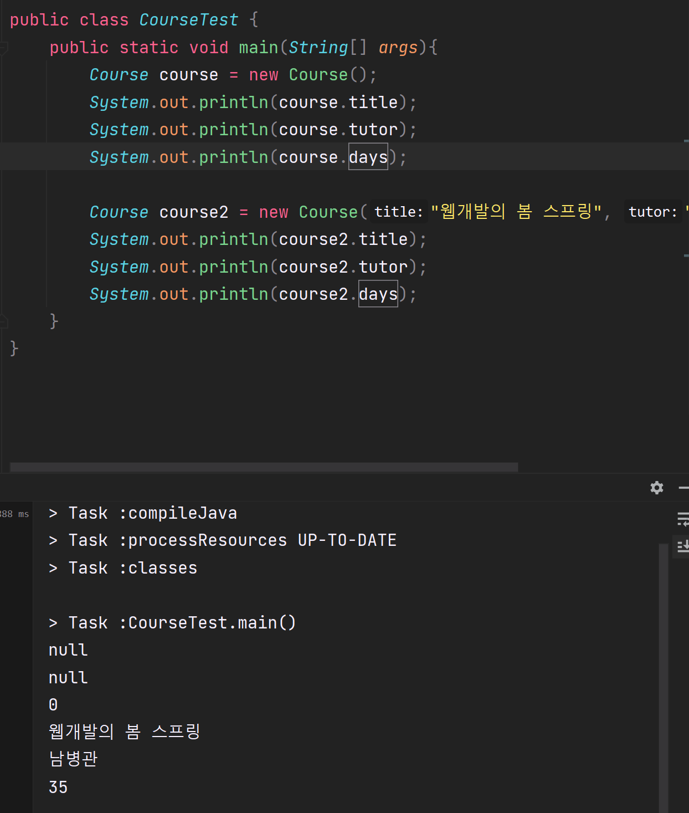
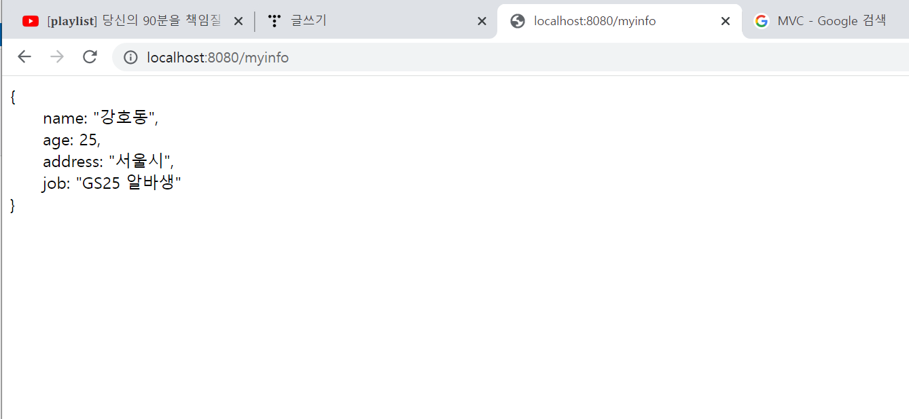

> **1) Tutor 클래스를 만들고, 이름(name)과, 경력(bio) 멤버 변수를 추가하세요. 2) 그리고 각 변수를 private 으로 선언하고, Getter와 Setter 를 만들어보세요. 3) 마지막으로, 기본 생성자와, name/bio 입력받는 생성자 두 개를 만들어보세요.**


**오늘은 항해 12일차로 챕터03이다.**

**오늘부터는 Spring 등 다양한 강의가 열리는 날이다!!**

**두근두근 두근두근**

---

**[수업 목표]**

1. **웹의 기본적인 구조를 이해하고, 5주 동안 만들 프로젝트를 살펴본다.**
2. **스프링 부트의 기본 구조를 이해한다.**
3. **Java 기초를 학습한다.**

**[목차]**

1. **1주차 미리보기**
2. **필수 프로그램 설치**
3. **스프링 작동**
4. **웹의 개념**
5. **자바 기초 문법**
6. **자바클래스**
7. **Getter, Setter**
8. **브라우저에 바로 나타내보기**
9. **Gradle**
10. **숙제**

---

### **#S.1 - 1주차 미리보기**

* **웹 서비스란?**

> **👉 웹서비스를 만든다는 건, 클라이언트와 서버 모두 만들어야 한다는 것을 뜻합니다. 앞으로 우린 이 둘을 모두 직접 만들어 웹서비스를 완성해 나갑니다.**  
>   
> **클라이언트는 사용자가 보는 화면입니다. 웹사이트로 따지면 크롬 브라우저나 사파리, 익스플로러가 해당되겠고 앱으로 따지면 여러분들 휴대폰에 많이 존재하는 어플, 즉 앱 자체가 해당됩니다**  
>   
> **서버는 여러분들이 원하는 데이터가 있는 곳이고, 원하는 데이터를 요청하면 이에 응답해주는 곳이기도 합니다.**  
>   
> **웹서비스의 기본 구조는, 클라이언트에서 원하는 데이터가 있을 때마다 서버에 요청하고, 응답 데이터를 받아 사용자에게 보여줍니다**  
>   
> **그렇다면 우린 사용자들이 보는 웹 화면을 만들고 필요한 데이터를 요청할 수 있는 서버를 만들면 되겠네요? 간단합니다**

* **자바란?**

> **💡 컴퓨터에게 명령을 내리기 위한 소통 도구를 "프로그래밍 언어"라고 하는데 그 중의 하나입니다. 자바 언어는**  
> **스택오버플로우(Stack Overflow) 라는 대표적인 개발자 커뮤니티에서 조사한 기술의 사용률에서 Javascript, Python과 함께 여전히 최고의 사용률을 보여주고 있습니다.**

* **스프링이란?**

> **위에서 말씀드린 "자바"라는 언어로 서버를 만드는데 필요한 녀석입니다. 훌륭한 개발자들이 미리 필요한 것들을 만들어두었고, 우리는 필요한 부분들만 쏙쏙 채워나가면 됩니다**

* **1 ~ 5주차 과정 요약**
  + **1주차: Java 기초 문법, Spring 기초 사용법**  
    **→ 산에 오르려면 기초 체력을 다져야겠죠? 스프링을 다루기 위해서 꼭 필요한 자바 지식만을 배웁니다.**
  + **2주차: RDBMS, SQL, Lombok, JPA 사용해보기**  
    **→ 정보를 저장하는 데이터베이스를 배우고, 이를 자바로 다루는 표준 방법인 JPA를 써먹어봅니다.**
  + **3주차: 익명 타임라인 페이지 만들어보기**  
    **→ 익명의 타임라인 서비스를 만들어봄으로써 Spring 에 익숙함을 느낍니다.**
  + **4주차: 나만의 셀렉샵 만들어보기**  
    **→ 네이버 검색 API를 이용해서 조금 더 고도화된 웹서비스를 만들어봅니다.**
  + **5주차: 프로젝트 마무리 & AWS 배포**  
    **→ 클라우드에 서비스를 배포하고, 친구들이 들어올 수 있도록 주소를 붙인 뒤 카톡으로 공유해봅니다.**

* **만들 서비스 살펴보기**  
  + **[익명 타임라인 주소](http://spring.spartacodingclub.kr/timeline)**
  + **[나만의 셀렉샵 주소](http://spring.spartacodingclub.kr/)**

---

### 

### **#S.2 - 필수 프로그램 설치**

* **[Advanced Rest Client](https://install.advancedrestclient.com/install)**

---

### **#S.3 - 스프링 작동하기**

1. **스프링 프로젝트 준비하기**  
   **[1 단계] 프로젝트 설정**  
   **- Group : 이 서비스가 제공될 주소를 거꾸로 작성하는 것(많은 이유가 있지만, 관습적으로 쓴다는 것)**  
   **- Artifact : 프로젝트 이름**  
   **- Type : Gradle, Maven 중 선택**  
   **- Packaging : Jar**  
   **- Version : 8   (중요!)**  

   **[2단계] 프로젝트 도구 선정(필수도구)**  
   **1. Spring Web**  
   **2. Mysql**  
   **3. H2**  
   **4. JPA**  
   **5. Lombok**
2. **인털레제이 세팅하기(Shift 2번)**  
   **1. 플러그인 설치 - monokai**  
   **2. Auto Import 에서 Insert imports on paste는 Always로, Add unambiguous imports on the fly는 체크박스 체크**
3. **배울 내용 확인**
   1. **웹의 기본 개념**
   2. **자바 기본 문법**
   3. **스프링 작동 방법**
   4. **컨트롤러**
   5. **Gradle**

---

### **#S. 4. 웹의 개념**

**1. 웹의 동작 개념(HTML을 받는 경우)**

> **우리가 보는 웹페이지는 모두 서버에서 미리 준비해두었던 것을 "받아서", "그려주는" 것입니다.**   
> **즉, 브라우저가 하는 일은 1) 요청을 보내고, 2) 받은 HTML 파일을 그려주는 일 뿐이죠.**

**2. 웹의 동작 개념(데이터만 받는 경우)**

> **그럼 항상 이렇게 HTML만 내려주냐구요? 아뇨! 데이터만 내려 줄 때가 더 많다.**

**3. 스프링의 역할은?**

> **스프링은 "서버"를 담당합니다. 요청에 따라 눈에 보이는 것들 또는 데이터를 제공해주는 것는 역할을 한다.**

---

### **#S. 5. 자바 기초 문법**

**1. 배열 - List**

> **정보를 묶을 때 List 라는 녀석을 사용합니다. 세 가지를 기억하시면 돼요.**   
> **1. 순서가 중요한 녀석이에요!**   
> **2. 같은 자료형만 넣을 수 있어요**   
> **3. 넣을 때는 add, 조회할 때는 get, 제거할 때는 remove를 사용합니다.**

```
import java.util.ArrayList;
import java.util.List;

public class Prac {
    public static void main(String[] args){
        List<String> list = new ArrayList<>();

        String course1 = "웹개발의 봄 Spring";
        String course2 = "프론트엔드의 꽃 React";

        list.add(course1);
        list.add(course2);
        System.out.println(list);           // [웹개발의 봄 Spring, 프론트엔드의 꽃 React]

        System.out.println(list.get(1));    // 프론트엔드의 꽃 React

        list.remove(1);
        System.out.println(list);           // [웹개발의 봄 Spring]
    }
}
```

**2. 퀴즈 1**

> **❓ course1 이라는 이름의 변수에 값을 "웹개발 종합반", course2 라는 이름의 변수에 값을 "앱개발 종합반", 넣고, course1 과 course2 를 courseList 라는 배열에 순서대로 넣으려면 어떻게 해야 할까요?**

```
import java.util.ArrayList;
import java.util.List;

public class quiz_01 {
    public static void main(String[] args){
        List<String> courselist = new ArrayList<>();

        String course1 = "웹개발 종합반";
        String course2 = "웹개발 종합반";

        courselist.add(0, course1);
        courselist.add(1, course2);
        System.out.println(courselist);     // [웹개발 종합반, 웹개발 종합반]
    }
}
```

**3. 퀴즈 2**

> **두 정수를 받아서, 뺀 값을 반환하는 메소드를 만들고, 그 값을 인쇄해보세요! (메소드명은 자유롭게 지으세요)**

```
public class quiz_02 {
    public static void main(String[] args) {
        int n1 = 2;
        int n2 = 3;

        System.out.println(sub(n1, n2));
    }

    public static int sub(int n1, int n2) {
        return n1 - n2;
    }
}
```

**4. 클래스**

* **객체지향 프로그래밍**

> **1. 조건문, 반복문, 메소드만으로 무질서한 코드에 규칙이 생길 수 있다.**  
> **2. 조금 더 프로그래밍을 현실 세계에 빗대어 체계적으로 해보자는 발상이, 객체지향 프로그래밍의 핵심입니다.**

* **클래스란?**

> **현실과 비슷한 개념(객체)을 나타내기 위한 자바의 도구를 클래스라 하고, 클래스 내 정보를 멤버 변수라 한다.**



클래스 예제 코드

**5. 접근지정자**

> **클래스의 모든 정보를 손쉽게 바꿀 수 있으면 안되겠죠~!**   
> **왜냐하면 클래스는 고객의 비밀번호/결제정보와 같이 민감한 정보들도 담고 있기 때문입니다.**   
> **그래서 자바의 클래스는, 밖에 드러내도 되는 것들을 public,함부로 바꾸면 안되는 것들을 private 으로 구분해서 나타낸답니다.**

**6. 퀴즈 - 3**

> **1) Tutor 클래스를 만들고, 이름(name)과, 경력(bio) 멤버 변수를 추가하세요.**   
> **2) 그리고 각 변수를 private 으로 선언하고, Getter와 Setter 를 만들어보세요.**   
> **3) 마지막으로, 기본 생성자와, name/bio 입력받는 생성자 두 개를 만들어보세요.**

```
public class Tutor {
    // 멤버 변수
    private String name;
    private String bio;

    // 기본생성자
    public Tutor() {
    }

    // 생성자
    public Tutor(String name, String bio) {
        this.name = name;
        this.bio = bio;
    }

    // Getter
    public String getName() {
        return this.name;
    }
    public String getBio() {
        return this.bio;
    }

    // Setter    
    public void setName(String name) {
        this.name = name;
    }
    public void setBio(String bio) {
        this.bio = bio;
    }
}
```

---

### **#S. 6. 브라우저에 바로 나타내보기**

> 데이터로 응답하려면, RestController 를 사용해야 합니다.

* Rest란?
  + 서버의 응답이 JSON 형식임을 나타냅니다.
  + HTML, CSS 등을 주고받을 때는 Rest 를 붙이지 않습니다.
* Controller란?
  + 자동 응답기 - 누군가 말을 걸면 응답
  + 클라이언트의 요청(Request)을 전달받는 코드를 Controller 라고 부릅니다.  
    **→ JSON 만을 돌려주는 것은 RestController 라고 부릅니다.**

```
@RestController
public class CourseController {

    @GetMapping("/courses")
    public Course getCourses() {
        Course course = new Course();
        course.setTitle("웹개발의 봄 스프링");
        course.setDays(35);
        course.setTutor("남병관");
        return course;
    }
}
```

> **요약해보면**   
> **첫 번째, @RestController는 자동으로 데이터를 요청하면 JSON형태로 변환해준다.**  
> **두 번째 @GetMapping("/URI")를 작성하면 해당 URI를 요청받게 될때 해당 메소드된다.**

---

### **#S.7. Gradle**

* 다른 사람들이 만들어둔 도구 내려받기
  + Javascript - NPM
  + Python - pip
  + Java - mavenCentral, jcenter
* [MVN Repository](https://mvnrepository.com/)

[Maven Repository: Search/Browse/Explore

OpenDaylight Controller stack with clustering Last Release on May 12, 2022

mvnrepository.com](https://mvnrepository.com/)

---

### **#S.8. 숙제**

> 1. 새로운 스프링 프로젝트를 만든다. (New Project ...)   
> 2. Person 클래스를 만든다.   
> 3. 3개 이상의 멤버 변수를 만든다. (name, age, address, job ...)   
> 4. 멤버 변수는 모두 private 이다.   
> 5. Getter, Setter를 만든다.   
> 6. PersonConroller를 만들고, http://localhost:8080/myinfo에 나의 정보가 뜨도록 한다.   
> 7. Person.java, PersonController.java 를 제출한다.



숙제 코드

---

> 후기  
>   
> 1주차에는 중요한 내용이 없는 것 같지만 가장 중요하다.  
> 이유는 가장 기초적인 내용이 가장 중요하기 때문이다.  
> 곱하기를 배우기 전 덧셈을 꼭 알아야하고  
> 덧셈을 배우기전 숫자를 알아야하는 것처럼  
> 모든 것을 단계가 중요하다.   
> 그러므로 스프링 강의 중 제일 중요한 강의를 제대로 완수한 것 같다  
>   
> Mission Completed
