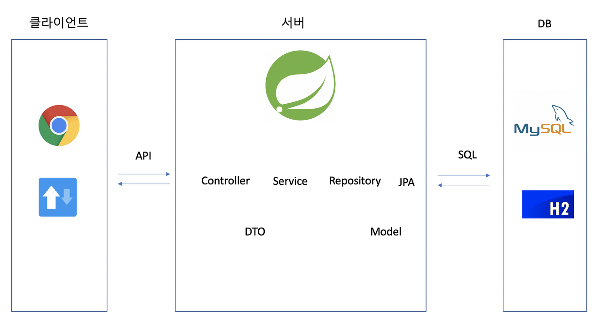
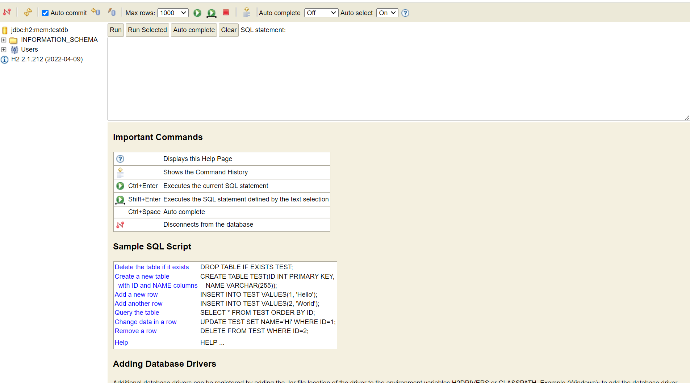
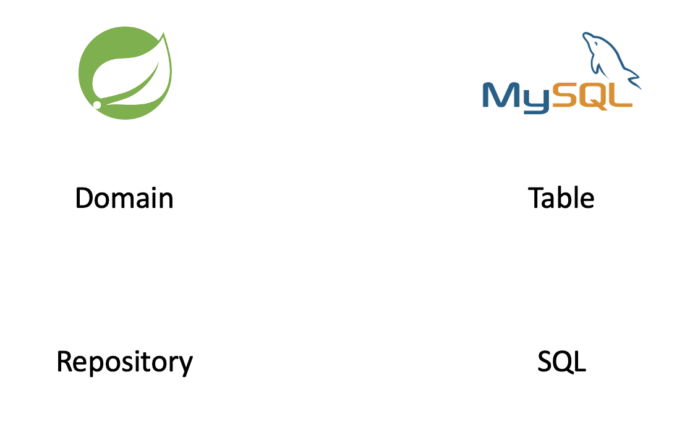
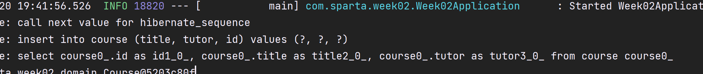
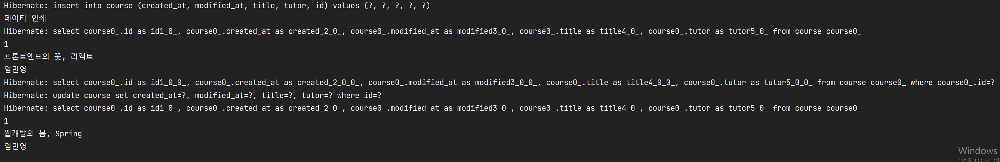
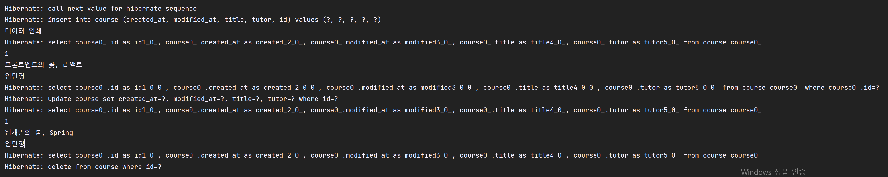
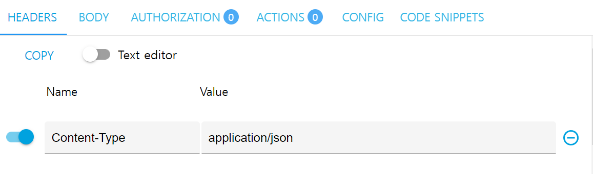

오늘은 1주차에 이어 2주차까지 수강하려고 한다.

이유는 1주차를 까먹지 않고 제대로 바로 사용할 수 있는 상태이기 때문이다.

다른 강의를 들으면 같은 양을 배우더라도 숙달의 속도가 느려지기 때문이다.

---

#### **[수업 목표]**

1. RDBMS의 기초 지식을 습득한다.
2. Spring Data JPA의 사용법을 습득한다.
3. REST API를 만드는 방법을 익힌다.

#### 

#### **[목차]**

1. 2주차 미리보기
2. RDBMS
3. SQL 연습하기
4. JPA
5. Lombok, DTO
6. API - GET, POST, PUT, DELETE
7. 과제

---

### **#S.1 2주차 미리보기**

1. 요약



서버와 클라이언트의 관계

2. RDBMS, H2, SQL

> 💡 서비스는 데이터를 다룰 수 있을 때 비로소 강력해집니다.

* RDBMS, 줄여서 RDB는 관계형 데이터베이스를 말합니다. 정보 저장소라고 생각하셔도 무방한데요.
* 쇼핑몰이라면 주문 정보, 고객 정보 등을 컴퓨터에 저장해야 할텐데, 이걸 도와주는 녀석입니다.
* H2는 RDBMS의 한 종류로, 서버가 켜져있는 동안에만 작동하는 RDB입니다.
* SQL은 데이터를 읽고, 저장하고, 변경하고, 삭제하는 구체적인 문법입니다.

3. JPA, Repository

* JPA(Spring Data JPA)는 스프링을 위해 태어난 녀석인데요.
* Java로 코드를 작성하면 SQL로 번역해줄 뿐만 아니라, 기본적인 기능이 거의 완벽하게 들어있습니다.
* Repository는 JPA를 작동시키는 매개체입니다.

4. API, Lombok, DTO

> 💡 클라이언트 - 서버 간의 약속인 API와 데이터를 주고받는 구체적인 방법에 대해 배웁니다.

* API 요청에도 다양한 방식이 있습니다. 생성, 조회, 수정, 삭제 각각에 맞는 방법을 알아봅니다.
* 스프링은 데이터를 주고받는 방법을 강제합니다. 어떻게 하면 올바르게 주고받을 수 있는지 배웁니다.
* 현업에서는 데이터를 주고받을 때, DTO를 반드시 이용합니다. 왜 그러한지 이유와 방법을 배웁니다.
* 코드를 절약할 수 있는 Lombok 사용법을 익힙니다.

---

### **#S.2 RDBMS1**

1. RDBMS
   1. RDBMS란?  
      * RDBMS(Relational DataBase Management System)은 컴퓨터에 정보를 저장하고 관리하는 기술입니다.
      * 성능/관리 면에서 매우 고도화된 엑셀 이라고 생각하셔도 좋습니다.
   2. RDBMS의 종류  
      * MySQL
      * PostgreSQL
      * Oracle Database
2. 우리가 사용할 RDBMS  
   * H2
     + In-memory DB의 대표 주자인 H2를, 4주차까지 사용해볼겁니다. 인메모리 DB란 서버가 작동하는 동안에만 내용을 저장하고, 서버가 작동을 멈추면 데이터가 모두 삭제되는 데이터베이스를 말합니다.
     + 연습용으로 딱이에요! 😎
   * MySQL  
     + MySQL은 우리가 서비스를 배포할 때 사용할 데이터베이스입니다. AWS RDS 라는 서비스를 사용해 붙여볼 예정인데요. 스프링과 궁합이 좋아서 많은 회사에서 사용하고 있답니다.
3. H2 웹콘솔
   1. 연결 방법
      1. resources - application.properties에 다음을 넣어준다.  
         spring.h2.console.enabled=true   
         spring.datasource.url=jdbc:h2:mem:testdb
      2. <http://localhost:8080/h2-console> 을 입력하면 확인가능하다.



h2-database 실행

---

### **#S.3 SQL 연습하기**

1) Long - BigInt in SQL

2) String - Varchar in SQL

* 웹서비스를 만들기 위해 SQL을 모두 배워야할까요? 아닙니다!

> 우리가 명령을 내린 Java 명령어를 SQL로 번역해주는 녀석이, 바로 다음 시간에 배울 Spring Data JPA 라는 녀석입니다! 이 녀석이 없었다면 우리는 진짜 필요한 개발을 하는 시간보다 SQL 만드느라 훨씬 많은 시간을 소비했을지 모릅니다.

---

### **#S.4 JPA**

**1. JPA란?**

> 👉 JPA는, SQL을 쓰지 않고 데이터를 생성, 조회, 수정, 삭제할 수 있도록 해주는 번역기입니다.

* JPA가 없다면? SQL로 JDBC를 통해 해야한다(복잡함)
* JPA가 있다면? 설정은 한줄이면 끝난다.

참고

* [JDBC 관련 자료](https://www.baeldung.com/spring-jdbc-jdbctemplate)
* [JPA 관련 자료](https://spring.io/guides/gs/accessing-data-jpa/)

**2. JPA 시작하기**

**1) Domain. Repository 의 역할**



compare Spring and MySql

* 자바로 DB를 사용하도록 도와주는 녀석이 JPA 라고 말씀드렸습니다.
* 그럼 DB를 이용하는데 핵심이었던 "테이블"과 "SQL"과 동일한 개념의 자바 용어가 있겠죠?
* "테이블"은 Domain, "SQL"은 Repository 입니다.

### **2) Domain, Repository 도입하기**

1. **@Entity** : 일반 클래스가 아닌 데이터베이스 기준 테이블 역할을 할 클래스를 지정
2. **@NoArgsConstructor :  Args가 파라미터를 의미 즉, 기본 생성자를 자동으로 넣어줘라**
3. **@Id : Primary Key로 설정한다. ID는 데이터베이스에서 사용하기 때문에 Getter & Setter를 하지 않는다.**
4. **@GeneratedValue(Strategy = GenerationType.AUTO) : 자동 증가 명령**
5. **@Column(nullable = false) : 컬럼 값이고 반드시 값이 존재해야 함.   
   Setter를 하지 않는 이유는 나중에 Repository으로 자동으로 해주기 때문에 하지 않는다.**

```
@NoArgsConstructor // 기본생성자를 대신 생성해줍니다.
@Entity            // 테이블임을 나타냅니다.
public class Course {

    @Id // ID 값, Primary Key로 사용하겠다는 뜻입니다.
    @GeneratedValue(strategy = GenerationType.AUTO) // 자동 증가 명령입니다.
    private Long id;

    @Column(nullable = false) // 컬럼 값이고 반드시 값이 존재해야 함을 나타냅니다.
    private String title;

    @Column(nullable = false)
    private String tutor;

    public String getTitle() {
        return this.title;
    }

    public String getTutor() {
        return this.tutor;
    }

    public Course(String title, String tutor) {
        this.title = title;
        this.tutor = tutor;
    }
}
```

```
public interface CourseRepository extends JpaRepository<Course, Long> {

}
```

* Interface 란?
  + JPA는 Repository를 통해서만 사용할 수 있습니다.
  + 인터페이스는 클래스에서 멤버가 빠진, 메소드 모음집이라고 보시면 됩니다

* SQL이 보이도록 설정하는 방법  
  - application.properties에 spring.jpa.show-sql=true 값을 입력하여 준다.



### **3) 생성일자, 수정일자**

**(1) 상**속의 개념

* "extends" 라는 단어를 Repository에서 보았어요. 이게 대체 뭘까요?
* "클래스의 상속"이라는 개념인데요. "이미 만들어둔거 가져다 쓰자!" 라고 선언하는 것입니다.
* Tutor extends Person 과 같이 쓸 수 있습니다. 좀 더 살펴볼까요?

**(2) Timestamped**

> 👉 DB 기본 중의 기본은, "생성일자"와 "수정일자"를 필드로 가지는 것입니다.

* @EntityListeners(AuditingEntityListener) : Entity를 주시하다가 수정하면 자동으로 반영해줘
* @MappedSuperclass : 상속을 하면 컬럼으로 인식해 줘라

```
@MappedSuperclass // 상속했을 때, 컬럼으로 인식하게 합니다.
@EntityListeners(AuditingEntityListener.class) // 생성/수정 시간을 자동으로 반영하도록 설정
public class Timestamped {

    @CreatedDate // 생성일자임을 나타냅니다.
    private LocalDateTime createdAt;

    @LastModifiedDate // 마지막 수정일자임을 나타냅니다.
    private LocalDateTime modifiedAt;
}
```

### **4) JPA 심화**

**(1)  CRUD - Create(생성), Read(조회), 변경(Update), 삭제(Delete)**

* FindAll가 다르게 findById를 통해 1개를 조회할때는 없을 경우에 대한 처리가 필요하다.

```
// 데이터 하나 조회하기
Course course = repository.findById(1L).orElseThrow(
        () -> new IllegalArgumentException("해당 아이디가 존재하지 않습니다.")
);
```

**(2) Service의 개념**

* 스프링의 구조는 3가지 영역으로 나눌 수 있습니다.
  1. Controller : 가장 바깥 부분, 요청/응답을 처리함.
  2. → 2주차 후반부에 배울 녀석
  3. Service : 중간 부분, 실제 중요한 작동이 많이 일어나는 부분
  4. → 지금 배울 녀석
  5. Repo : 가장 안쪽 부분, DB와 맞닿아 있음.
  6. → 여태 배운 녀석 (Repository, Entity)
* @Service : 스프링에게 서비스임을 알려주고 있는 어노테이션
* CourseRepository는 조회, 수정 등의 작업을 위해 필요한데, final을 통해 꼭 필요하다고 명시하는 것   
  (Final 키워드를 사용하면 한 번 값이 부여되면 변형될 수가 없다.)
* 생성자를 통해 CourseService를 생성시 CourseRepository가 생성될 수 있도록 설정되어 있다.
* update 메소드의 반환값이 Long타입인데 이것은 id를 반환하기 때문이다.
* 업데이트 하기 위해 구분할 수 있는 id가 필요하고, 두번 째로는 업데이트될 값이 필요하다.
* @Transactional 이라는 어노테이션 때문에 자동으로 데이터베이스에 반영된다.

```
@Service // 스프링에게 이 클래스는 서비스임을 명시
public class CourseService {

    // final: 서비스에게 꼭 필요한 녀석임을 명시
    private final CourseRepository courseRepository;

    // 생성자를 통해, Service 클래스를 만들 때 꼭 Repository를 넣어주도록
    // 스프링에게 알려줌
    public CourseService(CourseRepository courseRepository) {
        this.courseRepository = courseRepository;
    }

    @Transactional // SQL 쿼리가 일어나야 함을 스프링에게 알려줌
    public Long update(Long id, Course course) {
        Course course1 = courseRepository.findById(id).orElseThrow(
                () -> new IllegalArgumentException("해당 아이디가 존재하지 않습니다.")
        );
        course1.update(course);
        return course1.getId();
    }
}
```

#### **# UPDATE**

```
 System.out.println("데이터 인쇄");
    List<Course> courseList = courseRepository.findAll();
    for (int i=0; i<courseList.size(); i++) {
        Course course = courseList.get(i);
        System.out.println(course.getId());
        System.out.println(course.getTitle());
        System.out.println(course.getTutor());
    }

    Course new_course = new Course("웹개발의 봄, Spring", "임민영");
    courseService.update(1L, new_course);
    courseList = courseRepository.findAll();
    for (int i=0; i<courseList.size(); i++) {
        Course course = courseList.get(i);
        System.out.println(course.getId());
        System.out.println(course.getTitle());
        System.out.println(course.getTutor());
    }
};
```



Update 출력 상태

#### **#DELETE**

```
@Bean
public CommandLineRunner demo(CourseRepository courseRepository, CourseService courseService) {
    return (args) -> {
        courseRepository.save(new Course("프론트엔드의 꽃, 리액트", "임민영"));

        System.out.println("데이터 인쇄");
        List<Course> courseList = courseRepository.findAll();
        for (int i=0; i<courseList.size(); i++) {
            Course course = courseList.get(i);
            System.out.println(course.getId());
            System.out.println(course.getTitle());
            System.out.println(course.getTutor());
        }

        Course new_course = new Course("웹개발의 봄, Spring", "임민영");
        courseService.update(1L, new_course);
        courseList = courseRepository.findAll();
        for (int i=0; i<courseList.size(); i++) {
            Course course = courseList.get(i);
            System.out.println(course.getId());
            System.out.println(course.getTitle());
            System.out.println(course.getTutor());
        }

        courseRepository.deleteAll();
    };
}
```



DELETE 출력

---

### **#S.5. Lombok와 DTO**

**1) Lombok**

> 코드 절약하기! Lombok(이하 롬복)은, 자바 프로젝트를 진행하는데 거의 필수적으로 필요한 메소드/생성자 등을 자동생성해줌으로써 코드를 절약할 수 있도록 도와주는 라이브러리입니다.

**(1) 설치 : Annotaion Processors에서 체크박스 체크, Plugins에서 Lombok설치**

**- 어노테이션을 더 잘 작성할 수 잇도록 Intellij가 나한테 도와주는 기능이다.**

**2) 사용**

* Course.java  
  Course 클래스 Getter, NoArgsConstructor 적용
* CourseService.java  
  CourseService 클래스 RequiredArgsConstructor 적용

**# Original Course Class**

```
@NoArgsConstructor // 기본생성자를 대신 생성해줍니다.
@Entity            // 테이블임을 나타냅니다.
public class Course extends Timestamped {

    @Id // ID 값, Primary Key로 사용하겠다는 뜻입니다.
    @GeneratedValue(strategy = GenerationType.AUTO) // 자동 증가 명령입니다.
    private Long id;

    @Column(nullable = false) // 컬럼 값이고 반드시 값이 존재해야 함을 나타냅니다.
    private String title;

    @Column(nullable = false)
    private String tutor;

    public Long getId(){
        return this.id;
    }

    public String getTitle() {
        return this.title;
    }

    public String getTutor() {
        return this.tutor;
    }

    public Course(String title, String tutor) {
        this.title = title;
        this.tutor = tutor;
    }

    public void update(Course course) {
        this.title = course.title;
        this.tutor = course.tutor;
    }
}
```

**# Lombok Course Class**

- @Getter 어노테이션을 통해 Getter를 직접 만들지 않아도 사용할 수 있게 해준다.

```
@Getter
@NoArgsConstructor // 기본생성자를 대신 생성해줍니다.
@Entity            // 테이블임을 나타냅니다.
public class Course extends Timestamped {

    @Id // ID 값, Primary Key로 사용하겠다는 뜻입니다.
    @GeneratedValue(strategy = GenerationType.AUTO) // 자동 증가 명령입니다.
    private Long id;

    @Column(nullable = false) // 컬럼 값이고 반드시 값이 존재해야 함을 나타냅니다.
    private String title;

    @Column(nullable = false)
    private String tutor;


    public Course(String title, String tutor) {
        this.title = title;
        this.tutor = tutor;
    }

    public void update(Course course) {
        this.title = course.title;
        this.tutor = course.tutor;
    }
}
```

**# Original CourseService**

**- 지울수 있는 대상 : 생성자 -> 그렇지만 꼭 필요하다 -> @RequiredArgsConstructor**

```
@Service // 스프링에게 이 클래스는 서비스임을 명시
public class CourseService {

    // final: 서비스에게 꼭 필요한 녀석임을 명시
    private final CourseRepository courseRepository;

    // 생성자를 통해, Service 클래스를 만들 때 꼭 Repository를 넣어주도록
    // 스프링에게 알려줌
    public CourseService(CourseRepository courseRepository) {
        this.courseRepository = courseRepository;
    }

    @Transactional // SQL 쿼리가 일어나야 함을 스프링에게 알려줌
    public Long update(Long id, Course course) {
        Course course1 = courseRepository.findById(id).orElseThrow(
                () -> new IllegalArgumentException("해당 아이디가 존재하지 않습니다.")
        );
        course1.update(course);
        return course1.getId();
    }
}
```

**# Lombok Course**Service****

```
@RequiredArgsConstructor
@Service // 스프링에게 이 클래스는 서비스임을 명시
public class CourseService {

    // final: 서비스에게 꼭 필요한 녀석임을 명시
    private final CourseRepository courseRepository;


    @Transactional // SQL 쿼리가 일어나야 함을 스프링에게 알려줌
    public Long update(Long id, Course course) {
        Course course1 = courseRepository.findById(id).orElseThrow(
                () -> new IllegalArgumentException("해당 아이디가 존재하지 않습니다.")
        );
        course1.update(course);
        return course1.getId();
    }
}
```

**2) DTO**

> 테이블을 막 건드려도 될까?   
> = read, update할 때 Course 클래스를 막 써도 될까?  
>  = 내가 아닌 다른 사람이 변경이라도 한다면??😱  
>   
> 완충재로 활용하는 것이 DTO(Data Transfer Object)입니다.  
> 즉, 데이터를 전달하고 주고받을 때는 기존에 클래스가 아닌 새로운 클래스를 사용하자.

Question : update 메소드 만들었을 때 업데이트 대상의 ID, 업데이트할 내용을 가진 정보가 필요하다고 했는데

현재 Course Class클래스를 이용해서 받고 있다. 지금 옳은 코드일까? 

```
@Transactional // SQL 쿼리가 일어나야 함을 스프링에게 알려줌
public Long update(Long id, Course course) {
    Course course1 = courseRepository.findById(id).orElseThrow(
            () -> new IllegalArgumentException("해당 아이디가 존재하지 않습니다.")
    );
    course1.update(course);
    return course1.getId();
}
```

> Course 클래스를 이용할 때는 직접 저장하거나 찾아서 클라이언트에게 넘겨줄 때나  
> 이럴 때나 활용을 하는 것이지 이렇게 뭔가 변경을 하는데 변경을 할 데이터를 가지고  
> 다니는 매개체로 Course 클래스를 사용하면 안 좋습니다.   
>   
> Why ?   
> 코드를 작성하다가 테이블을 건드리게 되면 내가 아닌 다른 사람이  
> 마음대로 변경을 실수로 하게 되면 시스템이 오류가 날 가능성이 굉장히 커진다.   
> Course 클래스를 건드리는 것은 DB가 변경될 가능성이 커지기 때문이다.  
>   
> 그러므로 DB에 연결된 클래스는 그대로 두고 우리가 정보를 물고 다니는 녀석을   
> 따로 만들 필요성이 부각이 되는데 그때 필요한게 DTO이다.  
>   
>   
> 기존의 DB를 업데이트 하는 경우를 생각을 해보면  
> Couse의 정보를 변경해 달라고 요청을 하는 것이다.

**# DTO 과정**

**1. DTO를 하기 위한 클래스 생성**

```
@Setter                         // 정보를 몰고 다니기 위해서는 Setter도 필요
@Getter
@RequiredArgsConstructor
public class CourseRequestDto { // Course의 데이터를 몰고 다니는 녀석
    private final String title;
    private final String tutor;
}
```

**2. DTO 활용**

**[before]**

```
Course new_course = new Course("웹개발의 봄, Spring", "임민영");
courseService.update(1L, new_course);
courseList = courseRepository.findAll();
for (int i=0; i<courseList.size(); i++) {
    Course course = courseList.get(i);
    System.out.println(course.getId());
    System.out.println(course.getTitle());
    System.out.println(course.getTutor());
}

courseRepository.deleteAll();
```

**[After]**

**(변경 내역)**

**1. CourseService에 변경될 데이터의 타입을 CourseRequestDto타입으로 변경**

**2. Course에 Update부분에도 동일하게 변경**

```
CourseRequestDto requestDto = new CourseRequestDto("웹개발의 봄, Spring", "임민영");
    courseService.update(1L, requestDto);
    courseList = courseRepository.findAll();
    for (int i=0; i<courseList.size(); i++) {
        Course course = courseList.get(i);
        System.out.println(course.getId());
        System.out.println(course.getTitle());
        System.out.println(course.getTutor());
    }

    courseRepository.deleteAll();
};
```

---

### **#S.6. API**

**1. API**

> 클라이언트 - 서버 간의 약속입니다.  
>   
> 클라이언트가 정한대로 서버에게 요청(Request)을 보내면,   
> 서버가 요구사항을 처리하여 응답(Response)을 반환합니다.

**2. REST**

> REST란, 주소에 명사, 요청 방식에 동사를 사용함으로써 의도를 명확히 드러냄을 의미합니다.

(예시)

* GET /courses → 강의 전체 목록 조회 요청
* GET /courses/1 → ID가 1번인 녀석 조회 요청
* POST /courses → 강의 생성 요청
* PUT /courses/3 → ID가 3번인 녀석 수정 요청
* DELETE /courses/2 → ID 2번인 녀석 삭제 요청

(주의사항)

* 주소에 들어가는 명사들은 복수형을 사용합니다.
  + /course
* 주소에 동사는 가급적 사용하지 않습니다.
  + /accounts/edit

**3. GET - 데이터 조회**

- Controller를 통해 GET방식을 만든다.

```
@RequiredArgsConstructor
@RestController
public class CourseController {

    private final CourseRepository courseRepository;

    @GetMapping("/api/courses")
    public List<Course> getCourses() {
        return courseRepository.findAll();
    }
}
```

**4. POST - 생성 요청**

- GET 방식은 클라이언트로 전달되지만, POST 방식은 해당 메소드로 전달된다.

- CreateCourse 메소드는 기본적으로 Course를 반환한다.

- **(중요)** @RequestBody를 안넣어주면 절대 데이터가 안들어간다.

- Spring은 데이터의 요청을 주고받는 방식을 강제한다고 했었는데, 그게 이런 의미이다.

> POST 또는 PUT에서 데이터를 주고 받을 때 API에서 넘어오는 데이터를 잘 받으려면 @RequestBody형태로 받아줘야한다.

그러면 우리가 해야하는 일은 새로운 Course를 만들어서 Repository.save를 해주는거다.

근데 그럼 필요한 프로세스가 뭘까? 새로운 Course를 만들때 CourseDto 이용해서 만드는게 필요하다.

그런데 아직 그러한 생성자를 만든적이 없다. 생성자인데 파라미터가 CourseRequestDto인 걸 만들어줘야한다.

```
public Course(CourseRequestDto requestDto){
    this.title = requestDto.getTitle();
    this.tutor = requestDto.getTutor();
}
```

* **(중요!)** GET방식은 페이지를 요청하면 되지만, POST방식은 정해진 규칙이 있다. 철저하게 규칙을 지켜야한다.



Content-Type

**5. PUT - 전체 수정**

**- /api/courses/{id} : {id} 값이 유동적이다.**

**- 중요한 것은 대상을 가리킬 수 있는 id와 변경될 값에 requestDto가 필요하다.**

**- 파라미터값은 @RequestBody로 전달받았다면, id와 같은 URI는 @PathVariable로 받는다.**

```
@PutMapping("/api/courses/{id}")
public Long updateCourse(@PathVariable Long id, @RequestBody CourseRequestDto requestDto) {
    return courseService.update(id, requestDto);
}
```

**6. DELETE - 삭제**

```
@DeleteMapping("/api/courses/{id}")
public Long deleteCourse(@PathVariable Long id) {
    courseRepository.deleteById(id);
    return id;
}
```

---

#### 

**정리**

**1. 해당 파일별 역할을 파악할 수 있었다.**

**2. API를 설계하는 방법을 조금 더 쉽게 배울 수 있었다.**

**3. S.A하면서 배웠던 PUT을 기억하면서 할 수 있어서 좋았다.**
