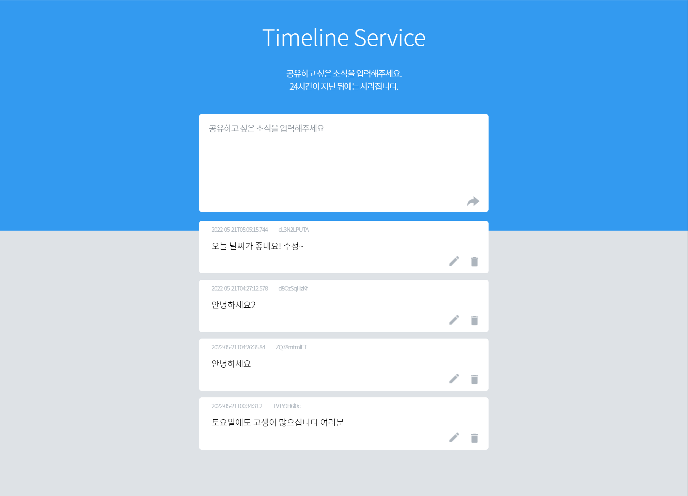
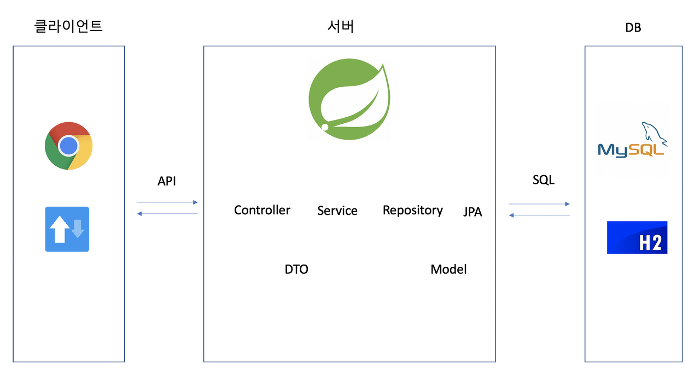
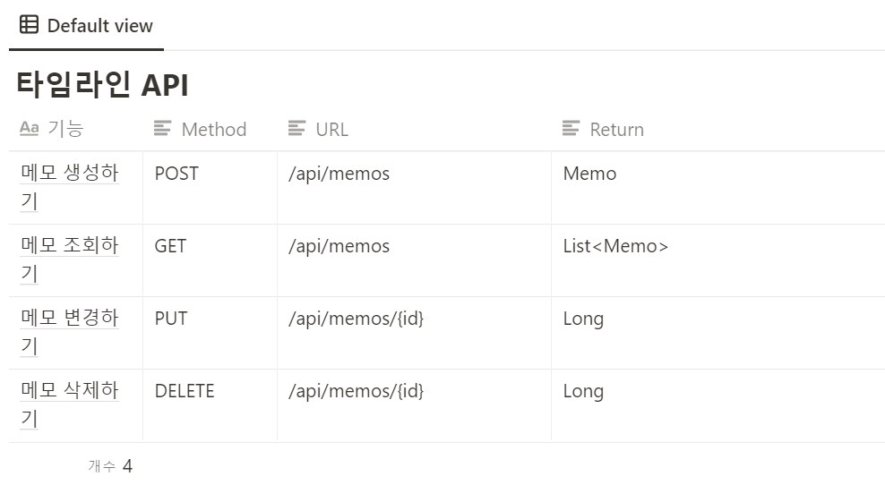
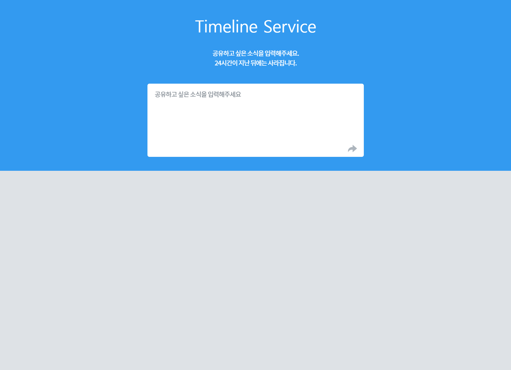

#### **오늘은 스프링 3주차!!!**

#### **드디어 수업에서 Spring 프레임워크를 활용하여 미니프로젝트를 만든다.**


---

#### **[수업 목표]**

1. 페이지를 만들기 위한 HTML,CSS, Javascript를 익힌다.
2. 스프링을 이용해 API를 만들고 기능 확인하는 법을 손에 익힌다.
3. 타임라인 서비스를 완성한다.

#### **[목차]**

1. 이번 주 배울 것

---

#### **#S.1 이번 주 배울 것**

**1) 만들 프로젝트 미리보기**

> 👉 End to End 로 프로젝트를 완성해보는 3주차입니다! 🔥



미니프로젝트 - TimeLine Service

**2) 서버 완성하기 - Memo API**

* 2주차 때 배운 내용을 바탕으로 CRUD 기능을 가진 Memo API를 만듭니다.
* 키워드: RestController, Service, Repository, RequestDto

---

#### 

#### **#S.2** **API 설계하기**

**1) 전체 구조 파악**



구조도

* Controller - Service - Repository 3계층이 존재한다는 것
* 우리는 안에서 바깥으로, 즉 Repository 쪽부터 Service, Controller 방향으로 만들면 된다.

**2) API 설계하기**



---

#### **#S.3****서버 구현**

**1) Repository 만들기**

1. Memo 클래스
   1. 메모는 익명의 작성자 이름, 메모 내용으로 이루어져 있다.
   2. 저장 시 작성날짜와 수정날짜를 함께 저장한다.
   3. **테이블과 연동되는 Entity 클래스와 Repository는 domain 패키지에 저장한다.**
   4. **@MappedSuperclass는 해당 클래스를 상속받는 클래스는 자동으로 생성 시간과 수정 시간을 컬럼으로 잡도록 도와준다.**
   5. **@EntityListeners는 클래스에 반응을 대기하고 있는데 옵션을 주어야한다.**
   6. **@AuditingEntityListener을 주어 변화하는 것을 인지할 수 있도록 해준다.**
   7. **Timestamped 클래스를 추상클래스로 설정한다.**
   8. **추상클래스는 직접 인스턴스를 생성하지 못하고, 상속이 되어야만 생성할 수 있는 클래스이다.**
2. MemoRepository 인터페이스
   1. [Spring Data JPA](https://docs.spring.io/spring-data/jpa/docs/current/reference/html/#jpa.query-methods) 공식 사이트를 참조하면 자신이 원하는 대로 Query를 만들 수 있는 방법을 알 수 있다.
   2. findAllByOrderByModifiedAtDesc 같은 경우 키워드로 나눌 경우  
      Ex) findAll By OrderBy Modified AtDesc  
      => OrderBy(순서대로) 보내줘라, 기준은 ModifiedAt(수정된 시간), Desc (내림차순) 정렬
   3. RequestDto를 쉽게 작성할 수 있을 것이다.

```
@NoArgsConstructor // 기본생성자를 만듭니다.
@Getter
@Entity // 테이블과 연계됨을 스프링에게 알려줍니다.
public class Memo extends Timestamped { // 생성,수정 시간을 자동으로 만들어줍니다.
    @GeneratedValue(strategy = GenerationType.AUTO)
    @Id
    private Long id;

    @Column(nullable = false)
    private String username;

    @Column(nullable = false)
    private String contents;

    public Memo(String username, String contents) {
        this.username = username;
        this.contents = contents;
    }

    public Memo(MemoRequestDto requestDto) {
        this.username = requestDto.getUsername();
        this.contents = requestDto.getContents();
    }

    public void update(MemoRequestDto requestDto) {
        this.username = requestDto.getUsername();
        this.contents = requestDto.getContents();
    }
}
```

```
public interface MemoRepository extends JpaRepository<Memo, Long> {
    List<Memo> findAllByOrderByModifiedAtDesc();
}
```

**2) Service 구현**

* CRUD중에서 update는 수정해야하는 작업이 필요하므로 Service에서 구현이 필요하다.
  + Step1. 업데이트를 위해 아이디와 변경될 내용을 받을 수 있는 메소드를 생성한다.   
    (변경될 내용은 Dto클래스로 받는 것 주의하기!)
  + Step2. 업데이트를 위해서는 먼저 찾고, 그다음에 찾은 데이터를 수정해야한다.  
    (이를 위해 Repository를 접근할 수 있도록 선언해주어야한다)
  + Step3. 대상을 DB에서 찾았을때와 찾기 못했을 때를 구분하여 처리할 수 있도로 한다.  
    이때, 에러 찾기를 위해서 선택할수 있는 클래스는 두 가지이다.  
    첫번째, NullPointerException - 가리킬 수 있는 것이 없다.  
    두번째, IllegalArgumentException - 전달받은 값이 잘못되었다.
  + Step4. 이제는 가장 빠뜨리기 쉬운 3가지가 있다.  
    첫번째, Service에서 repository를 그냥 냅두면 Spring이 인식하지 못하므로, 꼭 필요하다는 것을 알려주기 위해 Final을 넣어주어야한다.  
    두번째, RequiredArgsConstructor를 클래스 위에 붙여주어야 한다.  
    RequiredArgsConstructor는 생성자로 final로 선언된 것들이 있다면 생성할 때 무조건 같이 넣어준다.  
    세번째, Service라는  것을 알려주기 위한 어노테이션을 추가 하는 것과 DB에 잘 반영이 되어야한다는 것을 알려주기 위한 @Transcational을 update 메소드 위해 붙여주어야한다.

```
@RequiredArgsConstructor
@Service
public class MemoService {

    private final MemoRepository memoRepository;                // Step2

    @Transactional
    public Long update(Long id, MemoRequestDto requestDto) {    // Step 1
        Memo memo = memoRepository.findById(id).orElseThrow(    // Step 3
                () -> new IllegalArgumentException("아이디가 존재하지 않습니다.")
        );
        memo.update(requestDto);
        return memo.getId();
    }
}
```

**3) Controller**

1. Repository와 Service를 선언한다.  
   이유 : 생성, 조회, 삭제를 위해서는 Repository가 필요하고, 수정을 위해서는 Service가 필요하다.
2. 1번은 멤버이면서 필수적이므로 private + final을 붙여준다.  
   붙일 경우 빨간색으로 나오는데, 그것을 해결하는 방법은 Service에서와 동일하다.  
   @RequiredArgsConstructor를 클래스 위에 선언해 준다.  
   그러면 생성은 안해도 되는건가요? 라고 묻는다면, 정답은 YES -> Spring이 대신 해준다.
3. 반환값을 JSON으로 받기 위해 @RestController를 클래스 위에 붙여준다.
4. 생성 시 값을 파라미터로 받아온 것을 매칭시켜주기 위해서 @RequestBody을 추가해주어야한다.
5. 삭제 시 주의해야할 것은 URI로 받는 ID값을 받기 위해서는 @PathVariable을 입력값에 주면 된다.

```
@RequiredArgsConstructor
@RestController
public class MemoController {
    private final MemoRepository memoRepository;
    private final MemoService memoService;


    // 생성
    @PostMapping("/api/memos")
    public Memo createMemo(@RequestBody MemoRequestDto requestDto){
        Memo memo = new Memo(requestDto);
        return memoRepository.save(memo);
    }

    // 조회
    @GetMapping("/api/memos")
    public List<Memo> readMemo(){
        return memoRepository.findAllByOrderByModifiedAtDesc();
    }

    // 삭제
    @DeleteMapping("/api/memos/{id}")
    public Long deleteMemo(@PathVariable Long id){
        memoRepository.deleteById(id);
        return id;
    }

    @PutMapping("/api/memos/{id}")
    public Long updateMemo(@PathVariable Long id, @RequestBody MemoRequestDto requestDto){
        memoService.update(id, requestDto);
        return id;
    }
}
```

---

#### **#S.4 클라이언트 구현**

- 클라이언트 HTML은 강의 코드를 복사하여 사용하였다.



클라이언트 페이지

**1. 필요한 기능 살펴보기**

1. 접속하자마자 메모 전체 목록 조회하기
   1. GET API 사용해서 메모 목록 불러오기
   2. 메모 마다 HTML 만들고 붙이기
2. 메모 생성하기
   1. 사용자가 입력한 메모 내용 확인하기
   2. POST API 사용해서 메모 신규 생성하기
   3. 화면 새로고침하여 업데이트 된 메모 목록 확인하기
3. 메모 변경하기
   1. 사용자가 클릭한 메모가 어떤 것인지 확인
   2. 변경한 메모 내용 확인
   3. PUT API 사용해서 메모 내용 변경하기
   4. 화면 새로고침하여 업데이트 된 메모 목록 확인하기
4. 메모 삭제하기
   1. 사용자가 클릭한 메모가 어떤 것인지 확인
   2. DELETE API 사용해서 메모 삭제하기
   3. 화면 새로고침하여 업데이트 된 메모 목록 확인하기

**2. 메모 생성하기 (WrtiePost 메소드)**

1. 사용자가 입력한 메모 내용 확인
2. 작성 내용 확인
3. 랜덤한 username 만들기
4. 전달할 data를 JSON으로 만들기
5. POST API 사용해서 메모 신규 생성

```
function writePost() {
    // 1. 작성한 메모를 불러옵니다.
    let contents = $('#contents').val();
    // 2. 작성한 메모가 올바른지 isValidContents 함수를 통해 확인합니다.
    if(isValidContents(contents)==false){ return; }
    // 3. genRandomName 함수를 통해 익명의 username을 만듭니다.
    let username = genRandomName(10);
    // 4. 전달할 data JSON으로 만듭니다.
    let data = {'username':username, 'contents':contents};
    // 5. POST /api/memos 에 data를 전달합니다.
    $.ajax({
        type: "POST",
        url: "/api/memos",
        contentType: "application/json", // JSON 형식으로 전달함을 알리기
        data: JSON.stringify(data),
        success: function (response) {
            alert('메시지가 성공적으로 작성되었습니다.');
            window.location.reload();
        }
    });
}
```

**3. 메모 조회하기 (getMessage 메소드)**

1. 기존 메모 제거하기
2. GET API 사용해서 메모 목록 불러오기
3. 메모마다 HTML 만들고 붙이는 함수 만들기

> 현재 GET 메소드를 보내면 createdAt, modifiedAt이 나오지 않는다.  
> 이유는 무엇이고, 해결책은 무엇일까? 를 생각해야한다.  
>   
> 이유는 의외로 간단하다.  
>   
> 첫번째   
> 멤버는 private이기 때문에 가져올 수 없기 때문에 Getter가 필요하다.  
> 이것이 이유이고 해결책이다. Getter를 추가해라!  
>   
> 두번째 JPA를 할 때 꼭 넣어주어야하는 어노테이션이 있다.  
> 정답은? @EnableJpaAuditing이다.   
>   
> 위에 코드에서 어색한 부분을 느끼셨다면   
> Spring의 기본 코드 구조를 이해하신 상태이실 것입니다.

```
// 메모를 불러와서 보여줍니다.
function getMessages() {
    // 1. 기존 메모 내용을 지웁니다.
    $('#cards-box').empty();
    // 2. 메모 목록을 불러와서 HTML로 붙입니다.
    $.ajax({
        type: 'GET',
        url: '/api/memos',
        success: function (response) {
            for(let i=0; i<response.length;i++){
                let memo = response[i];
                let id = memo.id;
                let username = memo.username;
                let contents = memo.contents;
                let modifiedAt = memo.modifiedAt;
                addHTML(id, username, contents, modifiedAt)
            }
        }
    })
}

// 메모 하나를 HTML로 만들어서 body 태그 내 원하는 곳에 붙입니다.
function addHTML(id, username, contents, modifiedAt) {
    // 1. HTML 태그를 만듭니다.
    let temp_html = `<div class="card">
                        <!-- date/username 영역 -->
                        <div class="metadata">
                            <div class="date">
                                ${modifiedAt}
                            </div>
                            <div id="1-username" class="username">
                                ${username}
                            </div>
                        </div>
                        <!-- contents 조회/수정 영역-->
                        <div class="contents">
                            <div id="${id}-contents" class="text">
                                ${contents}
                            </div>
                            <div id="${id}-editarea" class="edit">
                                <textarea id="${id}-textarea" class="te-edit" name="" id="" cols="30" rows="5"></textarea>
                            </div>
                        </div>
                        <!-- 버튼 영역-->
                        <div class="footer">
                            
                            
                            
                        </div>
                    </div>`;
    // 2. #cards-box 에 HTML을 붙인다.
    $("#cards-box").append(temp_html);
}
```

**4. 메모 변경하기 (submitEdit 메소드)**

1. 작성 대상 메모의 username과 contents 를 확인
2. 작성한 메모가 올바른지 확인
3. 전달할 data 를 JSON으로 바꾸기
4. PUT /api/memos/{id} 에 data를 전달

> 1) div 태그 내의 값을 가져오는 방법  
> let username = $(`#${id}-username`).text().trim();  
>   
> 2) textarea의 정보를 가져오는 방법  
> let contents = $(`#${id}-textarea`).val().trim();

**5. 메모 삭제하기 (deleteOne 메소드)**

```
// 메모를 삭제합니다.
function deleteOne(id) {
    // 1. DELETE /api/memos/{id} 에 요청해서 메모를 삭제합니다.
    $.ajax({
        type:"DELETE",
        url: `/api/memos/${id}`,
        success : function (response){
            alert(`삭제가 완료되었습니다.`);
            window.location.reload();
        }
    })
}
```

---

#### **#S.5 숙제**

> 타임라인 서비스가 불러오는 메모 목록의 시간을, 조회 시간으로부터 24시간 이내로 바꿔보세요.   
> 힌트1) spring jpa localtime between 라고 구글링해보세요.   
> 힌트2) 지금은 LocalDateTime.now(), 하루 전은 LocalDateTime.now().minusDays(1) 입니다.

- 내가 풀이한 코드는 다음과 같다.

[MemoRepository]

```
public interface MemoRepository extends JpaRepository<Memo, Long> {
    List<Memo> findAllByModifiedAtBetweenOrderByModifiedAtDesc(LocalDateTime start, LocalDateTime end);
}
```

[조회 Controller]

```
@GetMapping("/api/memos")
public List<Memo> readMemo(){
    LocalDateTime start = LocalDateTime.of(LocalDate.now().minusDays(1), LocalTime.of(0,0,0));
    LocalDateTime end = LocalDateTime.of(LocalDate.now(), LocalTime.of(23,59,59));
    return memoRepository.findAllByModifiedAtBetweenOrderByModifiedAtDesc(start, end);
}
```

---

Spring을 이용하여 간단한 메모장을 만들어봤는데,

사실 난이도는 상당히 쉬운 프로젝이다. 그렇지만 학습을 위한 토이프로젝트이고

개념을 쏙쏙 익히면서 연습하니까 성장하는 느낌이 나서 좋았다!!

아자아자 화이팅!!
