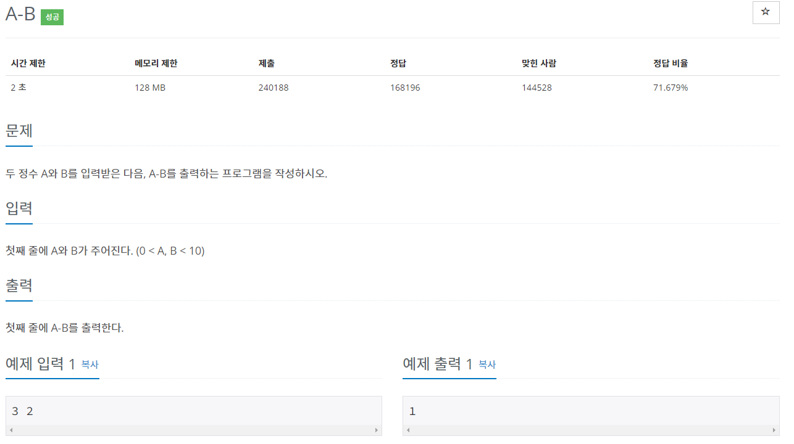
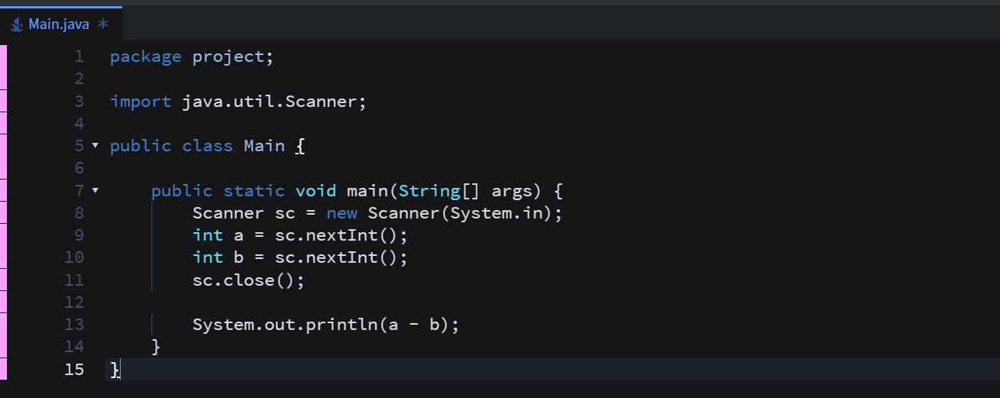
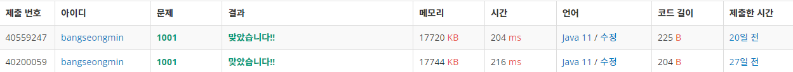

* 문제

* 간략설명

   1) Scanner 클래스를 이용하여 풀이하였습니다.

* 풀이

   - 방법1 (Scanner 클래스)

* 정리

- 간단한 문제이기 떄문에 큰 시간을 사용하지 않았습니다. 다양한 풀이 방법이 있겠지만, 간단하게 풀이하였습니다.

이전 

<참고>

\* 백준 1000번 - A+B 문제와 동일한 구조

[https://to-be-a-artist.tistory.com/10](tistory-10.html)
