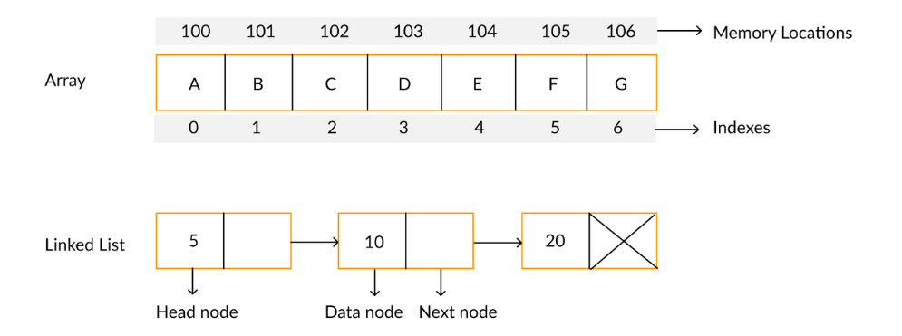
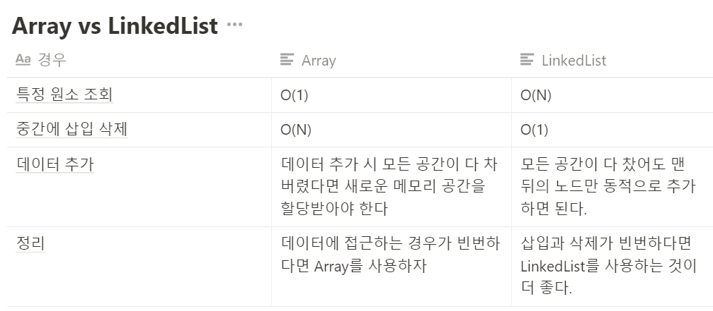
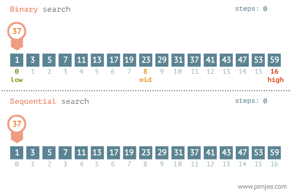
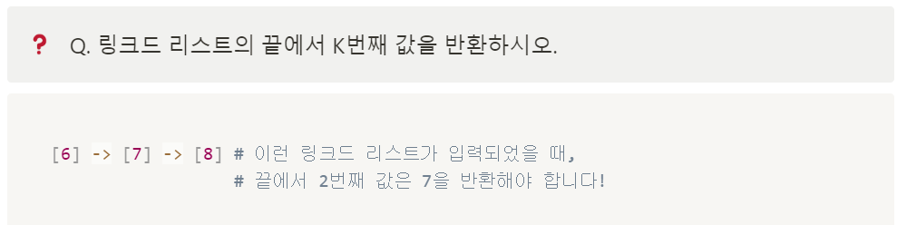
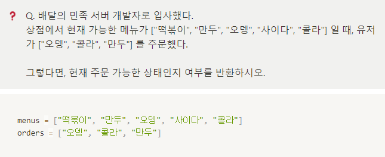
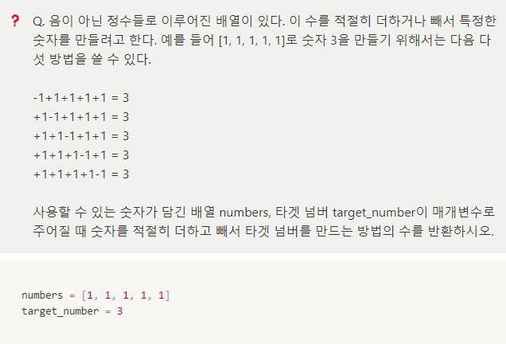

오늘은 알고리즘 2주차를 수강한다.

알고리즘 문제를 풀어보았고,

알고리즘 책을 통해 익혔지만 사실 제대로 모르는것 같다. 

자료구조를 공부했지만, 할때마다 코드에 대한 확신이 없을 때가 많다.

이번 기회로 제대로 공부해두면 좋을 것 같다.

---

**[수업 목표]**

1. 어레이와 링크드리스트에 대해 배우고 차이점을 익힌다.
2. 이진 탐색의 효율성과 전제 조건에 대해 배운다.
3. 재귀함수의 방법과 전제 조건에 대해 배운다.

**[목차]**

1. 오늘 배울 것
2. Array와 LinkedList
3. 클래스
4. LinkedList 구현
5. Binary 탐색
6. 재귀 함수
7. 2주차 끝

---

#### **#S.1 오늘 배울 것**

1. 알고리즘을 배우는 이유

> 특정 자료구조는 삽입/삭제가 빠르고 특정 자료구조는 조회가 빠릅니다.  
>   
> 이처럼 어떤 경우에는 이 자료구조가 좋고,   
> 어떤 경우에는 저 자료구조가 좋은 것 처럼 경우에 따라 다양한 자료구조와 알고리즘을 사용해야 합니다.

2. Array와 LinkedList



3. 이진 탐색과 재귀 함수


---

#### 

#### **#S.2 Array와 LinkedList**

**1) Array**

**- 배열은 크기가 정해진 데이터의 공간입니다. 한 번 정해지면 바꿀 수 없어요!**

**- 배열은 즉시 접근할 수 있습니다( O(1) 내에 접근할 수 있다 )**

**- 배열은 원소를 중간에 삽입/삭제 하려면 모든 원소를 다 옮겨야 합니다.**

**- 최악의 경우 배열의 길이 N 만큼을 옮겨야 하므로 O(N)의 시간 복잡도를 가집니다.**

**- 원소를 새로 추가하려면, 새로운 공간을 할당해야 하므로 매우 비효율적인 자료구조입니다.**

**2) LinkedList**

**- 리스트는 크기가 정해지지 않은 데이터의 공간입니다.**

**- 연결 고리로 이어주기만 하면, 자유자재로 늘어날 수 있습니다!**

**- 리스트는 특정 원소에 접근하려면 연결 고리를 따라 탐색해야 합니다.**

**- 최악의 경우에는 모든 화물 칸을 탐색해야 하므로 O(N)의 시간 복잡도를 가집니다**

**- 리스트는 원소를 중간에 삽입/삭제 하기 위해서는 앞 뒤의 포인터만 변경하면 됩니다.** **따라서 원소 삽입/삭제를 O(1)의 시간 복잡도 안에 할 수 있습니다.**

**3) 정리**



---

#### 

#### **#S.3 클래스**

**- 분류. 집합. 같은 속성과 기능을 가진 객체를 총칭**

**- 객체는 세상에 존재하는 유일무이한 사물**

즉, 예를 들면 클래스가 사람이라면, 객체는 유재석이 될수도 있고, 박명수가 될 수도 있습니다. 클래스가 동물이라면, 객체는 강아지가 될수도 있고, 고양이가 될 수도 있습니다.

```
class Person:
    def __init__(self, param_name):
        print("Im created! ", self)
        self.name = param_name

    def talk(self):
        print("안녕하세요, 제 이름은", self.name, "입니다")


person1 = Person("유재석")
print(person1.name)
person1.talk()

person2 = Person("박명수")
print(person2.name)
person2.talk()
```

---

#### **#S.4 LinkedList**

**1. LinkedList 구현하여 삽입과 출력**

```
class Node:
    def __init__(self, data):
        self.data = data
        self.next = None

node = Node(3)
first_node = Node(4)
node.next = first_node

class LinkedList:
    def __init__(self, data):
        self.head = Node(data)

    def append(self, data):
        if self.head is None:
            self.head = Node(data)
            return

        cur = self.head
        while cur.next is not None:
            cur = cur.next

        cur.next = Node(data)

    def print_all(self):
        cur = self.head
        while cur is not None:
            print(cur.data)
            cur = cur.next

linked_list = LinkedList(3)
linked_list.append(4)
linked_list.append(5)

linked_list.print_all()
```

2. 링크드 리스트 원소 찾기 / 원소 추가

```
class Node:
    def __init__(self, data):
        self.data = data
        self.next = None


class LinkedList:
    def __init__(self, value):
        self.head = Node(value)

    def append(self, value):
        cur = self.head
        while cur.next is not None:
            cur = cur.next
        cur.next = Node(value)

    def print_all(self):
        cur = self.head
        while cur is not None:
            print(cur.data)
            cur = cur.next

    def get_node(self, index):
        node = self.head

        while index > 0:
            node = node.next
            index -= 1

        return node

    def add_node(self, index, value):
        new_node = Node(value)  # [11]

        if index == 0:
            new_node.next = self.head
            self.head = new_node
            return

        node = self.get_node(index - 1)  # [5]
        new_node.next = node.next  # [11] -> [12] -> ...
        node.next = new_node  # [5] -> [11] -> [12] ...

        return new_node

    def delete_node(self, index):
        if index == 0:
            self.head = self.head.next
            return

        node = self.get_node(index - 1)
        node.next = node.next.next


linked_list = LinkedList(5)
linked_list.append(12)
linked_list.append(8)
linked_list.append(7)
linked_list.append(6)

linked_list.add_node(2, 11)
linked_list.print_all()

linked_list.delete_node(0)
linked_list.print_all()
```

3. 링크드 리스트 원소 삭제

```
class Node:
    def __init__(self, data):
        self.data = data
        self.next = None


class LinkedList:
    def __init__(self, value):
        self.head = Node(value)

    def append(self, value):
        cur = self.head
        while cur.next is not None:
            cur = cur.next
        cur.next = Node(value)

    def print_all(self):
        cur = self.head
        while cur is not None:
            print(cur.data)
            cur = cur.next

    def get_node(self, index):
        node = self.head

        while index > 0:
            node = node.next
            index -= 1

        return node

    def add_node(self, index, value):
        new_node = Node(value)  # [11]

        if index == 0:
            new_node.next = self.head
            self.head = new_node
            return

        node = self.get_node(index - 1)  # [5]
        new_node.next = node.next  # [11] -> [12] -> ...
        node.next = new_node  # [5] -> [11] -> [12] ...

        return new_node

    def delete_node(self, index):
        if index == 0:
            self.head = self.head.next
            return

        node = self.get_node(index - 1)
        node.next = node.next.next


linked_list = LinkedList(5)
linked_list.append(12)
linked_list.append(8)
linked_list.append(7)
linked_list.append(6)

linked_list.add_node(2, 11)
linked_list.print_all()

linked_list.delete_node(0)
linked_list.print_all()
```

4. 두 링크드 리스트의 합 계산

```
lass Node:
    def __init__(self, data):
        self.data = data
        self.next = None


class LinkedList:
    def __init__(self, value):
        self.head = Node(value)

    def append(self, value):
        cur = self.head
        while cur.next is not None:
            cur = cur.next
        cur.next = Node(value)


def get_linked_list_sum(linked_list_1, linked_list_2):
    sum = get_listed_list_to_num(linked_list_1) + get_listed_list_to_num(linked_list_2)

    return sum

def get_listed_list_to_num(linked_list):
    sum = 0
    head = linked_list.head
    while head is not None:
        sum = sum*10 + head.data
        head = head.next

    return sum


linked_list_1 = LinkedList(6)
linked_list_1.append(7)
linked_list_1.append(8)

linked_list_2 = LinkedList(3)
linked_list_2.append(5)
linked_list_2.append(4)

print(get_linked_list_sum(linked_list_1, linked_list_2))
```

---

#### 

#### **#S.5 이진 탐색 vs 순차 탐색**

**1. 이진 탐색( O(N) )**

```
def is_existing_target_number_binary(target, array):
    current_min = 0
    current_max = len(array)-1
    current_guess = (current_min + current_max) // 2

    while current_min <= current_max:
        if array[current_guess] == target:
            return True
        elif array[current_guess] < target:
            current_min = (current_guess+1)
        else:
            current_max = (current_guess-1)
        current_guess = (current_max + current_min) // 2
    return False


result = is_existing_target_number_binary(17, finding_numbers)
print(result)
```

**2. 순차 탐색( O(logN) )**

```
finding_target = 14
finding_numbers = [1, 2, 3, 4, 5, 6, 7, 8, 9, 10, 11, 12, 13, 14, 15, 16]


def is_existing_target_number_binary(target, array):
    for num in array:
        if num == target:
            return True

    return False


result = is_existing_target_number_binary(finding_target, finding_numbers)
print(result)
```



---

#### 

#### **#S.6 재귀 함수**

**1. 재귀함수란?**

**- 메소드가 제한된 조건 동안 자신의 메소드를 다시 호출하는 것을 의미한다.**

```
def count_down(n):
    if n < 0:
        return

    print(n)
    count_down(n-1)

count_down(60)
```

**2. 재귀함수 문제**

**(1) Factorial - 재귀함수 기초 문제**

```
def factorial(n):
    if n == 1:
        return 1
    else:
        return n * factorial(n-1)

print(factorial(5))
```

(2) 회문검사

1) 반복문을 이용한 풀이

```
def is_palindrome(string):

    front = 0
    end = len(string)-1

    while front <= end:
        if string[front] == string[end]:
            front += 1
            end -= 1
        else:
            return False

    return True

# palindrome 은 회문을 의미합니다!
print(is_palindrome("토마토"))   # True
print(is_palindrome("tomato")) # False
print(is_palindrome("abcba"))  # True
```

2) 재귀함수를 이용한 풀이

```
def is_palindrome(string):
    if string[0] != string[-1]:
        return False
    elif len(string) == 1:
        return True
    else:
        return is_palindrome(string[1:-1])

# palindrome 은 회문을 의미합니다!
print(is_palindrome("토마토"))   # True
print(is_palindrome("tomato")) # False
print(is_palindrome("abcba"))  # True
```

---

#### **#S.6 과제**

1. 링크드 리스트 끝에서 K 번째 값 출력하기



```
class Node:
    def __init__(self, data):
        self.data = data
        self.next = None


class LinkedList:
    def __init__(self, value):
        self.head = Node(value)

    def append(self, value):
        cur = self.head
        while cur.next is not None:
            cur = cur.next
        cur.next = Node(value)

    def get_kth_node_from_last(self, k):
        cur = self.head
        count = 0
        while cur.next is not None:
            cur = cur.next
            count += 1
        count += 1                      # 현재 노드의 개수

        count = k - count
        cur = self.head
        while count > 0 :
            cur = cur.next
            count -= 1

        return cur


linked_list = LinkedList(6)
linked_list.append(7)
linked_list.append(8)

print(linked_list.get_kth_node_from_last(2).data)  # 7이 나와야 합니다!
```

2. 배달의 민족 배달 가능 여부



```
shop_menus = ["만두", "떡볶이", "오뎅", "사이다", "콜라"]
shop_orders = ["오뎅", "콜라", "만두"]


def is_available_to_order(menus, orders):
    menus_set = set(menus)

    for order in orders:
        if order not in menus_set:
            return False
        else:
            return True


result = is_available_to_order(shop_menus, shop_orders)
print(result)
```

3. 더하거나 빼거나



```
numbers = [2, 3, 1]
target_number = 0
result_count = 0  # target 을 달성할 수 있는 모든 방법의 수를 담기 위한 변수


def get_count_of_ways_to_target_by_doing_plus_or_minus(array, target, current_index, current_sum):
    if current_index == len(array):  # 탈출조건!
        if current_sum == target:
            global result_count
            result_count += 1  # 마지막 다다랐을 때 합계를 추가해주면 됩니다.
        return
    get_count_of_ways_to_target_by_doing_plus_or_minus(array, target, current_index + 1, current_sum + array[current_index])
    get_count_of_ways_to_target_by_doing_plus_or_minus(array, target, current_index + 1, current_sum - array[current_index])


get_count_of_ways_to_target_by_doing_plus_or_minus(numbers, target_number, 0, 0)
# current_index 와 current_sum 에 0, 0을 넣은 이유는 시작하는 총액이 0, 시작 인덱스도 0이니까 그렇습니다!
print(result_count)  # 2가 반환됩니다!
```

---

마지막 과제는 난이도 있는 문제같다.

두문제는 풀만 했고, 한 문제는 어려웠다.. 더열심히 해야겠다 ㅠㅠ


