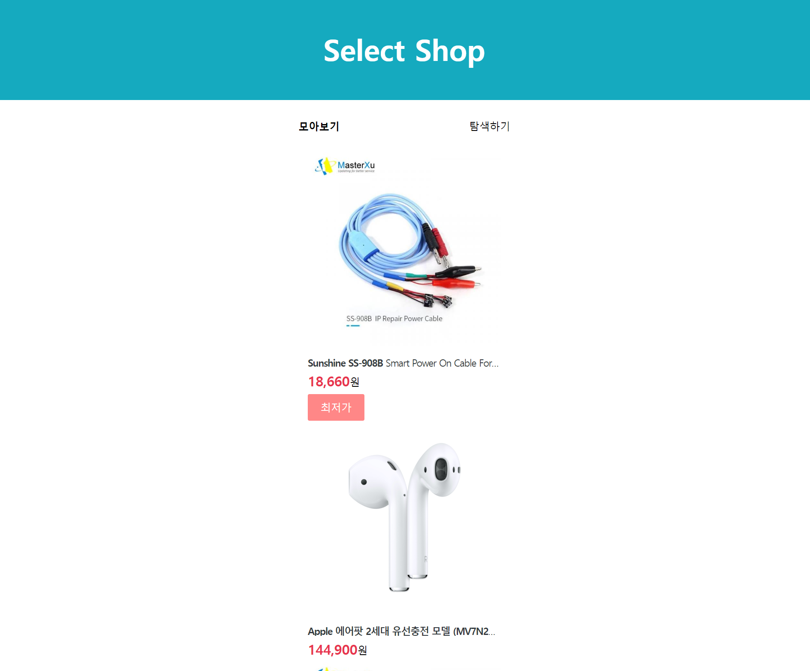
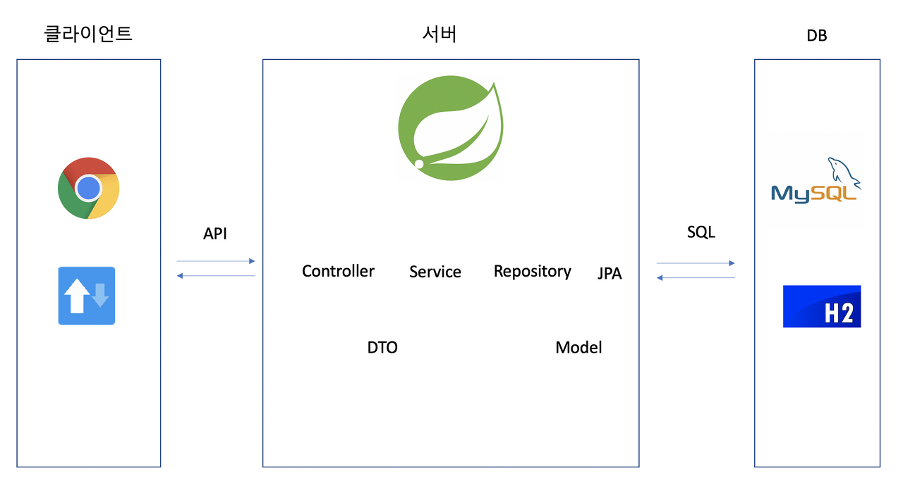
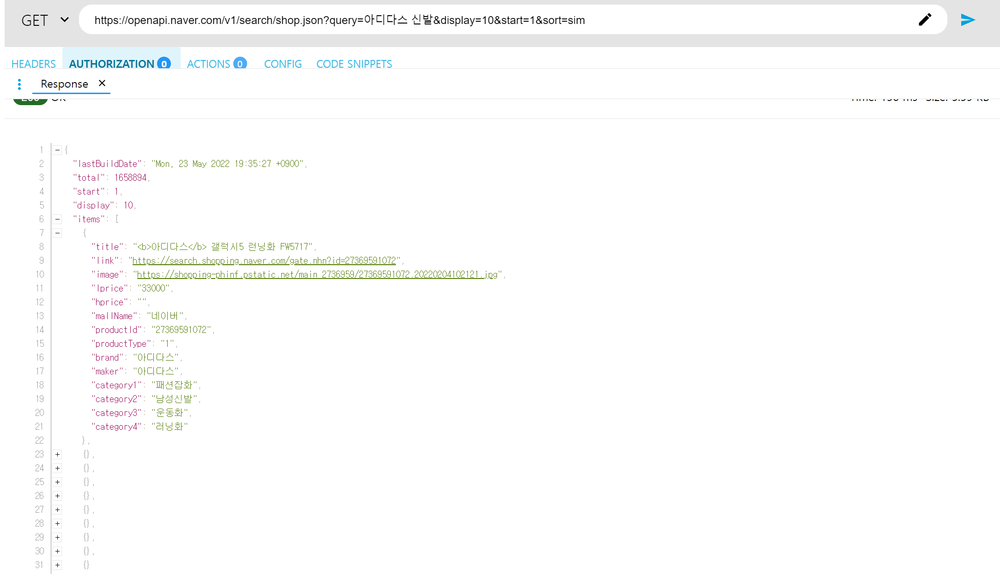
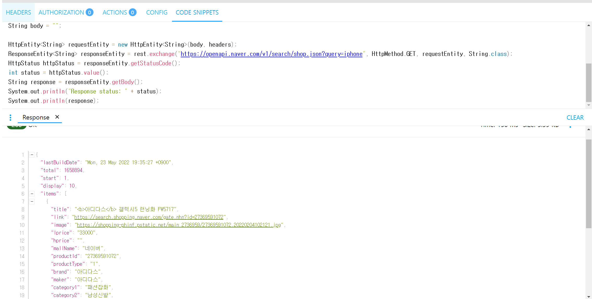
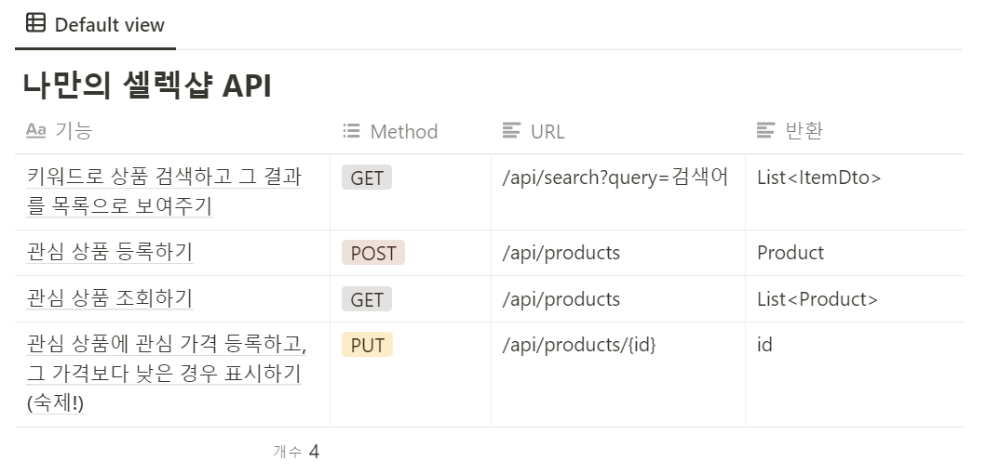
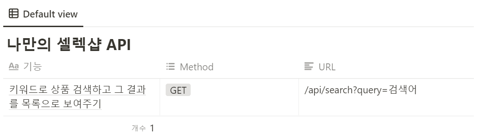

**[수업 목표]**

1. **Controller - Service - Repository 에 대해 자신감을 가진다!**
2. **자바를 이용해 API를 이용하는 방법을 익힌다.**
3. **스프링 스케줄러를 이용하여, 서버에게 원하는 작업을 원하는 시간에 시키는 방법을 익힌다.**

**[목차]**

1. **이번 주 배울 것**
2. **네이버 쇼핑 API 활용**
3. **나만의 셀렉샵**
4. **정리**

---

### **S#.1 이번 주 배울 것**

#### **1. 기본기**

> **3계층 숙달, API handling**

* 기본기란 익히면 익힐수록 흘러가는 것이 아니라 누적되고, 다른 기술을 익히기 쉽도록 도와주는 것입니다.
* 3계층(Controller, Service, Repository) 숙달과 API handling은 무엇보다 중요한 기본기라고 할 수 있다.

1. 3계층 숙달

* 스프링, 아니 개발의 핵심 중 하나가 분업과 느슨한 결합입니다. 각자가 맡은 바 책임을 다하면 기능이 온전히 작동하고, 느슨히 결합함으로써 유연성과 확장성을 가지기 때문이지요.
* 3계층은 분업과 느슨한 결합의 대표적인 예시이자, 스프링이 돌아가게 만드는 척추입니다.

2. API Handling

* 혼자 하는 개발은 없습니다. 그리고 세상에는 다양한 API가 있습니다. API를 잘 다루면 재미있는 나만의 서비스를 더 많이, 더 빠르게 만들 수 있고 그럼으로써 개발자로 한 단계 성장할 수 있습니다.
* 느슨한 결합의 대표적인 예시가 바로 API 입니다. 우리가 이용할 네이버 검색 API의 내부 로직이 어떻게 되든 상관없이, 우리는 정해진 약속대로 요구하면 정해진 결과를 받을 수 있다.

#### **2. 프로젝트 모습과 기능**



* 상품명에 따른 검색
* 관심 상품 등록 & 조회
* 관심 상품에 대한 최저가 등록하기

#### **3. 자바에서 API를 요청하고 그 결과를 어떻게 다룰 수 있을까?**

* 모든 코드를 이해하기보다, 요점을 정확히 파악하고 데이터를 주고받을 수만 있으면 됩니다.
* ARC를 이용해서 네이버에 검색을 요청하고, 응답을 자바 코드로 변환한 뒤 DB에 저장해보겠습니다.
* 더해서, 자동으로 정보를 수집하고 업데이트하는 스케줄러까지 만들어볼거에요!

#### **4. Controller - Service - Repository 3계층 레이어, 손에 붙어야 합니다!**



* Controller 는 제일 바깥 쪽에서 요청을 받고, 응답을 되돌려주는 역할을 합니다.
* Service 는 중간에서 구체적인 작업 순서를 결정하고요.
* Repository 는 DB와 직접 소통함으로써 자료를 생성하고, 조회하고, 변경하고, 삭제합니다.
* 그리고 각 레이어 간에는 절대 Entity를 직접 사용하지 않고, DTO 라는 택배상자를 만들어 사용합니다.

---

### **S#.2 네이버 쇼핑 API 이용 신청하기**

- 네이버 API 개발자 센터를 통해 사용할 수 있다.



> Tip : ARC를 사용하면 코드를 자동으로 만들어준다.



---

### **S#.3 나만의 셀렉샵**

#### 1. 프로젝트 설계하기

**1) 필요한 기능 확인**

1. 키워드로 상품 검색하고 그 결과를 목록으로 보여주기
2. 관심 상품 등록하기
3. 관심 상품 조회하기
4. 관심 상품에 원하는 가격 등록하고, 그 가격보다 낮은 경우 표시하기 (숙제!)

**2) API 설계하기**

> 위 API는 작성한 것, 아래 API는 강의 API

**1. 키워드로 상품 검색하고 그 결과를 목록으로 보여주기 (GET /api/search?query=item)**

**2. 관심 상품 등록하기(POST /api/producs)**

**3. 관심 상품 조회하기(GET /api/products)**

**4. 관심 상품에 원하는 가격 등록하고, 그 가격보다 낮은 경우 표시하기(PUT /api/products/<id>?price=가격)**



**3) 3계층 설계하기**

1. Controller
   * ProductRestController: 관심 상품 관련 컨트롤러
   * SearchRequestController: 검색 관련 컨트롤러
2. Service
   * ProductService: 관심 상품 가격 변경
3. Repository</aside>
   * Product: 관심 상품 테이블
   * ProductRepository: 관심 상품 조회, 저장
   * ProductRequestDto: 관심 상품 등록하기
   * ProductMypriceRequestDto: 관심 가격 변경하기
   * ItemDto: 검색 결과 주고받기
4. 👉 여기서 DB에 저장되는 녀석은 Product 뿐이라는 점!

#### **2. 구현하기**

**1. 기본 틀**

**1단계 - Timestamped를 통해 생성시간, 수정시간을 입력될 수 있게 클래스를 만들어 둔다.**

**1) Timestamped 클래스**

**2) Application에 @EnableJpaAuditing 어노테이션 추가**

**2단계 - Product 클래스를 만든다.**

* title, image, link, lprice, myprice 정보가 필요함을 알 수 있습니다

**3단계 - Repository와 Controller를 구현**

**2. 기능 구현**

**1) 관심 상품 등록**

> 상품을 검색한 후, 등록 버튼을 눌렀을 때 관심상품이 생성되어야 합니다.  
> 그러므로 제목, 이미지, 링크, 최저가를 가져오면 된다.

(1) Dto 클래스 만들기

(2) Product 클래스 변경

(3) Product Service 구현

(4) ProductRestController 변경

**3. 키워드로 상품 검색하기 - NaverShopSearch 발전시키기**

**1) 요구조건**

> 1. 검색어를 요구에 따라 바꿀 수 있어야 합니다.   
> 2. 검색 결과를 문자열에서 DTO로 바꿔야 합니다.

**2) 검색 결과를 문자열에서 DTO로 바꾸기**

**(1) org.json 패키지 설치 필요**

> 자바에서 JSON을 다루는 데 도와주는 라이브러리이다.  
> JSON을 자바에서 다루기 위해, JSONObject, JSONArray 클래스가 필요합니다.   
> 1, JSONObject : 말 그대로 중괄호로 시작해서 끝나는 그 하나를 다루기 위해서 필요한 녀석  
> 2. JSONArray : JSON이 배열로 이루어졌을 때 그 배열을 다루기 위한 클래스

(2) JSON 패키지 사용방법

> 1. 문자열 정보를 JSONObject로 바꾸기  
>   JSONObject rjson = new JSONObject(response):  
>   
> 2. JSONObject에서 items 배열 꺼내기  
>   JSONArray items = rjson.getJSONArray("items");  
>   
> 3. JSONArray에서 for문 돌기  
>   for(int i=0; i<items.length(); i++){  
>     JSONObject itemJson = (JSONObject) items.get(i);  
>     System.out.println(itemJson);  
>   }  
>   
> 4. JSONObject에서 String, int 데이터 뽑기  
>    String title = itemJson.getString("title");  
>    int lprice = itemJson.getInt("lprice");

```
    public static void main(String[] args) {
        NaverShopSearch naverShopSearch = new NaverShopSearch();
        String result = naverShopSearch.search("아이맥");
        JSONObject rjson = new JSONObject(result);
        JSONArray items = rjson.getJSONArray("items");
        // items는 JSONArray형식인데, 우리가 원하는 것은 배열에 들어있는 요소 하나하나씩이다.
        // 2가지를 사용해야 한다. 첫번째 for문을 사용하여 배열을 돌면서 꺼내야 하고, 두번째 꺼낼때는 JSONObject를 사용해야한다.
        for(int i=0;i<items.length();i++){
            JSONObject itemJson = items.getJSONObject(i);
//            System.out.println(itemJson);
            String title = itemJson.getString("title");
            String image = itemJson.getString("image");
            String link = itemJson.getString("link");
            int lprice = itemJson.getInt("lprice");
            System.out.println(title.split(" ")[1] + image + link + lprice);


        }
```

(3) ItemDto 생성하기

> 마지막으로 데이터를 요청한 클라이언트에게 현재 데이터를 전달해줘야한다.  
> 이를 위해 데이터를 물고 나를 수 있는 ItemDto 클래스가 필요하다.

**4. 키워드로 상품 검색하기 - 네이버 API와 서비스 연결하기**

(1) NaverShopSearch 컴포넌트 등록하기

> 더 이상 검색을 main 메소드에서 진행하는게 아니라, Controller 에서 가져다 써야 합니다.   
>   
> 스프링이 자동으로 필요한 클래스를 필요한 곳에 생성하려면,   
> "아, 사용자가 요구하면 자동으로 생성할 클래스 목록이 이것이구나" 라고 확인할 수 있어야 하겠죠?   
> 그 목록에 등록하는 간단한 방법이 바로 컴포넌트 등록입니다.  
>   
>   
> [설명]  
> Spring이 그때그때 요소를 요구할 때가 있다. 나 이거 필요한데 자동으로 생성할 수 있는거야? 없는거야? 라는 권한 판단이 조금 필요하다. Spring이 모든 걸 거의 자동으로 많이 해주는데 알고보면 repository 또는 service 같은 것들은 final과 RequiredArgsConsctructor만 넣으면 필요할때 그때그때 스프링이 자동으로 넣어준다고 얘기 했었다. 그, 배경에 컴포넌트라는게 있다.  
>   
> 컴포넌트로 등록이 되면 위와 같이 스프링이 권한을 획득을 할수 있다. 반대로 말하면 개발자가 스프링에게 권하는 주는 것이다. 즉, 스프링에서 내가 마음대로 갖다 쓸 수 있는 클래스 목록(컴포넌트에 등록된 것들만)  
>   
> 당연히 컨트롤러나 서비스나 Entity는 전부다 컴포넌트에 등록이 되어있다.  
> NaverShopSearch같은 경우는 직접 수동으로 컴포넌트를 등록해주어야한다.  
> Ex) 해당 클래스위에 @Component 어노테이션을 붙여주면 끝!



```
<div class="search-itemDto-right">
    
</div>
```

> 위 코드는 문자화돼서 전달이 될텐데 여기서 중요한 점은 나중에 ajax를 통해서 백엔드 서버에 전달할 때 서버에서 스프링에 전달을 할 때도 JSON.Stringfy를 한번 더 해줘야한다.   
> 이유는 파라미터로 받을 때 그 문자열이 만약에 JSON형태면 Javascript가 자동적으로 JSON으로 다시 바꿔버립니다.

```
function addProduct(itemDto) {
    // 문자화되서 전달이 될텐데, 백그라운드로 전달을 할때 또는 서버에서 스프링에 전달을 할 때도
    // JSON.Stringfy를 한번 더해줘야 한다. 이유는 파라미터로 받을때, 그 문자열이 만약에 JSON형태면
    // javascript가 자동으로 JSON으로 다시 바꿔버립니다.

    /**
     * modal 뜨게 하는 법: $('#container').addClass('active');
     * data를 ajax로 전달할 때는 두 가지가 매우 중요
     * 1. contentType: "application/json",
     * 2. data: JSON.stringify(itemDto),
     */
    // 1. POST /api/products 에 관심 상품 생성 요청
    $.ajax({
        type: "POST",
        url:"/api/products",
        data:JSON.stringify(itemDto),
        contentType: "application/json",
        success: function (response){
            console.log(response);
            $('#container').addClass('active');
            targetId = response.id;
        }
    })
    // 2. 응답 함수에서 modal을 뜨게 하고, targetId 를 reponse.id 로 설정 (숙제로 myprice 설정하기 위함)
}
```

**5. 관심 상품 보여주기**

**- 최저가를 보여주기 위해서는 현재 가격이 원하는 최소가격보다 낮아야한다. 이를 class부분에 3항연산자를 적용한다.**

```
<div class="isgood ${product.lprice <= product.myprice ? '' : 'none'}">
```

**6. 스케쥴러 만들기**

>  👉 매일 새벽 1시에 관심 상품 목록 제목으로 검색해서, 최저가 정보를 업데이트하는 스케줄러를 만들어보겠습니다.

```
@RequiredArgsConstructor // final 멤버 변수를 자동으로 생성합니다.
@Component // 스프링이 필요 시 자동으로 생성하는 클래스 목록에 추가합니다.
public class Scheduler {

    private final ProductRepository productRepository;
    private final ProductService productService;
    private final NaverShopSearch naverShopSearch;

    // 초, 분, 시, 일, 월, 주 순서(*:상관없다)
    @Scheduled(cron = "0 0 1 * * *")
    public void updatePrice() throws InterruptedException {
        System.out.println("가격 업데이트 실행");
        // 저장된 모든 관심상품을 조회합니다.
        List<Product> productList = productRepository.findAll();
        for (int i=0; i<productList.size(); i++) {
            // 1초에 한 상품 씩 조회합니다 (Naver 제한)
            TimeUnit.SECONDS.sleep(1);
            // i 번째 관심 상품을 꺼냅니다.
            Product p = productList.get(i);
            // i 번째 관심 상품의 제목으로 검색을 실행합니다.
            String title = p.getTitle();
            String resultString = naverShopSearch.search(title);
            // i 번째 관심 상품의 검색 결과 목록 중에서 첫 번째 결과를 꺼냅니다.
            List<ItemDto> itemDtoList = naverShopSearch.fromJSONtoItems(resultString);
            ItemDto itemDto = itemDtoList.get(0);
            // i 번째 관심 상품 정보를 업데이트합니다.
            Long id = p.getId();
            productService.updateBySearch(id, itemDto);
        }
    }
}
```

---

### **S#.4 정리**

**1. 복습**

* 3계층(Controller-Service-Repository)에 대해 심화하여 익혀보았습니다.
* 자바로 API에 데이터를 요청하고, 응답을 JSONObject, JSONArray로 다루는 방법을 살펴보았습니다.
* 프론트엔드 구현에 필요한 최소한의 Javascript, jQuery를 다시 한 번 연습해보았습니다.

2. 숙제

> 최저가를 변경하는 API를 완성해보세요.

숙제는 완료후 제출완료!!
