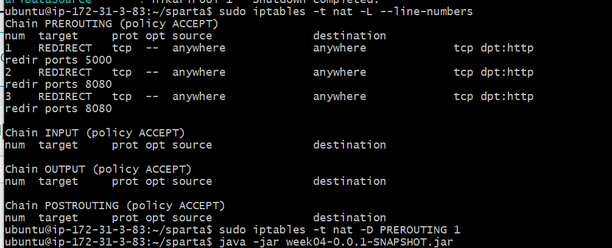
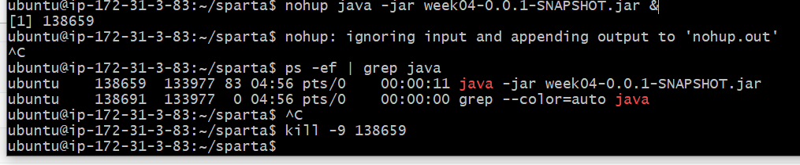

#### **드디어 오늘은 Spring 기초 5주차이다!!**

#### **얼른 끝내고 과제를 진행하러 가야지~!!**

**가야돼 가야돼!!!**


---

### **[수업 목표]**

1. 나만의 셀렉샵을 AWS RDS의 MySQL을 연결한다.
2. 나만의 셀렉샵을 AWS EC2에 배포한다.
3. 나만의 셀렉샵에 도메인을 붙이고 친구들에게 카톡으로 자랑한다.

### **[목차]**

1. 이번 주 배울 것
2. RDS 구매후 세팅하기
3. OG 태그 작업
4. EC2 구매하고 배포하기
5. 포트포워딩 & nohup 적용하기
6. 도메인 붙이고 카카오톡에 공유해보기

---

## **01. [5주차] 이번 주 배울 것**

**1. AWS RDS를 통해 데이터베이스를 원격으로 접근하게 한다.**

**2. OG 태그를 이용해서 페이지 공유시 정보를 보일 수 있게 한다.**

**3. EC2를 세팅하고, 배포**

---

## **02. RDS 구매하고 세팅하기**

1) RDS - MYSQL로 세팅 + 인바운드 규칙 생성

2) application.properties 에 RDS 연결

> spring.datasource.url=jdbc:mysql://나의엔드포인트:3306/myselectshop   
> spring.datasource.username=나의USERNAME   
> spring.datasource.password=나의패스워드   
> spring.jpa.hibernate.ddl-auto=update

---

## **03. OG 태그 셋팅**

```
<meta property="og:title" content="나만의 셀렉샵">
<meta property="og:description" content="관심상품을 선택하고, 최저가 알림을 확인해보세요!">
<meta property="og:image" content="images/og_selectshop.png">
```

---

## **04. EC2 연결**

**1) Gitbash 를 통한 연결**

**2) Gradle를 통한 Build**

**\* Gradle의 장점**

* 라이브러리를 잘 갖다 쓸 수 있도록 도와준다.
* 빌드를 쉽게 할 수 있도록 도와준다.
* 빌드하면 프로젝트 내에 Build/libs에 .jar형식에 배포파일이 생성된다.

**3) Gitbash에 OpenJDK 설치하기**

> sudo apt-get update   
> sudo apt-get install openjdk-8-jdk  
> java -version

4) Filezilla를 이용해서 배포 파일을 업로드하기

- 배포 파일인 .jar만 업로드시키면 된다.

5) 작동시키는 방법

> java -jar JAR파일명.jar

**6) 포트포워딩**

> sudo iptables -t nat -A PREROUTING -i eth0 -p tcp --dport 80 -j REDIRECT --to-port 8080

> (문제 발생) 포트포워딩을 했는데 먹히지 않았다!!!  
> 해결방법  
> 1) 이전 포트포워딩 기록을 확인하다!!   
> sudo iptables -t nat -L --line-numbers  
>   
> 2) 이전에 다른 포트로 포워딩한 것을 지운다.  
> sudo iptables -t nat -D PREROUTING 1(해당 숫자)



**7) SSH 접속을 끊어도 서버가 계속 돌게 하기**

> 1) SSH 접속여부와 관계없이 계속 실행시키는 방법  
> nohup java -jar week04-0.0.1-SNAPSHOT.jar &  
>   
> 2) 서버를 종료시키는 방법  
> ps -ef | grep java 명령어를 통해 Java로 실행되고 있는 포트를 확인하다.  
> 해당 포트를 죽인다. kill - 9 해당 포트



8) 도메인 연결

- 가비아를 통해 쉽게 도메인을 구입하여 사용할 수 있다.

---

<http://artist-bang.shop/>
