**[수업 목표]**

1. 스프링의 Controller, Service, Repository 각 역할을 이해한다.
2. 스프링 MVC 를 이해하고 사용법을 익힌다.
3. 스프링 IoC 컨테이너 / DI 의 핵심개념을 이해한다.

---

#### **01. 1주차 이번주 배울 것**

**1) 수업 대상**

1. 웹의 기본 동작 개념을 이해하고 있다.
   * 클라이언트, 서버
   * API
   * DB
   * HTML, CSS, Javascript
2. Java 기초 문법을 이해하고 있다.
   * 변수, 함수
   * 조건문, 반복문

2) 이번주 배울 내용

1. 스프링 학습 전략 / 수업 Overview
2. 스프링 3계층 (Controller, Service, Repository) 설계의 이유 파악
3. 스프링 MVC 에 대한 이해
4. 스프링의 핵심인 IoC / DI 이해

---

#### **02. **스프링 학습 전략 / 수업 Overview****

**1) 스프링 학습이 어려운 이유**

* 약 20여년 간 진화된 프레임워크
  + 스프링 1.0 버전: 2004년에 출시
* '**개발 편의성' 증대** 해주는 방향으로 발전
  + 쉽게 사용 가능, But 원리 파악은 어려움
* 방대한 양의 관련 기능과 옵션

**2) 스프링 학습 전략**

1. **작은 프로젝트 → 큰 프로젝트**
   1. 간단 프로젝트들을 만들어 사용법 위주의 경험 (예. 웹 개발의 봄 '스프링' 과정)
   2. 프로젝트들에 기능을 하나씩 추가
2. **사용법 → 원리**
   1. 일단 스프링 사용법 위주로 학습해서 프로젝트를 완성
   2. 이후 원리를 학습
      1. 이해가 가는 부분까지만 학습 반복! (한 번에 완벽히 X)
      2. 자주 막히거나 아리송한 부분 위주로!
   3. 원리를 파악해야 하는 이유
      1. 현업 개발에서는 정확도와 신뢰도가 중요!!
      2. 일반적이지 않은 어려운 요구사항을 해결해야 할 때 원리가 필요!!
3. **주제 별 학습**
   1. 스프링은 모듈화가 잘 되어 있음
      1. 필요한 부분만 추가해서 사용 가능
   2. 스프링 모듈 별 중점 학습
   3. 예) 스프링 3계층, 시큐리티, 테스트, JPA, AOP

**3) 수업에서 다루는 주제**

* 1주차: 스프링 동작 원리 파악  
  → '나만의 셀렉샵' 서비스를 구현해보고, 스프링의 핵심 동작 원리를 파악해 봅니다.
* 2주차: 회원가입 및 로그인 기능 구현  
  → '스프링 시큐리티' 를 이용해 회원가입, 로그인, 로그아웃 기능을 추가해 봅니다.
* 3주차: 테스트 코드 구현  
  → 테스트 코드의 필요성을 이해하고, '스프링 테스트 프레임워크' 를 이용해 우리 서비스의 기능 검증을 위한 테스트 코드를 구현해 봅니다.
* 4주차: JPA 를 이용한 데이터베이스 관리  
  → '스프링 Data JPA' 를 이용해 데이터베이스를 효과적으로 관리하는 방법을 학습합니다.
* 5주차: AOP 적용  
  → '스프링 AOP' 개념을 이해하고, 서비스에 적용하고 활용하는 방법을 학습합니다.

**4) 수업 방식**

> 👉 스프링을 이용한 서비스인 '나만의 셀렉샵'을 구현 해 보고, 현업 개발 플로우에 따라 점차적으로 발전시켜 나갈 예정입니다 .이 과정을 통해 여러분들은 현업에서 필요한 Spring 개발 능력을 갖추게 될 것입니다.

> 현업 개발 플로우 : 요구사항 분석 → 설계 → 구현 (프로그래밍) → 테스트 → 유지보수

1. 요구사항 분석
   1. 기획자로부터 요구사항을 전달받음
   2. (생략) 기획자, 디자이너, 관계자와 협의
2. 설계
   1. 프론트엔드 개발자와 협업을 위해 API 부터 설계
   2. DB 설계 → 4주차 학습
3. 구현 (프로그래밍)
   1. 스프링을 사용해 서버 구현
4. 테스트
   1. UI 연동 없이 API 테스트
      1. Advanced REST Client 사용
   2. UI 연동 후 통합 테스트
      1. 프론트엔드 개발자의 결과물 (HTML, CSS, JS 등) 을 받아서 연동 작업 (Integration)
      2. 웹 브라우져 통해 UI 연동 테스트
   3. 테스트 코드 작성방법 → 3주차 학습
5. 유지보수
   1. (생략) 서비스 운영 중 문제 발생 시 코드 수정
      1. 예) 버그 발생, 서버/DB 성능 이슈 등
   2. 새로운 기능 추가 → 5주 학습

---

#### **03. **"나만의 셀렉샵" 설계하기****

1. **요구사항 파악**

* 1. 키워드로 상품의 정보 검색
     1. 네이버 쇼핑 API 이용
     2. 상품 이름(title) 링크 URL(link), 이미지 URL(image), 최저가(lprice)
  2. 관심 상품 등록
     1. DB에 상품정보 입력(Insert)
        1. 상품 이름(title), 링크URL(link), 이미지 URL(image), 최저가(lprice)
        2. 희망 최저가(myPrice) = 0원으로 설정
  3. 관심 상품의 "희망 최저가" 설정하기
     1. DB 업데이트(Update)
        1. 등록된 관심상품의 "희망 최저가"만 업데이트
  4. 관심 상품 조회하기
     1. DB 조회(Select)
        1. 등록된 모든 관심상품 정보 조회
     2. UI에 '최저가' 표시 조건
        1. 희망하는 최저가보다 실제 최저가가 낮은 경우
  5. 등록된 관심 상품 최저가 정보 매일 업데이트
     1. 스케쥴러를 통해서 매일 새벽 1시에 DB에 등록된 '관심 상품'들의 최저가 정보를 업데이트
  6. API 설계하기

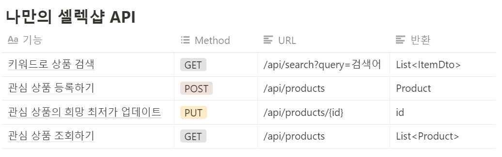

**3. H2 DB 연결 방법**

* src > main > resources > application.properties 에서 아래에 내용을 붙여줍니다.

> spring.h2.console.enabled=true  
> spring.datasource.url=jdbc:h2:mem:springcoredb

* H2 DB에 대해 알아보도록 하겠습니다.

1) 기본 URL 형식

* 임베디드 로컬 연결 - jdbc:h2:[file:][]  
  (예시) jdbc:h2:~/test, jdbc:h2:file:/data/sample, jdbc:h2:C:/data/sampe(이 경우 Windows일 경우에만 한정)
* 인메모리(비공개) - jdbc:h2:mem
* 인메모리(데이터베이스 이름 지정) - jdbc:h2:mem:  
  (예시) jdbc:h2:mem:test
* 원격연결(TCP/IP 사용) - jdbc:h2:tcp://[:]/[]  
  (예시) jdbc:h2:tcp://localhsot/~~/test, jdbc:h2:tcp://localhsot:8084/~~/test, jdbc:h2:tcp://localhsot/mem:test
* 원격(TLS 사용) - jdbc:h2:ssl://:[:]/[]  
  (에시) jdbc:h2:ssl://localhost/~/test;

2) 키워드

* 암호된 파일 사용을 사용할 경우  
  **Keyword** : CIPHER(jdbc:h2:;CIPHER=AES)  
  (예시) jdbc:h2:ssl//localhost/

  ~~/test;CIPHER=AES , jdbc:h2:file:~~

  /test;CIPHER=AES
* 데이터베이스가 이미 존재하는 경우에 데이터베이스를 사용하고 싶을 경우  
  **keyword** : IFEXISTS (jdbc:h2:;IFEXISTS=TRUE)  
  (예시) jdbc:h2:file:~/test;IFEXISTS=TRUE
* log 파일 레벨을 설정하고 싶을 경우  
  **keyword** : TRACE\_LEVEL\_FILE  
  (jdbc:h2:;TRACE\_LEVEL\_FILE=<level 0..3>)  
  → 0 : OFF  
  → 1 : ERROR  
  → 2 : INFO  
  → 3 : DEBUG  
  (예시) jdbc:h2:file:~/test;TRACE\_LEVEL\_FILE=3
* 연결할 때 바로 SQL 실행하고 싶은 경우  
  **keyword**: INIT=RUNSCRIPT FROM (jdbc:h2:;INIT=RUNSCRIPT FROM '<sql파일 위치>' )  
  (예시) jdbc:h2:file:

  ~~/test;INIT=RUNSCRIPT FROM '~~

  /create.sql'\;RUNSCRIPT FROM '~/dummy.sql'
* 호환모드 사용하고 싶은 경우  
  **keywrod**: MODE (jdbc:h2:;MODE=)  
  (예시) jdbc:h2:~/test;MODE=MYSQL;DATABASE\_TO\_LOWER=TRUE
* 연결이 끊겼을 시, 자동 재연결을 원하는 경우  
  **keyword** : AUTO\_RECONNECT (jdbc:h2:;AUTO\_RECONNECT=TRUE)  
  (예시) jdbc:h2:tcp://localhost/~/test;AUTO\_RECONNECT=TRUE  
  (유의사항) 자동 커밋이 활성화 된 경우에만 발생합니다. 만약 자동 커밋이 활성화 되어 있지 않다면, 예외가 발생

---

#### **04. Servlet 으로 상품 검색 API 구현하기**

* 키워드로 상품 검색(GET)  
  URL : /api/search?query=검색어  
  반환 : List

> [질문] "스프링 서버 구현 시 왜 꼭 Controller, Service, Repository 를 사용해야 하죠?"
>
> 이 질문에 대한 대답을 알기 위해 Controller 대신 Servlet을 사용하여 구현을 먼저 하겠다.

> Servlet 이란?  
> : 자바를 사용하여 웹페이지를 동적으로 생성하는 서버 측 프로그램 혹은 그 사양을 말함

1) "상품 검색 API" 동작 순서

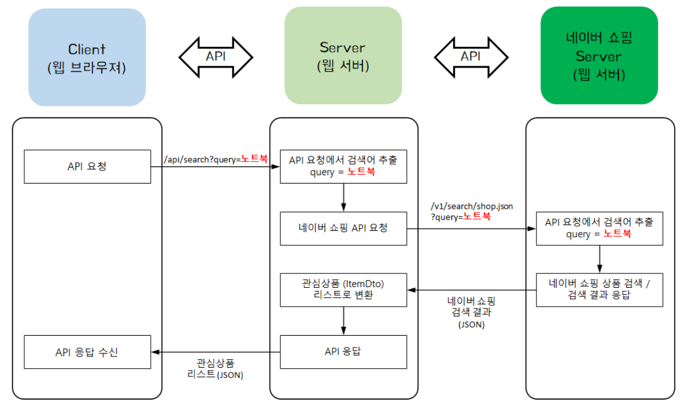

* 1단계 : API 요청  
  - 클라이언트는 원하는 keyword를 설정하여 웹 서버에 전달한다.

```
@WebServlet(urlPatterns = "/api/search")
public class ItemSearchServlet extends HttpServlet {
```

* 2단계 : API 요청에 대한 검색어 추출  
  - 웹서버는 query에 대한 keyword를 추출한다.

```
@Override
    protected void doGet(HttpServletRequest request, HttpServletResponse response) throws IOException {
        // 1. API Request 의 파라미터 값에서 검색어 추출 -> query 변수
        String query = request.getParameter("query");
```

* 3단계 : 네이버 쇼핑 API 요청  
  - 웹서버는 네이버 쇼핑 서버에 해당 키워드를 담아 네이버 API 요청 형식을 사용하여 데이터를 요청한다.  
  - 헤더 정보는 네이버 규칙을 준수하여 자신의 키값과 비밀 키를 입력해주어야한다.

```
// 2. 네이버 쇼핑 API 호출에 필요한 Header, Body 정리
RestTemplate rest = new RestTemplate();
HttpHeaders headers = new HttpHeaders();
headers.add("X-Naver-Client-Id", "xxxxxxx");
headers.add("X-Naver-Client-Secret", "xxxxxx");
String body = "";
HttpEntity<String> requestEntity = new HttpEntity<>(body, headers);
```

> [[네이버 쇼핑 검색 API]](https://developers.naver.com/docs/search/shopping/)

* 4단계 : API 요청에서 검색어 추출(네이버 서버)  
  5단계 : 네이버 쇼핑 삼품 검색 / 검색 결과 응답  
  - 네이버 서버에서 네이버 쇼핑 검색 결과를 JSON 형식으로 받는다.

```
ResponseEntity<String> responseEntity = rest.exchange("https://openapi.naver.com/v1/search/shop.json?query=" + query, HttpMethod.GET, requestEntity, String.class);
String naverApiResponseJson = responseEntity.getBody();
```

* 6단계 : 관심상품(ItemDto) 리스트로 변환  
  - 해당 과정에서 자신이 원하는 데이터만 Filtering하는 과정이 수행된다.  
  - ObjectMapper는 네이버에서 받은 응답 JSON형태를 Java 객체로 만들어주는 역할 수행

```
ObjectMapper objectMapper = new ObjectMapper()
        .configure(DeserializationFeature.FAIL_ON_UNKNOWN_PROPERTIES, false);
JsonNode itemsNode = objectMapper.readTree(naverApiResponseJson).get("items");
List<ItemDto> itemDtoList = objectMapper
        .readerFor(new TypeReference<List<ItemDto>>() {})
        .readValue(itemsNode);
```

* 7단계 : API 응답  
  - 웹서버는 네이버에서 받은 관심상품 리스트를 JSON형태로 클라이언트에 전달한다.  
  - itemDtoListJson는 Java 객체이기 때문에 바로 보낼 수 없어 JSON형태로 전환하는 코드

```
// 5. API Response 보내기
//  5.1) response 의 header 설정
response.setContentType("application/json");
response.setCharacterEncoding("UTF-8");
//  5.2) response 의 body 설정
PrintWriter out = response.getWriter();
//     - itemDtoList (자바 객체 형태) -> itemDtoListJson (JSON 형태)
String itemDtoListJson = objectMapper.writeValueAsString(itemDtoList);
out.print(itemDtoListJson);
out.flush();
```

* 8단계 : API 응답 수신  
  - 클라이언트는 응답 받는 데이터를 JSON 형태에서 원하는 데이터 형태로 가공하여 출력하여 사용자에게 보여준다.

---

#### **05. Controller의 역할 이해**

**1. Controller의 장점**

* HTTP request, response 처리를 위해 매번 작성해 줘야하는 중복코드들 생략 가능

[Servlet]

```
@WebServlet(urlPatterns = "/api/search")
public class ItemSearchServlet extends HttpServlet {
    @Override
  protected void doGet(HttpServletRequest request, HttpServletResponse response) throws IOException {
      String query = request.getParameter("query");

            // ...

      response.setContentType("application/json");
      response.setCharacterEncoding("UTF-8");
      PrintWriter out = response.getWriter();
      String itemDtoListJson = objectMapper.writeValueAsString(itemDtoList);
      out.print(itemDtoListJson);
      out.flush();
    }
}
```

[Controller]

```
@Controller
public class ItemSearchController {
    @GetMapping("/api/search")
  @ResponseBody
  public List<ItemDto> getItems(@RequestParam String query) throws IOException {

            // ...

            return itemDtoList;
  }
}
```

* API 이름마다 파일을 만들 필요 없음

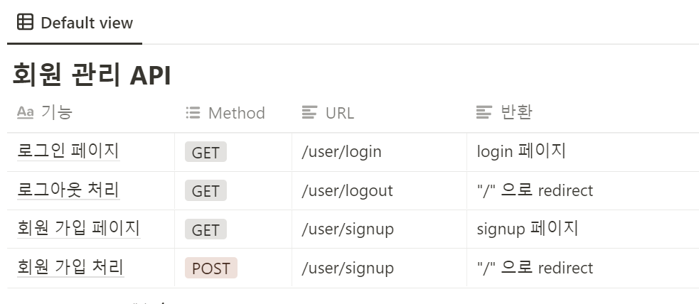

[Servlet]

```
@WebServlet(urlPatterns = "/user/login")
public class UserLoginServlet extends HttpServlet {
    @Override
  protected void doGet(HttpServletRequest request, HttpServletResponse response) {
        // ... 
    }
}
```

```
@WebServlet(urlPatterns = "/user/logout")
public class UserLogoutServlet extends HttpServlet {
    @Override
  protected void doGet(HttpServletRequest request, HttpServletResponse response) {
        // ... 
    }
}
```

```
@WebServlet(urlPatterns = "/user/signup")
public class UserSingUpServlet extends HttpServlet {
    @Override
  protected void doGet(HttpServletRequest request, HttpServletResponse response) {
        // ... 
    }

    @Override
  protected void doPost(HttpServletRequest request, HttpServletResponse response) {
        // ... 
    }

}
```

**[Controller]**

* API 마다 파일을 만들 필요 없음
  + 보통 하나의 Contoller 에 모든 API 를 넣지는 않음
  + 유사한 성격의 API 를 하나의 Controller 로 관리
* 함수 이름도 내 마음대로 설정 가능~!!! (단, 클래스 내의 중복함수명 불가)

```
@Controller
public class UserController {
    @GetMapping("/user/login")
    public String login() {
        // ...
    }

    @GetMapping("/user/logout")
    public String logout() {
        // ...
    }

    @GetMapping("/user/signup")
    public String signup() { 
        // ... 
    }

    @PostMapping("/user/signup")
    public String registerUser(SignupRequestDto requestDto) {
        // ... 
    }
}
```

---

#### **06. 스프링 MVC 이해 - Response**

1. MVC 이란?

- MVC(Model - View- Controller) 디지인 패턴

* Server에서 HTML 파일을 내려주는 경우  
  1. 정적(Static) 웹 페이지
  + Controller  
    1. Client의 요청을 Model로 받아 처리  
    예) 회원가입을 위한 개인 정보(id, password, name)  
    2. Client에게 View(정적 웹 페이지, HTML)를 내려줌2W. 동적(dynamic) 웹 페이지
  + Controller  
    1. Client의 요청을 Model로 받아 처리  
    2. Template engine에게 View, Model 전달

    ```java
    a. View : 동적 HTML 파일
    b. Model : View에 적용할 정보들
    ```


    3. Template engine

    ```
      a. View에 Model을 적용  → 동적 웹페이지 생성
          i) (예) 로그인 성공 시, "로그인된 사용자의 id"를 페이지에 추가
          ii. Template engine의 종류 : 타임리프(Thymeleaf), Groovy, FreeMarker, Jade 등(스프링에서 JSP 이용은 추천하지 않고 있음)
    ```


    4. Client에게 View(동적 웹 페이지, HTML)를 내려줌.

**2. Thymeleaf를 이용한 스프링 MVC 실습**

1) 정적 웹페이지는 static 폴더에 저장한다.

```html
<!DOCTYPE html>
<html>
<head>
    <meta charset="UTF-8">
    <title>Hello Spring</title>
</head>
    <body>
        Hello, Spring 정적 웹 페이지!!
    </body>
</html>
```

2) 동적 웹페이지는 templates 폴더에 저장한다.

```html
<!DOCTYPE html>
<html>
<head><meta charset="UTF-8"><title>Hello Spring</title></head>
<body>
<div>
    Hello, Spring 동적 웹 페이지!!
</div>
<div>
    (방문자 수: <span th:text="${visits}"></span>)
</div>
</body>
</html>
```

**3. HTTP 메시지 이해**

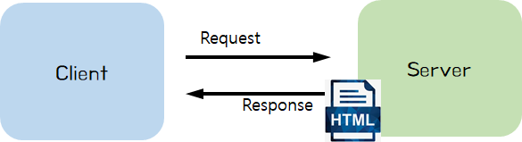

* Client 와 Server 간 Request, Response 는 **HTTP 메시지 규약**을 따름
* HTTP 메시지는 웹 서비스 개발자(백엔드, 프론트 개발자)에게 매우 중요한 내용!!
* 스프링 MVC 이해를 위한 필수 내용만 학습

**[HTTP 메시지]**

**(1) 메시지 구조**

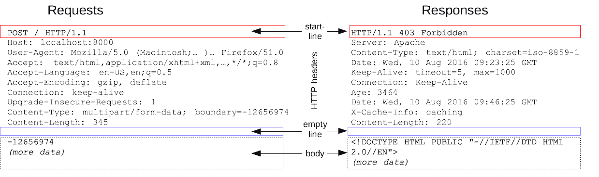

1. 시작줄 (start line)
   1. Response 에선 '상태줄 (status line)' 이라고 부름
2. 헤더 (headers)
3. 본문 (body)

**(2) Request 메시지**


**1. 시작줄: API 요청 내용  
=> HTTP 메소드 + URL +  HTTP 버전**

```html
GET naver.com HTTP/1.1
```

**2. 헤더 - meta 정보(추가적인 정보)**

* "Content type"

1. 없음
2. HTML <form> 태그로 요청 시

```html
Content type: application/x-www-form-urlencoded
```

   3. AJAX 요청

```html
Content type: application/json
```

**3. 본문(Client 에서 보내는 정보)**

1. GET 요청 시: (보통) 없음
2. POST 요청 시: (보통) 사용자가 입력한 폼 데이터

```html
name=홍길동&age=20
```

**(3) Response 메시지**

1. 상태줄: API 요청 결과 (상태 코드, 상태 텍스트)  
   HTTP/1.1 **404 Not Found** => **HTTP버전 + 상태코드 + 상태 메시지**
2. 헤더
   * "Content type" : 내가 보내는 정보에 대한 타입
     1. 없음
     2. Response 본문 내용이 HTML 인 경우   
        Content type: text/html
     3. Response 본문 내용이 JSON 인 경우  
        Content type: application/json
   * "Location"  
      Redirect 할 페이지 URL
   * `Location: <http://localhost:8080/hello.html>`
3. 본문
   1. HTML

```html
<!DOCTYPE html> 
<html> 
<head>
    <title>By @ResponseBody</title>
</head> 
<body>
	Hello, Spring 정적 웹 페이지!!
</body>
</html>
```

      2. JSON

```javascript
{ 
  "name":"홍길동",
  "age": 20
}
```

**4. Controller 와 HTTP Response 메시지**

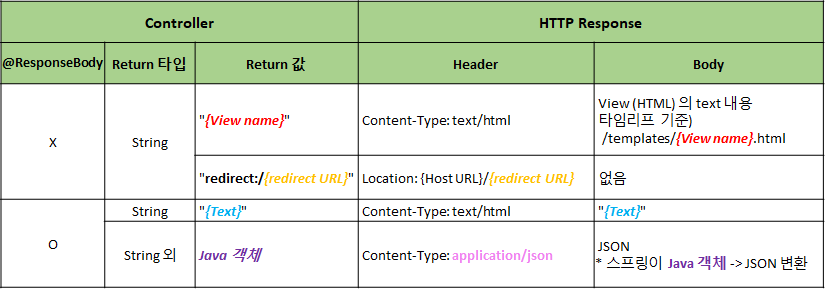

**(1) 정적 웹페이지**

**1. Static 폴더**

```html
http://localhost:8080/hello.html
```

**2. redirect**

   \* RequestMapping() : 공통된 경로를 갖을경우 클래스 위에 설정하여 사용할 수 있다.  
   (예시) "html/redirect" 같은 경우 **http://localhost:8080/hello/response/html/redirect** 로 요청하면 된다.

```java
@Controller
@RequestMapping("/hello/response")
public class HelloResponseController {
    // [Response header]
    //   Location: http://localhost:8080/hello.html
    @GetMapping("/html/redirect")
    public String htmlFile() {
        return "redirect:/hello.html";
    }
```

**3. Template engine 에 View 전달**

>  URL : http://localhost:8080/hello/response/html/templates

```java
@GetMapping("/html/templates")
public String htmlTemplates() {
    return "hello";
}
```

타임리프 default 설정

* prefix: **classpath:/templates/**
* suffix: **.html**

resources/templates/**hello**.html

**4. @ResponseBody**

> URL : http://localhost:8080/hello/response/html/templates

```java
@GetMapping("/body/html")
@ResponseBody
public String helloStringHTML() {
    return "<!DOCTYPE html>" +
           "<html>" +
               "<head><title>By @ResponseBody</title></head>" +
               "<body> Hello, 정적 웹 페이지!!</body>" +
           "</html>";
}
```

* @ResponseBody
  + View 를 사용하지 않고, HTTP Body 에 들어갈 String 을 직접 입력

**(2) 동적 페이지**

> URL : http://localhost:8080/hello/response/html/dynamic

```java
private static long visitCount = 0;

@GetMapping("/html/dynamic")
public String helloHtmlFile(Model model) {
    visitCount++;
    model.addAttribute("visits", visitCount);
    return "hello-visit";
}
```

* View, Model 정보 → 타임리프에게 전달
* 타임리프 처리방식
  + View 정보
    - "hello-visit" → resources\*\*/templates/**hello-visit**.html\*\*

    ```
    <div>
      (방문자 수: <span th:text="${**visits**}"></span>)
    </div>
    ```
  + Model 정보
    - **visits**: 방문 횟수 (visitCount)
    - 예) 방문 횟수: **1,000,000** 번

```html
<div>
  (방문자 수: <span>1000000</span>)
</div>
```

**(3) JSON 데이터**

**1. 반환 값 : String**

> 요청 URL : http://localhost:8080/hello/response/json/string

```java
@GetMapping("/json/string")
@ResponseBody
public String helloStringJson() {
    return "{\"name\":\"BTS\",\"age\":28}";
}
```

**2. 반환 값 : String 외 자바 클래스**

> 요청 URL : http://localhost:8080/hello/response/json/class

```java
@GetMapping("/json/class")
@ResponseBody
public Star helloJson() {
    return new Star("BTS", 28);
}
```

> [요약]   
> 크게 ResponseBody가 있는 경우와 없는 경우로 나뉘어진다.  
> 1. ResponseBody가 없는 경우 -> Return Type은 String  
> 1) String 으로 전달할 경우 Templates 엔진은 해당 String 값을 View로 전달하여 해당 String은 View name으로 읽는다. 없을 경우 에러를 발생시킨다.  
> 2) redirect가 있을 경우, view로 보내지 않고 해당 URL로 이동시켜준다.  
>   
> 2. Reponsebody가 있을 경우  
> 1) String을 반환해주는 경우 해당 텍스트는 text/html 타입으로 전달된다. 즉, 데이터가 아닌 텍스트로 전달된다.  
> 2) String외에 클래스 등을 반환해주는 경우, application/json타입으로 전달되는데 이는 Spring이 자동으로 변환해서 보내준다.   
>   
> (+) 만약 데이터를 매칭시켜서 전달시켜주고 싶은 경우는 Model을 사용하여 전달 가능하다.

**(4) Response 트렌드 변화**

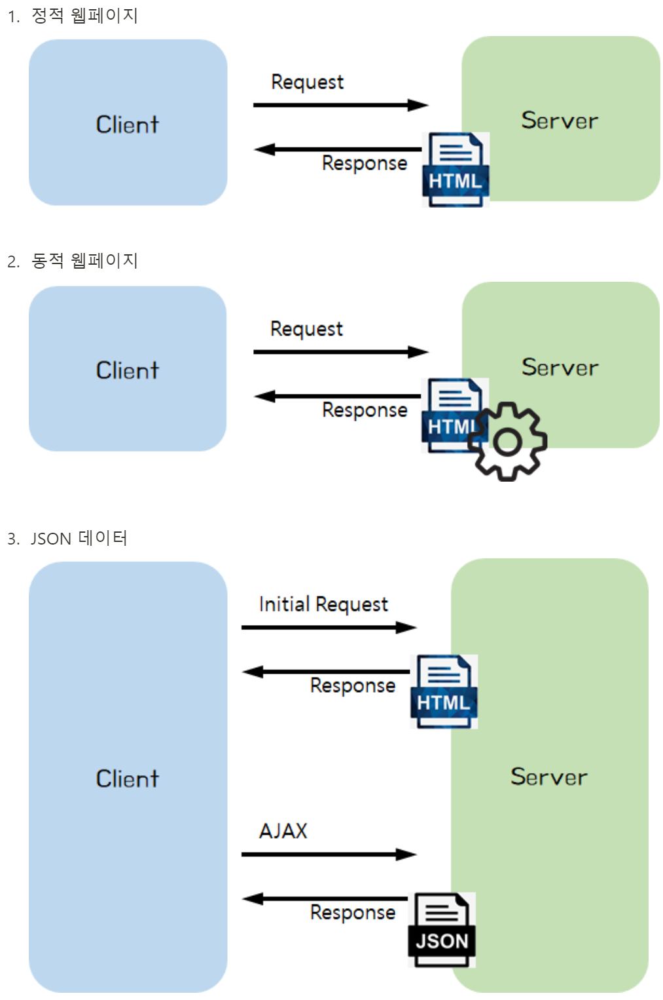

참고: [싱글페이지 애플리케이션 (SPA, Single Page Application)](https://ko.wikipedia.org/wiki/%EC%8B%B1%EA%B8%80_%ED%8E%98%EC%9D%B4%EC%A7%80_%EC%95%A0%ED%94%8C%EB%A6%AC%EC%BC%80%EC%9D%B4%EC%85%98)

[싱글 페이지 애플리케이션 - 위키백과, 우리 모두의 백과사전

싱글 페이지 애플리케이션(single-page application, SPA, 스파)은 서버로부터 완전한 새로운 페이지를 불러오지 않고 현재의 페이지를 동적으로 다시 작성함으로써 사용자와 소통하는 웹 애플리케이션

ko.wikipedia.org](https://ko.wikipedia.org/wiki/%EC%8B%B1%EA%B8%80_%ED%8E%98%EC%9D%B4%EC%A7%80_%EC%95%A0%ED%94%8C%EB%A6%AC%EC%BC%80%EC%9D%B4%EC%85%98)

**(5) @RestController = @Controller + @ResponseBody**

* 싱글 페이지 애플리케이션이 발달함에 따라 @RestController가 더 필요하게 되어졌다.

**5. Spring MVC 동작원리**

> @Controller 는 스프링 서버 개발자 입장에서는 시작점과 끝점으로 보이지만, 사실 스프링이 뒤에서 많은 부분을 보이지 않게 처리해 주고 있습니다.

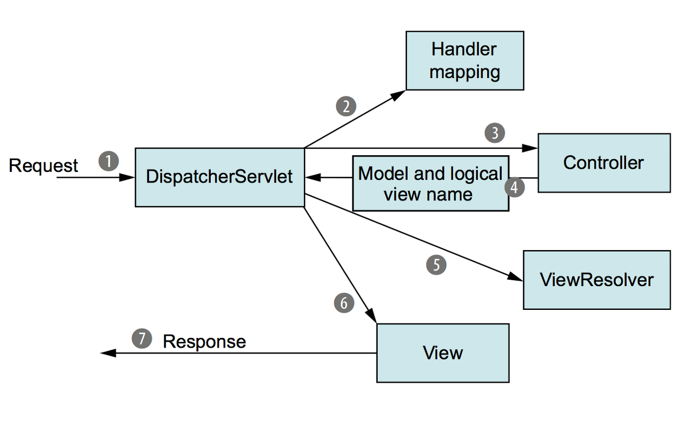

1. Client → DispatcherServlet
   1. **가장 앞 단에서 요청을 받아 FrontController 라고도 불림**

 2. DispatcherServlet → Controller

* API 를 처리해 줄 Controller 를 찾아 요청을 전달
* Handler mapping 에는 API path 와 Controller 함수가 매칭되어 있음
* **Handler mapping에서 어느 Controller 함수로 보내야되는지 찾고, 전달해주는 과정**

> 💡 [Sample]   
> **GET /hello/html/dynamic → HomeController 의 helloHtmlFile() 함수**   
> **GET /user/login → UserController 의 login() 함수**   
> **GET /user/signup → UserController 의 signup() 함수**   
> **POST /user/signup → UserController 의 registerUser() 함수**

* 함수 이름을 내 마음대로 설정 가능했던 이유!!
* Controller 에서 요청하는 Request 의 정보 ('**Model**') 전달(DispatcherServlet 에서 Controller로)
* **클라이언트로 부터 받은 정보를 해당 메소드 Controller로 전달해주는 것도 DispatcherServlet이 담당한다.**

```java
@Controller public class ItemSearchController {
     @GetMapping("/api/search")
     @ResponseBody
     public List<ItemDto> getItems(**@RequestParam String query**) { // ... }
}
```

1. **Controller** → DispathcerServlet
   1. Controller 가 Client 으로 받은 API 요청을 처리
   2. **'Model' 정보와 'View' 정보를 DispatcherServlet 으로 전달**
   3. **Model과 View를 거치지 않는 경우도 있는데, @responsebody를 하는 경우는 전달이 되지 않는다.**
2. DispatcherServlet → Client
   1. **ViewResolver 통해 View 에 Model 을 적용(View에 Model를 적용시켜 보낸다 -템플릿 엔진이 하는 역할)**
   2. View 를 Client 에게 응답으로 전달

---

#### **07. 스프링 MVC 이해 - Request**

**1) Controller 와 HTTP Request 메시지**

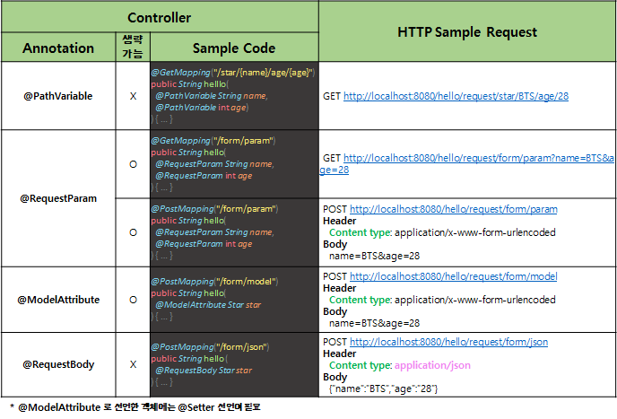

**1. GET 방식**

(1) PathVariagle

> http://localhost:8080/hello/request/star/BTS/age/25

1. Client에서 폼의 형태로 이름과 나이를 입력하여 전송한다.
2. 서버에서는 PathVariable를 통해 URI 정보에서 해당 Key값만 추출한다.
3. 해당 key값이 제대로 전달될 수 있도록 @PathVariblae을 사용한다.
4. 아래 코드는 Script 코드로 해당 form에 대한 값을 페이지로 요청하는 모습이다.

```
// GET /star/{name}/age/{age}
const helloPathForm = document.querySelector("#helloPathFormSend")
helloPathForm.onclick = (e) => {
  const form = document.querySelector("#helloPathForm");
  const name = form.querySelector('input[name="name"]').value;
  const age = form.querySelector('input[name="age"]').value;
  const relativeUrl = `/hello/request/star/${name}/age/${age}`;
  window.location.href = relativeUrl;
}
```

(2) RequestParam

> http://localhost:8080/hello/request/form/json

1. Client에서 폼의 형태로 이름과 나이를 입력하여 전송한다.
2. 클라이언트에서는 URI에 ? 뒤에 key and value 형태로 전송된다.
3. 서버는 해당 key와 value를 RequestParam을 통해 해당 키값이 일치되도록 한다.
4. 일치된 값을 format 형식에 맞게 입력하여 클라이언트로 전송한다.

```
// [Request sample]
// GET http://localhost:8080/hello/request/form/param?name=BTS&age=28
@GetMapping("/form/param")
@ResponseBody
public String helloGetRequestParam(@RequestParam String name, @RequestParam int age) {
    return String.format("Hello, @RequestParam.<br> name = %s, age = %d", name, age);
}
```

**2. POST 방식**

(1) RequestParam

> http://localhost:8080/hello/request/form/param

1. Client에서 폼의 형태로 이름과 나이를 입력하여 전송한다.
2. 클라이언트에서 Contenttype을 application/x-www-form-urlencoded로 데이터를 전송한다.(Body에 데이터가 있다)
3. 서버는 GET과 동일하게 @RequestParam을 통해서 Body에 담겨 있는 값에 Key값과 동일한 값을 매칭시켜서 받는다.
4. 일치된 값을 format 형식에 맞게 입력하여 클라이언트로 전송한다.
5. GET과 다른 점은 PostMapping이다.
6. 결론적으로 ContentType이 달라지더라도 데이터를 받아오는 방법은 Spring이 알아서 잘 해준다.

```
// [Request sample]
// POST http://localhost:8080/hello/request/form/param
// Header
//  Content type: application/x-www-form-urlencoded
// Body
//  name=BTS&age=28
@PostMapping("/form/param")
@ResponseBody
public String helloPostRequestParam(@RequestParam String name, @RequestParam int age) {
    return String.format("Hello, @RequestParam.<br> name = %s, age = %d", name, age);
}
```

(2) ModelAttribute

> http://localhost:8080/hello/request/form/model

1. Client에서 폼의 형태로 이름과 나이를 입력하여 전송한다.
2. 클라이언트에서 Contenttype을 application/x-www-form-urlencoded로 데이터를 전송한다.(Body에 데이터가 있다)
3. 서버는 ModelAttribute를 통해서 Reqeust의 내용을 해당 객체에 세팅을 해준다.
4. 이를 통해 인스턴스에 값을 잘 매칭할 수 있게 된다.
5. 유의할 점은 Setter가 없으면 작동하지 않는다.

```java
    // [Request sample]
    // POST http://localhost:8080/hello/request/form/model
    // Header
    //  Content type: application/x-www-form-urlencoded
    // Body
    //  name=BTS&age=28
    @PostMapping("/form/model")
    @ResponseBody
    public String helloRequestBodyForm(@ModelAttribute Star star) {
        return String.format("Hello, @RequestBody.<br> (name = %s, age = %d) ", star.getName(), star.getAge());
    }
```

(3) RequestBody

> http://localhost:8080/hello/request/form/json

1. Client에서 폼의 형태로 이름과 나이를 입력하여 전송한다.
2. 클라이언트에서 페이지 이동 없이 데이터를 JSON의 형태로 데이터를 전송한다.
3. 클라이언트에 요청 헤더에서 ContentType 이 application/json인 것을 확인 할 수 있다.
4. 서버에서는 JSON형태를 받이 위해서 @RequestBody를 통해 해당 JSON을 객체에 받을 수 있도록 하였다.
5. 여러 번 시도해도 페이지 이동 없이 데이터만 전송되도록 설정되어 있다.

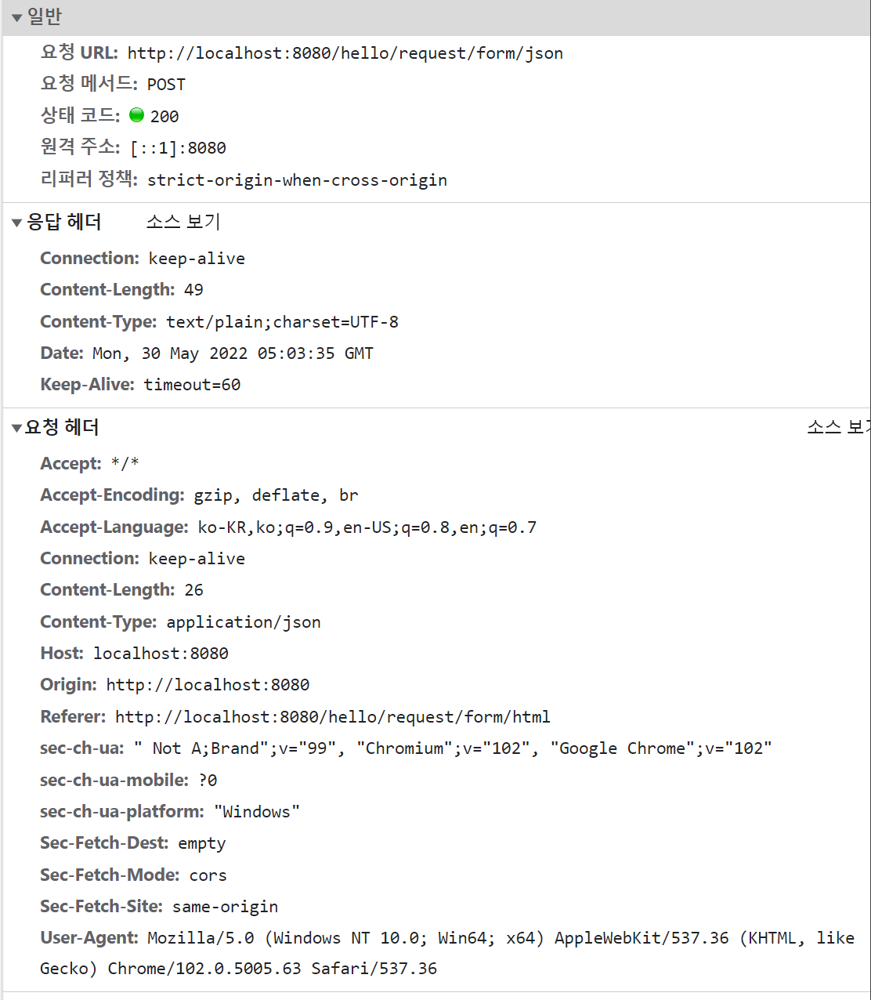

```
// [Request sample]
// POST http://localhost:8080/hello/request/form/json
// Header
//  Content type: application/json
// Body
//  {"name":"BTS","age":"28"}
@PostMapping("/form/json")
@ResponseBody
public String helloPostRequestJson(@RequestBody Star star) {
    return String.format("Hello, @RequestBody.<br> (name = %s, age = %d) ", star.getName(), star.getAge());
}
```

> 요약  
> 1. GET과 POST  
> GET은 URL 요청 안에 값을 넣어 전송한다면,  
> POST는 URL에 있는 것을 감추어 Body를 통해 전송한다.  
>   
> 2. Pathvariable과 RequestParam  
> Pathvariable은 생략하면 안되지만, RequestParam은 생략해도 매칭된다.  
> 명시적으로 작성하는 것을 추천  
>   
> 3. RequestParam과 ModelAttribute  
> - 입력 값으로 2-3개를 받는다면 그냥 작성해도 되지만 만약 데이터 10개 이상 등 많은 데이터를 가져온다면 파라미터에 다 작성해야하지만, Model을 통해서 객체로 받게 되면 객체에 자동으로 값을 넣어준다.  
> - 주의할 점은 Setter는 필수적으로 들어가야한다  
>   
> 4. ModelAttribute 와 RequestBody  
> - ModelAttribute는 String 형식으로 데이터가 들어왔다면,  
> RequestBody는 JSON형식으로 들어온 데이터를 세팅할때 사용한다.

**3. Quiz**

> 로그인 처리를 위한 Controller 를 구현해 주세요.

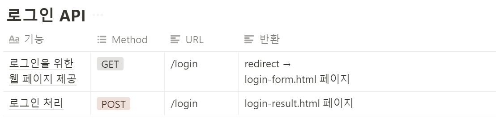

```
POST <http://localhost:8080/login>
Header
  Content type: application/x-www-form-urlencoded
Body
	id=**superman**&password=**superman**
```

* 요구사항 파악
  + GET 요청시 redirect을 통해 login-form으로 이동해야하므로 ResponseBody없이 사용하면 된다.  
    (templates가 아니므로 html 확장자 작성해야한다.)
  + POST 요청시 헤더가 form 형태이므로 String형태로 전송된다. (RequestParam과 ModelAttribute 사용가능)
  + 로그인 성공 시에만 Model 에 loginId 를 설정
    - loginId 값은 Client 가 요청한 id
    - id 와 password 가 동일한 문자열이어야 한다.
  + "login-result.html" 파일을 resouces/templates 폴더에 생성

```
@RequiredArgsConstructor 
@Controller
public class LoginController {

    private final UserService userService;

    @GetMapping("/login")
    public String getLogin(){
        return "redirect:/login-form.html";
    }

    @PostMapping("/login")
    public String processLogin(@ModelAttribute User user, Model model){
        if(userService.checkid(user.getId())){              // 영문자만 입력했는지 판단
            if(user.getId().equals(user.getPassword())) {   // 아이디와 비밀번호 동일 여부
                model.addAttribute("loginId", user.getId());
            }

        }
        return "login-result";
    }
}
```

---

#### **08.  관심상품 등록 API 구현하기**

> "흠.. Controller 는 왜 사용해야 하는지 이해를 했는데..   
> Service, Repository 는 꼭 사용해야 할까?"에 대한 대답을 이번 챕터에서 알 수 있게 된다.

**1) "관심 상품 API" 구현**

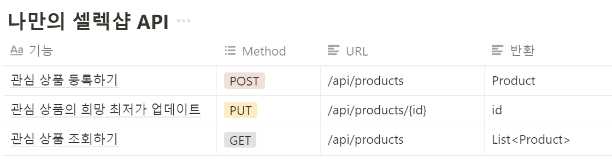

* Service, Repository 구분없이 통합된 Controller
* 관심상품 등록 요청 DTO
* 관심상품 DB테이블에 대응되는 Entity
* 관심상품 최저가 업데이터 요청 DTO

**2) UI 연동 없이 API 동작 검증**

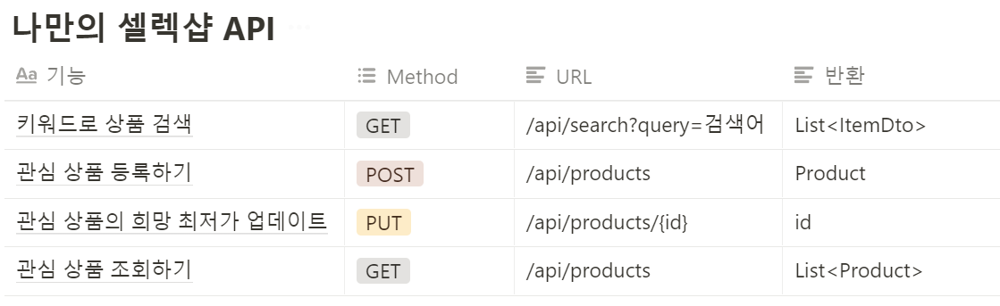
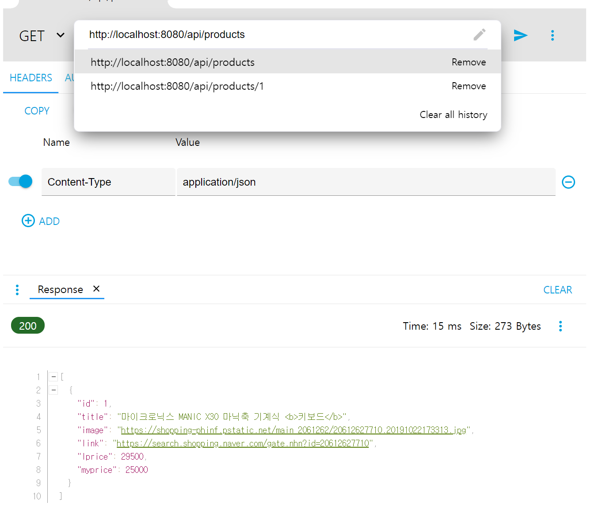

**3) UI 연동을 통한 API 동작 검증**

> 나만의 셀렉샵 UI를 연동함으로써 AllInOneController 의 API 동작을 검증하려고 합니다

* 현재 기능 작동에는 문제가 없다.

**4) AllInOneController의 문제점**

> Service, Repository 없이 Controller 한 개로도 잘 동작하네?   
> 일단 이렇게 잘 동작하는 AllInOneController 내용을 살펴봅시다.

**[웹 서비스 구성도]**

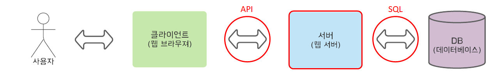

(1) 관심상품 등록 API

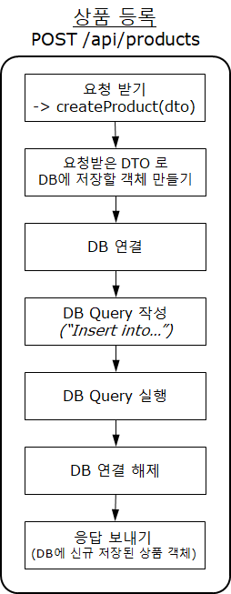

```
// 관심상품 등록
@PostMapping("/api/products")
public Product createProduct(@RequestBody ProductRequestDto requestDto) throws SQLException {
    // 요청받은 DTO 로 DB에 저장할 객체 만들기
    Product product = new Product(requestDto);

    // DB 연결
    Connection connection = DriverManager.getConnection("jdbc:h2:mem:springcoredb", "sa", "");

    // DB Query 작성
    PreparedStatement ps = connection.prepareStatement("select max(id) as id from product");
    ResultSet rs = ps.executeQuery();
    if (rs.next()) {
        // product id 설정 = product 테이블의 마지막 id + 1
        product.setId(rs.getLong("id") + 1);
    } else {
        throw new SQLException("product 테이블의 마지막 id 값을 찾아오지 못했습니다.");
    }
    ps = connection.prepareStatement("insert into product(id, title, image, link, lprice, myprice) values(?, ?, ?, ?, ?, ?)");
    ps.setLong(1, product.getId());
    ps.setString(2, product.getTitle());
    ps.setString(3, product.getImage());
    ps.setString(4, product.getLink());
    ps.setInt(5, product.getLprice());
    ps.setInt(6, product.getMyprice());

    // DB Query 실행
    ps.executeUpdate();

    // DB 연결 해제
    ps.close();
    connection.close();

    // 응답 보내기
    return product;
}
```

(2) 관심상품 최저 희망가 업데이트 API

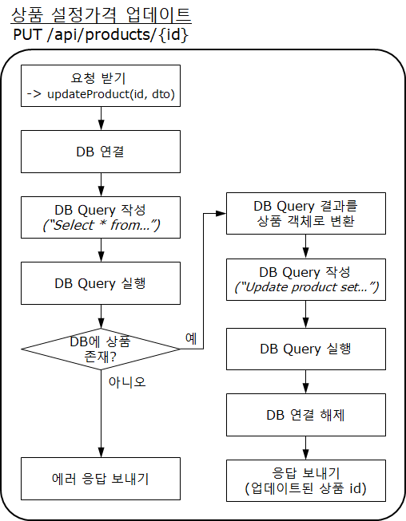

```
// 설정 가격 변경
@PutMapping("/api/products/{id}")
public Long updateProduct(@PathVariable Long id, @RequestBody ProductMypriceRequestDto requestDto) throws SQLException {
    Product product = new Product();

    // DB 연결
    Connection connection = DriverManager.getConnection("jdbc:h2:mem:springcoredb", "sa", "");

    // DB Query 작성
    PreparedStatement ps = connection.prepareStatement("select * from product where id = ?");
    ps.setLong(1, id);

    // DB Query 실행
    ResultSet rs = ps.executeQuery();
    if (rs.next()) {
        product.setId(rs.getLong("id"));
        product.setImage(rs.getString("image"));
        product.setLink(rs.getString("link"));
        product.setLprice(rs.getInt("lprice"));
        product.setMyprice(rs.getInt("myprice"));
        product.setTitle(rs.getString("title"));
    } else {
        throw new NullPointerException("해당 아이디가 존재하지 않습니다.");
    }

    // DB Query 작성
    ps = connection.prepareStatement("update product set myprice = ? where id = ?");
    ps.setInt(1, requestDto.getMyprice());
    ps.setLong(2, product.getId());

    // DB Query 실행
    ps.executeUpdate();

    // DB 연결 해제
    rs.close();
    ps.close();
    connection.close();

    // 응답 보내기 (업데이트된 상품 id)
    return product.getId();
}
```

(3) 관심상품 조회

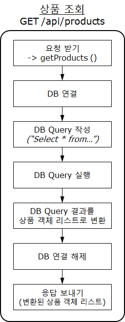

```
/ 등록된 전체 상품 목록 조회
@GetMapping("/api/products")
public List<Product> getProducts() throws SQLException {
    List<Product> products = new ArrayList<>();

    // DB 연결
    Connection connection = DriverManager.getConnection("jdbc:h2:mem:springcoredb", "sa", "");

    // DB Query 작성 및 실행
    Statement stmt = connection.createStatement();
    ResultSet rs = stmt.executeQuery("select * from product");

    // DB Query 결과를 상품 객체 리스트로 변환
    while (rs.next()) {
        Product product = new Product();
        product.setId(rs.getLong("id"));
        product.setImage(rs.getString("image"));
        product.setLink(rs.getString("link"));
        product.setLprice(rs.getInt("lprice"));
        product.setMyprice(rs.getInt("myprice"));
        product.setTitle(rs.getString("title"));
        products.add(product);
    }

    // DB 연결 해제
    rs.close();
    connection.close();

    // 응답 보내기
    return products;
}
```

**(4) AllInOneController 클래스의 문제점**

1. 한 개의 클래스에 너무 많은 양의 코드가 존재
   1. 코드 이해가 어려움: 처음부터 끝까지 다 읽어야 코드 내용을 이해할 수 있음**(가독성 ↓)**
2. 현업에서는 코드 추가 혹은 변경 요청이 계속 생김  
   1. 신규 상품 등록 시 Client 에게 응답 (Response) 하는 값 변경
      1. 등록된 Product 전체 정보 → 등록된 Product 의 id
   2. 최저가 (Myprice) 업데이트 조건 변경
      1. Client 가 최저가를 0원 이하로 입력 → 에러 발생
   3. DB 테이블 이름 변경
      1. Product 테이블의 **lprice** → **lowprice** 변경

**(5) 절차적 프로그래밍 VS 객체지향 프로그래밍**

* "절차적 프로그래밍"
  + 초기 프로그래밍 방식
  + 컴퓨터가 해야할 일들을 쭈~욱 순차적으로 나열해 놓는 코딩 방식
  + 예) AllInOneController 클래스의 각 API 처리내용
* "객체지향 프로그래밍"
  + 소프트웨어의 규모가 점점 커지면서 필요성이 부각이 됨
  + 대부분의 사람들은 한 번에 여러가지 다른 생각을 하는데 취약
  + 하나의 사물 (객체) 에 하나의 의미를 부여하는 것처럼 프로그래밍하게 됨
    - 예)
      * 뭔가 자를 것이 필요하면 '✂️' 를 떠올림 (class **Sciccors**)
      * 종이에 적을 게 필요하면 '✏️' 을 떠올림 (class **Pen**)
      * **"하나의 역할" →** 객체
* 메모앱 (ex. Evernote, Notion 등) 예제를 통한 이해
  + **절차적 프로그래밍**
    1. 장점:
       - 메모를 작성하기에 편함 (직관적)
    2. 단점:
       - 메모양이 많아지면 정리가 어려움
       - 내가 원하는 메모 내용을 찾기 어려움
  + : 아무 메모장을 띄워서, 생각나는데로 사고의 흐름을 적는다 (퀵메모)
  + **객체지향 프로그래밍**
    1. 장점: 메모를 관리하기 쉬움
    2. 단점:
       - 주제를 어떻게 나눠야 할지, 고민이 필요
         * 잘못 주제를 나누면..
           + 중복된 메모 내용이 생길 수 있음 (ex. "나중에 읽을 책", "도움이 되는 책")
           + 하나의 주제에 너무 적거나, 너무 많은 메모 내용이 들어갈 수 있음 (ex. "88 올림픽 한국 순위와 금메달 개수", "공부")
       - 주기적으로 주제별 (카테고리별) 정리가 필요할 수 있음
       - 떠오르는 생각들을 적을때 주제가 다른 메모내용들을 적기 어려움
  + : "주제별"로 정리해서 메모한다. (ex. 주식 투자, 바리스타 공부)
* 추천 프로그래밍 방식  
  1. 처음엔 "절차적 프로그래밍"
  2. "객체지향 프로그래밍"으로 **리팩토링**
     1. 하나의 파일에 **너무 많은 코드**가 들어가지 않게!
     2. **역할별**로 코드 분리!!
     3. 코드를 좀 더 **읽기 편하게**!!!

> 💡 '리팩토링' 이 뭐죠?? : 기능 상의 변경 없이 프로그래밍 구조를 개선하는 것

---

#### **09.  AllInOneController 의 역할 분리**

**1) Controller, Service, Repository 역할**

> 서버 개발자들은 서버에서의 처리과정이 대부분 비슷하다는 걸 깨닫고, 처리 과정을 크게 3개로 분리했습니다.   
>   
> 스프링에서 이미 구분해서 사용해 본적 있던 Controller, Service, Repository 입니다. 

**1. Controller**

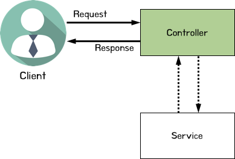

* 클라이언트의 요청을 받음
* 요청에 대한 처리는 서비스에게 전담
* 클라이언트에게 응답

**2. Service**


* 사용자의 요구사항을 처리 ('비즈니스 로직') 하는 **실세 중에 실세!!!**
  + 현업에서는 서비스 코드가 계속 비대해짐
* DB 정보가 필요할 때는 Repository 에게 요청

**3. Repository**

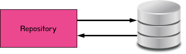

* DB 관리 (연결, 해제, 자원 관리)
* DB CRUD 작업 처리

**(MVC 구조)**

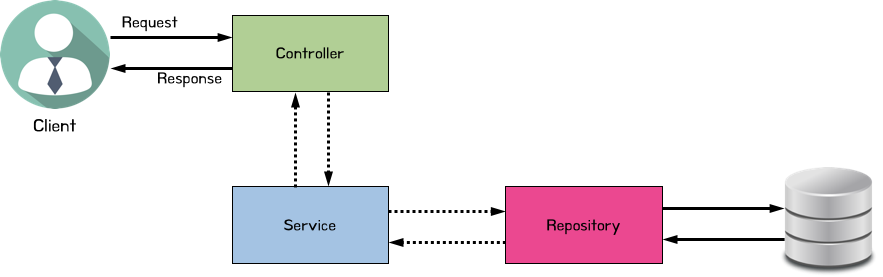

**2) Quiz 관심사 분리**


**3) Quiz 정답**

**1. Controller**

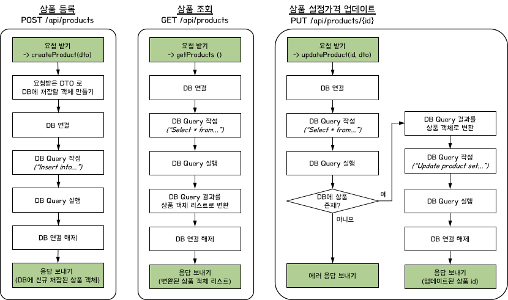

**2. Service**

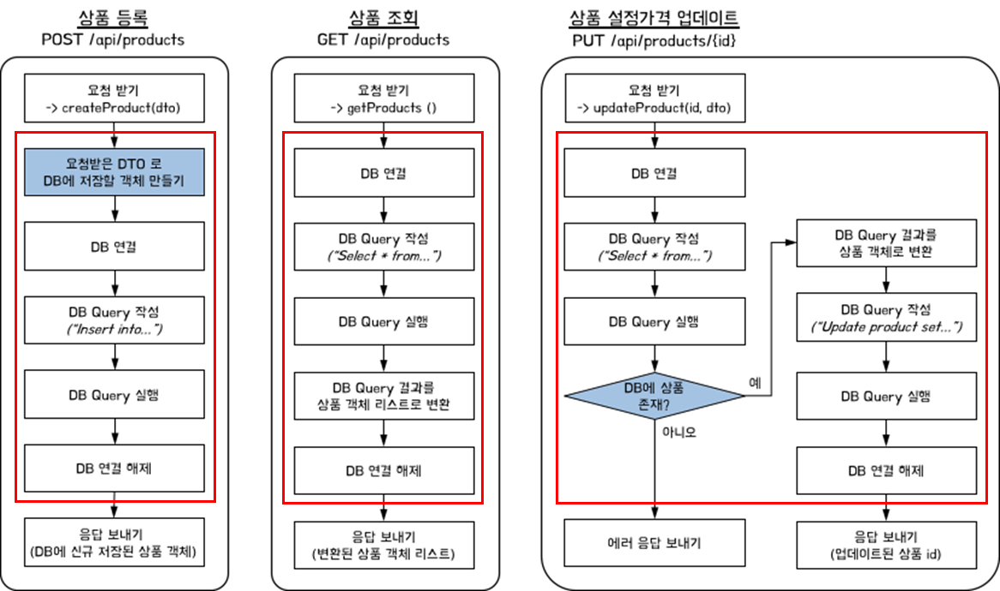

**3. Repository**

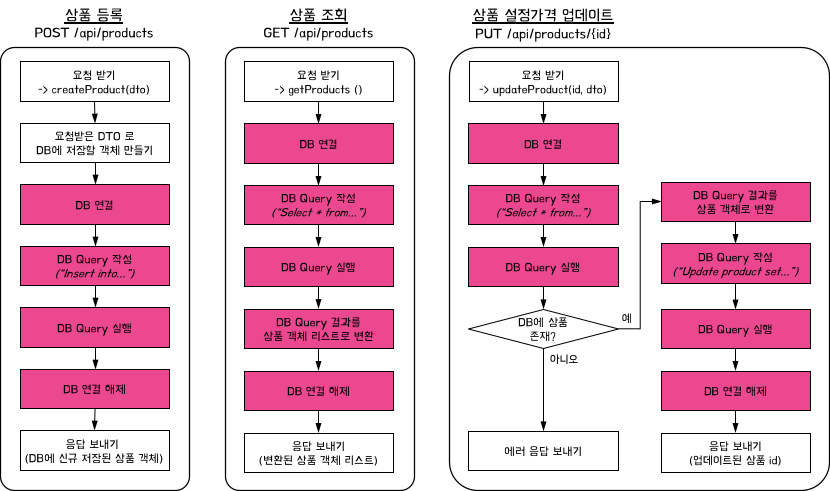

---

#### **10.  AllInOneController 의 코드 분리**

**1) 리팩토링 후 UI 를 통해 기능 검증**

**2)****리팩토링 후 개선점 확인**

* AllInOneController 의 문제점 **재확인!!**

1. 한 개의 클래스에 너무 많은 양의 코드가 존재
   1. 코드 이해가 어려움: 처음부터 끝까지 다 읽어야 코드 내용을 이해할 수 있음**→ 3개의 클래스에 역할 별로 코드가 정리됨**
2. 현업에서는 코드 추가 혹은 변경 요청이 계속 생김
   1. 신규 상품 등록 시 Client 에게 응답 (Response) 하는 값 변경
      1. 등록된 Product 전체 정보 → 등록된 Product 의 id**→ Controller 의 역할**
   2. 최저가 (Myprice) 업데이트 조건 변경
      1. Client 가 최저가를 0원 이하로 입력 → 에러 발생**→ Service 의 역할**
   3. DB 테이블 이름 변경
      1. Product 테이블의 **lprice** → **lowprice** 변경**→ Repository 의 역할**

---

#### **11.  객체 중복 생성 문제 해결**

**1. 객체 중복 생성 문제**

```java
public class ProductService {

    public List<Product> getProducts() throws SQLException {
        ProductRepository productRepository = new ProductRepository();
// ...
    }

    public Product createProduct(ProductRequestDto requestDto) throws SQLException {
        ProductRepository productRepository = new ProductRepository();
        // ...
    }

    public Product updateProduct(Long id, ProductMypriceRequestDto requestDto) throws SQLException {
        ProductRepository productRepository = new ProductRepository();
// ...
    }
}
```

* 생성자를 통해 1번만 생성되도록 변경한다(Controller, Service)
* 변경 후 항상 기능 검증을 실시

```
private final ProductService productService;

public ProductController(){
    ProductService productService = new ProductService();
    this.productService =productService;
}
```

```
private final ProductRepository productRepository;

public ProductService(){
    ProductRepository productRepository = new ProductRepository();
    this.productRepository = productRepository;
}
```

---

#### **11.  DI (의존성 주입) 의 이해**

**(1) 강한 결합의 문제점**

['강한 결합' 이해를 위한 예제]

1. Contoller1 이 Service1 객체를 생성하여 사용

```
public class Controller1 {
	private final Service1 service1;

	public Controller1() {
		this.service1 = new Service1();
	}
}
```

2. Service1 이 Repostiroy1 객체를 생성하여 사용

```java
public class Service1 {
	private final Repository1 repository1;

	public Service1() {
		this.repository1 = new Repository1();
	}
}
```

3. Repostiroy1 객체 선언

```java
public class Repository1 { ... }
```

4. 만약, 다음과 같이 변경된다면..

a. Repository1 객체 생성 시 DB 접속 id, pw 를 받아서 DB 접속 시 사용

* 생성자에 DB 접속 id, pw 를 추가

```java
public class Repository1 {

	public Repository1(String id, String pw) {
    // DB 연결
    Connection connection = DriverManager.getConnection("jdbc:h2:mem:springcoredb", id, pw);
  }
}
```

**[\*강한 결합"의 문제점]**

* **Controller 5 개**가 각각 Service1 을 생성하여 사용 중
* **Repository1** 생성자 변경에 의해  
  ⇒ **모든 Contoller** 와 **모든 Service** 의 코드 변경이 필요

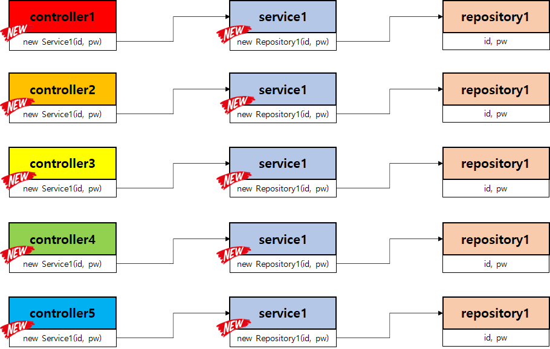

**(2) 강한 결합 해결방법**

> "강한 결합"을 해결할 방법이 없을까?   
> 1. 각 객체에 대한 객체 생성은 딱 1번만!!  
> 2. 생성된 객체를 모든 곳에서 재사용!!!

**1. Repository1 클래스 선언 및 객체 생성 → repository1**

```java
public class Repository1 { ... }

// 객체 생성
Repository1 repository1 = new Repository1();
```

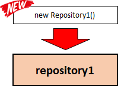

**2. Service1 클래스 선언 및 객체 생성 (repostiroy1 사용) → service1**

```java
Class Service1 {
	private final Repository1 repitory1;

	// repository1 객체 사용
	public Service1(Repository1 repository1) {
		this.repository1 = new Repository1();
		this.repository1 = repository1;
	}
}

// 객체 생성
Service1 service1 = new Service1(repository1);
```

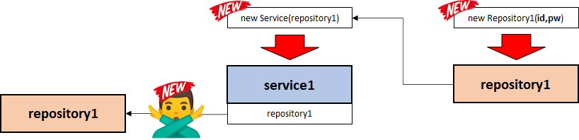

**3. Contoller1** 선언 ( **service1** 사용)

```java
Class Controller1 {
	private final Service1 service1;

	// service1 객체 사용
	public Controller1(Service1 service1) {
		this.service1 = new Service1();
		this.service1 = service1;
	}
}
```

**4. 만약, 다음과 같이 변경된다면,**

1. **Repository1** 객체 생성 시 DB 접속 id, pw 를 받아서 DB 접속 시 사용
   * 생성자에 DB 접속 id, pw 를 추가

```java
public class Repository1 {

	public Repository1(String id, String pw) {
    // DB 연결
    Connection connection = DriverManager.getConnection("jdbc:h2:mem:springcoredb", id, pw);
  }
}

// 객체 생성
String id = "sa";
String pw = "";
Repository1 repository1 = new Repository1(id, pw);
```

**[개선결과]**

> ⇒ Repository1 생성자 변경은 이제 누구에게도 피해(?) 를 주지 않음  
> ⇒ Service1 생성자가 변경되면? 모든 Contoller → Controller 변경 필요 X  
> 결론적으로, 강한 결합 ⇒ 느슨한 결합

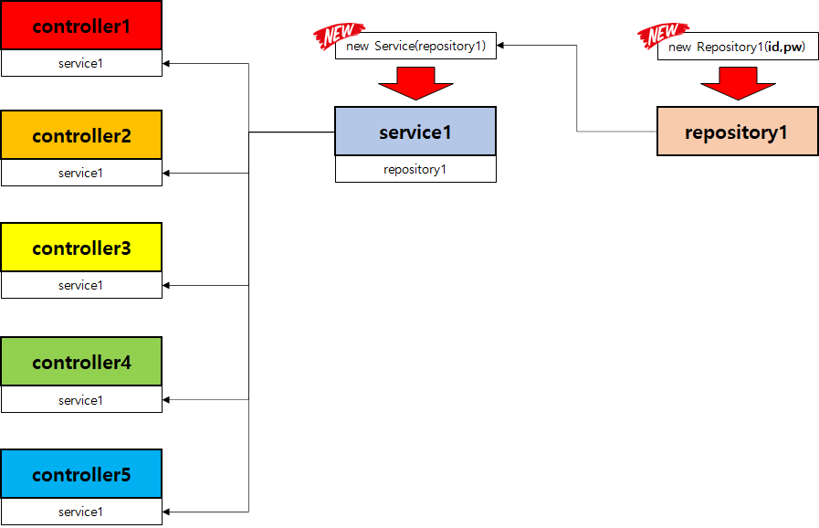

**(3) DI(의존성 주입)의 이해**

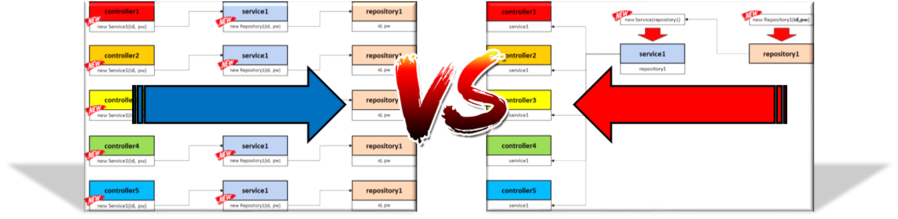

> 👉 "제어의 역전 (IoC: Inversion of Control)" 프로그램의 제어 흐름이 뒤바뀜

* 일반적: 사용자가 자신이 필요한 객체를 생성해서 사용
* IoC (제어의 역전)
  + 용도에 맞게 필요한 객체를 그냥 가져다 사용
    - "**DI (Dependency Injection)**" 혹은 한국말로 "**의존성 주입**"이라고 부릅니다.
  + 사용할 객체가 어떻게 만들어졌는지는 알 필요 없음
  + 실생활 예제) 가위의 용도별 사용
    - 음식을 자를 때 필요한 가위는? → 부엌가위 (생성되어 있는 객체 kitchenScissors)
    - 무늬를 내며 자를 때 필요한 가위는? → 핑킹가위 (생성되어 있는 객체 pinkingShears)
    - 정원의 나무를 다듬을 때 필요한 가위는? → 전지가위 (생성되어 있는 객체 pruningShears)

**(4) DI 적용 시도**

> 시도한 결과! 그러면 객체를 어디에 생성해두고 사용해야할까?? 이것에 대한 문제가 남아있다.

---

#### **12.  스프링 IoC 컨테이너 사용하기**

**1) Spring IoC 컨테이너**

> DI 를 사용하기 위해서는 객체 생성이 우선 되어야 했습니다.   
> 과연 어디서 객체 생성을 해야 할까요?   
>   
> 바로 스프링 프레임워크가 필요한 객체를 생성하여 관리하는 역할을 대신해 줍니다.

* **빈 (Bean)**: 스프링이 관리하는 객체
* **스프링 IoC 컨테이너**: '빈'을 모아둔 통

**2) Spring Bean 등록 방법**

**1. @Component**

* 클래스 선언 위에 설정

> @Component   
> public class ProductService { ... }

* 스프링 서버가 뜰 때 스프링 IoC 에 '빈' 저장
  + @Component 클래스에 대해서 스프링이 해 주는 일

> // 1. ProductService 객체 생성   
> ProductService productService = new ProductService();  
>   
> // 2. 스프링 IoC 컨테이너에 빈 (productService) 저장   
> // productService -> 스프링 IoC 컨테이너

* + 스프링 '빈' 이름: 클래스의 앞글자만 소문자로 변경
    - public class **ProductServcie** → **productServcie**
* **'빈' 아이콘 확인 → 스프링 IoC 에서 관리할 '빈' 클래스라는 표시**

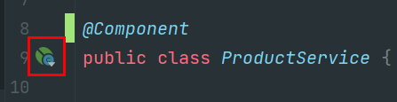

* @Component 적용 조건
  + **@ComponentScan 에 설정해 준 packages 위치와 하위 packages 들**

> @Configuration   
> @ComponentScan(basePackages = "com.sparta.springcore")   
> class BeanConfig { ... }

* + @SpringBootApplication 에 의해 default 설정이 되어 있음
  + com.sparta.springcore/**SpringcoreApplication.java**

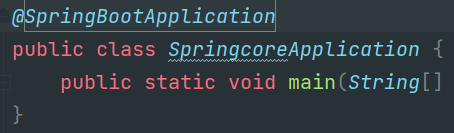

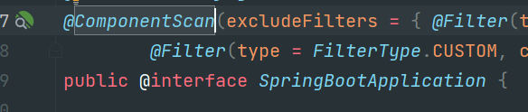

* 테스트 코드

```java
package com.sparta.abc;

import org.springframework.stereotype.Component;

@Component
public class TestClass {

}
```

**2.@Bean**

* 직접 객체를 생성하여 빈으로 등록 요청  
  (사용 예) 현재 ProductRepository에서 Componet로 사용할 경우 dbUrl, dbId, dbpassword 가 어디서 들어오는지 Spring은 알 수 없기 때문에 지금 사용할 수 없다.  
  => 해결 방법은 **Bean**

```java
@Bean
    public ProductRepository productRepository() {
        String dbUrl = "jdbc:h2:mem:springcoredb";
        String dbId = "sa";
        String dbPassword = "";

        return new ProductRepository(dbUrl, dbId, dbPassword);
    }
```

* @Bean이 있으면 빈 등록을 하는데 어떻게 하느냐? 여기서 리턴 되는 그 값을 빈에 등록하겠다라는 의미이다.
* 아래와 같이 어디론가 들어가는 모양을 하고 있다.

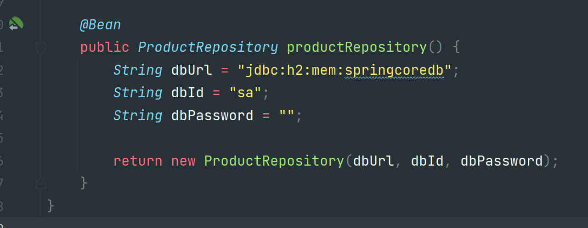

* 스프링 서버가 뜰 때 스프링 IoC 에 '빈' 저장

```java
// 1. @Bean 설정된 함수 호출
ProductRepository productRepository = beanConfiguration.productRepository();

// 2. 스프링 IoC 컨테이너에 빈 (productRepository) 저장
// productRepository -> 스프링 IoC 컨테이너
```

* 스프링 '빈' 이름: @Bean 이 설정된 함수명
  + public ProductRepository **productRepository()** {..} → **productRepository**

3) Spring Bean 사용 방법

1. @Autowired  
   - 멤버변수 선언 위에 @Autowired → 스프링에 의해 DI(의존성 주입) 된다.

```java
@Component
public class ProductService {

    @Autowired
    private ProductRepository productRepository;

		// ...
}
```

- '빈'을 사용할 함수 위에 @Autowired → 스프링에 의해 DI됨

```java
@Component
public class ProductService {

    private final ProductRepository productRepository;

    @Autowired
    public ProductService(ProductRepository productRepository) {
        this.productRepository = productRepository;
    }

		// ...
}
```

- @Autowired 적용 조건

* 스프링 IoC 컨테이너에 의해 관리되는 클래스에서만 가능

* Spring 4.3 버젼 부터 @Autowired 생략가능
* 생성자 선언이 1개 일 때만 생략 가능
  + 파라미터가 다른 생성자들

  ```
  public class A {
  	@Autowired // 생략 불가
  	public A(B b) { ... }

  	@Autowired // 생략 불가
  	public A(B b, C c) { ... }
  }
  ```
* Lombok 의 **@RequiredArgsConstructor** 를 사용하면 다음과 같이 코딩 가능

```java
@RequiredArgsConstructor // final로 선언된 멤버 변수를 자동으로 생성합니다.
@RestController // JSON으로 데이터를 주고받음을 선언합니다.
public class ProductController {

    private final ProductService productService;

    // 생략 가능
		// @Autowired
		// public ProductController(ProductService productService) {
		//     this.productService = productService;
		// }
}
```

**2. ApplicationContex****t**

* 스프링 IoC 컨테이너에서 빈을 수동으로 가져오는 방법
* ApplicationContext는 쉽게 말하면 스프링 IoC 컨테이너라고 이해하시면 된다.   
  Spring IoC 컨테이너를 handle하기 위한 클래스이다.

```java
@Component
public class ProductService {
    private final ProductRepository productRepository;

    @Autowired
    public ProductService(ApplicationContext context) {
        // 1.'빈' 이름으로 가져오기
        ProductRepository productRepository = (ProductRepository) context.getBean("productRepository");
        // 2.'빈' 클래스 형식으로 가져오기
        // ProductRepository productRepository = context.getBean(ProductRepository.class);
        this.productRepository = productRepository;
    }

		// ...		
}
```

> [요약]  
> 1. DI를 위한 객체 생성은 Spring이 알아서 해준다. -> Spring IoC 컨테이너에 등록을 해두면 된다.  
> 2. 적용 조건은 @ComponentScan 내부에 설정해둔 위치와 하위 패키지에 있으면 된다.  
> 3. @ComponentScan은 @SpringBootApplication 에 의해 default 설정이 되어 있음  
> 4. @Configuration 은 Spring이 처음 기동될 때 이 부분을 읽는다  
> 5. @Bean은 직접 객체를 생성하여 Bean으로 등록 요청을 해야한다.  
> 6. @Configuration을 통해 스프링 서버가 뜰 때 스프링 IoC에 '빈'저장이 되도록 한다. 이때 사용되는 메소드가 Bean 이름이 된다.  
> 7. Bean 사용방법은 간단한다. @Autowired만 선언하면 된다.  
> 8. @Autowired에 조건이 있는데, 조건은 스프링 IoC 컨테이너에 의해 관리되는 클래스에서만 가능  
> 9. @RequiredArgsConstructor는 멤버 변수중에서 final로 선언된 애를 가지고 생성자를 만들어준다.  
> 그러므로 생성자를 통해 DI를 하는 일을 @RequiredArgsConstructor가 대신 해주기때문에 생성자를 통해 DI를 해주지 않아도 된다.

---

<참고>

1.[[H2-DB 활용](https://velog.io/@locodingve/H2-DB%EB%A5%BC-%ED%99%9C%EC%9A%A9%ED%95%B4-%EB%B4%85%EC%8B%9C%EB%8B%A4)]
