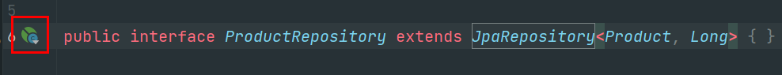
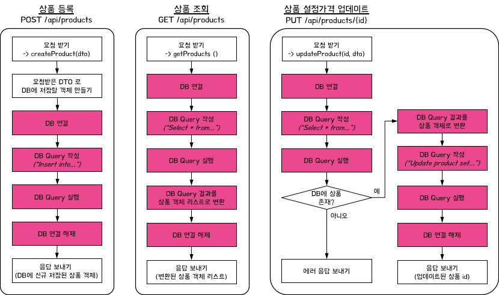
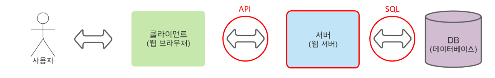

### **13. Spring 3계층 Annotation 적용하기**

#### 1) Spring 3계층 Annotation 적용

> [스프링 Annotation]   
> @Componet, @Autowired   
>   
> 앞에 '@' 를 붙여 선언 → 스프링이 처리

* **스프링 3계층 Annotation 은 모두 @Component**
  1. **@Controller, @RestController**
  2. **@Service**
  3. **@Repository**
* **@Repository 간단 설명**

* JpaRepository<"@Entity 클래스", "@Id 의 데이터 타입">를 상속받는 interface 로 선언
  + 스프링 Data JPA 에 의해 자동으로 @Repository 가 추가됨
  + 스프링 Data JPA 에 대한 자세한 내용은 4장에서 다뤄봅니다.
  + 아래 @Repository 역할 대부분을 자동으로 수행해 줌

#### 

> [요약]  
> 1, @RestController = @Controller + @ResponseBody  
> 2. @Controller 에 @Component가 존재하고 있다. 즉, @RestController와 @Controller는 @Componet이다.  
>   
> 3. @Service도 @Component이다.  
> 4. Spring Data JPA를 사용하려면 Spring Data JPA에 대한 문법을 또 익혀야한다.

#### 

#### 2) 패키지 나누기

- controller

- dto

- model(Entity의 집합소)

- repository

- service

> 리팩토링이 끝나면 테스트 수행  
> !! 힘들어도 계속 습관화가 되어야 합니다~!!!

---

### **14. Spring Framework 재이해**

#### **1) Spring 프레임워크란?**

> The Spring Framework provides a comprehensive programming and configuration model for modern Java-based  enterprise applications - on any kind of deployment platform.

* Enterprise applications 개발 편의성 제공
  + Enterprise applications? 기업용 애플리케이션??
    - 고객 대상 웹 서비스 ex) 구글, 네이버, 쿠팡 등
* 스프링은 결국 기업용 애플리케이션의 **요구사항 해결**에 초점을 맞춘 프레임워크
* 기업용 애플리케이션 특성
  1. 신뢰성이 중요 (ex. 병원에서 수술 시 환자 기록이 바뀐다면?)
  2. 서버의 안정성 유지 중요 (ex. 복권 실시간 추첨에 서버 다운 된다면? )
  3. 데이터 관리가 중요
     + 막대한 양의 데이터 관리 필요
     + 여러 사용자가 동시 접속 시 데이터 일관성  
       → 대부분 **DB (데이터베이스)** 사용

#### **2) 스프링의 핵심요소는?**

> **A key element of Spring is infrastructural support at the application level: Spring focuses on the "plumbing" of enterprise applications so that teams can focus on application-level business logic, without unnecessary ties to specific deployment environments.**

* 비즈니스 로직 (business logic) 에 집중하게 해 준다?
* 웹 서비스 다이어그램

* 서버 개발자들이 신경써야 할 부분이 너무 많음
  1. API: 클라이언트 ↔ 서버
  2. **비즈니스 로직 (@Service)**
     1. 실제로 사용자의 "요구사항이 처리"되는 부분!!
  3. DB: 서버 ↔ DB
* "기업의 요구사항"에만 집중하여 개발할 수 있도록!
  + 반복되고, 실수가 많은 부분 → 스프링이 대신~!!

---

### **15. 1주차 끝 & 숙제설명**

* 1주차 정리
  1. 스프링에서 Controller, Service, Repository 로 구분한 이유와 각 역할을 이해
  2. 스프링 MVC 이해
  3. 스프링 DI 와 스프링 IoC 컨테이너 역할 이해

* 숙제
  + itemSearchController에서 Service 분리하기  
    <https://github.com/bang-star/springcore>
