**오늘은 심화반 2주차를 수강하는 날...**

**1주차 ? 5시간 20여분...**

**2주차? 5시간 30여분...**

**나? 할 수 있어!! 얼른 달려!!!**

---

#### 

#### **[수업 목표]**

1. 웹의 인증 및 인가의 개념을 이해한다.
2. 스프링 시큐리티를 이용해 폼 로그인 기능을 구현한다.
3. 스프링 시큐리티 OAuth2 를 이용해 소셜 로그인 기능을 구현한다.
4. JWT 로그인 기능을 구현한다.

---

## 01. 2주차 오늘 배울 것

1) 웹의 인증 및 인가의 개념

- 웹의 인증과 인가라는 개념에 대해서 구분

2) '스프링 시큐리티'를 이용한 인증 및 인가 관리방법

- '스프링 시큐리티' 를 이용해 '나만의 셀렉샵' 서비스에 회원 관리 기능을 추가해 봄으로써 인증과 인가 방법에 대해 배워 봅니다.

3) OAuth2 를 이용한 소셜 로그인

- 여러분, 웹사이트나 어플리케이션을 이용하실 때, 카카오나 네이버 아이디로 로그인 하는 거 많이 경험해보셨을 거예요! 스프링을 이용해 직접 구현해볼게요~!

선택) JWT 를 이용한 로그인

- JWT 를 이용한 로그인을 시도해 볼 예정입니다. 난이도가 좀 있기 때문에 어려운 과제에 도전해 보실 분들 혹은 JWT 로그인 구현이 필요하신 분들만 선택적으로 수강하세요!!

---

## 02. 웹의 인증 및 인가

**1. 인증 vs. 인가**

> 인증과 인가는 한글로 보나 영어 (Authentication vs. Authorization) 로 보나 비슷해 보일 뿐 아니라 실제 많이 혼동되어 사용되고 있지만 명확히 다른 의미를 가지고 있습니다.

* **인증 (Authentication)**: 사용자 신원을 확인하는 행위
* **인가 (Authorization)**: 사용자 권한을 확인하는 행위

예를 들면,

* 인증: 회사 출입을 위한 출입증 확인 혹은 생체정보 (지문, 홍채) 인식
* 인가: 회사 건물 내 접근 권한 관리
  1. 방문자 → 회의실만 접근 가능
  2. 직원 → 회의실, 사무실 접근 가능
  3. 관리자 → 회의실, 사무실, 서버실, 물품보관실 접근 가능

**웹에서의 인증 및 인가**

* 인증: 로그인을 통해 본인임을 확인 (주로, 아이디와 패스워드 이용)
* 인가: 주로 역할에 따른 사용 권한 관리
* 예) 웹 카페 사이트에서 회원 랭킹 별 가능한 첨부파일 크기를 다르게 부여

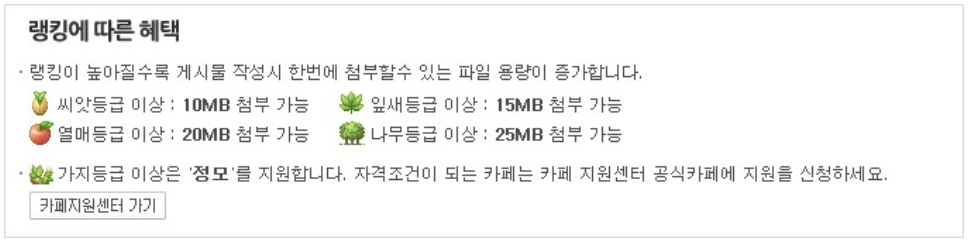

> [요약]  
> 1. 인증은 사용자 신원을 확인하는 행위로 로그인을 통해 본인임을 확인하는 것  
> 2. 인가는 사용자 권한을 확인하는 행위로 역할에 따른 사용 권한을 관리하는 것

---

## 03. 쿠키와 세션

1. 사용자를 구별하지 못 하는 HTTP

* HTTP 는 상태를 저장하지 않습니다. ('Stateless' 하다)
* 아래 그림에서 클라이언트의 요청 (GET <http://spartcodingclub.kr>)을 서버에게 보낸 후 응답을 받을 때까지가 하나의 HTTP 요청입니다. 하지만 HTTP 상태는 기억되지 않기 때문에 웹 서버에서는 1번과 2번이 같은 클라이언트의 요청인지 알 수 없습니다.

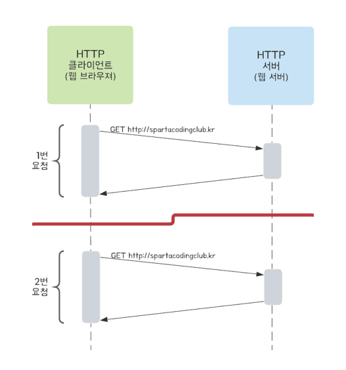

2. 쿠키와 세션

> 쿠키와 세션 모두 HTTP 에 상태 정보를 유지(Stateful)하기 위해 사용됩니다. 즉, 쿠키와 세션을 통해 서버에서는 클라이언트 별로 인증 및 인가를 할 수 있게 됩니다.

1. 쿠키
   * 클라이언트에 저장될 목적으로 생성한 작은 정보를 담은 파일 입니다.
   * 클라이언트인 웹 브라우저에 저장된 '쿠키' 를 확인해 보죠.
     + 크롬 브라우저 기준으로 '개발자도구' 를 열어 보세요.
     + Application - Storage - Cookies 에 도메인 별로 저장되어 있는게 확인 됩니다.
   * **Name** (이름): 쿠키를 구별하는 데 사용되는 키 (중복될 수 없음)
   * **Value** (값): 쿠키의 값
   * Domain (도메인): 쿠키가 저장된 도메인
   * Path (경로): 쿠키가 사용되는 경로
   * Expires (만료기한): 쿠키의 만료기한 (만료기한 지나면 삭제됩니다.)
2. 세션
   * 서버에서 일정시간 동안 클라이언트 상태를 유지하기 위해 사용
   * 서버에서 클라이언트 별로 유일무이한 '세션 ID' 를 부여한 후 클라이언트 별 필요한 정보를 서버에 저장
   * 서버에서 생성한 '세션 ID' 는 클라이언트의 쿠키값('세션 쿠키' 라고 부름)으로 저장되어 클라이언트 식별에 사용됨
   * 세션 동작 방식
     + 클라이언트가 서버에 1번 요청
     + 서버가 세션ID 를 생성하고, 응답 헤더에 전달
       - 세션 ID 형태: "SESSIONID = 12A345"
     + 클라이언트가 쿠키를 저장 ('세션쿠키')
     + 클라이언트가 서버에 2번 요청
       - 쿠키값 (세션 ID) 포함하여 요청
     + 서버가 세션ID 를 확인하고, 1번 요청과 같은 클라이언트임을 인지

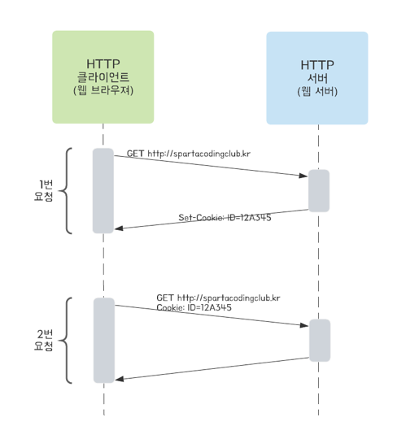
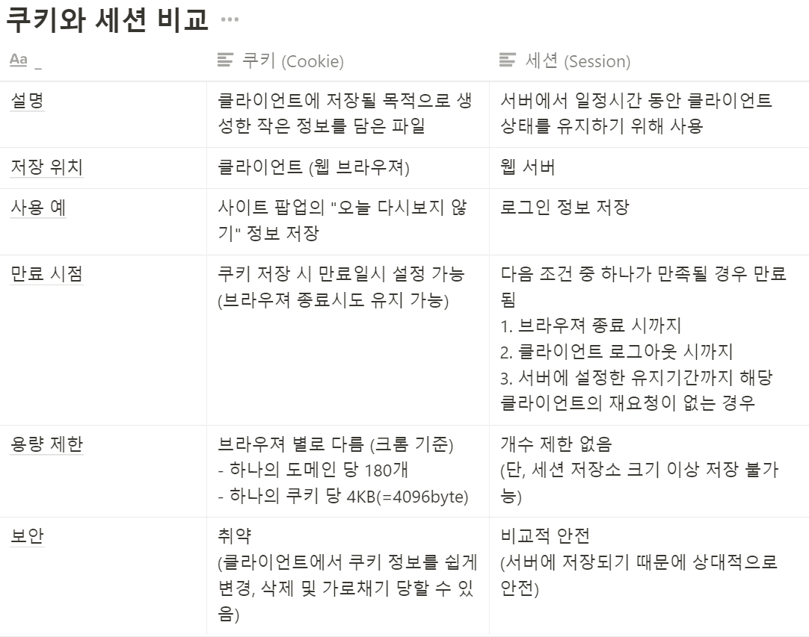

> [요약]  
> **1. HTTP는 상태를 저장하지 않는다는 특징이 있다.**  
> 즉, HTTP 서버는 방문을 내가 몇번 했는지 알지 못한다.  
>   
> **2. 로그인을 어떻게 유지할 수 있을까?**  
> → 쿠키와 세션이라는 개념이 필요하다.  
>   
> **3. 쿠키와 세션**  
> - 쿠키와 세션은 모두 HTTP에 상태 정보를 유지(Stateful)하기 위해 사용된다.  
> 즉,  쿠키와 세션을 통해 서버에서는 클라이언트 별로 인증 및 인가를 할 수 있다.  
>   
> **4. 쿠키**  
> - 목적 : **클라이언트에 저장**될 목적으로 생성  
> - **만료기한을 설정**할 수 있다.  
> - 작은 정보를 담은 파일  
> 예시) 네이버 다크 모드를 누르게 되면 "NDARK" 라는 키와 Value(Y)로 구성된 쿠키가 생성된다.   
>          즉 다크모크 모드를 기억하는 쿠키  
> - 구성 요소 : Name(쿠리를 구별하는 데 사용되는 Key), Value(쿠키 값),  Domain(쿠키가 저장된 도메인), Path(쿠키가 사용되는 경로), Expires(만료기한)  
>   
> **5. 세션**  
> - 세션은 쿠키와 다르게 **서버에서 저장**한다.  
> - 세션은 서버에서 일정시간 동안 **클라이언트 상태를 유지하기 위해 사용**  
> - 세션은 만약 사용자를 기억하고 싶다면? 서버에서 클라이언트 별로 **유일무이한** '세션ID'를 부여한 후 클라이언트 별 필요한 정보를 서버에 저장한다.   
> **- 사용자는 세션ID를 쿠키값으로 저장한다. 이를 통해 서버는 쿠키를 통해 사용자를 판별할 수 있다.**  
> - 세션 값이 저장된 쿠키를 세션쿠키라고도 한다.   
> **- 중요한 것은 서버에서 세션을 유지한다.**  
> **- 주로 로그인 정보 저장으로 사용한다.  
> - 세션은 쿠기가 필요하다.**

---

## **04. 회원 관리 기능 요구사항 및 설계**

**1) 요구사항**

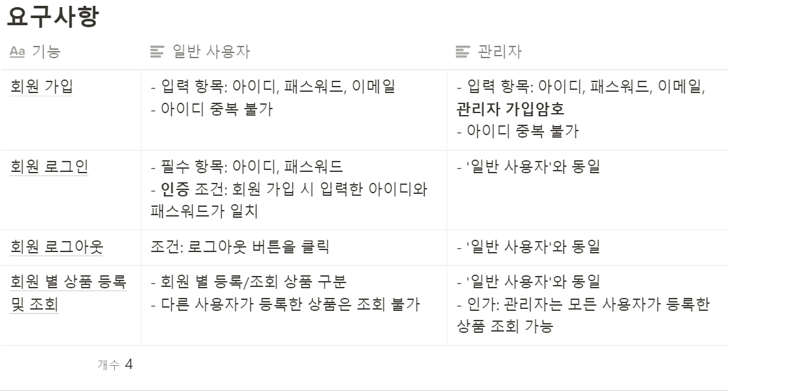

**2) API 설계**

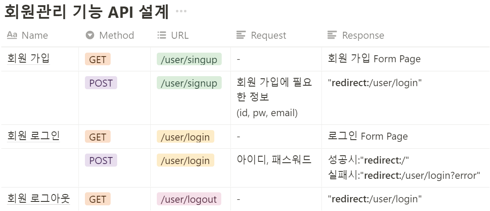

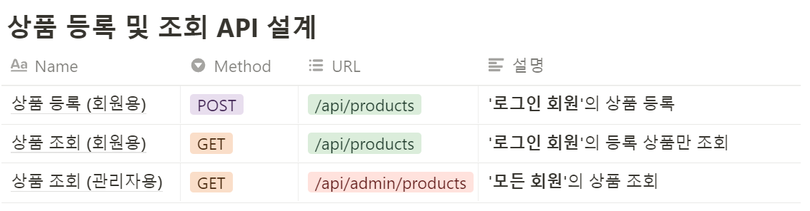

---

## **05. '스프링 시큐리티' 프레임워크**

**1. 스프링 시큐리티 적용**

> '스프링 시큐리티' 프레임워크는 스프링 서버에 필요한 인증 및 인가를 위해 많은 기능을 제공

**1) 프레임워크 추가**

* build.gradle -> dependencies

```java
// 스프링 시큐리티 
implementation 'org.springframework.boot:spring-boot-starter-security'
```

* security > WebSecurityConfig class 생성

```java
@Configuration
@EnableWebSecurity // 스프링 Security 지원을 가능하게 함
public class WebSecurityConfig extends WebSecurityConfigurerAdapter {
    @Override
    protected void configure(HttpSecurity http) throws Exception {

        http.authorizeRequests()
                // 어떤 요청이든 '인증'
                .anyRequest().authenticated()
                .and()
                // 로그인 기능 허용
                .formLogin()
                .defaultSuccessUrl("/")
                .permitAll()
                .and()
                // 로그아웃 기능 허용
                .logout()
                .permitAll();
    }
}
```

* configure 메소드를 통해서 SpringSecurity에 인증 및 인가 관련된 설정들을 해줄 수 있다.
* 현재는 기본설정으로 있는 것이고, 우리는 변경해서 사용할 것이기 때문에 @Override 한 것이다.
* http.authorizeRequests로 시작하고 (.) 을 통해 추가 설정을 할 수 있다.
* .anyRequest().authenticated() : 어떤 요청이든 '인증'을 하겠다.
* .and() : 조건을 추가하겠다는 의미
* .formLogin() : 미리 스프링 시큐리티에서 만들어놓은 기능을 허용
* .defaultSuccessUrl("/") : 로그인이 성공하게 되면 어느쪽으로 이동을 시킬것인지 URI를 설정하는 곳
* .permitAll() : 위 기능들을 허용해줘라 라는 의미
* .logout : 로그아웃 기능을 허용해줘라

> **어떻게 테스트를 진행할 수 있을까??   
> 이미 Spring Security에서 Default 로그인 기능을 제공해주고 있다.**

**2. 스프링 시큐리티의 default 로그인 기능**

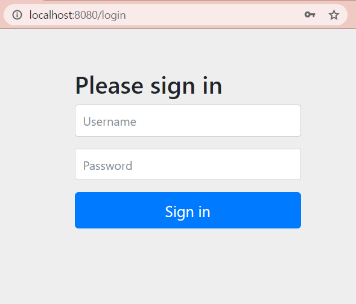

* Username: **user**
* Password: spring 로그 확인 (서버 시작 시마다 변경됨)

[캐쉬 생성 확인]

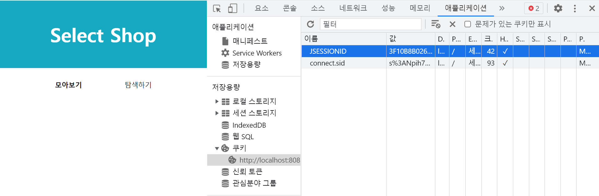

**[캐쉬 삭제 후 갱신]**

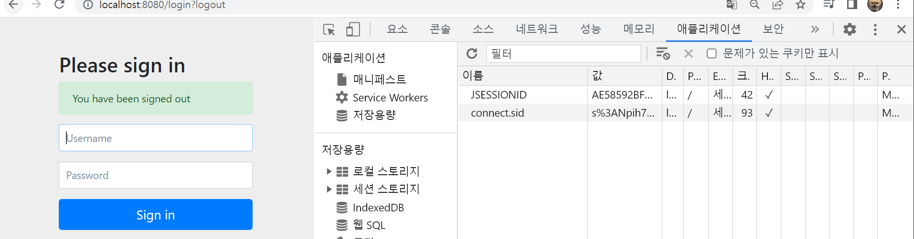

> [요약]  
> 1. 사용자 인증 및 인가를 위한 도구로 스프링 시큐리티 프레임워크를 사용한다.  
> (무조건 인증 및 인가를 위해 스프링 시큐리티가 필요한 것은 아니다)  
>   
> 2. @Configuration은 Spring이 처음 기동할때 미리 설정해둔 것을 활성화시키는 것이다.  
> 3. @EnableWebSecurity는 Spring Security가 가능하게 해주는 그런 어노테이션이다.  
>   
> <참조>   
> 1. [websecurityconfigureradapter deprecated](https://spring.io/blog/2022/02/21/spring-security-without-the-websecurityconfigureradapter)

---

## **06. 회원 가입**

1. 회원가입 UI 반영

* 회원가입 및 로그인 UI 연동
  + 타임리프 모듈 추가  
    build.gradle에 추가  
    - // Thymeleaf (뷰 템플릿 엔진)  implementation 'org.springframework.boot:spring-boot-starter-thymeleaf'
  + 회원 가입 Form 페이지
  + 로그인 Form 페이지
  + 공통 CSS 파일
* 회원가입 페이지 요청 처리
  + WebSecurityConfig 에 formLogin() 처리 부분 변경

```java
                .and()
                    // 로그인 기능 허용
                    .formLogin()
                    .loginPage("/user/login")
                    .defaultSuccessUrl("/")
                    .failureUrl("/user/login?error")
                    .permitAll()
```

* UserController 파일 생성

```java
import org.springframework.stereotype.Controller;
import org.springframework.web.bind.annotation.GetMapping;

@Controller
public class UserController {

    // 회원 로그인 페이지
    @GetMapping("/user/login")
    public String login() {
        return "login";
    }

    // 회원 가입 페이지
    @GetMapping("/user/signup")
    public String signup() {
        return "signup";
    }
}
```

**2. UI 이슈 해결**

**1. "기대하는 UI" vs "실제 UI"**

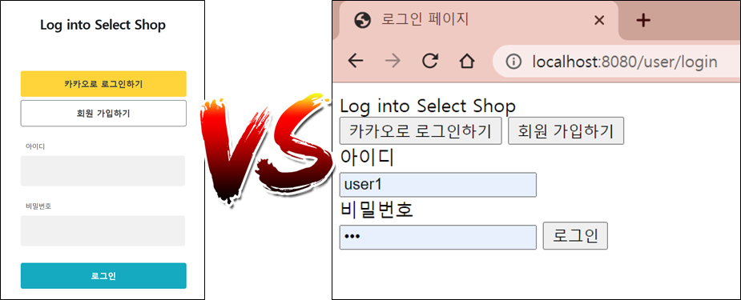

* 로그인 페이지에 CSS 가 적용되지 않음
* 웹 페이지 이슈가 생겼을 때 원인을 파악하고 해결할 수 있는 능력 필요
* '개발자 도구' 로 에러 내용 확인

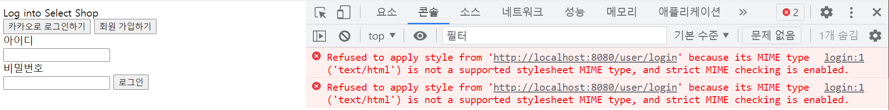

* CSS가 제대로 정상작동하지 않는다.

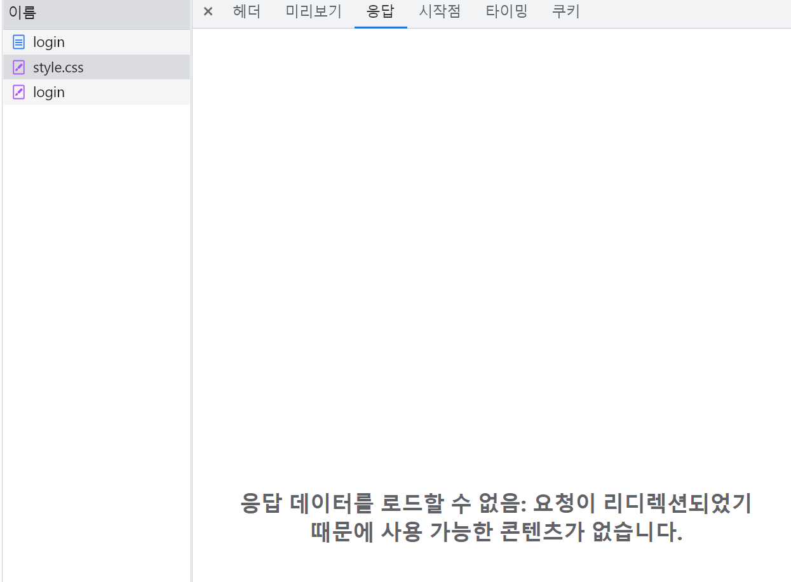

* 스프링 시큐리티의 URL 허용 정책 변경 필요 확인

```java
  // image 폴더를 login 없이 허용
  .antMatchers("/images/**").permitAll()
  // css 폴더를 login 없이 허용
  .antMatchers("/css/**").permitAll()
```

```java
@Configuration
@EnableWebSecurity // 스프링 Security 지원을 가능하게 함
public class WebSecurityConfig extends WebSecurityConfigurerAdapter {
    @Override
    protected void configure(HttpSecurity http) throws Exception {

        http.authorizeRequests()
                // image 폴더를 login 없이 허용
                .antMatchers("/images/**").permitAll()
                // css 폴더를 login 없이 허용
                .antMatchers("/css/**").permitAll()
                // 어떤 요청이든 '인증'
                .anyRequest().authenticated()
                .and()
                // 로그인 기능 허용
                    .formLogin()
                    .loginPage("/user/login")
                    .defaultSuccessUrl("/")
                    .failureUrl("/user/login?error")
                    .permitAll()
                .and()
                // 로그아웃 기능 허용
                    .logout()
                    .permitAll();
    }
}
```

**3. 회원 테이블 설계**

* 회원 DB 설계
  + 요구사항과 디자인을 확인하며 어떤 정보가 저장되어야 할지 정리 필요

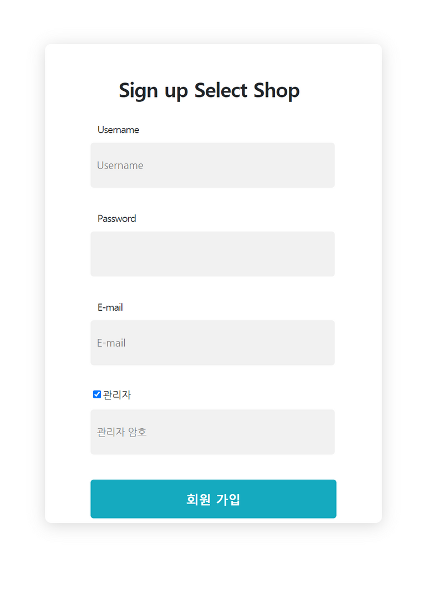

프로토타입 UI

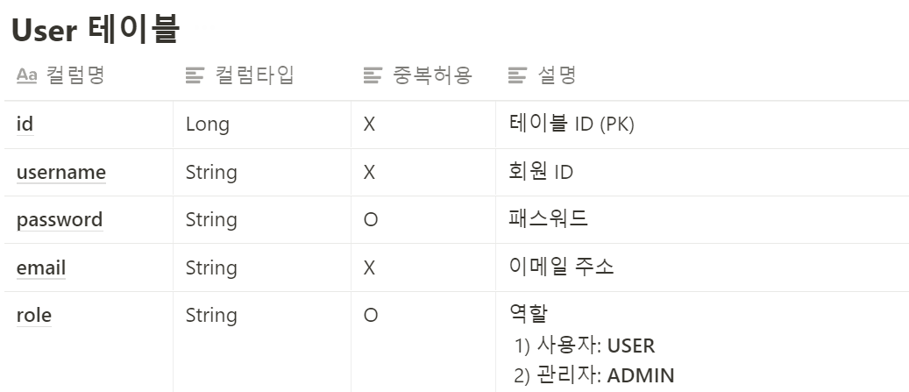

User 테이블 설계

* 회원 DB 에 매핑되는 @Entity 클래스 구현
  + User
  + UserRoleEnum

```java
import lombok.Getter;
import lombok.NoArgsConstructor;
import lombok.Setter;

import javax.persistence.*;

@Setter
@Getter // get 함수를 일괄적으로 만들어줍니다.
@NoArgsConstructor // 기본 생성자를 만들어줍니다.
@Entity // DB 테이블 역할을 합니다.
public class User {

    // ID가 자동으로 생성 및 증가합니다.
    @GeneratedValue(strategy = GenerationType.AUTO)
    @Id
    private Long id;

    // nullable: null 허용 여부
    // unique: 중복 허용 여부 (false 일때 중복 허용)
    @Column(nullable = false, unique = true)
    private String username;

    @Column(nullable = false)
    private String password;

    @Column(nullable = false, unique = true)
    private String email;

    @Column(nullable = false)
    @Enumerated(value = EnumType.STRING)
    private UserRoleEnum role;

    public User(String username, String password, String email, UserRoleEnum role) {
        this.username = username;
        this.password = password;
        this.email = email;
        this.role = role;
    }
}
```

```java
public enum UserRoleEnum {
    USER,  // 사용자 권한
    ADMIN  // 관리자 권한
}
```

**4. 관리자 회원 가입 인가 방법**

* **'관리자 가입 토큰'** 입력 필요  
  : 랜덤하게 생성된 토큰 사용

```java
AAABnv/xRVklrnYxKZ0aHgTBcXukeZygoC
```

> 실제로 '관리자' 권한을 이렇게 엉성하게 부여해 주는 경우는 드뭅니다.   
>   
> 해커가 해당 암호를 갈취하게 되면, 관리자 권한을 너무 쉽게 획득할 수 있게 되겠죠?   
>   
> 보통 현업에서는   
> 1) '관리자' 권한을 부여할 수 있는 관리자 페이지 구현   
> 2) 승인자에 의한 결재 과정 구현 → 관리자 권한 부여

**5. 회원가입 API 구현**

**1. 회원가입 요청 DTO 구현**

```java
import lombok.Getter;
import lombok.Setter;

@Setter
@Getter
public class SignupRequestDto {
    private String username;
    private String password;
    private String email;
    private boolean admin = false;
    private String adminToken = "";
}
```

**2. 회원관리 Controller 구현**

```java
import com.sparta.springcore.dto.SignupRequestDto;
import com.sparta.springcore.service.UserService;
import org.springframework.beans.factory.annotation.Autowired;
import org.springframework.stereotype.Controller;
import org.springframework.web.bind.annotation.GetMapping;
import org.springframework.web.bind.annotation.PostMapping;

@Controller
public class UserController {

    private final UserService userService;

    @Autowired
    public UserController(UserService userService) {
        this.userService = userService;
    }

    // 회원 로그인 페이지
    @GetMapping("/user/login")
    public String login() {
        return "login";
    }

    // 회원 가입 페이지
    @GetMapping("/user/signup")
    public String signup() {
        return "signup";
    }

    // 회원 가입 요청 처리
    @PostMapping("/user/signup")
    public String registerUser(SignupRequestDto requestDto) {
        userService.registerUser(requestDto);
        return "redirect:/user/login";
    }
}
```

**3. 회원가입 API Service 구현**

* 회원 가입 요청 처리
  1. 회원 중복 Id 확인
  2. 관리자 가입 요청에 대해서는 '관리자 가입 토큰' 인가

```java
import com.sparta.springcore.dto.SignupRequestDto;
import com.sparta.springcore.model.User;
import com.sparta.springcore.model.UserRoleEnum;
import com.sparta.springcore.repository.UserRepository;
import org.springframework.beans.factory.annotation.Autowired;
import org.springframework.stereotype.Service;

import java.util.Optional;

@Service
public class UserService {
    private final UserRepository userRepository;
    private static final String ADMIN_TOKEN = "AAABnv/xRVklrnYxKZ0aHgTBcXukeZygoC";

    @Autowired
    public UserService(UserRepository userRepository) {
        this.userRepository = userRepository;
    }

    public void registerUser(SignupRequestDto requestDto) {
        String username = requestDto.getUsername();
        String password = [REDACTED]();
        // 회원 ID 중복 확인
        Optional<User> found = userRepository.findByUsername(username);
        if (found.isPresent()) {
            throw new IllegalArgumentException("중복된 사용자 ID 가 존재합니다.");
        }

        String email = requestDto.getEmail();
        // 사용자 ROLE 확인
        UserRoleEnum role = UserRoleEnum.USER;
        if (requestDto.isAdmin()) {
            if (!requestDto.getAdminToken().equals(ADMIN_TOKEN)) {
                throw new IllegalArgumentException("관리자 암호가 틀려 등록이 불가능합니다.");
            }
            role = UserRoleEnum.ADMIN;
        }

        User user = new User(username, password, email, role);
        userRepository.save(user);
    }
}
```

**4. 회원가입 API Repository 구현**

```java
import com.sparta.springcore.model.User;
import org.springframework.data.jpa.repository.JpaRepository;

import java.util.Optional;

public interface UserRepository extends JpaRepository<User, Long> {
    Optional<User> findByUsername(String username);
}
```

**5. UI 연동 테스트**

1. 회원 가입 페이지로 이동: **GET /user/signup**
2. 회원 가입 시도: **POST /user/signup**
3. DB 확인
   1. H2 console 통해 가입된 회원 정보 확인

**6. 스프링 시큐리티 허용 정책 변경 필요**

1. 회원 관리 API 허용 (CSRF 무시)
2. h2-console 사용에 대한 허용 (CSRF, FrameOptions 무시)

```java
import org.springframework.context.annotation.Configuration;
import org.springframework.security.config.annotation.web.builders.HttpSecurity;
import org.springframework.security.config.annotation.web.builders.WebSecurity;
import org.springframework.security.config.annotation.web.configuration.EnableWebSecurity;
import org.springframework.security.config.annotation.web.configuration.WebSecurityConfigurerAdapter;

@Configuration
@EnableWebSecurity // 스프링 Security 지원을 가능하게 함
public class WebSecurityConfig extends WebSecurityConfigurerAdapter {

    @Override
    public void configure(WebSecurity web) {
        // h2-console 사용에 대한 허용 (CSRF, FrameOptions 무시)
        web
                .ignoring()
                .antMatchers("/h2-console/**");
    }

    @Override
    protected void configure(HttpSecurity http) throws Exception {
        // 회원 관리 처리 API (POST /user/**) 에 대해 CSRF 무시
        http.csrf()
                .ignoringAntMatchers("/user/**");

        http.authorizeRequests()
                // image 폴더를 login 없이 허용
                .antMatchers("/images/**").permitAll()
                // css 폴더를 login 없이 허용
                .antMatchers("/css/**").permitAll()
                // 회원 관리 처리 API 전부를 login 없이 허용
                .antMatchers("/user/**").permitAll()
                // 그 외 어떤 요청이든 '인증'
                .anyRequest().authenticated()
                .and()
                    // 로그인 기능
                    .formLogin()
                    .loginPage("/user/login")
                    .defaultSuccessUrl("/")
                    .failureUrl("/user/login?error")
                    .permitAll()
                .and()
                    // 로그아웃 기능
                    .logout()
                    .permitAll();
    }
}
```

> (변경사항) h2-database에 User라는 예약어가 존재하여 Users로 수정

> [요약]  
> 1. Spring Security에서 CSS와 이미지를 적용시키기 위해서는 URL 허용 정책 변경이 필요하다.  
> 이유 : Spring Security가 어떤 요청이든지 다 막도록 되어있기 때문이다.  
> 2. 프로젝트 설계 단계에서 진행하는 과정을 현재 과정을 통해서 알 수 있다.  
>   1) 요구사항 명세  
>   2) API 설계  
>   3) 데이터베이스 설계  
>   4) 기능 구현  
>   (Option) 설계 또는 구현 중 부족한 부분이 있을 경우, 관련자들과 함께 논의를 해야한다.  
>   
> 3. @Enumerated(value=EnumType.STRING)  
>  - 서버에서는 Enum값으로 저장하고, DB에서는 String 타입으로 저장한다는 것이다.  
>  - 변환 작업은 Spring data JPA에서 자동으로 변환을 해준다.  
>   
> 4. 회원가입 API 허용  
>  1) \*\*로 설정한 이유  
> - 유저 관련된 회원가입 처리 API들은 /user로 시작하도록 하였기 때문에 회원가입 처리를 허용하는 코드이다.  
> 즉, 로그인이 되지 않은 상태에서도 API는 사용이 되어야 되기 때문에 전체에 대해서 회원관리 처리 API 전부를 다 이렇게 허용을 해두는 것이다.  
>   
>       // 회원 관리 처리 API 전부를 login 없이 허용  
>       .antMatchers("/user/\*\*").permitAll()  
>   
>   
> 2) CSRF는 무엇인가?  
>  - 현재 GET /user/singup은 문제가 없었는데, POST /user/signup 회원가입을 실제로 처리하는 그 요청을 할때 위에 내용으로는 허용이 되지 않기 때문에 작성한다.  
> - CSRF 라는 것 때문에 POST 요청이 오면 스프링 시큐리티가 자동적으로 csrf 토큰을 확인하는 그런 작업들이 있는데, 그 부분들은 이 csrf를 무시하는 처리를 해줘야한다.   
> 즉, Spring Security 프레임워크를 사용할 때 POST 요청은 csrf를 무시해줘야한다. (공식처럼 외우기)  
>   
>       // 회원 관리 처리 API (POST /user/\*\*) 에 대해 CSRF 무시  
>       http  
>       .csrf()  
>                      .ignoringAntMatchers("/user/\*\*");  
>   
> 5. h2-console 사용에 대한 허용 (CSRF, FrameOptions 무시)  
> - h2 console은 CSRF뿐만 아니라 FrameOptions라는 것도 Spring Security가 맡고 있기 때문에 무시를 시켜줘야한다.  
>       @Override  
>       public void configure(WebSecurity web)   
>       {   
>             // h2-console 사용에 대한 허용 (CSRF, FrameOptions 무시)   
>             web .ignoring()   
>             .antMatchers("/h2-console/\*\*");  
>       }

---

## 08. 패스워드 암호화 구현

**1) 패스워드 암호화 이해**

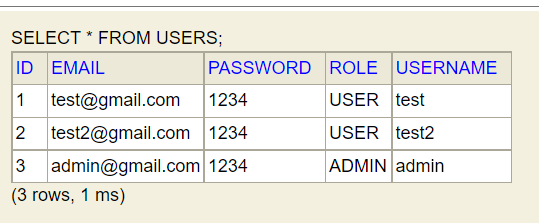

- 문제점: 패스워드가 평문(=있는 그대로)으로 저장되어 있음

> 회원 등록 시 '비밀번호'는 사용자가 입력한 문자 그대로 DB 에 안 된다는 사실!!   
> '**정보통신망법, 개인정보보호법' 에 의해 비밀번호는 암호화(Encryption)가 의무!!**

만약 해커가 DB 에 있는 앨리스의 패스워드 정보를 갈취하더라도 실제 암호를 알 수 없습니다. 그래서 복호화가 불가능한 **'일방향' 암호 알고리즘** 사용이 필요합니다.

**'일방향' 암호 알고리즘**

* 암호화: 평문 → **(암호화 알고리즘)** → 암호문
* 복호화: **불가** (~~암호문 → (암호화 알고리즘) → 평문)~~

그럼 **사용자**가 로그인할 때는 **암호화된 패스워드를 기억**해야 하나요?

⇒ 아닙니다.

1. 사용자가 로그인을 위해 "**아이디,** **패스워드 (평문)"** 입력 → 서버에 로그인 요청
   1. 서버에서 패스워드 (평문) 을 암호화
      1. 평문 → **(암호화 알고리즘)** → 암호문
2. DB 에 저장된 "**아이디, 패스워드 (암호문)**"과 일치 여부 확인

**2) 패스워드 암호화 적용**

* 스프링 시큐리티에서 '권고'하고 있는 'BCrypt 해시함수'를 사용해 패스워드를 암호화하여 DB 에 저장하겠다.

1. 암호화 알고리즘을 "빈(Bean)" 으로 등록

> @Bean   
> public BCryptPasswordEncoder encodePassword() {  
>      return new BCryptPasswordEncoder();   
> }

**[암호화 알고리즘 사용용도]**

(1) 회원 가입 시 패스워드를 암호화하여 저장

* 직접 구현해 줘야 함

(2) 로그인 인증 시 사용

* 스프링 시큐리티 자동으로 가져다 사용
* 로그인 처리 시
  + 사용자가 입력한 패스워드 평문을 암호화
  + 암호화된 DB 의 패스워드와 비교

**2. 회원 가입 시 패스워드 암호화 구현**

```java
import com.sparta.springcore.dto.SignupRequestDto;
import com.sparta.springcore.model.User;
import com.sparta.springcore.model.UserRoleEnum;
import com.sparta.springcore.repository.UserRepository;
import org.springframework.beans.factory.annotation.Autowired;
import org.springframework.security.crypto.password.PasswordEncoder;
import org.springframework.stereotype.Service;

import java.util.Optional;

@Service
public class UserService {
    private final PasswordEncoder passwordEncoder;
    private final UserRepository userRepository;
    private static final String ADMIN_TOKEN = "AAABnv/xRVklrnYxKZ0aHgTBcXukeZygoC";

    @Autowired
    public UserService(UserRepository userRepository, PasswordEncoder passwordEncoder) {
        this.userRepository = userRepository;
        this.passwordEncoder = passwordEncoder;
    }

    public void registerUser(SignupRequestDto requestDto) {
        // 회원 ID 중복 확인
        String username = requestDto.getUsername();
        Optional<User> found = userRepository.findByUsername(username);
        if (found.isPresent()) {
            throw new IllegalArgumentException("중복된 사용자 ID 가 존재합니다.");
        }

        // 패스워드 암호화
        String password = [REDACTED](requestDto.getPassword());
        String email = requestDto.getEmail();

        // 사용자 ROLE 확인
        UserRoleEnum role = UserRoleEnum.USER;
        if (requestDto.isAdmin()) {
            if (!requestDto.getAdminToken().equals(ADMIN_TOKEN)) {
                throw new IllegalArgumentException("관리자 암호가 틀려 등록이 불가능합니다.");
            }
            role = UserRoleEnum.ADMIN;
        }

        User user = new User(username, password, email, role);
        userRepository.save(user);
    }
}
```

**3. 동작 검증**

* 회원 가입 후 DB 에 패스워드가 암호화되어 저장되는지 확인

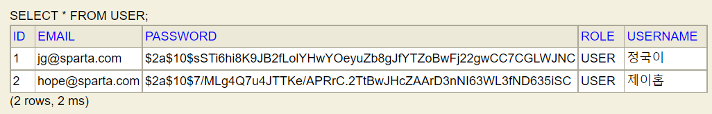

> [요약]  
> 1. 비밀번호 암호화가 필요한 이유  
> 1) 사용자의 정보가 해킹당할 우려가 있기 때문이다.  
> 2) 정보통신망법, 개인정보보호법에 의해 비밀번호 암호화는 의무이다.  
>   
> 2. 단방향 암호 알고리즘  
> - 양방향 알고리즘은 양방향 알고리즘은 암호화된 암호문을 복호화 할 수 있는 알고리즘 Ex) 비공개키, 공개키 방식  
> - 단방향 알고리즘은 암호화는 수행하지만 절대로 복호화가 불가능한 알고리즘 Ex) Hash 방식  
>   
> 3. @Bean 등록  
> 조건 : @Bean 등록을 위해서는 @Configuration가 붙은 클래스가 필요하다.   
> - @Configuration이 붙은 클래스를 새로 만들수도 있지만, WebSecurityConfig 파일 자체가 @Configuration을 가지고 있기 때문에 여기에 등록하여 사용할 수있다.

---

## 08. 로그인, 로그아웃 기능 구현

### 

### 1. 로그인, 로그아웃 처리 과정 이해

* 스프링 시큐리티 사용 전

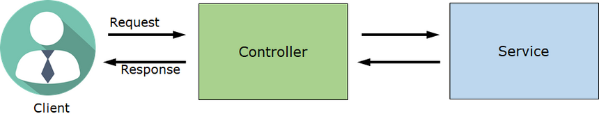

* 스프링 시큐리티 사용 후

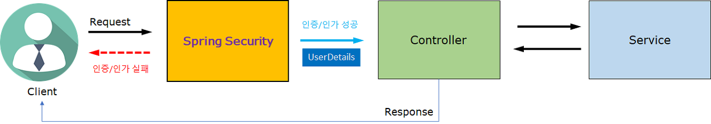

* Client 의 요청은 모두 Spring Security 를 거침
* Spring Security 역할
  1. 인증/인가
     1. 성공 시: Controller 로 Client 요청 전달
        1. Client 요청 + 사용자 정보 (UserDetails)
     2. 실패 시: Controller 로 Client 요청 전달되지 않음
        1. Client 에게 Error Response 보냄
* 로그인 처리 과정

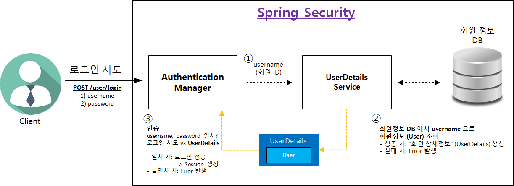

1. Client
   1. 로그인 시도
   2. 로그인 시도할 username, password 정보를 HTTP body 로 전달 (POST 요청)
   3. 로그인 시도 URL 은 WebSecurityConfig 클래스에서 변경 가능
      * 아래와 같이 설정 시 "**POST /user/login**" 로 설정됨

      ```
      @Override
      protected void configure(HttpSecurity http) throws Exception {
          http.authorizeRequests()
                  .anyRequest().authenticated()
                  .and()
                      // [로그인 기능]
                      .formLogin()
                      // 로그인 처리 (POST /user/login)
                      **.loginProcessingUrl("/user/login")**
                      .permitAll();
      }
      ```
2. **인증 관리자** (Authentication Manager)
   1. UserDetailsService 에게 username 을 전달하고 회원상세 정보를 요청
3. UserDetailsService
   1. 회원 DB에서 회원 조회
      1. 회원 정보가 존재하지 않을 시 → Error 발생
   2. 조회된 회원 정보(User)를 UserDetails 로 변환
   3. UserDetails를 "**인증 관리자**"에게 전달
4. "인증 관리자" 가 인증 처리
   1. 아래 2 개의 username, password 일치 여부 확인
      1. Client 가 로그인 시도한 username, password
      2. UserDetailsService 가 전달해준 UserDetails 의 username, password
   2. password 비교 시
      1. Client 가 보낸 password 는 평문이고, UserDetails 의 password 는 암호문
      2. Client 가 보낸 password 를 암호화해서 비교
   3. 인증 성공 시 → 세션에 로그인 정보 저장
   4. 인증 실패 시 → Error 발생

* 로그아웃 처리
  + "**GET /user/logout"** 요청 시 로그아웃
  + 서버 세션에 저장되어 있는 로그인 사용자 정보 삭제

### 

### 2. 로그인, 로그아웃 구현

1. 로그인, 로그아웃 처리 URL 설정
2. DB 의 회원 정보 조회 → 스프링 시큐리티의 "인증 관리자" 에게 전달
   1. UserDetailsService 구현
      1. UserDetailsService 인터페이스 → UserDetailsServiceImpl 클래스
   2. UserDetails 구현
      1. UserDetails 인터페이스 → **UserDetailsImpl** 클래스

### 3. 회원 로그인 / 로그아웃 UI 처리

1. **"로그아웃" 버튼** 클릭 시
   * "**GET /user/logout"** 로 API 설계 했는데, "**POST /user/logout"** 으로 처리 필요
     + 이유: CSRF protection 이 기본적으로 enable 되어 있기 때문
     + CSRF protection 을 disable 하면 GET /user/logout 으로도 사용 가능
2. 로그인 성공한 회원의 **username 표시**
   * UI 에서 username 대신 nickname (별칭), name (회원 본명) 을 표시해 주기도 함
   * Controller 에서 "로그인된 회원 정보" 사용 가능
     1. Spring Security 가 "로그인된 회원 정보"를 Controller 에게 전달해 줌
     2. Controller 에서 "**로그인된 회원 정보 (UserDetailsImpl)"** 사용하는 방법

```java
@Controller
public class TestController {
    @GetMapping("/")
    public String test(@AuthenticationPrincipal UserDetailsImpl userDetails) {
	}
}
```

> [요약]  
>   
> 1. 로그인 처리과정(1차 인 경우)  
> 1) Client가 로그인을 시도한다 (Post /User/login) {username, password}  
> - SpringSecurity에서 회원ID 이런 식으로 쓰지 않고 Username으로 쓰고 있기 때문에 동일하게 username으로 사용하고 있다.   
>   
> 2) Spring Security에 Authentication Manager(인증 관리자)를 가장 먼저 만나게 된다.  
> -  직접 무엇인가를 하지 않고 UserDetails Service에게 **Username(회원ID)**를 보낸다.  
>   
> 3) UserDetail Service는 회원정보 DB를 통해 Username를 가진 회원정보를 조회한다.  
> - 성공 시 : "회원 상세정보"(UserDetails) 생성  
> - 실패 시 : Error 발생  
>   
> 4) UserDetail은 User에 대한 상세정보를 가지고 Authentication Manager(인증 관리자)에게 전달한다.  
> - 회원정보 DB에 있는 Username의 패스워드와 로그인 시도한 패스워드를 비교한다.  
> - 비교를 위해서는 회원가입 시 비밀번호를 암호화해서 저장했던 것처럼, 비교 시에도 암호화 과정이 수행된다.  
> - 성공 시 : 로그인 성공(Session 생성) 후 Controller로 이동  
> - 실패 시 : Error 발생  
>   
>   
> 2. 로그인 처리과정(2차 이상인 경우)  
> - 1차 과정을 통해서 세션 ID가 발급되었다면 위 과정을 거치지 않고, Controller로 보내진다.  
>   
> > Authentication Manager(인증 관리자)의 역할은 같을 수 있으나, UserDetails Service의역할은 서로 다르기 때문에 직접 구현해주어야 한다.  
>   
> 3. 로그인 구현(코드 분석)  
> 1) // 로그인 View 제공 (GET /user/login)  
>     .loginPage("/user/login")  
> > .loginPage(url)을 작성하면 로그인 뷰를 제공해주는 URI를 설정하는 것이다.  
>   
> 2) // 로그인 처리 (POST /user/login)  
> .loginProcessingUrl("/user/login")  
> > Spring Scurity가 해주는 로그인 처리과정은 로그인 프로세싱 URI가 들어오면 그 과정이 Authentication Manager에게 전달되게 된다.  
> > 이때 클라이언트에서 로그인 정보를 같이 보내주어야한다.  
>   
> 3) // 로그아웃 처리 URL  
> .logoutUrl("/user/logout")  
> > 로그아웃을 처리해주는 URL로 유저 로그아웃 처리를 해주는 그 URL이다.  
> > logout 처리 URL을 GET으로 설계했는데, GET으로 처리가 되지 않는다.  
>   
>   
> 4. UserDetails 구현  
> - UserDetailsServiceImpl 클래스는 UserDetailsService 인터페이스의 UserDetailsService 메소드를 무조건 구현해주어야한다.  
> - UserDetailsImpl 클래스는 UserDetails 인터페이스를의 메소드들을 정의해주어야한다.  
>   
>   
> 5. Controller에서 "로그인된 회원 정보" 사용가능  
> 이유 : Spring Security가 로그인 성공하면 컨트롤러에게 넘어갈 수 있도록 해준다고 하였는데, 이때  로그인된 회원정보까지 넘겨준다.   
> - Authentication Manager가 인증을 한 다음에 성공하면 컨트롤러에게 사용자 정보를 넘겨주는다는 말이다.  
> - 어떻게 받을 수 있을까? TestController 예시 처럼 @AuthenticationPrincipal을 붙여주고 UserDetailImpl 클래스를 매개변수로 받으면 로그인한 사용자의 정보가 넘어오게 된다.  
>   
> 6. 현재 메인페이지의 파일명을 변경시켜주어야한다.  
> - 현재 메인페이지는 index.html로 표시가 되고 있었고, 굳이 컨트롤러를 만들어주지 않았었다.  
> 이유는 Static에 index.html 이라는 파일이 존재하면 Spring이 알아서 루트로 요청이 들어왔을 때 index.html 파일을 내려주기 때문이다.  
>   
> Then 지금은 로그인된 사용자의 정보가 넘어 온다면 이제 동적으로 변경해 줄 필요가 생기기 때문에 스프링의 디폴트를 사용하지 않고 직접 만들어서 스프링 MVC를 사용해야한다.  
>   
> 이제는 Username을 넘겨주어야 한다. 그래서 동적으로 변환하기 위해서 index.html파일을 static →templates로 이동을 시켜주어야한다.
