## 9. 회원별 상품 등록 및 조회

1. 상품 등록 및 조회(모든 회원)

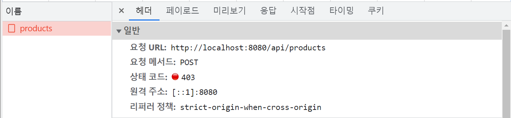

* 상품 등록 API 가 처리되지 않고 있음
  + POST "/api/products" 요청 → HTTP **403** Forbidden
* POST 요청마다 처리해 주는 대신 CSRF protection 을 disable  

  1) POST 요청마다 처리 (비효율적)  
  http.csrf()   
          .ignoringAntMatchers("/user/\*\*")   
  .ignoringAntMatchers("/api/products/\*\*");  

  2) CSRF를 disable  
  // CSRF protection 을 비활성화   
  http.csrf().disable();

* 이후 상품 등록 및 조회 동작 확인

> [현재 문제점]  
> 모든 회원에게 모든 관심상품이 보이고 있음

2. 상품 등록 및 조회(회원별)

1. 상품 등록 시 누구의 상품인지 등록 필요

* 관심 상품 등록 시, 등록을 요청한 "회원 정보" 추가 필요
  + 회원 (User) 테이블을 설계하여, 어떤 정보를 저장해야 좋을지 결정 필요
  + 각 회원마다 부여되어 있는 **"회원 테이블 ID" (id)** 를 저장하는 것으로 결정
    - 보통 테이블의 PK 를 사용함 ⇒ DB 입장에서 효율적
    - 4주차 수업에서 자세히 학습합니다. ("**DB 연관관계**")

2. Product 테이블에 "회원 테이블 ID" 추가

* 관심 상품 (Product) 테이블에 "회원 테이블 ID" 저장을 위한 컬럼 "userId" 추가

3. 상품 등록 및 조회 구현

1. Controller 에서 로그인 회원 정보를 받아 Service 로 전달
2. Service 에서 회원별 상품 등록 및 조회 구현
3. Repository 에 회원별 상품 조회하는 함수 추가

> [요약]  
> 1. API 요청마다 ignore 하는 것은 비효율적이므로 일단은 csrf을 비활성화해두면 post요청들이 정상작동한다.  
> 2. @AuthenticationPrincipal를 넣어주면 로그인 성공한 사용자의 정보가 넘어온다.

---

## 10. 관리자 상품 조회

1) 상품 조회 설계(관리자용)

* 요구사항 재확인

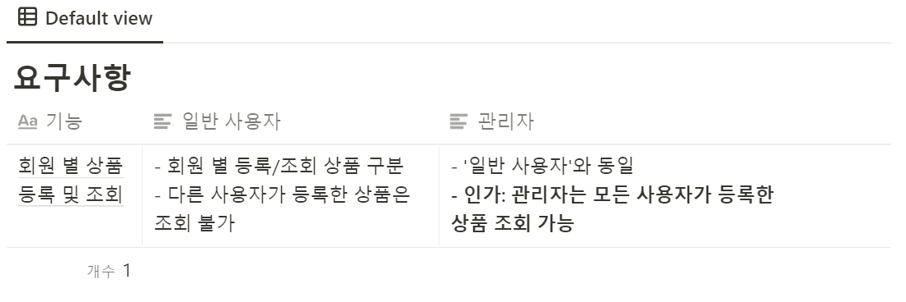

* 상품 조회 API 설계 재확인

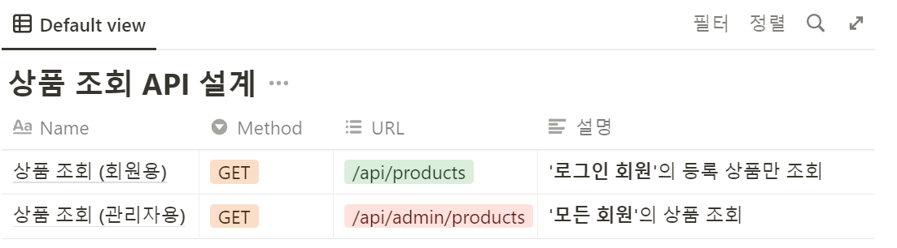

* Client 에서 **"일반 회원"** 과 **"관리자"** 구분하여 API 호출 필요
  1. 일반 회원: **GET** **/api/products**
  2. 관리자: **GET** **/api/admin/products**
* 프론트 개발자와 작업 방법 논의
  + 서버에서 역할을 프론트에 내려줄 수 있는 방법
    1. 로그인 성공 시 Response 에 회원 Role 추가
    2. 쿠키 사용
       1. 세션 유지를 위해 쿠키 설정했던 것과 같은 방식

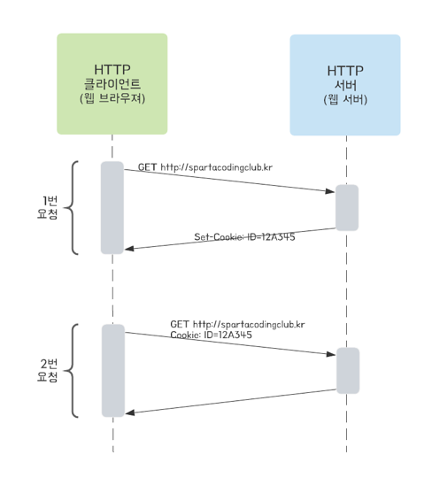

                     3. index.html 에 admin 데이터 추가

                        a. 관리자인 경우만 → "admin" id를 가진 <div> 추가(동적 웹페이지 사용)

                        b. 프론트 개발자 작업  
                             1. "admin" id 가 내려오면 관리자로 판단

                             2. 상품 조회 시 역할별로 분리하여 API 호출

                                      1. 일반 회원: **GET** **/api/products**

                                      2. 관리자: **GET** **/api/admin/products**

2) 상품 조회 (관리자용) 구현

1. "관리자" 회원에 대한 처리
   1. "관리자"인 경우에만 **model 값 ("admin\_role": true) 추가**
   2. 타임리프 문법에 맞춰, model 에 **"admin\_role"** 값이 있으면  
      → **"admin"** id 값을 가진 <div> 추가
2. "관리자" 용 상품 목록 조회 API 구현
   1. **GET** **/api/admin/products** 에 대한 처리
3. UI 테스트
   1. 기능은 정상적으로 작동
   2. 버그 발견!!

> 일반 회원이 관리자 API를 요청할 수 있다는 버그가 있다!! 

---

## 11. 접근 불가 페이지 만들기

**1. API 접근권한 제어 이해**

> '일반 사용자'는 관리자 페이지에 접속이 인가되지 않아야 합니다!!

1. 스프링 시큐리티에 "권한 (Authority)" 설정방법

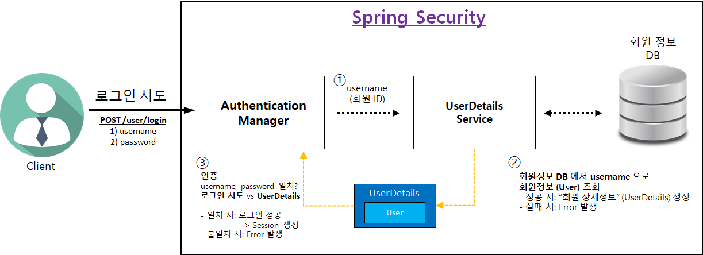

1. 회원 상세정보 (**UserServiceImpl**) 를 통해 **"권한 (Authority)"** 설정 가능
2. 권한을 1개 이상 설정 가능
3. **"권한 이름"** 규칙
   1. **"ROLE\_"** 로 시작해야 함  
      예) "**ADMIN**" 권한 부여 → "**ROLE\_ADMIN**", USER" 권한 부여 → "ROLE\_USER"

2. 스프링 시큐리티를 이용한 API 별 권한 제어 방법

* Controller 에 "**@Secured"** 어노테이션으로 권한 설정 가능
  + **@Secured("권한 이름")** 선언
    - 권한 1개 이상 설정 가능

```java
// (관리자용) 등록된 모든 상품 목록 조회
    @Secured("ROLE_ADMIN")
    @GetMapping("/api/admin/products")
    public List<Product> getAllProducts() {
        return productService.getAllProducts();
    }
```

* "@Secured" 어노테이션 활성화 방법

```java
@Configuration
@EnableWebSecurity // 스프링 Security 지원을 가능하게 함
@EnableGlobalMethodSecurity(securedEnabled = true) // @Secured 어노테이션 활성화
public class WebSecurityConfig extends WebSecurityConfigurerAdapter {
```

**2. 접근 불가 페이지 적용**

1. Secured 이름 설정

[1단계] - 변경하였지만, 아직 쓸모있는 코드는 아니다.

```java
public enum UserRoleEnum {
    USER,  // 사용자 권한
    ADMIN;  // 관리자 권한

    private static final String PREFIX_ROLE = "ROLE_";

    public String getAuthorithy(){
        return PREFIX_ROLE + USER;
    }

    public static class Authroity{
        public static final String USER = "ROLE_USER";
        public static final String ADMIN = "ROLE_ADMIN";
    }
}
```

[2단계] USERRole Enum에 Autorithy 클래스 생성 + Enum 값을 싱글톤이라는 점을 활용

```
public enum UserRoleEnum {
    USER(Authority.USER),  // 사용자 권한
    ADMIN(Authority.ADMIN);  // 관리자 권한

    private final String authorithy;

    UserRoleEnum(String authorithy){
        this.authorithy = authorithy;
    }

    public static class Authority {
        public static final String USER = "ROLE_USER";
        public static final String ADMIN = "ROLE_ADMIN";
    }
}
```

* 다음과 같이 사용자가 접근할 경우, 접근 권한을 얻을 수 없게 되어 Error핸들링에 의해 다음과 같은 페이지로 이동하게 된다.

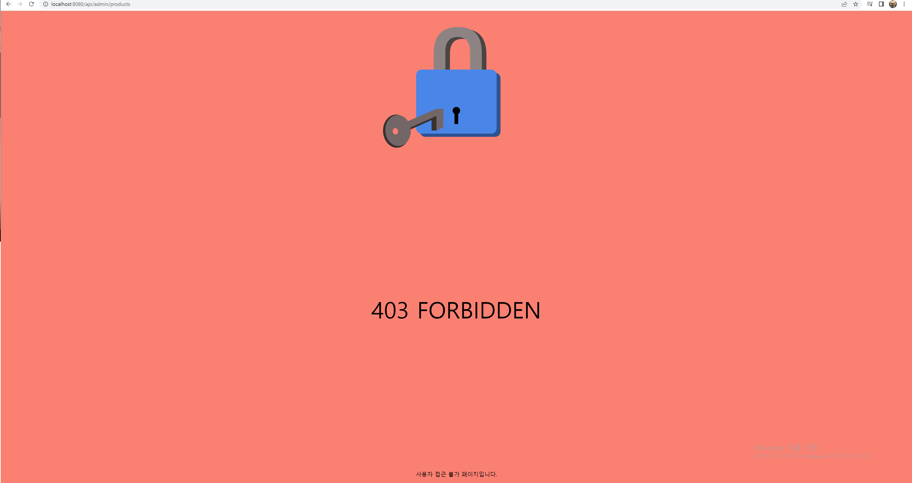

> [요약]  
> 1. API 접근권한 제어   
> 현재 상황 : 일반 사용자가 직접 API URL을 입력하여 사용할 수 있다.  
>   
> **해결방법**  
>   - 방법은 여러가지가 있겠지만, 스프링 시큐리티의 도움을 받을 수 있다.  
> **1단계 - API 권한 설정**  
>   - 회원 상세정보(UserServiceImpl)를 통해 **권한** 설정이 가능하다. 즉, UserDetails를 통해 가능하다.  
>   - getAuthorities 메소드를 @Override하여 사용하면 되는데, 권한 이름 규칙을 준수하여 사용해야한다.  
>   
> **2단계 - API 권한 부여**  
>   - 권한을 부여 하였으므로 이제는 API별로 권한을 부여하는 방법을 알아야한다.  
>   - @Secured어노테이션에 해당 권한 이름을 선언하여 해당 Controller에 붙여주면 된다.  
>   
> 3단계 - @Secured 어노테이션 활성화  
>   - 기본적으로 해당 어노테이션이 활성화되어 있지 않다. 그러므로 활성화를 시켜주어야한다.  
>  - WebSecuriyConfig에 다음에 어노테이션을 붙여주면 된다.  
>     @EnableGlobalMethodSecurity(securedEnabled = true)  
>   
>   
> 2. 권한 이름  
> 예시) @Secured("ROLE\_ADMIN")  
> - 보통은 이렇게 해도 그냥 문제는 없는데, 사실 Enum 값에서 값이 오고 있는데  
> 먄약 Enum 클래스에 Enum 값이 추가되거나 ADMIN 값이 변경된다면 Secured에 권한 이름은 변경은 변경되지가 않는다.  
> - 지금은 하드코딩을 한 것인데, 변수를 가져와서 사용하는 것이 효율적이다.  
> - 그러나 Secured에 들어가는 이름이 constant이어야하므로 쉽게 되지는 않는다.

---

## 12. 소셜 로그인

1. 소셜 로그인 탄생 배경

> 모든 웹 사이트에서 회원가입 과정을 거치는 것은 사용자에게 부담이 됩니다.   
>   
> 매번 번거로운 회원가입 과정을 수행해야 할 뿐 아니라, 웹 사이트마다 다른 아이디와 비밀번호를 기억해야 합니다.  
>   
>  또한 웹 사이트를 운영하는 측에서도 회원들의 개인정보를 지켜야하는 역할이 부담이 됩니다. 바이러스와 백신의 관계 처럼, 발전하는 해킹 기술을 막기 위해 보안을 강화하는 노력이 지속적으로 필요하기 때문이죠.   
>   
> 이런 문제를 해결하기 위해 OAuth 를 사용한 소셜 로그인이 등장합니다.

2. OAuth

> OAuth는 인터넷 사용자들이 비밀번호를 제공하지 않고 다른 웹사이트 상의 자신들의 정보에 대해 웹사이트나 애플리케이션의 접근 권한을 부여할 수 있는 공통적인 수단으로서 사용되는, 접근 위임을 위한 개방형 표준입니다.   
>   
> 사용자가 애플리케이션에게 모든 권한을 넘기지 않고 사용자 대신 서비스를 이용할 수 있게 해주는 HTTP 기반의 보안 프로토콜 입니다.   
>   
> OAuth를 사용하는 서비스 제공자는 대표적으로 구글, 페이스북,네이버와 카카오 등이 있다.

---

## **13. 카카오 로그인**

### 1. 사용 승인 받기

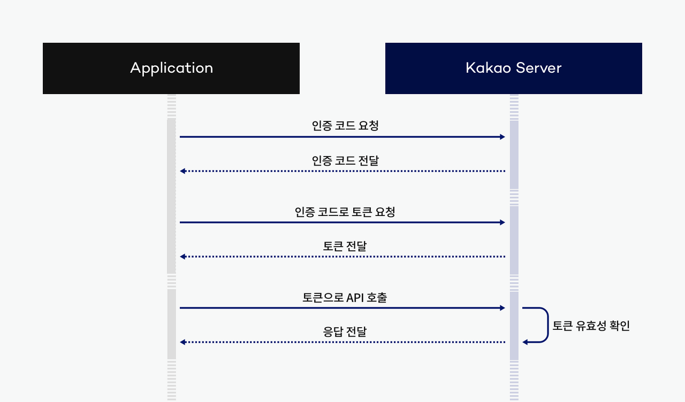

1. 애플리케이션 추가
2. 애플리케이션 > 플랫폼 > Web 플랫폼 등록 > URL 등록
3. 카카오로 로그인 햇을때 인가토큰을 받게 될 Redirect URI(callback) 설정 선택
4. 상태 OFF → ON 전환, Redriect URI 등록(카카오로 부터 정보를 받을 URI 정보)
5. 동의항목에서 닉네임, 이메일을 동의하기
6. 동의화면 미리보기를 통해 사용자에게 정보를 받을 수 있도록 설정

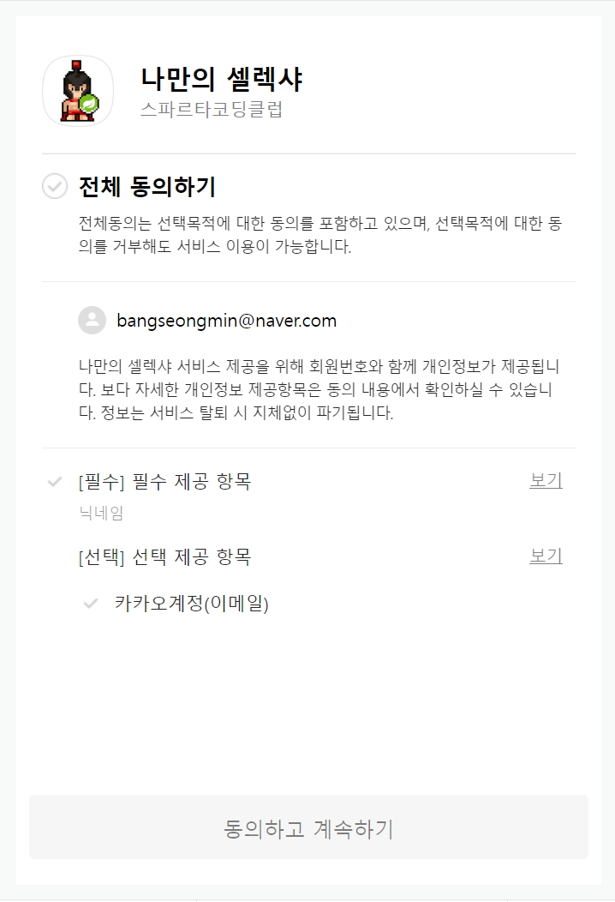

### 

### 2 . 카카오 사용자 정보 가져오기

**1. 카카오 로그인 사용 승인 받기**

> [참고 : 카카오 메뉴얼에는 인증코드로 되어있는데, 오해 소지가 있어 "인가 코드"로 통일함]

* 카카오 인가코드 받기
  + 인가코드 요청 방법  
    <https://kauth.kakao.com/oauth/authorize?client_id=>{REST\_API\_KEY}&redirect\_uri={REDIRECT\_URI}&response\_type=code
  + "/templates/login.html" 파일 수정
    - 아래 코드 부분을 찾아, "client\_id=" 뒷부분에 REST API 키 추가  

      https://kauth.kakao.com/oauth/authorize?client\_id=본인의 REST API키&redirect\_uri=http://localhost:8080/user/kakao/callback&response\_type=code
* 카카오에서 보내주는 '**인가코드**' 처리
  + controller > UserController 에 카카오에서 보내주는 '인가코드'를 받음 ≫ **Controller**
  + **'인가코드'**를 가지고 카카오 로그인 처리 ≫ **Service**
  + 로그인 성공 시 "/"으로 redirect ≫ **Controller**

**2. 카카오 사용자 정보 가져오기**

> 빨간 박스를 통해 진행해야하는 것들을 표시하고 있다.

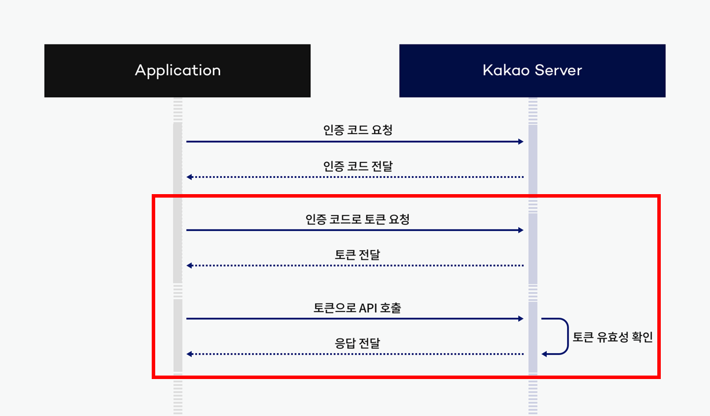

1. **"인가 코드"**로 "액세스 토큰" 요청 - [코드1]
   1. 액세스 토큰 요청
   2. KakaoOAuth2 에 발급 받은 본인의 REST API 키 입력  
      body.add("client\_id", "본인의 REST API키");
   3. 인가 코드로 토큰 요청 후 전달받은 토큰을 받는다.
2. "액세스 토큰"으로 "카카오 사용자 정보" 가져오기 - [코드2]  
   - 요청 URL은 조금씩 변경됨
   1. 전달받은 토큰 정보를 가지고 API 호출
   2. KAKAO 서버에서 토큰 유효성 검사를 통해 응답 값을 전달한다.

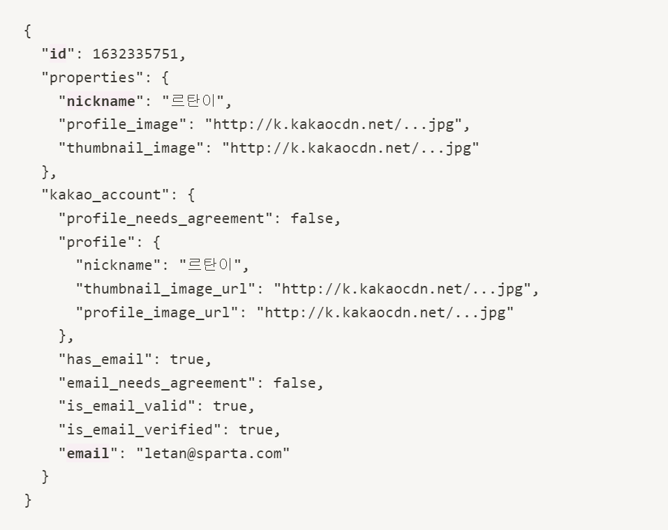

**3. 리팩토링**

**1. KakaoUserInfoDto**

**2. UserService**

**[코드1]**

```java
        // 1. "인가 코드"로 "액세스 토큰" 요청
        // HTTP Header 생성
        HttpHeaders headers = new HttpHeaders();
        headers.add("Content-type", "application/x-www-form-urlencoded;charset=utf-8");

        // HTTP Body 생성
        MultiValueMap<String, String> body = new LinkedMultiValueMap<>();
        body.add("grant_type", "authorization_code");
        body.add("client_id", "11");
        body.add("redirect_uri", "http://localhost:8080/user/kakao/callback");
        body.add("code", code);

        // HTTP 요청 보내기
        HttpEntity<MultiValueMap<String, String>> kakaoTokenRequest = new HttpEntity<>(body, headers);
        RestTemplate rt = new RestTemplate();                               // 서버에서 서버로 데이터를 보낼 때 사용하는 RestTemplate
        ResponseEntity<String> response = rt.exchange(
                "https://kauth.kakao.com/oauth/token",
                HttpMethod.POST,
                kakaoTokenRequest,
                String.class
        );

        // HTTP 응답 (JSON) -> 액세스 토큰 파싱
        String responseBody = response.getBody();
        ObjectMapper objectMapper = new ObjectMapper();                 // JSON 형태를 자바에서 사용하기 위해 ObjectMapper 사용
        JsonNode jsonNode = objectMapper.readTree(responseBody);        // readTree를 통해 스트링으로 된 형태의 JSON 포맷을 객체형태로 변하는 과정
        String accessToken = jsonNode.get("access_token").asText();     // JsonNode.get를 통해 "access_token"값을 뺴오는 것이다.
```

**[코드2]**

```java
		// 2. 토큰으로 카카오 API 호출
        // HTTP Header 생성
        headers.add("Authorization", "Bearer " + accessToken);
        headers.add("Content-type", "application/x-www-form-urlencoded;charset=utf-8");

        // HTTP 요청 보내기
        HttpEntity<MultiValueMap<String, String>> kakaoUserInfoRequest = new HttpEntity<>(headers);
        response = rt.exchange(
                "https://kapi.kakao.com/v2/user/me",
                HttpMethod.POST,
                kakaoUserInfoRequest,
                String.class
        );

        responseBody = response.getBody();
        jsonNode = objectMapper.readTree(responseBody);
        Long id = jsonNode.get("id").asLong();
        String nickname = jsonNode.get("properties")
                .get("nickname").asText();
        String email = jsonNode.get("kakao_account")
                .get("email").asText();

        System.out.println("카카오 사용자 정보: " + id + ", " + nickname + ", " + email);
```

> [요약]  
> 1. 카카오 인가 코드 요청  
>  https://kauth.kakao.com/oauth/authorize?client\_id={Key}&redirect\_uri={URI}&response\_type=code   
>   
> 2. 카카오 인가 코드 받기  
> - 설정한 URI로 인가 코드가 전달되게 된다.  
> - 카카오 로그인 시도 후 설정한 리다이렉트 주소로 인가 코드를 받는 것이다.  
> - 아래와 같이 callback ? code = ~ 가 인가 코드이다.  
> - 다음 단계는? 해당 URI 컨트롤러를 만들고, 코드를 받아서 처리해야한다.  
> http://localhost:8080/user/kakao/callback?code=L1oIx2KgyyQOGiQMLdZGKENcBEUTXc\_mfwi4L-etwm6yrBTPjiePuJIFlrXbAQaQo9cuoAAAGBHfLpTA  
>   
> 3. 인가 코드로 액세스 토큰 받는 과정  
> - KAKAO 요청 규칙을 준수하여 HTTP Header를 조성하고 Body에 정해진 키와 인가 코드를 함께 넣어 전달한다.  
> - 이를 통해 액세스 토큰이 오게 되는데 데이터 형식은 JSON이므로 ObjectMapper를 통해서 JSON을 String으로 변환하여 처리한다.  
>   
> 4. 액세스 토큰으로 카카오 사용자 정보 가져오기  
> - 3번과 동일하게 KAKAO 요청 규칙을 준수하여 HTTP Header를 작성한다.  
> - 3번에서 전달받은 액세스 토큰을 **Authorization**에 **HeaderValue**에 넣어주면된다.  
>   
> 5. Bearer   
> - JWT와 관련이 있다.  
>   
> 6. 토큰으로 카카오 API 호출  
> - 이 부분에서도 response에 결과는 JSON형태이므로 getBody()를 통해 JSON을 꺼내오고,   
> 필요한부분을 추출하기 위해 ObjectMapper.readTree를 사용한다.   
> - 가져온 JSON에서 id, nickname, email 을    
>   
>   
> 7. 리팩토링  
> - 기능상의 변화 없이 코드를 개선하여 읽기 쉽게 하거나 하는 것  
>   
> 8. @AllArgsConstructor  
> - 해당 어노테이션을 통해 생성자 작성없이 자동생성 할 수 있다.

---

## 

## 14. 카카오 사용자 정보로 회원가입 설계

1. 카카오 사용자 회원가입 설계

> 관심 상품 등록을 했을 때 회원 구분이 필요하기 때문에,   
> 카카오서버에서 받은 사용자 정보를 이용해 회원 가입을 합니다.

* 현재 회원 (User) 테이블 확인

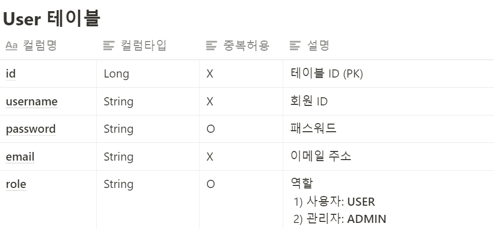

* 카카오로 부터 받은 사용자 정보
  + id
  + nickname
  + email
* 테이블 설계 옵션
  1. 카카오 User 를 위한 테이블 (ex. **KakaoUser**) 을 하나 더 만든다.
     1. 장점: 결합도가 낮아짐
        1. 성격이 다른 유저 별로 분리 → 차후 각 테이블의 변화에 서로 영향을 주지 않음
        2. 예) 카카오 사용자들만 profile\_image 컬럼 추가해서 사용 가능
     2. 단점: 구현 난이도가 올라감
        1. 예) 관심상품 등록 시, 회원별로 다른 테이블을 참조해야 함
           1. 일반 회원: User - Product
           2. 카카오 회원: KakaoUser - Product
  2. 기존 회원 (User) 테이블에 카카오 User 추가
     1. 장점: 구현이 단순해짐
     2. 단점: 결합도가 높아짐
        1. 폼 로그인을 통해 카카오 로그인 사용자의 username, password 를 입력해서 로그인한다면??
* 회원 (User) 테이블에 적용하기로 결정
  + 패스워드를 UUID로 설정한 이유  
    : 폼 로그인을 통해서 로그인되지 않도록 하기 위해서

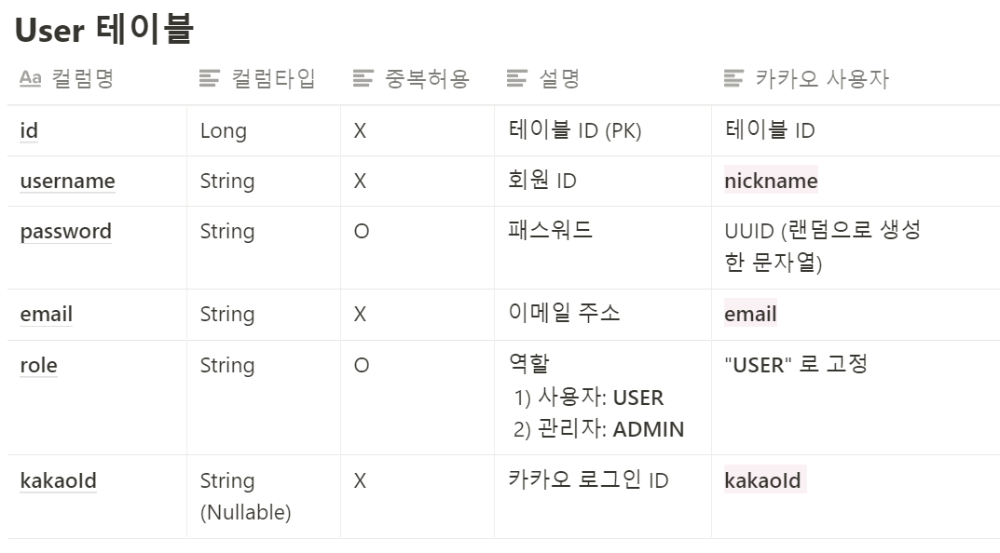

---

## 15. 카카오 사용자 정보로 회원가입 구현

1. 카카오 사용자 정보로 회원가입

* User 테이블에 'kakaoId' 추가 (Model > Users 변경)
* 회원가입  
  - kakaoId를 가진 회원이 없는 경우에만 회원가입(repository > UserRepository 변경)

```java
	// 3. 카카오 사용자 회원가입 정보를 확인하고 없으면 회원가입, 아니면 로그인 처리
        // DB 에 중복된 Kakao Id 가 있는지 확인
        Long kakaoId = kakaoUserInfo.getId();
        Users kakaoUser = userRepository.findByKakaoId(kakaoId).orElse(null);

        if (kakaoUser == null) {
            // 회원가입
            // username: kakao nickname
            String nickname = kakaoUserInfo.getNickname();

            // password: random UUID
            String password = UUID.randomUUID().toString();
            String encodedPassword = passwordEncoder.encode(password);

            // email: kakao email
            String email = kakaoUserInfo.getEmail();
            // role: 일반 사용자
            UserRoleEnum role = UserRoleEnum.USER;

            kakaoUser = new Users(nickname, encodedPassword, email, role, kakaoId);
            userRepository.save(kakaoUser);
        }
```

2. 강제 로그인 처리

* Spring Security Login 처리 과정


* 로그인 성공 시
  + "로그인 성공 사용자 정보" (UserDetails) 는 SecurityContext 에 저장됨
  + User < UserDetails < UsernamePasswordAuthenticationToken < SecurityContext

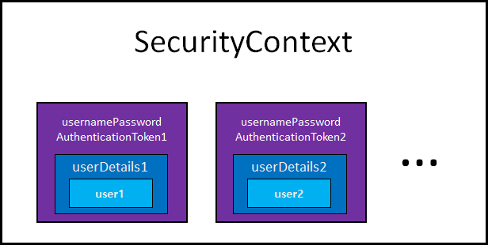

3. 테스트, 리팩토링, 테스트

* 카카오 로그인 후 상품 등록 및 조회 테스트
  1. 카카오 로그인 사용자로 상품 등록 및 조회가 잘 되는지?
  2. 일반 로그인 사용자에게 카카오 로그인 사용자가 등록한 상품이 보이지 않는지?
  3. 관리자에 의해 카카오 로그인 사용자가 등록한 상품이 잘 조회 되는지?
* 리팩토링  
  1. dto > KakaoUserInfoDto
  2. service > KakaoUserService
  3. service > UserService
  4. controller > UserController
* 리팩토링 후 테스트
  + 카카오 로그인 후 상품 등록 및 조회 테스트 과정 반복

> [요약]  
> 1. 강제로그인이 필요한 이유  
> - Kakao API를 통해 로그인을 하게 되면 Spring Security에서 Authentication Manager를 통해 수행되는 과정이 필요 없어진다. 이유는 카카오 서버에서 이미 대신 해준 과정이기 때문이다. 그러므로 강제로그인 과정이 필요하다.  
>   
> 2. 강제 로그인 과정  
>  1) Authentication Manager에 의해서 승인이 되면 Session 생성이 되는데, 이때 로그인 정보와 사용자 정보(User)가 Security Context라는 곳에 로그인 성공한 사용자들의 정보가 담기게 된다. 또한 사용자 정보는 UserDetail 객체로 담기게 된다.  
>   
>  2) usernamePasswordAuthenticationToken까지 해줘야 Security Context에 담겨질 수 있다.  
>  정리해보면 User < UserDetails < UsernamePasswordAuthenticationToken < SecurityContext 순으로 담겨져있다.  
>   
>  3) UsernamePasswordAuthenticationToken  
> - UsernamePasswordAuthenticationToken은 Authentication의 구현체이다.  
> - 해당 객체를 SecurityContext에 넣어줘야되는데 이때 Security Context로 바로 접근이 가능하지 않고 ContextHolder라는 애를 통해서 이렇게 setAuthentication을 할 수 있도록 되어있다. 이렇게 하면 강제 로그인을 할 수 있다.

---

## 16. JWT 로그인 구현하기

1. JWT란?

* JWT 사용이유 파악
  1. 서버가 1대인 경우 **(그림 1)**  
     - Session1 이 모든 Client의 로그인 정보 소유
  2. 서버가 2대 이상인 경우 **(그림 2)**  
     - 서버의 대용량 트래픽 처리를 위해 서버 2대 이상 필요  
     - Session 마다 다른 Client 로그인 정보를 가지고 있을 수 있음  
       1) Session1 : Client1, Client2, Client3  
       2) Session2 : Client4  
       3) Session3 : Client5, Client6  

     - Client 1 로그인 정보를 가지고 있지 않은 Server2나 Server3에 API 요청을 하게되면 어떻하지?  
        - 해결방법  
         1) Sticky  Session : Client 마다 요청 Server 고정  
         2) 세션 저장소 생성
  3. 세션 저장소 생성 **(그림 4)**  
     - Session storage가 모든 Client의 로그인 정보 소유
  4. JWT 사용 **(그림 5)**  
     - 로그인 정보를 Server에 저장하지 않고, Client에 로그인정보를 JWT를 암호화하여 저장 → JWT 통해 인증 인가  
     - 모든 서버에서 **동일한 Secret Key** 소유  
     - Secret Key 통한 암호화 / 위조 검증(복호화 시)  

     - JWT 장/단점  
     1. 장점
        1. 동시 접속자가 많을 때 서버 측 부하 낮춤
        2. Client, Server 가 다른 도메인을 사용할 때  
           - 예) 카카오 OAuth2 로그인 시 JWT Token 사용
     2. 단점
        1. 구현의 복잡도 증가
        2. JWT에 담는 내용이 커질 수록 네트워크 비용 증가(클라이언트 → 서버)
        3. 기생성된 JWT를 일부만 만료시킬 방법이 없음
        4. Secret Key 유출 시 JWT 조작 가능
* JWT 사용 흐름 Overview  
  1. Client가 username, password로 로그인 성공 시  
    a. "로그인 정보"  →  JWT 로 **암호화 (Secret Key 사용)  (그림 6)**  b. JWT 를 Client 응답에 전달  
    c. Client 에서 JWT 저장 (쿠키, Local storage 등)  

  2. Client 에서 JWT 통해 인증 방법  
    a. JWT를 API 요청 시마다 Header 에 포함  
      예) HTTP Headers (Content-type : application/json, Authentication : Bearer <JWT>)  

    b. Server  
        a. Client 가 전달한 **JWT 위조 여부 검증 (Secret Key 사용)**      b. JWT 유효기간이 지나지 않았는지 검증  
        c. 검증 성공시,  
            a. JWT → "로그인 정보" (**UserDetailsImpl**) 만들어 사용  
                ex) **GET /api/products :** JWT 보낸 사용자의 관심상품 목록 조회
* JWT 구조 **(그림 7)**  
  + JWT는 누구나 평문으로 복호화 가능
  + Secret Key 가 없으면 JWT 수정 불가능  
    → JWT는 Read only 데이터  
    1. Header - { "alg" : "HS256", "typ" : "JWT" }  
    2. Payload - { "sub" : "123456789", "username" : "제이홉", "admin" : true }  
    3. Signature - HMACSHA256(base64UrlEncode(header) + "." + base64UrlEncode(payload), secret)

---

[그림 1]

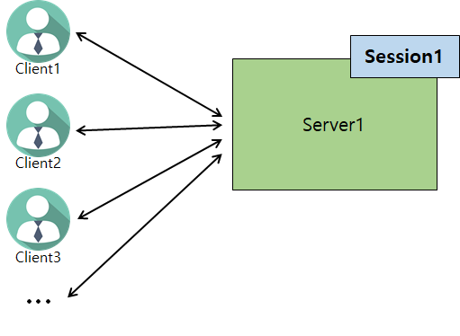

[그림 2]

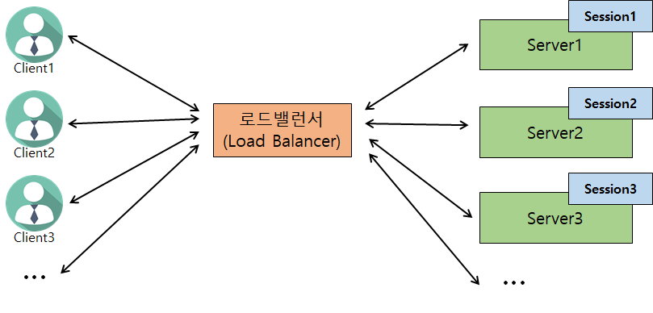

[그림 3]

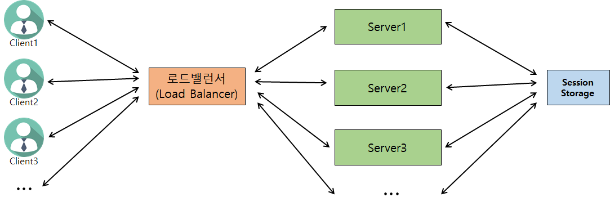

[그림 4]

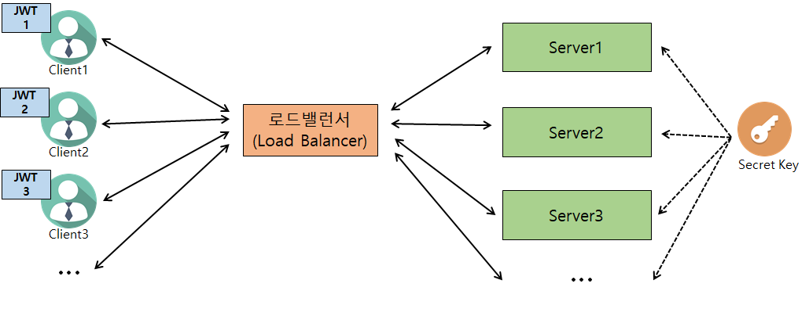

[그림 5]

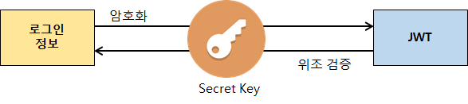

[그림 6]

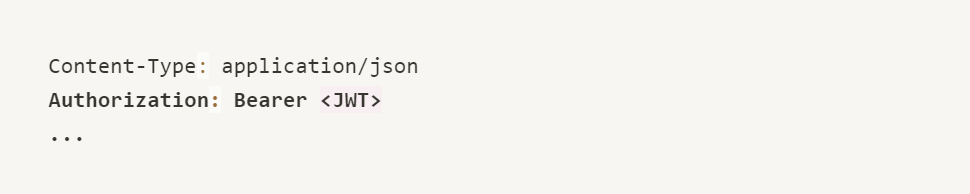

[그림 7]

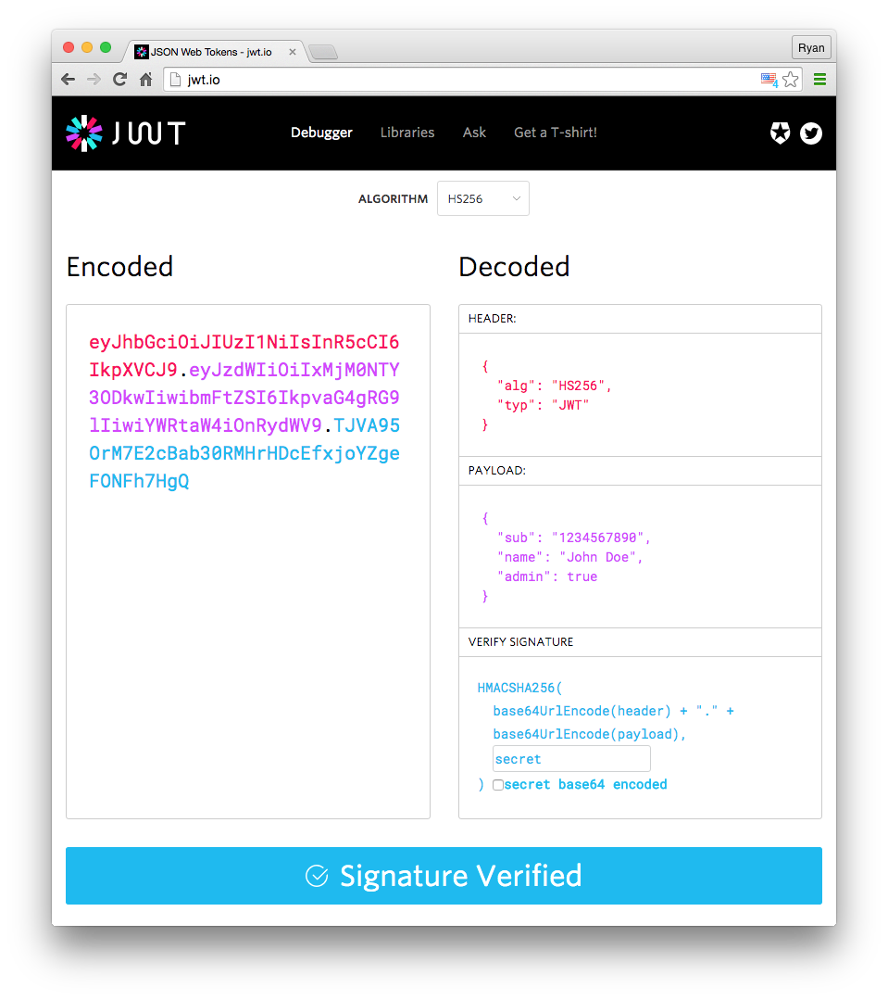

---

2. JWT 로그인 이해 **(그림 1)**

1. JWTAuthFilter : API 요청 Header 에 전달되는 JWT 유효성 인증  
   a. 모든 API에 대해 JWTAuthFilter가 JWT 확인  
   b. 로그인 전 허용이 필요한 API 예외처리 필요 ≫ FilterSkipMatcher  
      i. ex) 로그인 폼 페이지, 로그인 처리, css 파일 등
2. FormLoginFilter : 회원 폼 로그인 요청 시 username / password 인증 **(그림 2)**  
   - 인증 성공 시 응답(Response)에 JWT 포함  
   : JWT 전달방법은 개발자가 정함  예) 응답 **Header** 에 아래 형태로 **JWT** 전달

```java
Authorization: BEARER <JWT>

ex)
Authorization: BEARER [REDACTED]
```

---

[그림 1]

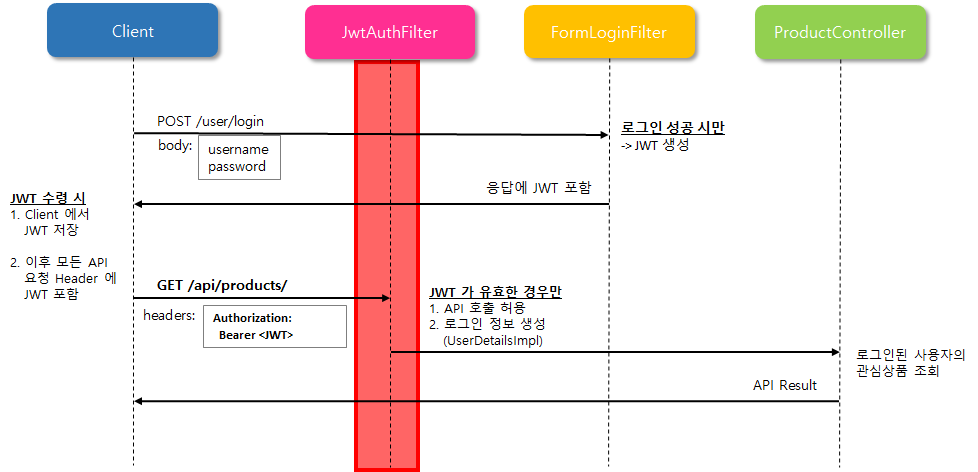

[그림 2]

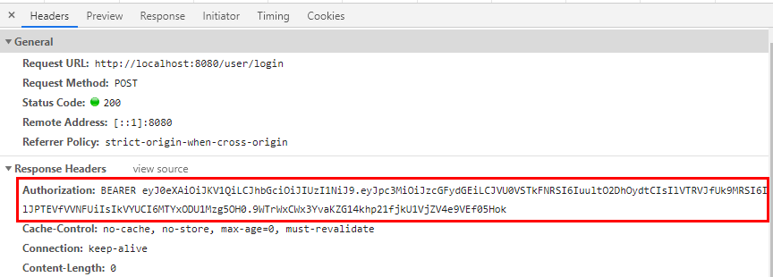

---

**3. JWT 구현 샘플 프로젝트 확인**

1. JWT 구현 샘플 프로젝트  
   [1. 프로젝트 압축파일](https://www.notion.so/teamsparta/Spring-2-d27c954d8964494993c0d44823b360dc#becb243310da4491a9b222371efbed67)
2. JWT 로그인 적용인증 처리(Filter)  
   - Filter 는 Client 의 API 요청이 Controller 에 전달되기 전, 사전처리를 하는 영역  
   - 즉, Controller에 도달하기 전에 인증 처리를 하기 위해 사용  
   1. **FormLoginFilter** : 회원 폼 로그인 요청 시 username / password 인증  
      a. POST **"/user/login"** API에 대해서만 동작 필요  
            i.  "GET /user/login" 가 처리되지 않게 하기 위해 API 주소 변경  
                1.  "GET /user/login" → "GET /user/loginView"  
   b.  Client 로부터 username, password 를 전달받아 인증 수행  
   c. 인증 성공 시  
        i. FormLoginSuccessHandler 통해 JWT 생성  
        ii. 이후 Client 에서는 모든 API 응답 Header에 JWT를 포함하여 인증  

   2. **JWTAuthFilter** : API 요청 Header에 전달되는 JWT 유효성 인증
3. 인증 처리(Provider)
   * Filter 가 인증에 필요한 정보를 적합한 클래스 형태로 만들어 Spring Security 에 인증 요청을 함
   * Spring Security 는 Filter 가 요청한 인증 처리를 할 수 있는 Provider 를 찾고,   
     실제 인증처리는 Provider 에 의해 진행됨
     + 인증처리 가능 여부 판단 기준 : supports 함수 통해 "인증정보의 클래스 타입"을 보고 판단 **(코드 1)**
   * 1. FormLoginAuthProvider
     + Client에서 전달한 ID/PW가 DB의 ID/PW와 일치하는지 인증 **(코드 2)**
     + 인증 성공 시 → FormLoginSuccessHandler에서 응답 Header에 JWT 포함시킴 **(코드 3)**
   * 2. JWTAuthProvider
     + Client의 Header로 전달된 JWT가 유효한지 검증**(코드 4)**
4. **인증된 사용자 정보 처리**  
   * Controller에서 사용가능한 인증 사용자 정보(@AuthenticationPrincipal)를 만듦 **(코드 5)**
   * 현재 문제점 - API 호출마다 JWT 검증 후 매번 회원 DB(User) 조회
     + 원인 : UserDetailImpt 에서 "User" Entity 객체를 가지고 있기 때문
     + 개선 방법   

       1. UserDetailsImpl에 User 객체를 저장하지 않도록 수정  
       - 인증 사용자 정보는 Spring Security가 제공하는 UserDetails 인터페이스 형태만맞추서 구현하면 됨.
       - 멤버변수는 마음대로 수정가능
       - Ex) UserDeatilsImpl에 User 객체 대신 userId, username, role만 저장 **(코드 6)**
     + 2. JWT에 userId, username, role 정보를 암호화/복호화하여 사용

[코드 1]

```java
@Override
public boolean supports(Class<?> authentication) {
    return authentication.equals(UsernamePasswordAuthenticationToken.class);
}
```

[코드 2]

```java
@Override
public Authentication authenticate(Authentication authentication) throws AuthenticationException {
    UsernamePasswordAuthenticationToken token = (UsernamePasswordAuthenticationToken) authentication;
    // FormLoginFilter 에서 생성된 토큰으로부터 아이디와 비밀번호를 조회함
    String username = token.getName();
    String password = (String) token.getCredentials();

    // UserDetailsService 를 통해 DB에서 username 으로 사용자 조회
    UserDetailsImpl userDetails = (UserDetailsImpl) userDetailsService.loadUserByUsername(username);
    if (!passwordEncoder.matches(password, userDetails.getPassword())) {
        throw new BadCredentialsException(userDetails.getUsername() + "Invalid password");
    }

    return new UsernamePasswordAuthenticationToken(userDetails, null, userDetails.getAuthorities());
}
```

[코드 3]

```java
public class FormLoginSuccessHandler extends SavedRequestAwareAuthenticationSuccessHandler {
    public static final String AUTH_HEADER = "Authorization";
    public static final String TOKEN_TYPE = "BEARER";

    @Override
    public void onAuthenticationSuccess(final HttpServletRequest request, final HttpServletResponse response,
                                        final Authentication authentication) {
        final UserDetailsImpl userDetails = ((UserDetailsImpl) authentication.getPrincipal());
        // Token 생성
        final String token = JwtTokenUtils.generateJwtToken(userDetails);
        response.addHeader(AUTH_HEADER, TOKEN_TYPE + " " + token);
    }

}
```

[코드 4]

```java
@Override
public Authentication authenticate(Authentication authentication)
        throws AuthenticationException {
    String token = (String) authentication.getPrincipal();
    String username = jwtDecoder.decodeUsername(token);

    // TODO: API 사용시마다 매번 User DB 조회 필요
    //  -> 해결을 위해서는 UserDetailsImpl 에 User 객체를 저장하지 않도록 수정
    //  ex) UserDetailsImpl 에 userId, username, role 만 저장
    //    -> JWT 에 userId, username, role 정보를 암호화/복호화하여 사용
    User user = userRepository.findByUsername(username)
            .orElseThrow(() -> new UsernameNotFoundException("Can't find " + username));;
    UserDetailsImpl userDetails = new UserDetailsImpl(user);
    return new UsernamePasswordAuthenticationToken(userDetails, null, userDetails.getAuthorities());
}
```

[코드 5]

```java
// 신규 상품 등록
@PostMapping("/api/products")
public Product createProduct(@RequestBody ProductRequestDto requestDto,
 @AuthenticationPrincipal UserDetailsImpl userDetails) {
    // 로그인 되어 있는 ID
    Long userId = userDetails.getUser().getId();

    Product product = productService.createProduct(requestDto, userId);
    // 응답 보내기
    return product;
}
```

[코드 6]

```java
public class UserDetailsImpl implements UserDetails {
		// 삭제
    private User user;

		// 추가
		private Long userId;
	  private String username;
		private UserRoleEnum role;
```

---

> **Part 1****1. JWT 사용하는 이유**  
>  - 서버가 1대인 경우 → Session 하나에 모든 클라이언트의 로그인 정보가 저장되어있다.  
>  - 서버가 2대 이상인 경우(대용량 트래픽 처리를 위해 서버 2대 이상 운영 필요)  
> → 클라이언트와 서버 사이에 **Load Balancer** 가 필요하다.  
>   
> ※ Load Balance  
> : 하나의 인터넷 서비스가 발생하는 트래픽이 많을 때 여러 대의 서버가 분산처리하여 서버의 로드율 증가, 부하량, 속도저하 등을 고려하여 적절히 분산처리하여 해결해주는 서비스  
>   
> 클라이언트 입장에서는 하나의 주소에 URL에 호출하는 것처럼 보이지만,   
> 내부적으로는 API로 데이터를 분산해서 처리해주고 있다. 서버가 100대, 1000대가 될수도 있다.   
> 이때 서버의 개수만큼 세션의 개수가 같이 늘어나게 되어 로그인 정보가 흩어질 수 밖에 없는 환경이다.   
>   
> [Q&A]  
> Q : Client 1 로그인 정보를 가지지 않은 Server2 나 Server3으로 Load Balacer를 통해 API 요청 하면 어떻게 할까??   
> A : 로그인 정보가 없기 때문에 서버 2나 3으로 가면 로그인을 다시 해야한다. 이 상황은 말도 안되고, 경험해보지 못한 일이다.  
>   
> 위 문제를 해결하기 위한 방법  
> **1. Sticky Session**  
> - Client마다 요청 Server를 고정해두는 방식 (옛날에 많이 사용함)  
>   예를 들면, 클라이언트1은 항상 서버 1로 요청하도록 하고, 클라이언트2는 항상 서버2로 요청하도록 설정  
>   
> **[ Sticky Session의 문제점 ]**  
> **(1) Load balancer의 역할을 제대로 수행할 수 없다.**  
> - 클라이언트가 항상 로그인을 계속해 있는 게 아니다. 로드밸런서의 역할은 데이터가 들어왔을 때 균등하게 처리를 해주기 위한 것인데 하나의 고정이 된다면 시간이 지남에 따라 로드밸런서의 역할이 제대로 데이터가 분산되지 못할 수 도 있다.  
>   
> **(2) 클라이언트와 서버 간 매핑 정보를 저장해야한다.**  
> - 클라이언트가 서버 1에 묶여 있다는 것을 저장하기 위해 클라이언트와 서버 간에 매핑 정보를 저장해두어야 한다.  
>   
> **2.  세션 저장소 생성**  
> - 세션의 모든 정보를 하나의 스토리지 Redis나 DB를 사용해서 세션 정보를 하나에 묶어 모든 것을 저장해서 사용하도록 하는 방식이다.  
> -모든 클라이언트의 로그인 정보를 하나의 세션 스토리지에 저장을 하고 모든 서버가 그 세션 스토리지를 저장하거나 조회할 수 있어 모든 서버가 모든 클라이언트에 대한 세션 정보를 같이 소유해서 사용할 수 있다.  
>   
> **3. JWT 사용**- 대체로 사용하고 있다. 대체라는게 지금 세션 저장소 생성하는 것을 대체해서 사용한다는 의미이다.   
> - **로그인 정보를 Server에 저장하지 않고, Client에 로그인 정보를 JWT로 암호화하여 저장한다**- 클라이언트의 로그인 정보를 JWT로 암호화해서 저장을 하고, JWT를 통해서 클라이언트는 인증 및 인가를 할수 있다.  
>   
> **3-1 JWT 원리**  
> - 시크릿 키가 모든 서버에서 하나의 동일한 시크릿 키를 가지고 있으면서 사용을 한다. 스크릿 키를 통해서 암호화와 위조가 됐는지 검증하는 과정을 거친다.   
>   
> [ 예시를 통한 비교 ]  
> 예전에 로그인 정보가 세션에 그냥 저장이 되어 있었다 그러면 서버에 그냥 저장이 됐었다.  
> JWT는 클라이언트에 저장하기 전에 암호와 시크릿 키를 통해서 암호화를 하고 암호화된 jwt 를 클라이언트가 가지고 있다가 서버에 요청을 보낼 때 JWT를 같이 보내면 그내용을 가지고 서버가 이 사용자구나라고 판단을 하는 데 클라이언트에서 암호화를 했기 때문에 복호화를 해야되는데 복호화를 하는 과정에서 이 jwt가 변경이 되었는지 위조가 되었는지 검증을 할 수 있다. **즉, 시크릿 키를 통해서 복호화와 동시에 위조까지 검증을 할 수 있다.**  
>   
> **3-2 JWT 장점과 단점**  
> (장점)   
>   a. 동시 접속자가 많을 때 서버 측 부하를 낮출 수 있다.  
>   - 동시 접속자가 많을 때 서버측 부하가 많이 될 수 있을 건데, 그때 클라이언트 측에서 이런 정보를 가지고 있기 때문에 서버측에 부하를 낮출 수 있다.  
>   
>   b. 클라이언트와 서버가 다른 도메인을 사용할 때 장점이 될 수 있다.   
> 예를 들어, 카카오 OAuth2 로그인을 한번 사용해 봤는데, 이때도 사실 JWT 토큰을 사용하고 있습니다. 도메인이 다르면 **cors가 문제가 생길 수 있다**. 그 문제를 해결할 수 있는 JWT 토큰을 사용할 수 있다라는 점이 좀 있다.  
>   
> (단점)   
>   a. 구현에 복잡도가 증가할 수 있다.  
>   b. JWT 내용이 커진다면 암호화했을 때  로그인 정보의 내용이 함께 커지면 네트워크 비용이 증가한다.   
>  - 클라이언트에 저장이 되기 하지만 서버로 요청을 보낼 때 항상 JWT를 함께 보내야 되거든요 근데 이 JWT 내용이 크다면 네트워크 비용이 결론적으로는 증가하게 된다  
>   c. 기생성된 JWT를 일부만 만료시킬 방법이 없음 즉, 무료화시킬 방법이 없다.  
>   d. Secret Key 유출 시 JWT 조작 가능  
>    - 예를 들면 jwt를 위조 검증하는 것을 시크릿 키를 통해서 한다 그랬는데 만약 시크릿 키가 유출된다면 jwt 내용을 시크릿 키를 통해서 암호화 할 수 있다라는 얘기고 JWT 내용을 조작해서 사용할 수 있다는 것이다.  
> 결론적으로 말씀하면 다른 사용자인 척하면서 다른 사용자의 로그인을 할 수 있다는 이야기다.  
>   
>   
> **3.3 JWT 사용 흐름 Overview**  
> -  첫 시작은 동일하다.  
> 1) 클라이언트가 username 과 password를 서버에 주고 로그인 요청  
> (로그인 성공시)  
> 2) 성공 시 로그인 정보를 가지고 **서버에서** Secret Key를 통해 JWT로 암호화  
> 3) 알수 없는 JWT 암호화된 문자열이 생기게 된다.  
> 4) 클라이언트에서 클라이언트 응답에 JWT 암호화된 문자열을 전달을 해줘야 된다. 그래야 클라이언트에서 이걸 받아서 사용할 수 있다. 그렇게 응답의 내용을 전달해 줄 것이다.  
> 5) 클라이언트에서는 JWT를 어떻게든 저장을 시켜야 한다.   
> - 쿠키 라든가(세션의 경우도 쿠키에다 저장을 했었다.) 또는 로컬 스토리지 라던가 여러 클라이언트에서 저장할 수 있는 메모리도 될수 있다.  
> 6) 저장을 시켜야하고, 저장된 JWT를 통해서 클라이언트에서 인증 과정을 수행한다.  
> - 인증할 수 있는 방법은 JWT를 통해서 모든 API 요청 시마다 헤더에 이 JWT를 포함해서 보내줘야 된다.  
>   
> 7) 아래와 같이 HTTP Headers 에 다음과 같이 항상 헤더에 JWT를 포함시켜야 된다.  
> Content-Type : application/json  
> **Authorization** : Bearer <JWT>  
>   
> 포함시켜서 보내면 서버에서는 이 클라이언트가 전달하는 JWT가 위조됐는지 안됐는지를 검증한다.  
> - Secret key가 복호화하면서 jwt를 로그인 정보로 복호화하면서 위조 됐는지를 검사한다.   
> 왜냐하면 클라이언트에서 가지고 있다 보니까 바뀔 수도 있다. 그랬을 때 뭐가 변경되었다면 위조 됐다라고 생각해서 유효화지 않다라고 판단을 할 수 있다.  
>   
> 8) 유효기간에 맞춰 리프레시 토큰을 갱신해야한다.  
> - JWT가 계속 영원히 지속되는 건 아니고 유효 기간이 있다. 유효 기간이 지난 토큰은 유효하지 않게 된다.  
> - 토큰을 갱신하는 방법이 리프레시 토큰을 통해서 갱신하는 방법이 있다. (수업에서는 다루지 않을 것이다)  
>   
> 9) 검증 성공시, JWT를 통해서 들어온 사용자가 실제 로그인이 성공한 사용자이고 로그인 정보가 JWT에 담겨져 있다.   
> - 그 정보를 가지고 우리가 예전에 로그인 정보를 UserDetailsImpl 만들어서 사용했었는데, 이걸로 만들어서 사용하는 것이다. 결국 우리가 스프링 서버 세션에서 만들었던 userdetailsImpl를 그대로 만들어서 사용한다고 생각하면 될 것 같다.  
>   
> 정리하면 서버 세션 대신에 지금 JWT를 사용하고 있다.  
> 예를 들어 GET /api/products 호출 되었을 때 원래 관심 상품 목록을 조회하는 건데 JWT가 보낸 사용자의 관심 상품 목록을 조회한다고 생각하시면 된다.  
>   
>   
>   
> **3-4. JWT 구조**- [그림7]과 같은 형태로 되어있다.  
> - 누구나 평문으로 복호화가 가능하다.  
> - signature 정보를 통해서 변조 여부를 확인할 수 있다.  
> - JWT 암호문을 [JWT.io](https://jwt.io/) 사이트에서 해당 알고리즘을 선택하면 복호화가 가능하다.  
> 예를 들면, 로그인한 사용자의 정보가 우리는 로그인한 아이디라던가 Username, 관리자인지 아닌지에 대한 정보가 노출이 된다. 하지만 이렇게 평문으로 복호화는 가능한데 만약 서버에서만 가지고 있던 시크릿 키가 없다면 JWT를 수정하는 것은 불가능하다.  
>   
> ****즉, JWT는 Read ONLY 데이터이다. 그러므로 수정하거나 발급하는것은 시크릿 키를 갖은 서버에서만 가능하다.  
>   
> 암호문은 크게 빨간색, 보라색, 파란색으로 **3가지로 나눠져 있는데 각자 header, payload, signature 이런 형태로 되어 있다. signatrue 부분이 서버에서 변조 됐는지 안됐는지를 판단하기 위한 어떤 그 사인이라 그래야 될까요 그 이게 이제 쌓이는데 그래서 Signatrue가 중요하다.  
>   
> header는 알고리즘(HS256 같은 암호화 알고리즘) 과 타입(JWT와 같은 메타 정보)  
> payload는 실제 사용자의 정보가 들어가는 부분이다. Ex) username, admin 여부  
> signature는 암호화가 되는건데 이때 시크릿 키가 사용되어 암호화가 된다는 것을 알고 있으면 된다.  
>   
> => 시크릿 키를 통해서 JWT는 암호화가 되고 복호화가 된다.  
>   
>   
>   
> **Part 2**1. JWT 로그인 이해   
> - 클라이언트와 ProductController가 있는데, 보통은 클라이언트에서 요청이 들어왔을때 Controller로 바로 가거나 Spring Security가 중간에서 어떤 로그인 과정을 처리 했었는데, 지금 이 JWT 에서는 두개의 필터가 있다.  
> 간단하게, JwtAuthFilter와 FormLoginFilter는 인증의 대한 처리를 해준다. 정도로만 이해하면 된다.  
>   
>   
> 1) ****JwtAuthFilter**** - API 요청 Header에 전달되는 JWT 유효성 인증  
> : API 요청을 할 때마다 JWT를 항상 클라이언트에서 들고있던 JWT를 가지고 요청을 한다고 말씀 드렸는데,   
> 그래서 그 보내진 정보를 가지고 JWT에 아까 앞서 말씀드렸던 인증 과정이 있었잖아요. 검증하는 과정 유연성 이라든가 어떤 그 유효 기간이 서져 있지 않았던가 그런 것들 좀 확인할 수 있는 그 역할을 해준다.  
> 즉, 전체 JWT 로그인할 때 JWT에 대한 어떤 그 처리를 해줄 때 모든 API에 대해서 얘가 대문 역할을 해서 클라이언트 JWT가 서버가 갖고 있는 JWT가 맞는지 체크하고 나서 그다음에 컨트롤러로 보내준다.   
>   
>   
> 중요한 것은 로그인 전에 허용되어야 되는 API들이 있었다. 그러한 API들은 예외 처리가 좀 필요하겠죠? FilterSkipMatcher를 통해서 예외 처리를 좀 해줘야 된다. 이게 모든 API에 대해서 하는 것이 맞는데 예외 처리를 해줘야 될 부분이 있다는 것이 중요하다.  
> 예를 들면 로그인 폼 페이지, 회원가입 페이지, 로그인 처리에 대한 요청, css, js, h2-console 등에 예외처리가 필요하다  
>   
> 2) FormLoginFilter - 회원 폼 로그인 요청 시 username / password 인증  
> (비교) Spring Security에서 Form Login 처리해줬던 것과 유사하다.  
>   
>   
> 2. JWT 호출 순서 이해  
> 1단계 : POST /user/login → body : username, password ****→ FormLoginFilter로 전달****  
> - 현재는 JWT가 만들어지기 전이기 때문에 로그인 처리(JwtAuthFilter)는 예외처리가 된다.  
> - FormLoginFilter에서 로그인이 성공/실패를 확인한다.  
> - 성공 : username, password를 DB에서 체크하고 JWT를 생성  
>   
> 2단계 : JWT 포함해서 클라이언트로 응답  
> - JWT는 클라이언트에 저장해야한다.  
> - JWT 수령 시, Client에서 JWT를 저장하고 이후 모든 API 요청 Header에 JWT를 포함시킨다.  
>   
> 3단계 : GET /api/products ****→**** ****관심 상품 목록을 조회해 달라(header : Authorization : Bearer <JWT>)****- ****Session에서 로그인 되어있는지 확인한 다음에 Controller로 보내주었던 작업을 JWT에서는**** JWTAuthFilter가 대신한다.  
> - 모든 API에 대해서 보안 검색대 역할을 한다.  
>   
> 4단계 : JWT가 유효한 경우 ********→**** ****Controller로 전달********  
> 1) API 호출 허용   
> 2) 로그인 정보 생성(UserDetailsImpl)  
>   
> 5단계 - JWT를 가지고 로그인된 사용자의 관심 상품을 조회  
> - 서버 Session을 사용했을 때와 동일한 방식  
>   
> 6단계 - 조회된 API Result를 클라이언트에 전달  
> - 클라이언트는 API Result에 대해 처리하면 된다.  
>   
> 7단계 - 이후 모든 API 요청에 JWT를 포함해서 전달한다.  
>   
>   
> ******Part 3******1. JWT 로그인 적용인증 처리 (Filter)  
> 1)****** "GET /user/login" 가 처리되지 않게 하기 위해 API 주소 변경
>
> "GET /user/login" → "GET /user/loginView"  
>   
>   
> 2. 현재 코드에서는 findbyUsername을 계속하고있는데 이것을 변경해줄 필요가 있다.
