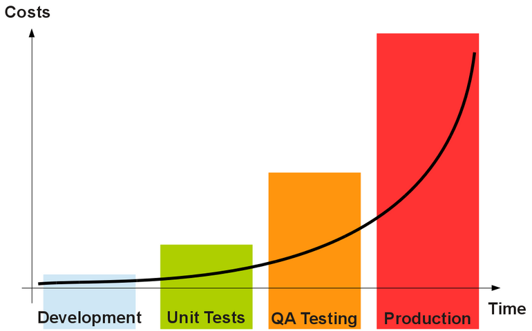
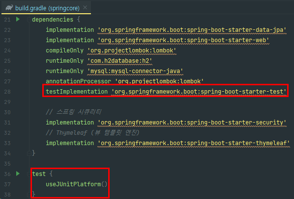
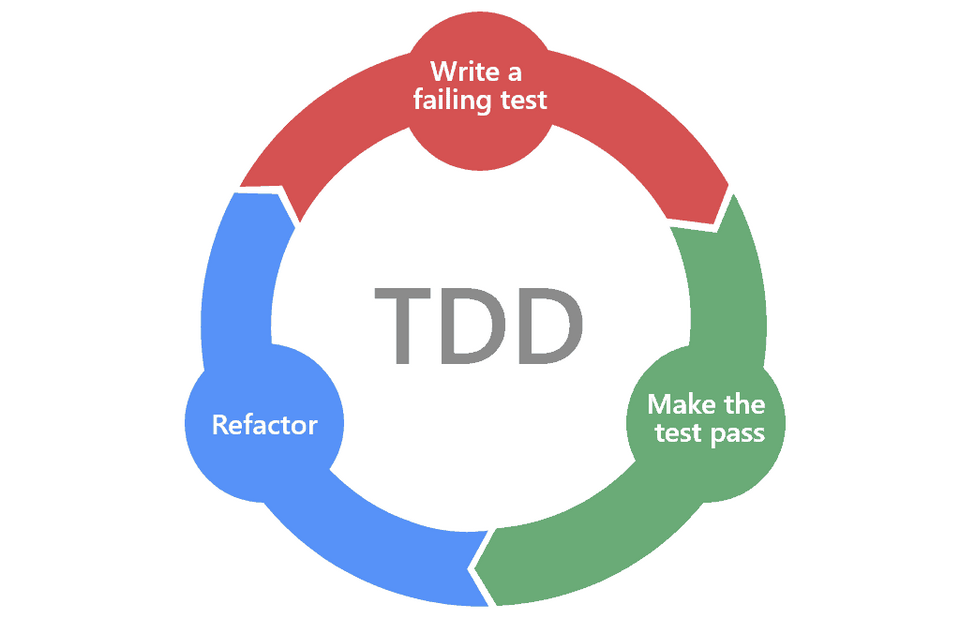
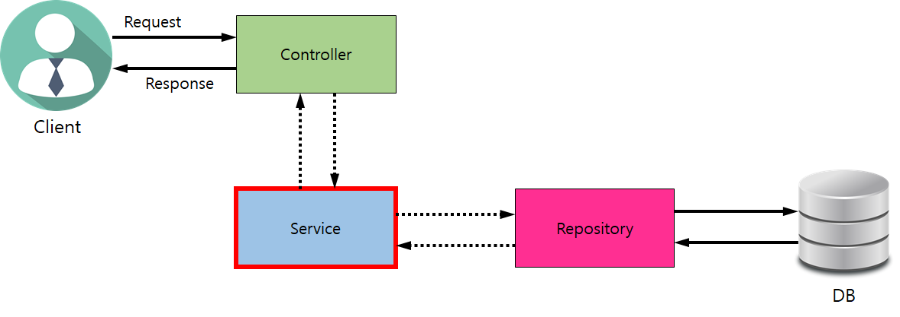
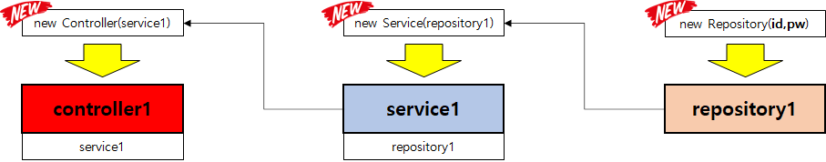
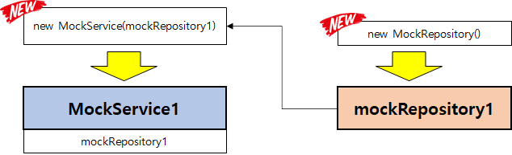
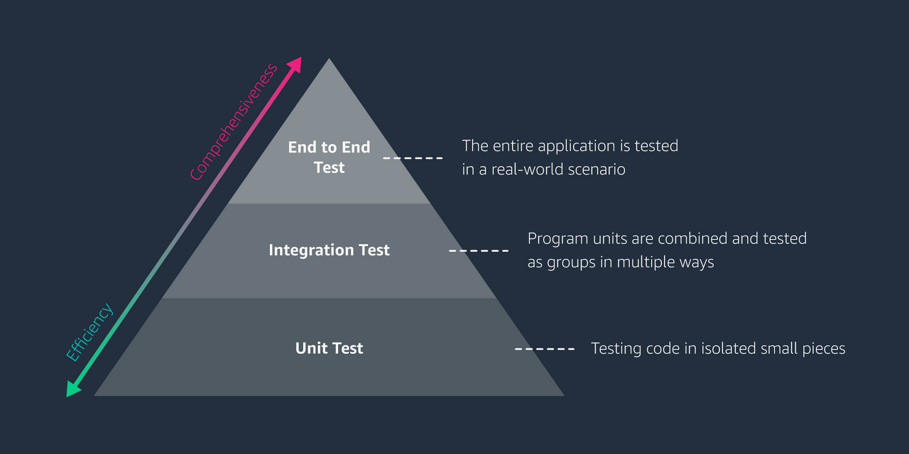

## 01. 테스트의 필요성

1. 개발은 어려운 일입니다.  
   1. 버그
      1. 소프투에어가 예상하지 못한 결과를 내는 것
      2. 버그는 '소스 코드'나 설계과정에서의 오류'때문에 발생
   2. 현업에서 '버그'란
      1. 사용자들에게 불편을 줄 수 있다.
         * 일부 기능이 동작하지 않음 (이커머스 사이트에서 '주문'만 안 됨)
         * 일부 기능이 의도와 다르게 동작 (10만원 결제 → 100만원 결제)
           + 잘못된 동작에 대한 고객 보상 및 데이터 보정 작업이 추가로 필요
         * 전체 기능 동작하지 않음 (서비스 접속 불가)
      2. 회사에 악영향
         * 매출 감소
         * 신뢰도 감소
           + 필요할 때 내 곁에 없는 회사..
           + 회사정보, 개인정보 유출 가능성
      3. 저녁 없는 삶, 주말 없는 삶, 휴가 없는 삶의 원인
         * 버그는 시간을 가려서 발생하지 않음
         * 소프트웨어는 스스로 치유되는 능력이 없음
2. 개발 코드 배포 전, 버그를 (최대한 많이) 찾아내는 법
   1. 블랙박스 테스팅
      1. 개념  
         - 블랙박스 테스팅이란 소프트웨어 내부 구조나 동작원리를 모르는 블랙박스와 같은 상태에서,   
         즉 웹 서비스의 사용자 입장에서 동작을 검사하는 방법
      2. 장점과 단점
         1. 장점
            1. 누구나 테스트 가능 - 개발자부터 디자이너, 베타 테스터 혹은 사장님까지!
         2. 단점
            1. 기능이 증가될 수록 테스트의 범위가 증가
               1. 시간이 갈 수 록 테스트하는 사람이 계속 늘어나야함
            2. 테스트 하는 사람에 따라 테스트 퀄러티가 다를 수 있음 → QA 직군이 있는 이유
      3. 개발자 테스트
         1. 장점
            1. 빠르고 정확한 테스트 가능 (예상 동작 VS 실제 동작)
            2. 테스트 자동화 가능
               1. 배포 절차 시 테스트 코드가 수행되어 동작 검증
            3. 리팩토링 후 기존 동작에 대한 보증수표!!!
         2. 단점
            1. 개발 시간이 오래 걸림
            2. 테스트 코드를 유지보수하는 비용

---

## 02. JUnit을 이용한 단위 테스트

01. 단위 테스트

> 프로그램을 작은 단위로 쪼개서 각 단위가 정확하게 동작하는지 검사하고 이를 통해 문제 발생 시 정확하게 어느 부분이 잘못되었는지를 재빨리 확인할 수 있게 해준다.

* 버그 발견 시간이 늦어짐에 따라 비용은 기하급수적으로 커질 수 있다.



1. Development: 개발
2. Unit Tests (**단위 테스트**): 개발자 테스트
3. QA Testing:
   * 블랙박스 테스팅
   * 주로 QA 팀이 Production 환경과 유사한 환경(Stage)에서 테스팅
4. Production: 실 서비스 운영 환경

---

02. JUnit 사용 설정

> JUnit이란 자바 프로그래밍 언어용 단위 테스트 프레임워크입니다.

* build.gradle 파일을 열어보면 JUnit 사용을 위한 환경설정이 이미 되어있습니다



03. 테스트 파일 생성

1. Navigate > File > "원하는 클래스 이름" 입력
2. 해당 클래스 내에서 오른쪽 마우스를 눌러서 Generate > test > 기본 세팅 그대로

04. 테스트 코드 작성

```java
class ProductTest {
    @Test
    @DisplayName("정상 케이스")
    void createProduct_Normal() {
        // given
        Long userId = 100L;
        String title = "오리온 꼬북칩 초코츄러스맛 160g";
        String image = "https://shopping-phinf.pstatic.net/main_2416122/24161228524.20200915151118.jpg";
        String link = "https://search.shopping.naver.com/gate.nhn?id=24161228524";
        int lprice = 2350;

        ProductRequestDto requestDto = new ProductRequestDto(
                title,
                image,
                link,
                lprice
        );

        // when
        Product product = new Product(requestDto, userId);

        // then
        assertNull(product.getId());
        assertEquals(userId, product.getUserId());
        assertEquals(title, product.getTitle());
        assertEquals(image, product.getImage());
        assertEquals(link, product.getLink());
        assertEquals(lprice, product.getLprice());
        assertEquals(0, product.getMyprice());
    }
}
```

---

## 03. Edge 케이스를 고려한 단위 테스트

1) 다양한 Edge 케이스 고려해보기

* 입력 가능한 모든 케이스를 고려해 보기

```java
// 회원 Id
Long userId = 1230L;
// 상품명
String title = "오리온 꼬북칩 초코츄러스맛 160g";
// 상품 이미지 URL
String image = "https://shopping-phinf.pstatic.net/main_2416122/24161228524.20200915151118.jpg";
// 상품 최저가 페이지 URL
String link = "https://search.shopping.naver.com/gate.nhn?id=24161228524";
// 상품 최저가
int lprice = 2350;
```

1. 회원 ID

> 1) 회원 아이디 (userId) 가 null 로 들어온다면, 등록된 상품은 어떤 회원의 상품이 되는거지?  
>   
> 2) 회원 아이디 (userId) 가 마이너스 값이라면, 등록된 상품은 어떤 회원의 상품이 되는거지? (DB 테이블 Id 의 경우 마이너스 값을 가질 수 없음)

2. 상품명

> 1) 상품명이 null 로 들어오면 어떻하지?   
> 2) 상품명이 빈 문자열인 경우에도 저장을 해야 할까? → 저장한다면 UI 에서는 어떻게 표시되야 할까?

3. 상품 이미지 URL

> 1) 상품 이미지 URL 이 null 로 들어오면?   
> 2) 상품 이미지 URL 이 URL 형태가 아니라면?? (UI 에는 어떻게 표시될까?)

4. 상품 최저가 페이지 URL

> 1) 상품 최저가 페이지 URL 이 null 로 들어오면?  
> 2) 상품 최저가 페이지 URL 이 URL 형태가 아니라면?? (UI 에서는 어떻게 동작될까?)

5. 상품 최저가

> 1) 상품 최저가가 0 이라면? (공짜 상품??)   
> 2) 상품 최저가가 음수라면??

---

2) Edge 케이스 발견 후 처리방법

> Edge 케이스에 대해 개발자가 독단적으로 방향을 결정하는 것보다는, 관련 담당자(들)과 협의 진행 후 결정합니다.

* 관련 담당자: 관련 개발팀, 기획자, 디자이너, QA
* 예를들면,
  + 에러 발생으로 결정
    - 정확한 에러문구 필요 (문구의 통일성, 글로벌 서비스의 경우 번역 고려)
    - 부적절한 문구의 예: "헐.. 빈 문자열을 입력하시면 레알 멘붕!!"
  + 빈 문자열 허용
    - DB 에는 빈 문자열 ("")
    - UI 에 표시할 때는 "**알 수 없음**" 으로 표시 → 프론트엔드 개발 필요
  + 빈 이미지 허용
    - UI 에 대체 이미지 표시 → 디자이너, 프론트엔드 개발 작업이 필요

---

3) TDD(Test-Driven-Development)

* AS-IS) 설계 → 개발 → 테스트 (→ **설계 수정)** 순서를
* TO-BE) 설계 → 테스트 **(→설계 수정)** → 개발로 변경



---

## 04. Mock object 직접 구현을 통한 단위 테스트

1) ProductService의 단위 테스트 작성 시도

* 상품 희망 최저가 업데이트 시
  + "최저가 입력 조건" 추가: **최소 100원 이상**

```java
@Service
public class ProductService {
		public static final int MIN_MY_PRICE = 100;

		// ...

    public Product updateProduct(Long id, ProductMypriceRequestDto requestDto) {
        int myprice = requestDto.getMyprice();
        if (myprice < MIN_MY_PRICE) {
            throw new IllegalArgumentException("유효하지 않은 관심 가격입니다. 최소 " + MIN_MY_PRICE + " 원 이상으로 설정해 주세요.");
        }

        Product product = productRepository.findById(id)
                .orElseThrow(() -> new NullPointerException("해당 아이디가 존재하지 않습니다."));

        product.setMyprice(myprice);
        productRepository.save(product);

        return product;
    }

		// ...
}
```

> 현재 상황  
> - 목적은 ProductService를 테스트하려고 하는 것이지, ProductRepository가 아니다! 현재 DI가 많이 걸려있다...  
> => 해결 방법은 Mock Object



---

2) Mock Object(가짜 객체)

> 이상적으로, 각 테스트 케이스는 서로 분리되어야 한다.   
> 이를 위해 **가짜 객체(Mock object)**를 생성하는 것도 좋은 방법이다.

**1. 분리 되기 어려운 클래스들**



* **Controller 클래스**만 테스트할 수 없을까?
  + 테스트 범위: Controller, Service, Repository
* **Service 클래스**만 테스트할 수 없을까?
  + 테스트 범위: Service, Repository
* **Repository 클래스**만 테스트할 수 없을까?
  + 테스트 범위: Repository

---

**2. 가짜객체 (Mock object) 를 통한 분리 방법**



* 가짜 객체 (Mock object) 로 분리
* MockRepository
  + 실제 객체와 겉만 같은 객체!
    - 동일한 클래스명, 함수명
  + 실제 DB 작업은 하지 않음
    - DB 작업이 이뤄지는 것처럼~
    - 테스트를 위해 필요한 결과값을 return
* 이하 간단히 'mock' (목) 이라고 부르기로 함

> MockRepository는 DB와 연결하는 것이 아니라 메모리에 저장(리스트, 배열, Collection 등)하여 각 기능을 확인한다.  
> 그래서 Spring Data JPA를 사용하였던 기능들을 구현해줄 필요가 있다.

> [꿀팁]  
> 1. Compare Code  
> 파일 비교 시 원하는 영역을 둘다 스크롤하여 오른쪽 마우스로 Compare 하면 영역이 둘로 나뉘어서 코드를 순서대로 같이 내리면서 확인할 수 있다.  
> (Comment)  맨날... 그냥 영역나눠서 스크롤해서 팔아팠는데...

---

## 05. Mockito mock을 사용한 단위 테스트

1. Mockito 를 사용한 단위 테스트 구현

* Mockito framework: Mock 객체를 쉽게 만들 수 있는 방법 제공
* **@Mock 어노테이션을 선언하여 복잡한 DI 문제를 해결할 수 있다.**

```java
@ExtendWith(MockitoExtension.class)
class ProductServiceTest {
    @Mock
    ProductRepository productRepository;

    @Test
    @DisplayName("관심 상품 희망가 - 최저가 이상으로 변경")
    void updateProduct_Normal() {
        // given
        Long productId = 100L;
        int myprice = MIN_MY_PRICE + 1000;

        ProductMypriceRequestDto requestMyPriceDto = new ProductMypriceRequestDto(
                myprice
        );

        ProductService productService = new ProductService(productRepository);

        // when
        Product result = productService.updateProduct(productId, requestMyPriceDto);

        // then
        assertEquals(myprice, result.getMyprice());
    }

    @Test
    @DisplayName("관심 상품 희망가 - 최저가 미만으로 변경")
    void updateProduct_Failed() {
        // given
        Long productId = 100L;
        int myprice = MIN_MY_PRICE - 50;

        ProductMypriceRequestDto requestMyPriceDto = new ProductMypriceRequestDto(
                myprice
        );

        ProductService productService = new ProductService(productRepository);

        // when
        Exception exception = assertThrows(IllegalArgumentException.class, () -> {
            productService.updateProduct(productId, requestMyPriceDto);
        });

        // then
        assertEquals(
                "유효하지 않은 관심 가격입니다. 최소 " + MIN_MY_PRICE + " 원 이상으로 설정해 주세요.",
                exception.getMessage()
        );
    }
}
```

2. Mokito를 사용한 단위 테스트 실행 결과 리뷰

* 현재 2개 중 1개가 에러가 발생하고 있다.
* 이유는 Mock을 사용했을 때 사용케이스도 정의가 필요하다는 것이다.
* 즉, 가짜 함수를 호출해 줄 수 있지만, 결과에 대해서 명시를 해주어야한다.
* 아래 코드와 위 코드를 비교해보면 .thenReturn(Optional.of(product)); 부분만 변경되었는데   
  이 부분을 명시적으로 리턴값을 설정하는 것이고, 해당 결과의 타입을 Null이 아닌경우를 판단하는 것이다.  
  [참조 : [Optional 개념 및 사용법](https://mangkyu.tistory.com/70) ]

```
@ExtendWith(MockitoExtension.class)
class ProductServiceTest {
    @Mock
    ProductRepository productRepository;

    @Test
    @DisplayName("관심 상품 희망가 - 최저가 이상으로 변경")
    void updateProduct_Normal() {
        // given
        Long productId = 100L;
        int myprice = MIN_MY_PRICE + 1000;

        ProductMypriceRequestDto requestMyPriceDto = new ProductMypriceRequestDto(
                myprice
        );

        Long userId = 777L;
        ProductRequestDto  requestProductDto = new ProductRequestDto(
                "오리온 꼬북칩 초코츄러스맛 160g",
                "https://shopping-phinf.pstatic.net/main_2416122/24161228524.20200915151118.jpg",
                "https://search.shopping.naver.com/gate.nhn?id=24161228524",
                2350
        );

        Product product = new Product(requestProductDto, userId);

        ProductService productService = new ProductService(productRepository);

        when(productRepository.findById(productId))     // Mock객체가 호출되었을때 thenRutrn : 이 결과를 내줘라라
               .thenReturn(Optional.of(product));       // 결과가 Optional 형태여야 되기 때문에 

        // when
        Product result = productService.updateProduct(productId, requestMyPriceDto);

        // then
        assertEquals(myprice, result.getMyprice());
    }

    @Test
    @DisplayName("관심 상품 희망가 - 최저가 미만으로 변경")
    void updateProduct_Failed() {
        // given
        Long productId = 100L;
        int myprice = MIN_MY_PRICE - 50;

        ProductMypriceRequestDto requestMyPriceDto = new ProductMypriceRequestDto(
                myprice
        );

        ProductService productService = new ProductService(productRepository);

        // when
        Exception exception = assertThrows(IllegalArgumentException.class, () -> {
            productService.updateProduct(productId, requestMyPriceDto);
        });

        // then
        assertEquals(
                "유효하지 않은 관심 가격입니다. 최소 " + MIN_MY_PRICE + " 원 이상으로 설정해 주세요.",
                exception.getMessage()
        );
    }
}
```

---

## 06. 통합 테스트

**1. 단위 테스트 vs 통합 테스트**



1. 단위 테스트 (Unit Test)
   * 하나의 모듈이나 클래스에 대해 세밀한 부분까지 테스트 가능
   * 모듈 간에 상호 작용 검증 못함
2. 통합 테스트 (Integration Test)
   * 두 개 이상의 모듈이 연결된 상태를 테스트
   * 모듈 간의 연결에서 발생하는 에러 검증 가능
3. E2E 테스트 (End to End Test)
   * 실제 사용자의 실행 환경과 거의 동일한 환경에서 테스트 진행 (=블랙박스 테스팅)

**2. '눈길' 서비스를 테스트한다면**

>  👉 드라마 '스타트업' 에는 '눈길'이라는 서비스가 등장하는데요, 이는 스마트폰으로 시각 장애인들에게 도움을 주는 서비스입니다. "영실아, 지금 정류장에 들어오는 버스 번호 좀 알려줘!" "영실아, 이 지폐가 얼마짜리야?"  
>   
> 그렇다면 우리가 이 서비스를 테스트한다고 가정해 봅시다!

1. 단위 테스트
   1. 음성인식 기능 (음성 → 텍스트)
   2. 텍스트 명령 이해 기능
      1. 한국어
      2. 영어
      3. 중국어
   3. 사진 촬영 기능
   4. 사진 속 사물 인식 기능
   5. 명령에 대한 응답 텍스트 생성
   6. 응답 텍스트 음성 변환 (텍스트 → 음성)
2. 통합 테스트
   * 음성 인식 + 텍스트 명령 이해 기능
   * 사진 촬영 + 사진 속 사물 인식 기능
   * 음성 인식 ~ 텍스트 음성 변환
3. E2E 테스트
   * 갤럭시폰에서 실 서비스 테스트
   * 아이폰에서 실 서비스 테스트

---

## 07. 스프링 부트를 이용한 통합 테스트

**1. 스프링 부트 이용한 통합 테스트**

* 통합 테스트
  + 여러 단위 테스트를 하나의 통합된 테스트로 수행
  + Controller → Service → Repository
* 단위 테스트 시 스프링은 동작되지 않는다.

```java
class ProductTest {

    @Autowired
    ProductService productService;

	// ...

		@Test
    @DisplayName("정상 케이스")
    void createProduct_Normal() {
	// ...

	****// 에러 발생! productService 가 null
        Product productByService  = productService.createProduct(requestDto, userId);
}
```

* "@SpringBootTest"
  + **스프링이 동작되도록 해주는 어노테이션!(스프링이 시작되는 시간이 좀 걸린다는 단점이 있다)**
  + 테스트 수행 시 스프링이 동작함
    - Spring IoC 사용 가능
    - Repository 사용해 DB CRUD 가능
  + End to End 테스트도 가능
    - **Client 요청** → Controller → Service → Repository → **Client 응답**
    - **즉, HTTP 통신이 가능하다**

* @Order(1), @Order(2), ...
  + 테스트의 순서를 정할 수 있음
  + 테스트 실행 시, 순서가 정해져있지 않아 항상 순서가 바뀔 수 있다는 문제점이 있다.
  + 통합테스트에서는 순서가 중요할 수 있기 때문에 순서를 정하는 것이 좋다.

**2. 관심상품 통합 테스트 설계**

1. 신규 관심상품 등록
   * 회원 Id 는 임의의 값
2. 신규 등록된 관심상품의 희망 최저가 변경
   * 1번에서 등록한 관심상품의 희망 최저가를 변경
3. 회원 Id 로 등록된 모든 관심상품 조회
   * 조회된 모든 관심상품 중 1번에서 등록한 관심상품이 존재하는지?
   * 2번에서 업데이트한 내용이 잘 반영되었는지?

```java
package com.sparta.springcore.integration;

import com.sparta.springcore.dto.ProductMypriceRequestDto;
import com.sparta.springcore.dto.ProductRequestDto;
import com.sparta.springcore.model.Product;
import com.sparta.springcore.service.ProductService;
import org.junit.jupiter.api.*;
import org.springframework.beans.factory.annotation.Autowired;
import org.springframework.boot.test.context.SpringBootTest;

import java.util.List;

import static org.junit.jupiter.api.Assertions.assertEquals;
import static org.junit.jupiter.api.Assertions.assertNotNull;

@SpringBootTest(webEnvironment = SpringBootTest.WebEnvironment.RANDOM_PORT)     // Spring이 시작하기 위한 포트를 설정해주어야한다.
@TestInstance(TestInstance.Lifecycle.PER_CLASS)                                 //
@TestMethodOrder(MethodOrderer.OrderAnnotation.class)                           // 테스트 순서를 지정하기 위해 어노테이션션
public class ProductIntegrationTest {
    @Autowired                                                                  // Spring에서 실행되므로  Bean을 사용할 수 있다.
    ProductService productService;

    Long userId = 100L;
    Product createdProduct = null;
    int updatedMyPrice = -1;

    @Test
    @Order(1)
    @DisplayName("신규 관심상품 등록")
    void test1() {
        // given
        String title = "Apple <b>에어팟</b> 2세대 유선충전 모델 (MV7N2KH/A)";
        String imageUrl = "https://shopping-phinf.pstatic.net/main_1862208/18622086330.20200831140839.jpg";
        String linkUrl = "https://search.shopping.naver.com/gate.nhn?id=18622086330";
        int lPrice = 77000;
        ProductRequestDto requestDto = new ProductRequestDto(
                title,
                imageUrl,
                linkUrl,
                lPrice
        );

        // when
        Product product = productService.createProduct(requestDto, userId);

        // then
        assertNotNull(product.getId());
        assertEquals(userId, product.getUserId());
        assertEquals(title, product.getTitle());
        assertEquals(imageUrl, product.getImage());
        assertEquals(linkUrl, product.getLink());
        assertEquals(lPrice, product.getLprice());
        assertEquals(0, product.getMyprice());
        createdProduct = product;
    }

    @Test
    @Order(2)
    @DisplayName("신규 등록된 관심상품의 희망 최저가 변경")
    void test2() {
        // given
        Long productId = this.createdProduct.getId();
        int myPrice = 70000;
        ProductMypriceRequestDto requestDto = new ProductMypriceRequestDto(myPrice);

        // when
        Product product = productService.updateProduct(productId, requestDto);

        // then
        assertNotNull(product.getId());
        assertEquals(userId, product.getUserId());
        assertEquals(this.createdProduct.getTitle(), product.getTitle());
        assertEquals(this.createdProduct.getImage(), product.getImage());
        assertEquals(this.createdProduct.getLink(), product.getLink());
        assertEquals(this.createdProduct.getLprice(), product.getLprice());
        assertEquals(myPrice, product.getMyprice());
        this.updatedMyPrice = myPrice;
    }

    @Test
    @Order(3)
    @DisplayName("회원이 등록한 모든 관심상품 조회")
    void test3() {
        // given

        // when
        List<Product> productList = productService.getProducts(userId);

        // then
        // 1. 전체 상품에서 테스트에 의해 생성된 상품 찾아오기 (상품의 id 로 찾음)
        Long createdProductId = this.createdProduct.getId();
        Product foundProduct = productList.stream()
                .filter(product -> product.getId().equals(createdProductId))
                .findFirst()
                .orElse(null);

        // 2. Order(1) 테스트에 의해 생성된 상품과 일치하는지 검증
        assertNotNull(foundProduct);
        assertEquals(userId, foundProduct.getUserId());
        assertEquals(this.createdProduct.getId(), foundProduct.getId());
        assertEquals(this.createdProduct.getTitle(), foundProduct.getTitle());
        assertEquals(this.createdProduct.getImage(), foundProduct.getImage());
        assertEquals(this.createdProduct.getLink(), foundProduct.getLink());
        assertEquals(this.createdProduct.getLprice(), foundProduct.getLprice());

        // 3. Order(2) 테스트에 의해 myPrice 가격이 정상적으로 업데이트되었는지 검증
        assertEquals(this.updatedMyPrice, foundProduct.getMyprice());
    }
}
```

---

## 08. 스프링 MVC 테스트

1. Spring MVC 테스트

1. build.gradle에 Depencies 추가  
   testImplementation 'org.springframework.security:spring-security-test'
2. MockSpringSecurityFilter   
   - Spring의 필터 역할을 해주는 건데 Spring Secuity의 Mock 가자 싸용자를 만들어 주기 위해서 필터가 필요하기 대문에 추가해준 부분이다.
3. UserProductMvcTest   
   - @WebMvcTest 어노테이션는 Controller를 테스트 한다  
   > 이를 위해서는 HTTP 통신이 필요한데, 클라이언트와의 관계에서 클라이언트가 요청을 해서 그 결과로 클라이언트의 어떤 값이 오면 그것을 확인하는 이런 과정으로 View와 Controller 까지 테스트한다

> 참조 - [다양한 Spring Boot 테스트 Annotation](https://www.baeldung.com/spring-boot-testing)
