**이번 주차는 신기하게 수업 목표가 없다...**

**없는 것일까 삭제된 것일까?**

**궁금해하고 있었다..**


---

### **1. 4주차 배울 내용**

* 4주차에는 JPA, Spring Data JPA를 배울 예정이다.
* 배운 내용을 바탕으로 '나만의 셀렉샵'에 폴더 기능을 추가하는 작업을 진행한다.

1. **JPA**
   1. **영속성 컨텍스트**
   2. **JPA 연관관계**
2. **Spring Data JPA**
   1. **Query Methods**
   2. **페이지 및 정렬**
3. **'나만의 셀렉샵'에 폴더 기능 추가**

---

### **2. JPA 이해**

> **강의 시작 전, 내가 알고 있는 JPA는?**  
> 내가 알고 있는 JPA는 Java에서 ORM 기술 표준으로 사용하는 인터페이스 모음이다.  
> 즉, Java에서 ORM을 사용하는 가장 대표적인 방법이다.  
> JPA 하면 생각나는 것은 Hibernate, Spring Data JPA가 있다. 

#### **1. ORM(Object-Relational Mapping)**

* Object : "객체"지향 언어 (자바, 파이썬)
* Relation : "관계형" 데이터베이스(H2, MySQL)
* 백엔드 개발자(Backend Developer): 웹 서버를 개발하는 개발자
* DBA (Database Administration): 데이터베이스 관리자. 데이터베이스를 설치, 구성, 관리 등의 일을 맡은 사람

**(질문)**  
**1. ORM이 없이 웹 서버 개발은 못 하나요?**

* ORM 없이도 충분히 웹 서버 개발 가능
* 예) AllInOneController 에서 Repository 역할 분리

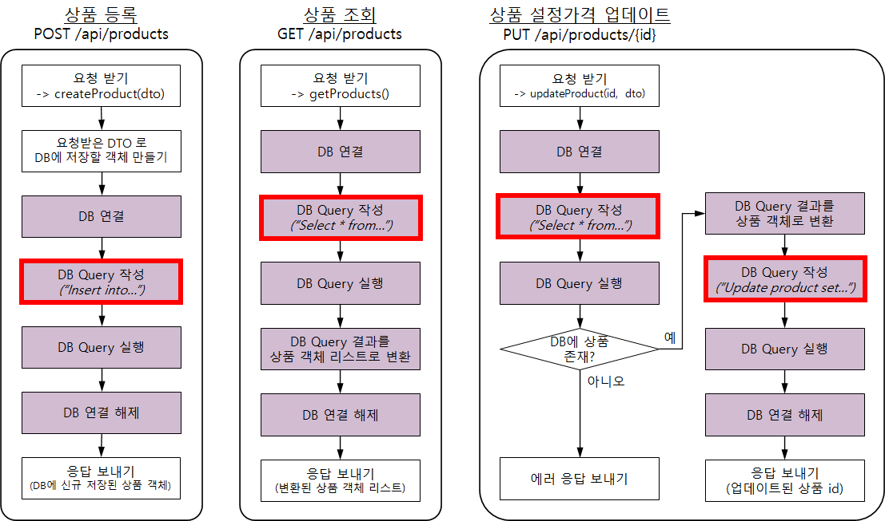

* ORM 만든 이유?
  + ORM 이 없는 환경에서는 백엔드 개발자가 비즈니스 로직 개발보다 SQL 작성에 더 많은 노력을 들여야하기 때문
  + SQL 작성은 단순하고 반복적이며, 실수하기는 쉬움
* 웹 서버 개발 언어(Java, Python, Javascript 등) 와 관계형 데이터베이스 언어 (SQL) 의 목적 및 사용방법이 다름

**2. 백엔드 개발자는 DB에 대해 몰라도 될까?**

> 정답은 X  
> 이유는 백엔드 개발자는 DB 테이블 설계, SQL Query 성능 확보 등을 위해 DB 에 대해 잘 알고 있어야 한다. 

#### **2. JPA**

* JPA: Java Persistence API 자바 ORM 기술에 대한 표준 명세

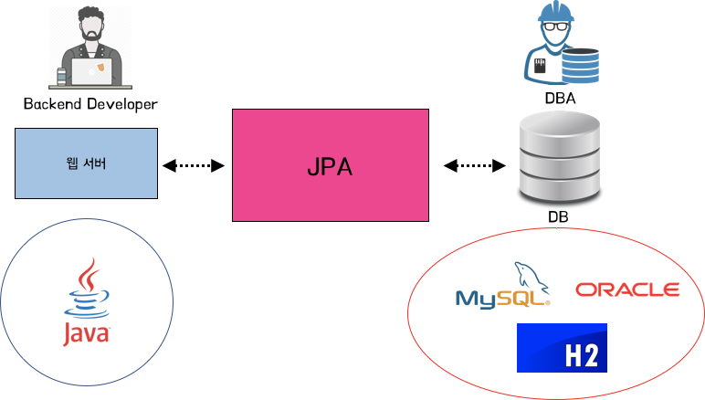

1) JPA 샘플

* 테이블 및 컬럼 매핑

```java
@Entity // DB 테이블 역할을 합니다.
public class User {
		// ID가 자동으로 생성 및 증가합니다.
    @GeneratedValue(strategy = GenerationType.AUTO)
    @Id
    private Long id;

    // nullable: null 허용 여부
    // unique: 중복 허용 여부 (false 일때 중복 허용)
    @Column(nullable = false, unique = true)
    private String username;

    @Column(nullable = false)
    private String password;

    @Column(nullable = false, unique = true)
    private String email;

    @Column(nullable = false)
    @Enumerated(value = EnumType.STRING)
    private UserRoleEnum role;

    @Column(unique = true)
    private Long kakaoId;
}
```

* DB 테이블 및 컬럼

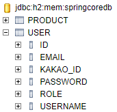

> [질문]  
> 1. JPA 가 없으면?   
> (나) - 서비스 로직에만 집중할 수 없고, DB 처리를 위한 SQL 처리에 많은 시간을 소요하게 된다.  
> (강의)   
> - 직접 SQL문을 작성해서 구현 가능( AllInOneController )  
> - 실제로 과거엔 JPA없이 웹 서버를 개발한 기업이 많았고, 현재도 유효  
>   
> 2. JPA 사용 트렌드?  
> - 과거 SQL 매퍼(MyBatis, JdbcTemplate) 위주로 개발  
> - 전 세계적으로 JPA 사용 빈도가 급격히 높아졌고 현재는 JPA가 대세  
>   
> 3. Hibernate  
> - JPA는 표준 명세이고, 이를 실제 구현한 프레임워크 중 사실상 표준에 해당  
> - 스프링 부트에서 기본적으로 "하이버네이트" 사용 중

---

### 

### **3. JPA 영속성 컨텍스트 이해**

#### **1. 영속성 컨텍스트**

* JPA
  + **객체** - ORM - **DB**
  + **객체** - **영속성 컨텍스트 매니져** (entity context manager) - **DB**
* **영속성 컨텍스트 매니저**
  + 객체와 DB의 소통을 효율적으로 관리
* PK(Primary Key)
  + 테이블에서 각 row 마다 가져야 하는 유일무이한 값(Null 허용되지 않음)
  + 샘플
    - 자연키 vs 인조키
      * 자연키 : Username, Email
      * 인조키 : ID
    - 보통 테이블 ID를 PK로 설정(인조키)

> Quiz) 왜 인덱스를 PK로 사용할까??  
> 정답은 **검색 성능을 향상 시키기 위함이다.**(검색 성능을 실질적으로 향상시키기 위해서 해당 쿼리가 index를 사용하는지, 카디널리티 또는 selectivity와 같은 요소들이 고려된 인덱스가 생성되어야 한다.)  
> 1. 장점  
> - 빠른 검색 선으  
>   
> 2. 단점  
> - 인덱스를 구성하는 비용(추가, 수정, 삭제 연산시 인덱스 형성하기 위해 필요한 추가적 연산)  
>   
> [참조] [데이터베이스에서 인덱스를 사용해야하는 이유](https://velog.io/@guswns3371/%EB%8D%B0%EC%9D%B4%ED%84%B0%EB%B2%A0%EC%9D%B4%EC%8A%A4-%EB%8D%B0%EC%9D%B4%ED%84%B0%EB%B2%A0%EC%9D%B4%EC%8A%A4%EC%97%90%EC%84%9C-%EC%9D%B8%EB%8D%B1%EC%8A%A4%EB%A5%BC-%EC%82%AC%EC%9A%A9%ED%95%98%EB%8A%94-%EC%9D%B4%EC%9C%A0)

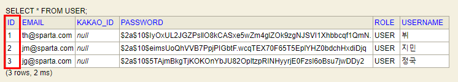

#### **2. 프로젝트 및 H2 File DB 세팅**

**1. DB 관련 설정 변경**

* H2 In-memory DB → File DB
* JPA 에 의해 변경된 DB 요청 "SQL 쿼리"가 출력되게 설정
* resources > application.properties에 다음과 같이 설정

```java
spring.h2.console.enabled=true
spring.datasource.driverClassName=org.h2.Driver
spring.datasource.url=jdbc:h2:./myselectdb;AUTO_SERVER=TRUE     # mem을 쓰지않고, ./myselectdb라는 파일이 기동되어 저장된다.
spring.datasource.username=sa
spring.datasource.password=

[REDACTED]=true                 # hibernate에 대한 SQL을 출력
spring.jpa.hibernate.ddl-auto=update
spring.jpa.generate-ddl=true
logging.level.org.hibernate.SQL=debug
logging.level.org.hibernate.type.descriptor.sql=trace

server.port=8090                                                # 기존 서버 포트와 겹치지 않게 하기 위한 용도이고 주석처리해도 상관 없다.
```

**2. 회원 테이블 Entity**

* 기존과 다른 점은 Index가 아닌 username을 PK로 설정
* name이라는 필드 이름으로 username을 저장하도록 설정

```java
import lombok.Getter;
import lombok.NoArgsConstructor;
import lombok.Setter;

import javax.persistence.Column;
import javax.persistence.Entity;
import javax.persistence.Id;

@Setter
@Getter // get 함수를 일괄적으로 만들어줍니다.
@NoArgsConstructor // 기본 생성자를 만들어줍니다.
@Entity // DB 테이블 역할을 합니다.
public class User {
    // nullable: null 허용 여부
    // unique: 중복 허용 여부 (false 일때 중복 허용)
    @Id
    @Column(name = "id", nullable = false, unique = true)
    private String username;

    @Column(nullable = false, unique = false)
    private String nickname;

    @Column(nullable = false, unique = false)
    private String favoriteFood;

    public User(String username, String nickname, String favoriteFood) {
        this.username = username;
        this.nickname = nickname;
        this.favoriteFood = favoriteFood;
    }
}
```

3. 데이터베이스 설정

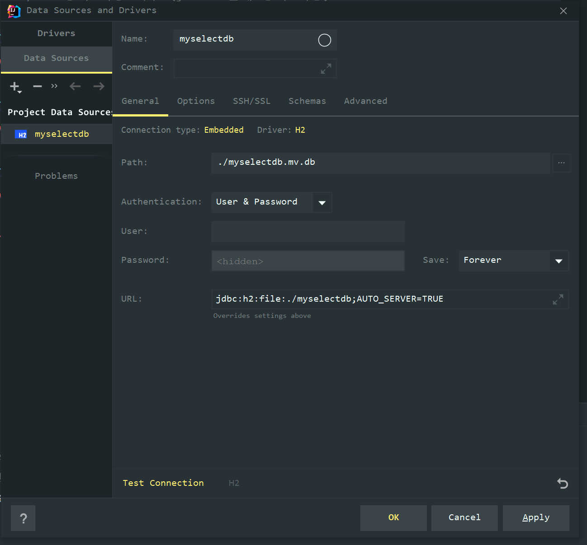

> 2020년 Intelij로 작업했을 때는 Catalog 스키마 에러가 발생하였었다.  
> 해결방법으로 좋은 방법은 아니지만, 시간 상 가장 적절한 방법은 업데이트였다.  
> 현재 2022.1버전에 Intelij Ultimate는 에러가 발생하지 않았고, 스키마가 잘보였다.. 

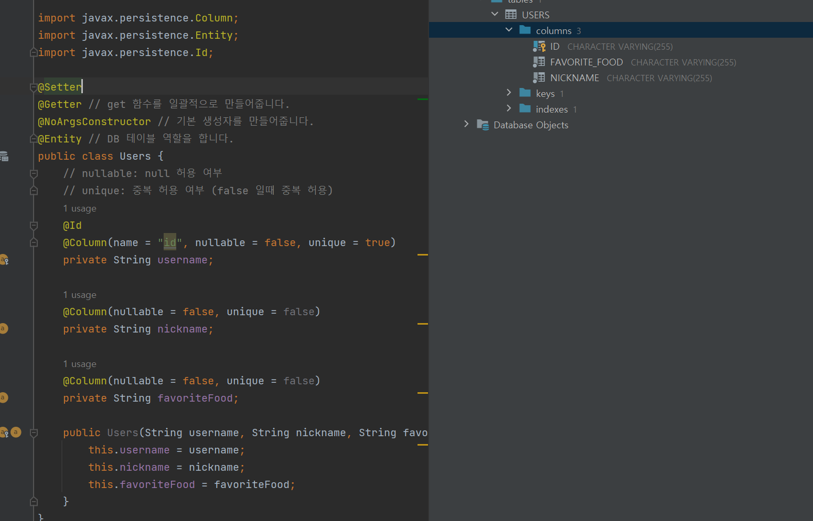

* [JPA] 규칙 발견!!  
  우리는 자바 convention하게 favoriteFood라고 Entity 멤버를 지정하였지만,  
  JPA는 자신의 규칙대로 대문자를 기준으로 '\_'를 붙여서 Column명을 재지정한다.  


  **자신이 원하는대로 지정하기 위해서는 어떻게 해야할까??**정답은 Id를 username으로 name을 지정해주었던 것처럼, 지정해주면 된다

#### **3. 영속성 컨텍스트 확인을 위한 테스트 코드 구현**

* Intellj 디버깅 시에 전체를 멈추는 것이 아니라 Thread로 처리하도록 변경

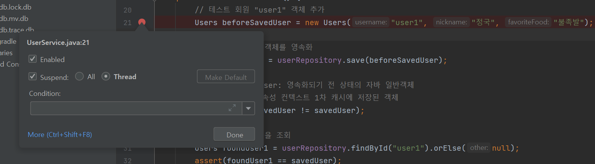

---

### **4. JPA 영속성 컨텍스트 1차 캐시 이해**

**1. 영속성 컨텍스트 1차 캐시**

* **Entity 저장 시**  
  - Entity에 들어가 있는 1차 캐시의 객체와 new User를 통해 생성한 객체는 서로 다른 객체이다.  
  - 내용은 같지만, 서로 다른 객체이다라는 것을 기억해야한다.  
  - 이유는 1차 캐시에서는 새롭게 하나를 만들어서 가지고 있는데, save시 리턴되는 해당 객체가 1차 캐시 Entity이다.

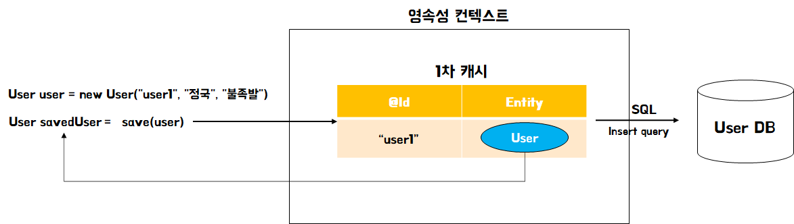

> [질문] 캐시는 무엇을 위해 만들어졌을까?  
> > 네트워크를 통해 데이터베이스에 접근하는 시간 비용은 애플리케이션 서버 내부 메모리에 접근하는 시간보다 훨씬 비싸다. 따라서 조회한 데이터를 메모리에 캐싱해 두면 데이터베이스 접근 횟수를 줄여 성능을 개선할 수 있다.

* Entity 조회 시(1차 캐시에 조회하는 ID가 존재하는 경우)  
  - findById를 할 경우, DB에서 가져오는 것이 아니라 영속성 컨텍스트 1차 캐시에 있는 객체에서 Id값으로 조회하는 것  
  - 1차 캐시에 있는 객체와 DB에 있는 객체는 서로 다르지만, 값은 동일하므로 사용에 문제가 없다.

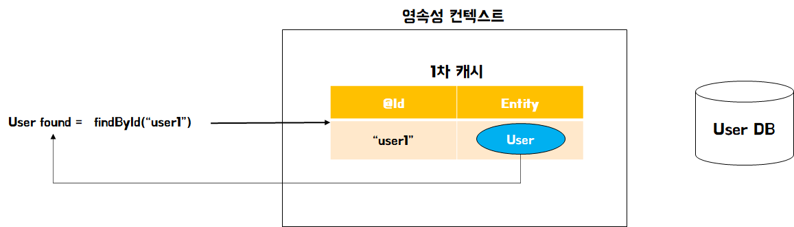

* Entity 조회 시(1차 캐시에 조회하는 Id 가 존재하지 않은 경우)  
  - 만약 1차 캐시에 없다면 query를 통해 DB에서 찾아서 가져와서 1차 캐시에 저장하여 사용한다.

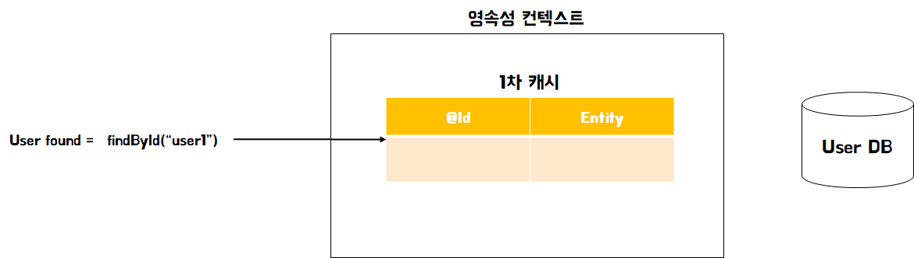
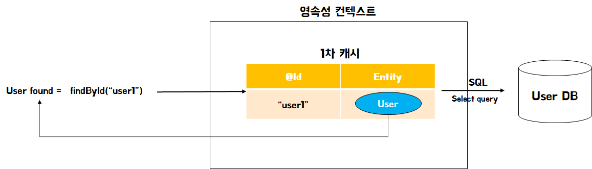
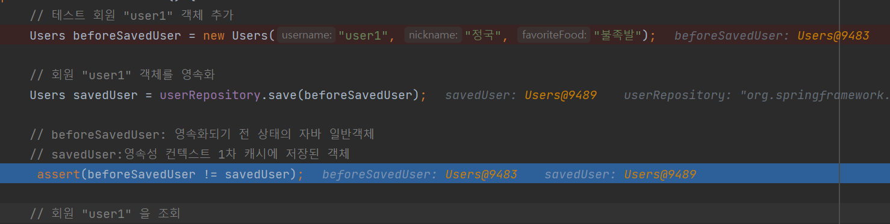

> '1차 캐시' 사용의 장점  
> 1. DB 조회 횟수를 줄임   
> 2. '1차 캐시'를 사용해 DB row 1개 당 객체 1개가 사용되는 것을 보장 (객체 동일성 보장)

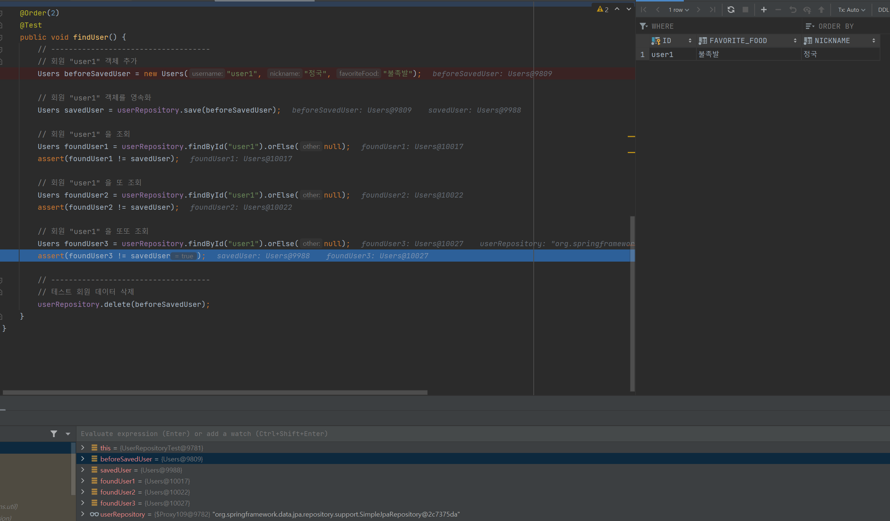

> 위 테스트 코드를 통해 알 수 있는 것은  
> 1. 1차 캐시가 무조건 동작하는 것이 아니라 Spring 내부에서만 동작한다. 라고만 생각하기  
> (Spring에서 설정에 따라서 바뀌는 부분들이 있으며 어쨌든 유용하기 때문에 Spring 내부에서 우리가 Service 부분에서 1차 캐시를 사용한다.  
>   
> 2. 일반적으로 1차 캐시가 그냥 동작하는 것은 아니다.

> [질문] 만약 DB 에서는 'user1' 회원 1명, 자바 객체로는 'user1' 회원 3명이라면??  
> - 만약 자바 객체로 n개를 만들어지고, 수정하게 된다면 동일성이 보장되지 못하게 된다.

---

**2. Entity 삭제**

1. User객체를 생성하여 저장한다.
2. User객체를 delete 메소드에 입력값으로 설정한다.
3. 자동으로 1차 캐시에 생성된 값을 삭제하고 Query문을 생성하여 DB에도 삭제한다.


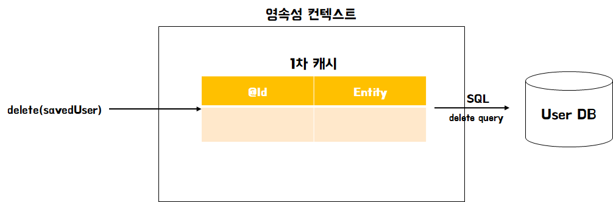

---

**3. Entity 업데이트 실패**

* Entity 객체를 수정해도 DB 에는 update 가 되지 않음

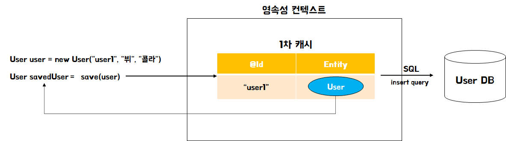
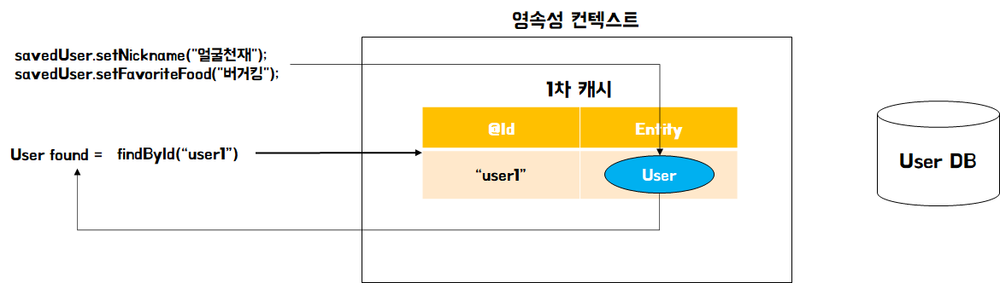

* **1차 캐시 Entity 객체에만 업데이트 반영됨**
* **User DB 에는 반영되지 않음**

**4. Entity 업데이트 방법**

**방법 1) userRepository.save() 사용**


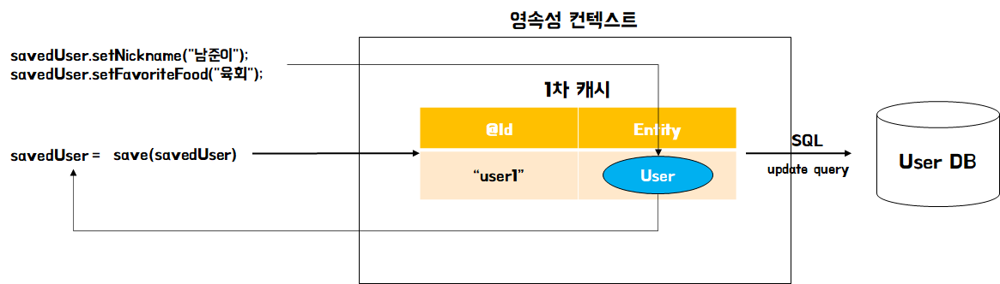

**방법 2)**

* @Transactional 을 추가하면 DB에도 함수 호출이 끝나야 반영이 된다.
* userRepository.save() 함수를 호출하지 않아도, 함수가 끝나는 시점에 변경된 부분을 알아서 업데이트 해준다  
  (이를 "Dirty check" 라고 함)
* 간단히 함수가 종료되는 시점에 각 Entity 에 save() 가 호출된다라고 이해

> 정확한 이해 위해 필요한 추가학습 내용 : 쓰기 지연 SQL 저장소, flush, commit 등

---

### **5. DB 의 연관관계 이해**

**1. DB의 연관관계**

* JPA 가 제공하는 연관관계는 결국 DB 의 연관관계를 표현하기 위함
* 따라서 먼저 DB 의 연관관계를 이해해야 함
* DB 의 연관관계는 비즈니스 요구사항에 맞춰 이루어짐

**2. 음식 주문앱 DB 설계 예제**

> 예를 들어, 우리가 음식 주문앱 DB를 설계한다고 가정해볼게요!   
> 일단 "고객이 1개의 음식을 주문할 수 있다"라는 요구사항을 받았다고 해봅시다.

1. 일단 각 주체의 테이블 설계가 필요

* 테이블 설계시 바로 작성하는 것보다 문장을 통해 필요한 요소를 작성하는 것이 좋다.

2. 연관 관계 고민

* 고객이 음식 주문 시, 주문 정보는 어느 테이블에 들어가야 할까?
* 고객 테이블? 음식 테이블??
* Tip) 테이블 설계 시 실제 값을 넣어봄 << 경험상 실제 문장을 통해 시나리오를 작성하고 하는 것이 낫다..

(상황1) "고객 테이블" 에 주문 정보

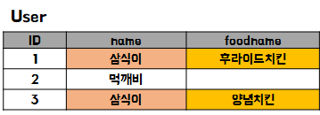

문제점 : 회원 중복

(상황2) "음식 테이블" 에 주문 정보

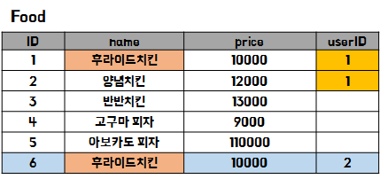

문제점 : 음식 중복

* '주문'을 위한 테이블이 필요 → Order 테이블 추가

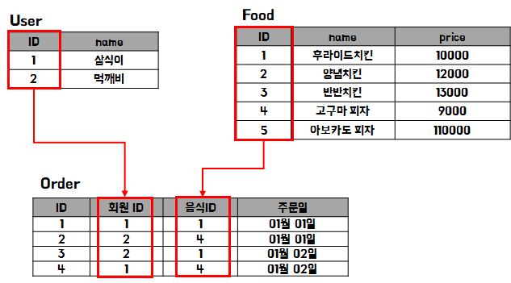

* 회원 1명은 주문 N개를 할 수 있다.
  + 회원 : 주문 = 1 : N 관계
* 음식 1개는 주문 N개에 포함될 수 있다.
  + 음식 : 주문 = 1 : N 관계
* 결론적으로
  + 회원 : 음식 = N : N 관계

---

### **6. JPA 연관관계**

**1. JPA 연관관계 설정**

> JPA 의 경우는 Enitity 클래스의 필드 위에 연관관계 어노테이션 (@) 을 설정해 주는 것만으로 연관관계가 형성됩니다!

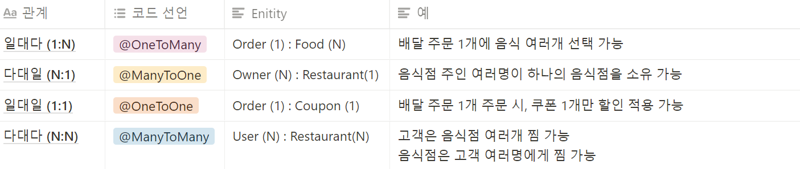

* 주문 코드

```java
@Enitity
public class Order {
    @OneToMany
    private List<Food> foods;

		@OneToOne
		private Coupon coupon;
}
```

* 음식점주

```java
@Entity
public class Owner {
	@ManyToOne
	Restaurant restaurant;
}
```

* 고객

```java
@Entity
public class User {
	@ManyToMany
	List<Restaurant> likeRestaurants;
}
```

---

### **7. Spring Data JPA**

> (나의 생각) Spring Data JPA는 JPA를 한 단계 추상화시킨 Repository이다.

**1. Spring Data JPA는?**

* JPA 를 편리하게 사용하기 위해, 스프링에서 JPA 를 Wrapping
* JPA 를 사용할 때 필수적으로 생성해야 하는 반복적인 코드들 → Spring Data JPA 가 대신 작성
* Repostiory 인터페이스만 작성하면, 필요한 구현은 스프링이 대신 알아서 척척!

**2. Spring Data JPA 예제**

* 상품 Enitity 선언

```java
@Entity
public class Product extends Timestamped {
    @GeneratedValue(strategy = GenerationType.AUTO)
    @Id
    private Long id;
    private Long userId;
    private String title;
    private String image;
    private String link;
    private int lprice;
    private int myprice;
}
```

* Spring Data JPA) 상품 Repository 생성

```java
public interface ProductRepository extends JpaRepository<Product, Long> {
}
```

* **ID 외의 필드에 대한 추가 기능은 interface 만 선언해 주면, 구현은 Spring Data JPA 가 대신!!(대단한 기능)**

```java
public interface ProductRepository extends JpaRepository<Product, Long> {
    // (1) 회원 ID 로 등록된 상품들 조회
    List<Product> findAllByUserId(Long userId);

    // (2) 상품명이 title 인 관심상품 1개 조회
    Product findByTitle(String title);

    // (3) 상품명에 word 가 포함된 모든 상품들 조회
	List<Product> findAllByTitleContaining(String word);

    // (4) 최저가가 fromPrice ~ toPrice 인 모든 상품들을 조회
    List<Product> findAllByLpriceBetween(int fromPrice, int toPrice);
}
```

> [Spring 공식 문서] [Spring Data JPA의 Query Method](https://docs.spring.io/spring-data/jpa/docs/current/reference/html/#jpa.query-methods)

---

### 

### **8. 페이징 및 정렬 설계**

**1. 페이징 이해**

* 한 번에 수백 ~ 수억 개의 데이터를 내린다면?  
  > 네트워크 상태 또는 클라이언트가 받을 수 있는 처리 능력에 따라서 시간은 계속해서 다 변할 수 있겠지만,   
     쉽게 받을 수 없다.
* 페이지네이션 (Pagination), 페이징 (Paging)  
  : 원하는 만큼 일부분만 요청하여 가져오는 것을 의미한다.
* Infinite Scroll  
  : 사용자가 페이지 하단에 도달했을 때, API가 호출되며 콘텐츠가 계속 로드되는 사용자 경험(UX) 방식입니다.   
  한 페이지 아래로 **스크롤** 하면 끝없이 새로운 화면을 보여주게 되고 이로 인해 많은 양의 콘텐츠를 **스크롤** 해서 볼 수 있습니다.

**2. '나만의 셀렉샵' 에 페이징 및 정렬 기능 추가 API 설계**

[UI]

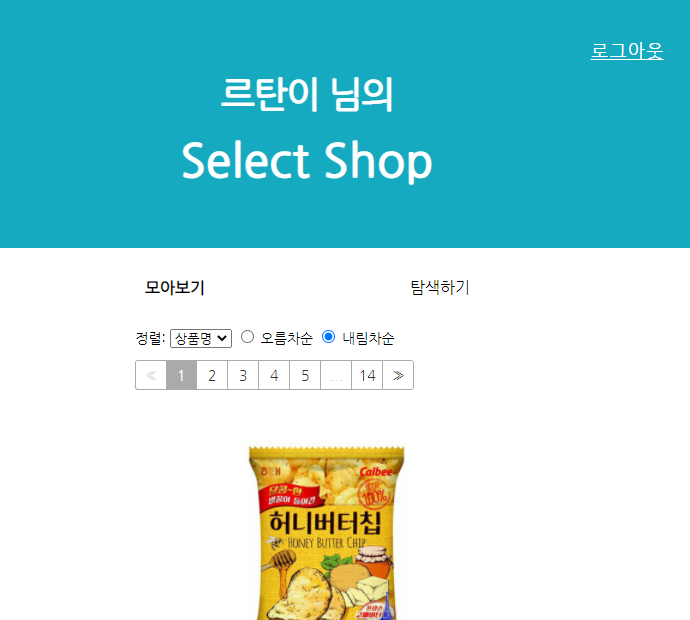

**[변경 사항]**

* 상품 조회 API 수정 필요
* Client → Server

1. 페이징
   1. page : 조회할 페이지 번호 (**1부터 시작**)
   2. size : 한 페이지에 보여줄 상품 개수 (**10개로 고정**!)
2. 정렬
   1. sortBy (정렬 항목)
      1. id : Product 테이블의 id
      2. title : 상품명
      3. lprice : 최저가
      4. createdAt : 생성일 (보통 id 와 동일)
   2. isAsc (오름차순?)
      1. true: 오름차순 (asc)
      2. false : 내림차순 (desc)

* Server → Client
  + number: 조회된 페이지 번호 (**0부터 시작**)
  + content: 조회된 상품 정보 (배열)
  + size: 한 페이지에 보여줄 상품 개수
  + numberOfElements: 실제 조회된 상품 개수
  + totalElement: 전체 상품 개수 (회원이 등록한 모든 상품의 개수)
  + totalPages: 전체 페이지 수
  + first: 첫 페이지인지? (boolean)
  + last: 마지막 페이지인지? (boolean)

---

### 

### **9. 페이징 및 정렬 구현**

**1. 구현**

1단계 - 프론트엔드 개발자의 UI 작업 적용

2단계 - Spring 서버 구현

```java
import com.sparta.springcore.dto.ProductMypriceRequestDto;
import com.sparta.springcore.dto.ProductRequestDto;
import com.sparta.springcore.model.Product;
import com.sparta.springcore.model.UserRoleEnum;
import com.sparta.springcore.security.UserDetailsImpl;
import com.sparta.springcore.service.ProductService;
import org.springframework.beans.factory.annotation.Autowired;
import org.springframework.data.domain.Page;
import org.springframework.security.access.annotation.Secured;
import org.springframework.security.core.annotation.AuthenticationPrincipal;
import org.springframework.web.bind.annotation.*;

@RestController // JSON으로 데이터를 주고받음을 선언합니다.
public class ProductController {

    private final ProductService productService;

    @Autowired
    public ProductController(ProductService productService) {
        this.productService = productService;
    }

    // 신규 상품 등록
    @PostMapping("/api/products")
    public Product createProduct(@RequestBody ProductRequestDto requestDto,
                                 @AuthenticationPrincipal UserDetailsImpl userDetails) {
        // 로그인 되어 있는 회원 테이블의 ID
        Long userId = userDetails.getUser().getId();

        Product product = productService.createProduct(requestDto, userId);
        // 응답 보내기
        return product;
    }

    // 설정 가격 변경
    @PutMapping("/api/products/{id}")
    public Long updateProduct(@PathVariable Long id, @RequestBody ProductMypriceRequestDto requestDto) {
        Product product = productService.updateProduct(id, requestDto);

        // 응답 보내기 (업데이트된 상품 id)
        return product.getId();
    }

    // 로그인한 회원이 등록한 관심 상품 조회
    @GetMapping("/api/products")
    public Page<Product> getProducts(
            @RequestParam("page") int page,
            @RequestParam("size") int size,
            @RequestParam("sortBy") String sortBy,
            @RequestParam("isAsc") boolean isAsc,
            @AuthenticationPrincipal UserDetailsImpl userDetails
    ) {
        Long userId = userDetails.getUser().getId();
        page = page - 1;
        return productService.getProducts(userId, page, size, sortBy, isAsc);
    }

    // (관리자용) 전체 상품 조회
    @Secured(UserRoleEnum.Authority.ADMIN)
    @GetMapping("/api/admin/products")
    public Page<Product> getAllProducts(
            @RequestParam("page") int page,
            @RequestParam("size") int size,
            @RequestParam("sortBy") String sortBy,
            @RequestParam("isAsc") boolean isAsc
    ) {
				page = page -1;
        return productService.getAllProducts(page, size, sortBy, isAsc);
    }
}
```

---

### **10. '나만의 셀렉샵'에 폴더 기능 추가**

**1. 요구사항 분석**

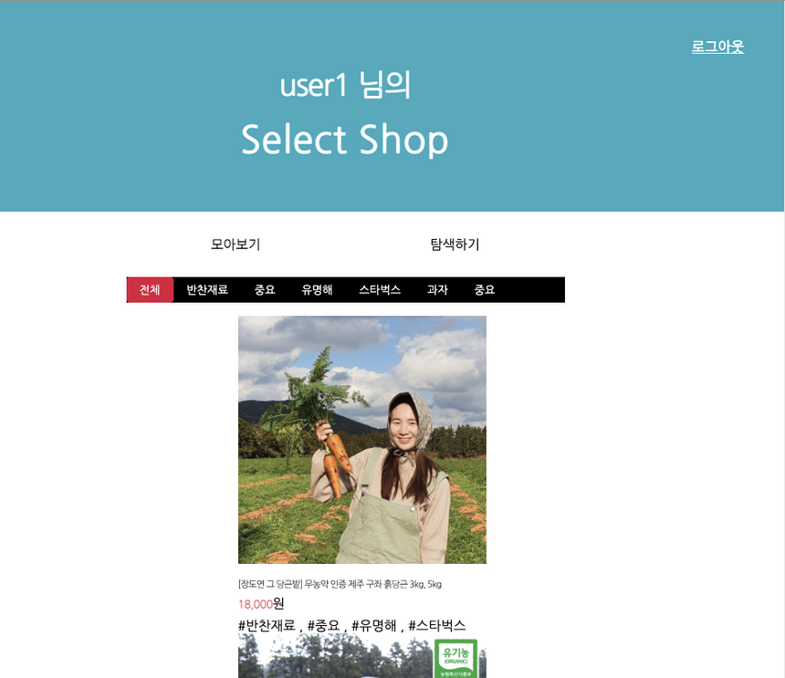

1. 배경
   1. 회원들 중 페이지네이션 기능만으로는 원하는 관심상품을 쉽게 찾기 어렵다는 애로사항이 많이 접수됨
   2. 폴더 별로 관심상품을 저장/관리할 수 있는 기능을 추가하기로 함
2. 요구사항
   1. 폴더 생성
      1. 회원별 폴더를 추가할 수 있다.
      2. 폴더를 추가할 때 1개~N개를 한번에 추가할 수 있다.
   2. 관심상품에 폴더 설정
      1. 관심상품에 폴더는 N개 설정할 수 있다.
      2. 관심상품이 등록되는 시점에는 어느 폴더에도 저장되지 않는다.
      3. 관심상품 별로 1번에서 생성한 폴더를 선택하여 추가할 수 있다.
   3. 폴더 별 조회
      1. 회원은 폴더 별로 관심상품 조회가 가능하다.
      2. 조회 방법
         1. '전체' 클릭 시: 폴더와 상관 없이 회원이 저장한 전체 관심상품들을 조회 가능하다.
         2. '폴더명' 클릭 시: 폴더별 저장된 관심상품들을 조회 가능하다.

---

### **11. 폴더 테이블 설계**

1. '폴더' 테이블 설계

* 폴더 테이블에 필요한 정보
  1. **폴더명**: 회원이 등록한 폴더 이름을 저장
  2. **회원ID**: 폴더를 등록한 회원의 ID 를 저장
     + A 회원이 생성한 폴더는 A 회원에게만 보여야 함
     + 회원과 폴더의 관계
       - '회원과 폴더'의 관계는 '회원과 관심상품' 관계와 동일

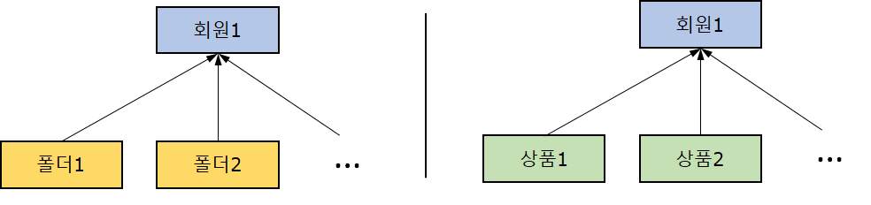

2. 기존 관계 설정 방법의 문제점('회원과 폴더')

* 기존 관계설정 방법으로 구현한 Folder 객체

```java
@Entity
public class Folder {
    @GeneratedValue(strategy = GenerationType.AUTO)
    @Id
    private Long id;

    @Column(nullable = false)
    private String name;

    @Column(nullable = false)
    private Long userId;
}
```

* 폴더가 가지고 있는 **userId** 가 "회원의 Id 값"이라는 사실은 "개발을 진행한 사람"만 알 수 있음
* 객체 (Folder Entity 클래스)와 DB 모두에서 회원과 상품이 어떤 관계인지를 알 수 없음
* 객체) 회원과 폴더의 관계

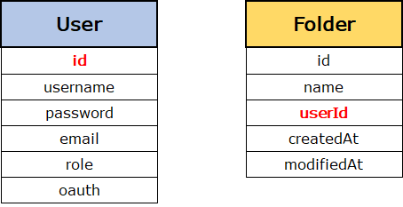

* 회원 → 폴더 조회
  1. user1 이 저장한 모든 폴더 조회
  2. Folder Repository에서 userId를 기준으로 조회하는 함수 필요
* 폴더 → 회원 조회
  1. folder1 의 userId 로 회원 조회

---

### 12. JPA 연관관계를 이용한 폴더 테이블 설계

**1. 회원 Entity 관점**

* 회원 1명이 여러 개의 폴더를 가질 수 있음
* "**@OneToMany**" 로 설정

```java
public class User {
    @OneToMany
    private List<Folder> folders;
}
```

* 회원이 가진 폴더들을 조회

```java
List<Folder> folders = user.getFolders();
```

* 기존방식과 비교!!

```java
public class Folder {
    private Long userId;
}
```

1. user1 이 저장한 모든 폴더 조회
2. Folder Repository 에 userId 를 기준으로 조회하는 함수 생성 필요

```java
// 1. 로그인한 회원 (user1) 의 id 를 조회
Long userId = user1.getId();
// 2. userId 로 저장된 모든 folder 조회
List<Folder> folders = folderRepository.findAllByUserId(userId);
```

```java
public interface FolderRepository extends JpaRepository<Folder, Long> {
    List<Folder> findAllByUserId(Long userId);
}
```

**2. 폴더 Entity 관점**

* 폴더 여러 개를 회원 1명이 가질 수 있음
* "**@ManyToOne**"
* 폴더를 소유한 회원을 조회

```java
public class Folder{
    @ManyToOne
    private User user;
}
```

```java
folder.getUser();
```

**3. 객체의 관계를 맺어주면, DB의 관계 설정 맺어줌**

* 객체) 회원과 폴더의 관계  
  폴더를 소유한 회원 id 가 아닌 객체를 저장

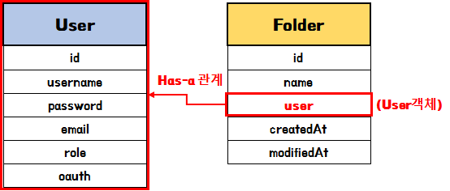

* DB) 회원과 폴더의 관계 - 외래키를 통한 관계 형성

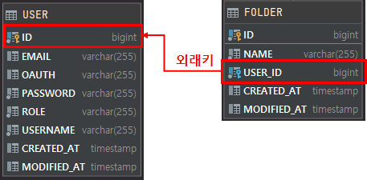

---

**4. JPA 연관관계 Column 설정방법**

```java
@ManyToOne
@JoinColumn(name = "USER_ID", nullable = false)
private User user;
```

* @JoinColumn 내 속성값 설정
  + name: 외래키 명
  + nullable: 외래키 null 허용 여부
    - **false** (default)
      * 예) 폴더는 회원에 의해서만 만들어짐. user 값이 필수
    - **true**
      * 예) 공용폴더의 경우, 폴더의 user 객체를 null 로 설정하기로 함

---

### **13. 폴더 생성 기능 구현**

1. 요구사항

1. 회원별 폴더를 추가할 수 있다.
2. 폴더를 추가할 때 1개~N개를 한번에 추가할 수 있다.
3. 회원별 저장한 폴더들이 조회 되어야 한다.

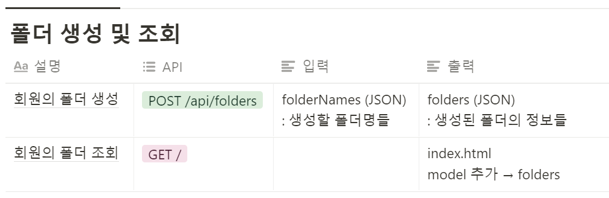

2. 구현

* 구현 시 객체간 연관관계 매핑을 사용해야한다.

---

### **14.  관심상품에 폴더 추가 구현**

1. 요구사항

1. 관심상품에 폴더를 0개 ~ N개 설정할 수 있다.
2. 관심상품이 등록되는 시점에는 어느 폴더에도 저장되지 않는다.
3. 관심상품 별로 기생성했던 폴더를 선택하여 추가할 수 있다.


* 폴더 전체 조회 및 선택

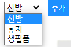

* 폴더와 상품의 연관 관계는?
  + 상품 1개에 여러개의 폴더 저장 가능
  + 폴더 1개에 여러개의 상품 저장 가능
  + 결론적으로
    - 상품 : 폴더 = N : N

2. API 설계 및 구현

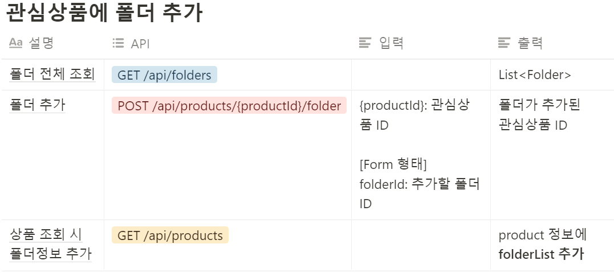

> [Think]  
> 해당 구현 강의를 들게 되면 떠오르게 될 것이다...  
> 왜 Query문이 발생하지 않을까?? 우리는 그에게 Query문을 발생하게 시키지 않았기 때문이다.  
> => 코드는 거짓말을 치지 않는다.

---

### **15.  폴더 별 관심상품 조회 구현**

**1. 요구사항**

* 회원은 폴더 별로 관심상품 조회가 가능
* 조회 방법
  + '폴더별' : 폴더별 저장된 관심상품 조회 가능
  + '전체' : 폴더와 상관없이 회원이 저장한 전체 관심상품들을 조회 가능

**2. API 설계 및 구현**

* '전체' 상품 조회는 이미 구현 완료!!! ("GET /api/products")

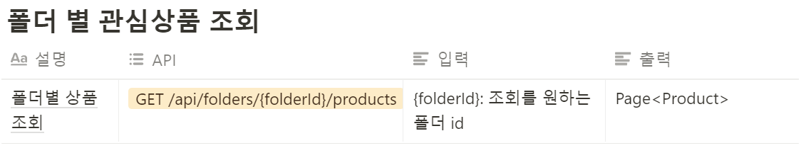

---

### **16.  4주차 끝 & 숙제 설명**

**1. 4주차 정리**

1. **JPA**
   1. 영속성 컨텐스트
      1. **"1차캐시"**
   2. JPA 연관관계
      1. @OneToOne
      2. @OneToMany
      3. @ManyToOne
      4. @ManyToMany
2. DB 에 대한 이해
   1. 프라이머리키 (PK)
   2. 외래키 (FK)
3. **Spring Data JPA**
   1. Query Methods 사용방법
   2. 페이징 및 정렬
4. **'나만의 셀렉샵'에 폴더 기능 추가**

**2. 숙제 설명**

1. 중복 폴더명 생성 이슈
   1. 문제점: 현재 폴더명이 중복해서 생성되고 있습니다!
   2. 해결방법: 생성할 폴더명이 입력으로 들어왔을 때, DB 에 동일 폴더명이 없는 경우에만 생성
   3. 수정할 파일
      1. FolderService.java
      2. FolderRepository.java
2. 테스트 코드 에러 해결
   1. ProductServiceTest.java 파일 테스트 정상적으로 수행되도록 수정
