이번 5주차 핵심 Keyword는 "AOP"

AOP에 대한 개념은 따로 포스팅 해두었다.

[AOP 개념](https://github.com/bang-star/TIL/blob/main/programming/programming_type.md)

---

## 1. 5주차 오늘 배울 것

1. 이번주 배울 내용

- 스프링 AOP 를 프로젝트에 직접 적용해 보며 AOP 의 개념을 이해합니다.

1. AOP 개념 이해
2. '나만의 셀렉샵' 에 스프링 AOP 적용
   1. Top5 회원 찾기
   2. 중복 폴더명 저장 시 에러 처리
   3. 스프링 예외 처리
3. DB 트랙잭션 이해

---

## 2. Top5 회원 찾기 요구사항

1. 요구사항

> **[ 서비스 확장 ]**

1. '고객 감사 이벤트'
   * 2주간 '나만의 셀렉샵' 을 **가장 많이 사용하는 Top5 회원들**에게 선물 증정
   * 회원별 '나만의 셀렉샵' 사용시간 저장
2. 회원별 '나만의 셀렉샵' 사용시간 조회 가능
   * 일반 회원은 조회 불가능
   * '관리자' 만 조회 가능

> **[ Top 5회원 기준 ]**

1. '나만의 셀렉샵' 페이지에 머문 시간??
   * 웹 브라우져에 '나만의 셀렉샵' 페이지를 띄워두고 아무런 동작을 하지 않는다면?
2. '나만의 셀렉샵' **서버 사용시간**으로 하기로 함
   * **서버 사용시간**: '나만의 셀렉샵' 모든 API 수행시간의 총합
     1. 상품 조회 API ("GET /api/search") 수행시간
     2. 관심상품 등록 API ("POST /api/products") 수행시간
     3. 폴더 저장 API ("POST /api/folders") 수행시간
     4. ...
   * 예) 회원 A 의 "서버 사용시간"
     + 상품 조회 API: **6시간**
     + 관심상품 등록 API: **3시간**
     + 폴더 저장 API: **1시간**
     + ⇒ 총합: **10시간**

2. API 사용시간 측정 방법

* API 사용시간
  + = Controller 에 요청이 들어온 시간 ~ 응답이 나간 시간
  + 예)
    - Controller 에 요청이 들어온 시간: **9시 10분 30초**
    - Controller 에 응답이 나간 시간: **9시 10분 33초**
    - API 사용시간?
      * Controller 에 응답이 나간 시간 - Controller 에 요청이 들어온 시간
      * **3초**
* 수행시간 측정 코드 구현
  1. Intellij 메뉴에서 File > New > Scratch File
  2. 수행시간 측정코드 구현  
     - 함수 호출 전 시간과 함수 호출 후 시간을 측정하여 차를 구하는 것이다.  
     ( 나는 알고리즘 학습 시에 수행시간 측정을 많이 사용한다 )  
     **+) Java에서는 \_를 통해 숫자를 구분할 수 있도록 지원해준다... 이것은 개발하면서 처음 알았다.. 대박!!**

```java
class Scratch {
    public static void main(String[] args) {
        // 측정 시작 시간
        long startTime = System.currentTimeMillis();

        // 함수 수행
        long output = sumFromOneTo(1_000_000_000);

        // 측정 종료 시간
        long endTime = System.currentTimeMillis();

        long runTime = endTime - startTime;
        System.out.println("소요시간: " + runTime);
    }

    private static long sumFromOneTo(long input) {
        long output = 0;

        for (int i = 1; i < input; ++i) {
            output = output + i;
        }

        return output;
    }
}
```

---

## 3. Top5 회원 찾기 설계 및 구현

**1. 회원별 총 API 사용시간 저장**

1) API 사용시간을 저장할 테이블 설계

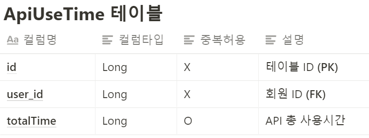

2) 회원별 사용시간 누적 저장

* 관심상품 저장하는 API (POST /api/products) 에만 적용

3) 구현 순서

1. model > ApiUseTime 클래스 생성  
   - 해당 클래스는 테이블 ID, 회원 ID(테이블의 ID), 총 사용시간을 가지고 있다.  
   - 사용자와 사용시간은 1대1 관계를 갖는다는 것을 알아야한다.
2. repository > ApiUseTimeRepository  
   - 해당 정보를 저장하기 위한 저장소를 만들어두기 위한 용도이다. (구현 후 생성하여도 문제 없다.)
3. controller > ProductController 에서 관심상품 저장시 사용시간을 저장한다.  
   - 관심상품 저장하는 API에 적용을 시작으로 적용 범위를 넓힐 것이다.

**2. 회원별 API 총 사용시간 조회 (관리자용)**

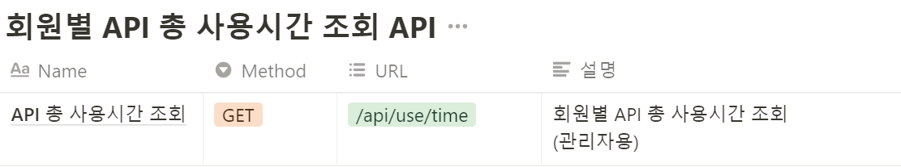

* 관리자'만 조회 가능
  + API 위에 @Secured("**ROLE\_ADMIN**") 추가
* API 동작 확인
  1. 테스트 회원 추가
     1. 일반 회원 2명 이상 추가
     2. 관리자 회원 추가
  2. 관심상품 등록시마다 API 사용시간이 잘 저장되는지 확인
  3. 회원별 총 사용시간 조회 API 동작 검증
     1. 일반 회원: 조회 불가
        1. API 요청 시 "사용자 접근 불가 페이지" (HTTP 403) 뜨는지 확인
     2. 관리자: 조회 가능

> 현재 문제점 : 유저의 모든 정보가 반환되고 있다.  
> 해결 방법은 여러가지가 있겠지만, Dto를 통해 사용자의 이름과 총 시간만 받을 수 있도록 Dto를 만들어 반환해주는 방식을 강의에서 간략하게 설명해주고 있다. (아래코드가 그 내용)

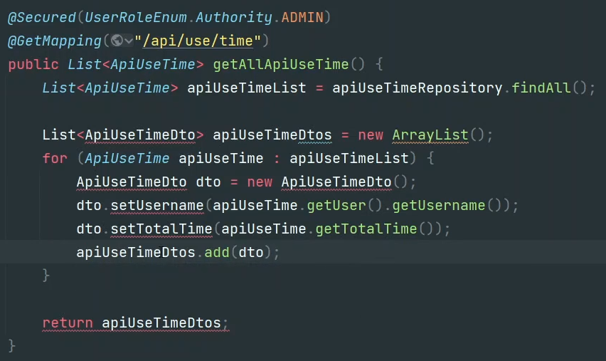

---

## 4. AOP란?

**1. 부가기능 모듈화의 필요성**

> 'Top5 회원 찾기' 기능이 추가된 것을 '나만의 셀렉샵' 회원들이 알 수 있을까요? 혹은 알 필요가 있을까요?

* **'핵심기능**': 각 API 별 수행해야 할 비즈니스 로직  
  ex) 상품 키워드 검색, 관심상품 등록, 회원 가입, 관심상품에 폴더 추가, ....


* **'부가기능'**: 핵심기능을 보조하는 기능  
  ex) 회원 패턴 분석을 위한 로그 기록, API 수행시간 저장

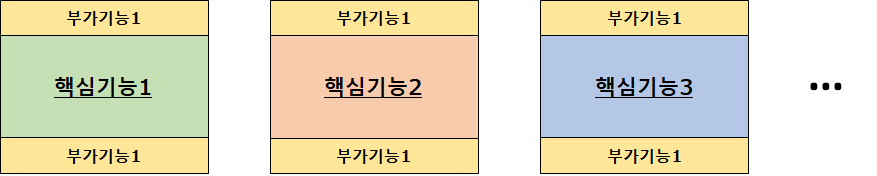

* 문제점
  + 모든 **'핵심기능**'의 Controller 에 '부가기능' 코드를 추가했을 때..
    - **'핵심기능**' 이 100개라면??
      * 100개의 **'핵심기능**' 모두에 동일한 내용의 코드 추가 필요
    - **'핵심기능**' 이 나중에 추가된다면?
      * 항상 '부가기능' 추가를 신경써야 함
      * '부가기능' 추가를 깜박한다면?
        + 일부 API 수행시간이 추가되지 않음 → Top5 회원의 신뢰성 이슈
  + **'핵심기능**' 수정 시
    - 같은 함수 내에 **'핵심기능**'과 '부가기능'이 섞여 있음
    - **'핵심기능**' 이해를 위해 '부가기능'까지 이해 필요
  + '부가기능'의 변경이 필요하다면??
    - **'핵심기능**'의 개수만큼 '부가기능'도 수정해 줘야 함
    - '부가기능' 삭제

---

**2. 부가기능을 모듈화**

* AOP (Aspect Oriented Programming) 를 통해 부가기능을 모듈화
  + **'부가기능'은 '핵심기능'과는 관점(Aspect), 관심이 다름**
  + '핵심기능'과  분리해서 **'부가기능'** 중심으로 설계, 구현 가능

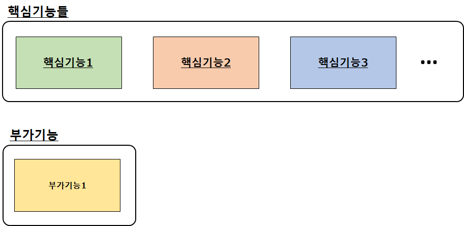

> [요약]  
> AOP는 기존 객체지향 프로그래밍에서 부족한 OOP구조를 보완하는 역할을 담당

**3. 스프링이 제공하는 AOP**

* 핵심 기능과 부가기능을 따로 분리하여 개발하고, 적용 위치를 설정해주게 된다.

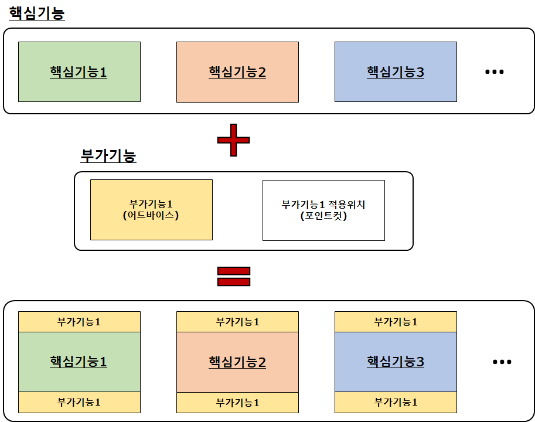

1. 어드바이스: 부가기능
2. 포인트컷: 부가기능 적용위치

---

## 5. Spring AOP 적용

1. 스프링 AOP 적용

* ProductController 에 추가했던 부가기능 제거 (Rollback)
* AOP 사용해 모든 Controller 에 부가기능 추가

```java
package com.sparta.springcore.aop;

import com.sparta.springcore.model.ApiUseTime;
import com.sparta.springcore.model.Users;
import com.sparta.springcore.repository.ApiUseTimeRepository;
import com.sparta.springcore.security.UserDetailsImpl;
import org.aspectj.lang.ProceedingJoinPoint;
import org.aspectj.lang.annotation.Around;
import org.aspectj.lang.annotation.Aspect;
import org.springframework.security.core.Authentication;
import org.springframework.security.core.context.SecurityContextHolder;
import org.springframework.stereotype.Component;

@Aspect
@Component
public class UseTimeAop {
    private final ApiUseTimeRepository apiUseTimeRepository;

    public UseTimeAop(ApiUseTimeRepository apiUseTimeRepository) {
        this.apiUseTimeRepository = apiUseTimeRepository;
    }

    @Around("execution(public * com.sparta.springcore.controller..*(..))")
    public Object execute(ProceedingJoinPoint joinPoint) throws Throwable {
        // 측정 시작 시간
        long startTime = System.currentTimeMillis();

        try {
            // 핵심기능 수행
            Object output = joinPoint.proceed();
            return output;
        } finally {
            // 측정 종료 시간
            long endTime = System.currentTimeMillis();
            // 수행시간 = 종료 시간 - 시작 시간
            long runTime = endTime - startTime;

            // 로그인 회원이 없는 경우, 수행시간 기록하지 않음
            Authentication auth = SecurityContextHolder.getContext().getAuthentication();
            if (auth != null && auth.getPrincipal().getClass() == UserDetailsImpl.class) {
                // 로그인 회원 정보
                UserDetailsImpl userDetails = (UserDetailsImpl) auth.getPrincipal();
                Users loginUser = userDetails.getUser();

                // API 사용시간 및 DB 에 기록
                ApiUseTime apiUseTime = apiUseTimeRepository.findByUser(loginUser)
                        .orElse(null);
                if (apiUseTime == null) {
                    // 로그인 회원의 기록이 없으면
                    apiUseTime = new ApiUseTime(loginUser, runTime);
                } else {
                    // 로그인 회원의 기록이 이미 있으면
                    apiUseTime.addUseTime(runTime);
                }

                System.out.println("[API Use Time] Username: " + loginUser.getUsername() + ", Total Time: " + apiUseTime.getTotalTime() + " ms");
                apiUseTimeRepository.save(apiUseTime);
            }
        }
    }
}
```

---

## 6. Spring AOP 이해

1. 스프링 AOP 동작 이해

* 개념적 이해

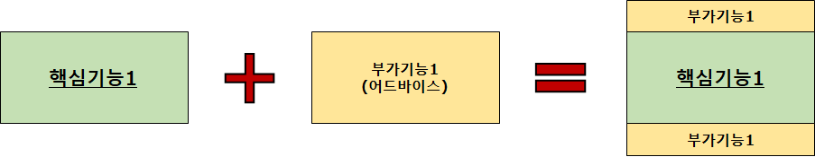

* 스프링 실제 동작  
  - 기존에는 클라이언트에 요청에 핵심기능이 바로 호출이 되었다.  
  - AOP에서는 클라이언트 요청이 오면 프록시라는 객체가 생성되어 프록시가 핵심기능을 호출하는 순서로 변한다.  
  - 프록시가 부가기능의 역할을 담당한다.

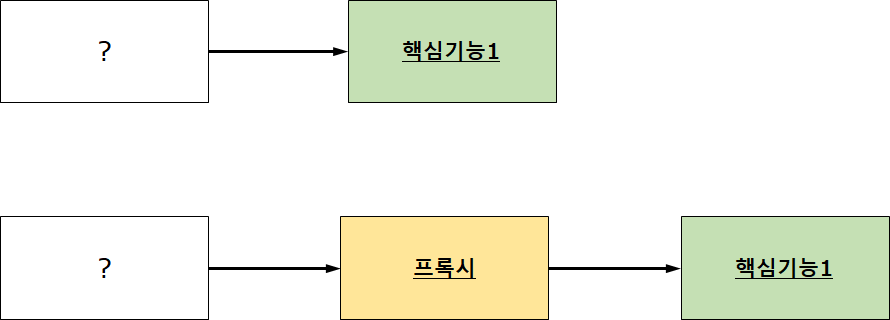

* 시퀀스 다이어그램 (Sequence Diagram)

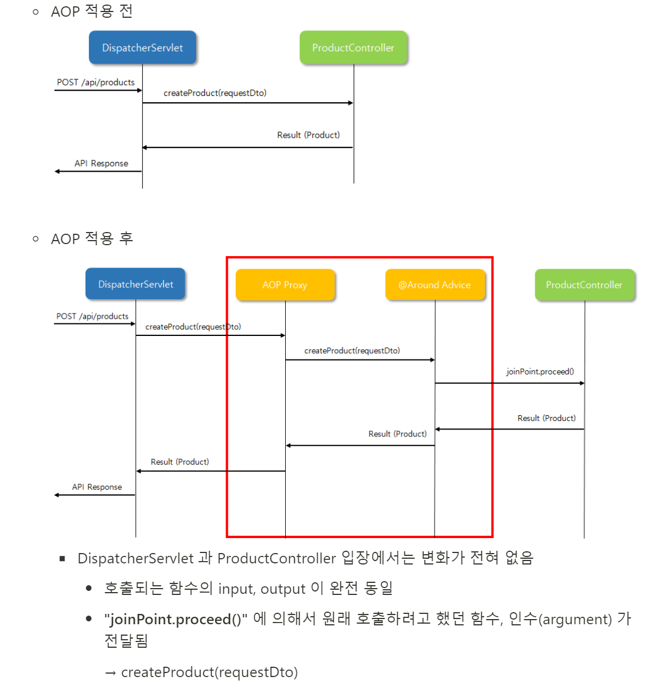

* 스프링 서버가 기동될 때
  + 핵심 기능 DI 시
  + 프록시 객체를 중간에 삽입

---

2. 스프링 AOP 어노테이션

1. @Aspect
   * 스프링 빈 (Bean) 클래스에만 적용 가능
2. 어드바이스 종류
   * @Around: '핵심기능' 수행 전과 후 (@Before + @After)
   * @Before: '핵심기능' 호출 전 (ex. Client 의 입력값 Validation 수행)
   * @After: '핵심기능' 수행 성공/실패 여부와 상관없이 언제나 동작 (try, catch 의 finally() 처럼 동작)
   * @AfterReturning: '핵심기능' 호출 성공 시 (함수의 Return 값 사용 가능)
   * @AfterThrowing: '핵심기능' 호출 실패 시. 즉, 예외 (Exception) 가 발생한 경우만 동작 (ex. 예외가 발생했을 때 개발자에게 email 이나 SMS 보냄)
3. 포인트 컷
   1. 포인트컷 Expression Language  
      execution(modifiers-pattern? return-type-pattern declaring-type-pattern? **method-name-pattern(param-pattern)** throws-pattern?)  
      => 어떤 함수에서 부가 기능을 추가할 것인지를 명세하는 것이다.
      1. ?는 생략 가능
   2. 포인트컷 Expression 예제

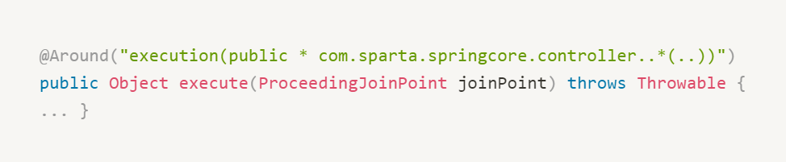

* modifiers-pattern
  + **public**, private, \*  
    => public 에만 적용하겠다!
* return-type-pattern
  + void, String, List<String>, \*  
    => \*로 할 경우, 모든 곳에서 포인트컷 Advice를 적용
* declaring-type-pattern
  + 클래스명 (패키지명 필요)
  + **com.sparta.springcore.controller.**\* - controller 패키지의 모든 클래스에 적용
  + **com.sparta.springcore.controller..** - controller 패키지 및 하위 패키지의 모든 클래스
* **method-name-pattern(param-pattern)**
  + 함수명
    - **addFolders** : addFolders() 함수에만 적용
    - **add**\* : add 로 시작하는 모든 함수에 적용
  + 파라미터 패턴 (param-pattern)
    - **(com.sparta.springcore.dto.FolderRequestDto)** - FolderRequestDto 인수 (arguments) 만 적용
    - **()** - 인수 없음
    - **(\*)** - 인수 1개 (타입 상관없음)
    - **(..)** - 인수 0~N개 (타입 상관없음)
* @Pointcut
  + 포인트컷 재사용 가능
  + 포인트컷 결합 (combine) 가능

```java
@Component
@Aspect
public class Aspect {
	@Pointcut("execution(* com.sparta.springcore.controller.*.*(..))")
	private void forAllController() {}

	@Pointcut("execution(String com.sparta.springcore.controller.*.*())")
	private void forAllViewController() {}

	@Around("forAllContorller() && !forAllViewController")
	public void saveRestApiLog() {
		...
	}

	@Around("forAllContorller()")
	public void saveAllApiLog() {
		...
	}	
}
```

* Controller - Service - Repository 3계층에 맞춰 구현을 해야 하는 다른 이유
  + Controller 에 비즈니스 로직을 추가한다면?
  + Controller 에서 Repository 를 바로 호출한다면??  

    **=> 비즈니스 로직을 추가하고 Repository를 바로 호출하였다면, 부가기능을 사용할 수 는 있겠지만, 효율적인 코드를 작성할 수 없을 것이고 가독성이 떨어지게 될 것이다.**

---

## 

## 7. 중복 폴더명 예외처리 설계 및 구현

1. 요구사항

폴더들을 저장 시, "중복 폴더명 저장 시" 에러를 발생시킴

**예)**

* 회원 username: **"르탄이"**
* "르탄이"의 저장 폴더명:
  1. 생필품
  2. 과자
  3. IT 기기
* 추가 요청된 폴더명
  1. 신발
  2. 옷
  3. **과자**
     + 중복된 폴더명이 존재!!

> 요구사항에서 사용되는 용어 중 AS-IS, TO-BE 가 있습니다.   
> **AS-IS** : 기존 동작   
> **TO-BE** : 변경 동작

AS-IS)

* 중복을 제외한 모든 폴더명이 저장됨
* "르탄이"의 저장 폴더명:
  1. 생필품
  2. 과자
  3. IT 기기
  4. 신발
  5. 옷

TO-BE)

* Alert 팝업을 띄워서 사용자가 폴더명을 수정할 수 있도록 유도!!
  + 중복된 폴더명 표시
* 저장 시도한 폴더 모두 저장되지 않음
* "르탄이"의 저장 폴더명:
  1. 생필품
  2. 과자
  3. IT 기기
  4. ~~신발~~ (저장되지 않음!)
  5. ~~옷~~ (저장되지 않음!)

---

2. 동작 상태 확인(with 디버깅)

* 아래 코드와 같이 개별적으로 폴더명을 저장할 경우 문제가 발생할 수 있다.  
  1. Exception이 발생하고 나면 중복되지 않은 폴더명이 DB에 남아있게 된다.  
  요구사항에 따라 사용자가 문제를 파악하고 직접 수정하여 다시 저장하도록 해야하기 때문이다.

```java
    public List<Folder> addFolders(List<String> folderNames, Users user) {
        // 1) 입력으로 들어온 폴더 이름을 기준으로, 회원이 이미 생성한 폴더들을 조회합니다.
        List<Folder> existFolderList = folderRepository.findByUserAndNameIn(user, folderNames);

        List<Folder> savedfolderList = new ArrayList<>();
        for (String folderName : folderNames) {
            // 2) 이미 생성한 폴더가 아닌 경우만 폴더 생성
            if (isExistFolderName(folderName, existFolderList)) {
                // To-BE(Exception 발생)
                throw new IllegalArgumentException("중복된 폴더명을 변경해 주세요. 폴더명 : " + folderName);
            }else{
                Folder folder = new Folder(folderName, user);
                // 폴더명 저장
                folder = folderRepository.save(folder);
                savedfolderList.add(folder);
            }
        }

        return savedfolderList;
    }
```

3. 해결방법(1)

* 에러가 발생할 경우, 저장된 폴더명을 순회하면서 삭제한다.
* 저장 폴더리스트를 전달하여 한번에 삭제도 가능하다.

```java
// 1) 순차 삭제
for(Folder folder : savedfolderList){
	folderRepository.delete(folder);
}
// 2) 한번에 삭제
folderRepository.deleteAll(savedfolderList);
```

4. 해결방법(2)

* 트랜잭션 (@Transactional) 을 이용

---

## 8. 트랜잭션의 이해

**1. 트랜잭션이란?**

> 트랜잭션: 데이터베이스에서 데이터에 대한 하나의 논리적 실행단계  
>   
> ACID (원자성, 일관성, 고립성, 지속성)는 데이터베이스 트랜잭션이 안전하게 수행된다는 것을 보장하기 위한 성질을 가리키는 약어  
> 출처 : [위키백과](https://ko.wikipedia.org/wiki/ACID)

* 트랜잭션의 특징
  + 더 이상 쪼갤 수 없는 최소단위의 작업
  + 모두 저장되거나, 아무 것도 저장되지 않거나를 보장(Commit or Rollback)

**2. 데이터 저장**

1) 데이터 1개 저장 시

1. 회원 등록 요청  
   User user = new User(username, password, email, role); user = userRepository.save(user);
2. 만약, DB 저장 시 에러로 다음과 같이 저장된다면??
   * 저장 요청 DATA
     + USERNAME: **"삼식이"**
     + PASSWORD: **"$2a^A..."** (암호화된 패스워드)
     + EMAIL: **"[sameat@sparta.com](mailto:sameat@sparta.com)"**
     + ROLE: **"USER"**
   * [그림 1] 실제 DB 에 저장된 DATA  
     - 그림과 같이 DB에 원하는 방식으로 저장되지 않는다면 믿고 사용할 수 없다.
3. 회원 저장 요청이 1개의 트랜잭션
   1. DB는 1개의 회원정보가 안전하게 저장됨을 보장

[그림 1]

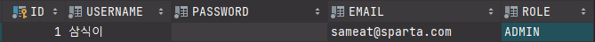

---

2) 데이터 2개 이상 저장 시

**A 계좌→ B계좌로 200,000 원 이체 시**

* A 계좌 잔고: 1,000,000 원
* B 계좌 잔고: 1,000,000 원

**정상 케이스**

1. A 계좌 잔고 **200,000 원** 이상 확인
   * A 계좌 잔고: 1,000,000 원
2. A 계좌 잔고 **200,000 원** 금액 감소
   * A 계좌 잔고: 800,000 원 (1,000,000 원 - 200,000 원)
3. B 계좌 잔고 **200,000 원** 금액 증가
   * B 계좌 잔고: 1,200,000 원 (1,000,000 원 + 200,000 원)

**만약, 3번 과정에서 에러가 발생 시**

* A 계좌 잔고: **800,000 원 ??**
* B 계좌 잔고: 1,000,000 원 ??

---

3) 데이터 2개 이상 저장 시(with 트랜잭션)

* **트랜잭션 시작**

1. A 계좌 잔고 **200,000 원** 이상 확인
   * A 계좌 잔고: 1,000,000 원
2. A 계좌 잔고 **200,000 원** 금액 감소
   * A 계좌 잔고: 800,000 원 (1,000,000 원 - 200,000 원)
3. B 계좌 잔고 **200,000 원** 금액 증가
   * B 계좌 잔고: 1,200,000 원 (1,000,000 원 + 200,000 원)

* **모두 성공 시 ⇒트랜잭션 Commit**
* **중간에 하나라도 실패 시 ⇒ 트랜잭션 Rollback**

---

## 9. @Transactional 의 정체

1. 트랜잭션을 사용한 폴더 생성 코드

* 아래 코드는 @Transactional 어노테이션이 담고 있는 모습이다.  
  어노테이션을 사용하면 자동으로 처리해준다.  
  **즉, @Transactional 어노테이션을 붙여주면 AOP가 동작하게 된다.**

```java
public List<Folder> addFolders(List<String> folderNames, User user) {
				// 트랜잭션의 시작
        TransactionStatus status = this.transactionManager.getTransaction(new DefaultTransactionDefinition());
				try {
	        // 1) 입력으로 들어온 폴더 이름을 기준으로, 회원이 이미 생성한 폴더들을 조회합니다.
	        List<Folder> existFolderList = folderRepository.findAllByUserAndNameIn(user, folderNames);

	        List<Folder> savedFolderList = new ArrayList<>();
	        for (String folderName : folderNames) {
	            // 2) 이미 생성한 폴더가 아닌 경우만 폴더 생성
	            if (isExistFolderName(folderName, existFolderList)) {
	                // Exception 발생!
	                throw new IllegalArgumentException("중복된 폴더명을 제거해 주세요! 폴더명: " + folderName);
	            } else {
	                Folder folder = new Folder(folderName, user);
	                // 폴더명 저장
	                folder = folderRepository.save(folder);
	                savedFolderList.add(folder);
	            }
	        }

					// 트랜잭션 commit
          transactionManager.commit(status);

	        return savedFolderList;
        } catch (Exception ex) {
            // 트랜잭션 rollback
            transactionManager.rollback(status);
            throw ex;
        }
    }
```

2. 트랜잭션을 사용한 폴더 생성 FlowChart

* 비즈니스 로직에 트랜잭션 코드가 포함됨

**\* 트랜잭션 과정**

1. Controller에서 Service로 넘겨준다.
2. 트랜잭션이 시작되면 DB에서 트랜잭션의 시작을 알려준다.
3. DB에서 트랜잭션 아이디를 부여해준다. 아이디를 가지고 Commit하거나 Rollback을 수행하게 된다.
4. 반복문을 통해 해당 폴더네임이 존재하는지 확인하면서 존재한다면 에러를 발생시킨다.
5. 에러 발생하면서 트랜잭션 아이디로 Rollback을 전달해준다.
6. 존재하지 않는다면 해당 정보를 임시로 저장해두었다가 Commit 메시지가 들어오면 저장을 시킨다.

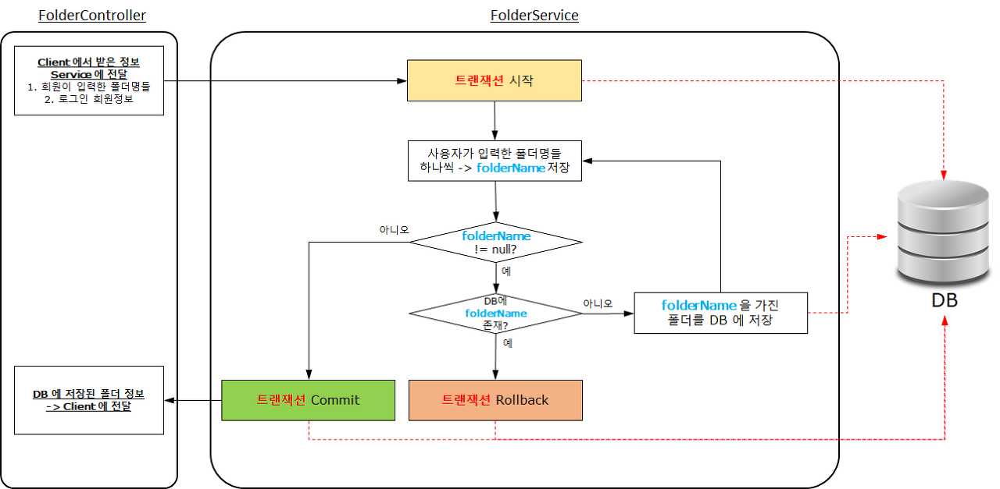

3. @Transactional 사용 시 폴더 생성 FlowChart

```java
@Transactional
public List<Folder> addFolders(List<String> folderNames, User user) {
  // ...
}
```

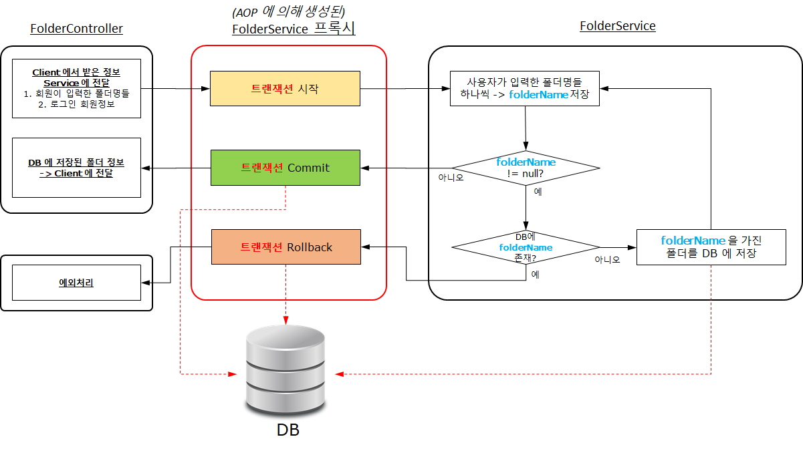

---

## 10. @Transactional 관련 Quiz

> 다음과 같이 코드를 리팩토링 했는데 문제점이 생겼습니다. 무엇이 문제점일까요?

1. repository > FolderRepository

```java
public interface FolderRepository extends JpaRepository<Folder, Long> {
    List<Folder> findAllByUser(User user);
    boolean existsByUserAndName(User user, String name);
}
```

2. service > FolderService

```java
import org.springframework.beans.factory.annotation.Autowired;
import org.springframework.data.domain.Page;
import org.springframework.data.domain.PageRequest;
import org.springframework.data.domain.Pageable;
import org.springframework.data.domain.Sort;
import org.springframework.stereotype.Service;
import org.springframework.transaction.annotation.Transactional;

import java.util.ArrayList;
import java.util.List;

@Service
public class FolderService {

    private final FolderRepository folderRepository;
    private final ProductRepository productRepository;

    @Autowired
    public FolderService(
            FolderRepository folderRepository,
            ProductRepository productRepository
    ) {
        this.folderRepository = folderRepository;
        this.productRepository = productRepository;
    }

    // 로그인한 회원에 폴더들 등록
    public List<Folder> addFolders(List<String> folderNames, User user) {
        List<Folder> savedFolderList = new ArrayList<>();
        for (String folderName : folderNames) {
            Folder folder = createFolderOrThrow(folderName, user);
            savedFolderList.add(folder);
        }

        return savedFolderList;
    }

    @Transactional
    public Folder createFolderOrThrow(String folderName, User user) {
        // 입력으로 들어온 폴더 이름이 이미 존재하는 경우, Exception 발생
        boolean isExistFolder = folderRepository.existsByUserAndName(user, folderName);
        if (isExistFolder) {
            throw new IllegalArgumentException("중복된 폴더명을 제거해 주세요! 폴더명: " + folderName);
        }

        // 폴더명 저장
        Folder folder = new Folder(folderName, user);
        return folderRepository.save(folder);
    }

    // 로그인한 회원이 등록된 모든 폴더 조회
    public List<Folder> getFolders(User user) {
        return folderRepository.findAllByUser(user);
    }

    // 회원 ID 가 소유한 폴더에 저장되어 있는 상품들 조회
    public Page<Product> getProductsInFolder(
            Long folderId,
            int page,
            int size,
            String sortBy,
            boolean isAsc,
            User user
    ) {
        Sort.Direction direction = isAsc ? Sort.Direction.ASC : Sort.Direction.DESC;
        Sort sort = Sort.by(direction, sortBy);
        Pageable pageable = PageRequest.of(page, size, sort);
        Long userId = user.getId();
        return productRepository.findAllByUserIdAndFolderList_Id(userId, folderId, pageable);
    }
}
```

---

> [답안]  
> 1. 나의 생각  
> 답안 : 어노테이션의 위치가 잘못되었다.  
> 설명 :  
> createFolderOrThrow메소드에 @Transcational 어노테이션을 부여하고 있다.  
> 이로 인해 1개씩 저장할때마다 존재하는 것은 Rollback, 존재하지 않으면 Commit 되어 요구사항에 충족되지 못한다. 이 문제를 해결하기 위해 @Transcational 어노테이션의 위치를 addFolders 메소드 위로 변경해야한다.  
> 위치 변경을 통해 대상이 부분에서 전체를 대상으로 Commit 되거나 Rollback되게 된다.  
>   
> 2. 강의  
> 답안 : DB 에 이미 저장된 폴더명들이 Rollback 되지 않음  
> 이유: 하나의 folder 생성마다 하나의 트랜잭션으로 처리되기 때문

---

## 11. 현업에서 DB 운영 방식 (Primary, Replica)

1. 현업에서 DB 운영 박식

* 웹 서비스에서 DB 에 담겨있는 Data 는 소중한 재산
  + 회원 정보
  + 서비스 이용 정보
* DB 훼손 가능성
  + DB 도 결국 물리적인 HDD (하드 디스크) 에 존재
  + DB 가 저장된 하드디스크 고장
  + DB 가 저장된 컴퓨터 고장
* 현업에서는 DB 를 2대 이상 운영
  + 문제점: DB1 과 DB2 를 어떻게 데이터 Sync 를 하지??
  + 예제를 통한 이해
    - 회원 A 계좌 잔고: 100만원
      * DB1: 100만원
      * DB2: 100만원
    1. 70만원 인출 시도
       1. DB1 에서 70만원 인출하여 잔고 30만원
       2. DB2 에서도 동일하게 잔고 30만원으로 데이터 Sync 필요!
    2. 50만원 인출 시도
       1. DB1 를 통해 잔고 확인 시
          - 회원 A 의 "잔고 30만원"이기 때문에, 인출불가 에러 발생
       2. DB2 를 통해 잔고 확인 시
          - DB2 에 "첫번째 인출 시도한 데이터(70만원)"가 Sync 적용되기 전이라고 가정
            * 혹은 DB2 에 데이터 Sync 중 에러가 발생했다고 가정
          - DB2 에서는 회원 A의 "잔고 100만원" 이 남아 있다고 판단
          - 50만원이 정상 인출됨
    3. DB1 과 DB2 의 데이터 불일치 ⇒ 어느 정보를 믿어야하지?
       1. DB1 에서 회원 A 의 잔고: 30만원
       2. DB2 에서 회원 B 의 잔고: 50만원

---

2. Primary / Replica 운영방식

* 쓰기 전용 DB (Primary) 와 읽기 전용 DB (Replica) 를 구분

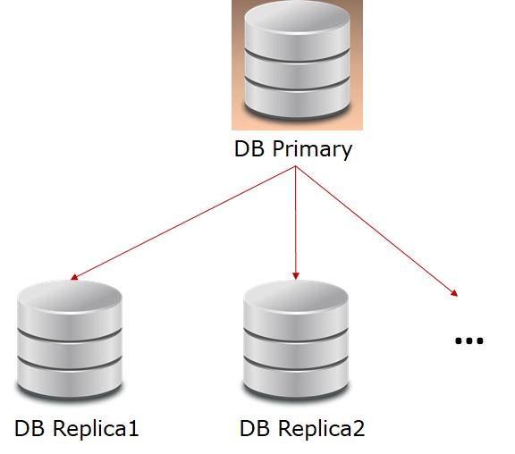

**1. Primary: 쓰기 전용**

* @Transactional 의 readOnly 속성

```java
@Transactional(readOnly = false)
```

* readOnly 를 코드에 적지 않으면, 기본값은 false

```java
import org.springframework.transaction.annotation.Transactional;

@Transactional
public List<Folder> createFolders(List<String> folderNameList, User user) {
```

* Write 된 Data (Create, Update, Delete) 가 Replica 로 Sync 됨 (Replication)

**2. Replica (Secondary): 읽기 전용**

```java
@Transactional(readOnly = true)
```

* 하지만, 위 개념은 스프링에 Primary DB endpoint, Replica DB endpoint 를 설정해야지만 가능!!

> 수십년 동안 통용되던 용어가 '노예제'와 관련된다는 이유로 대체됨   
>   
> 마스터 (Master) → Primary  
> 슬레이브 (Slave) → Replica, Secondary  
>   
> 출처 : 위키백과

---

3. Primary에 문제가 생겼을 때

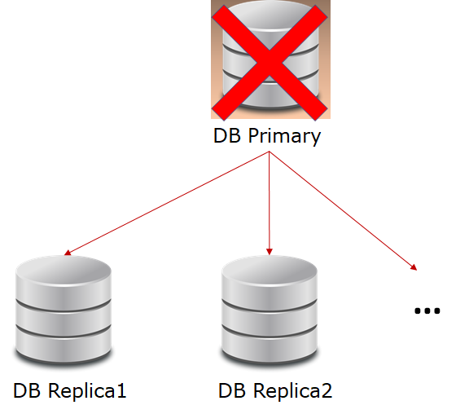

* Replica 중 1개가 Primary로 승격됨

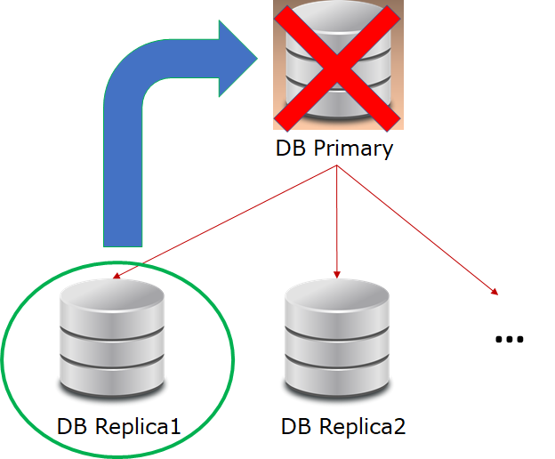

* 다시 Primary - Replica 로 정상 운영


---

## 12. 스프링 예외 처리 방법

1. 스프링 기본 에러 처리

1) HTTP 에러 메시지 전달 방법 이해

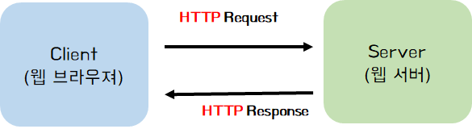

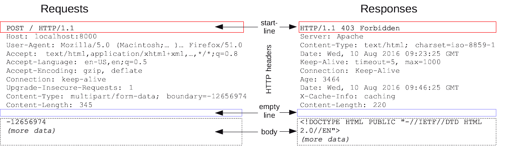

* Response 메시지
* 1. 상태줄: API 요청 결과 (상태 코드, 상태 텍스트)  
   > HTTP/1.1 404 Not Found  

  + HTTP 상태 코드 요약  
    1. 2xx : Success  
    2. 4xx : Client Error  
    3. 5xx : Server Error  
    [참고] org.springframework.http > HttpStatus
* 2. 헤더  
  + "Content Type"
    - 없음
    - Reponse 본문 내용이 HTML인 경우 : text/html
    - Response 본문 내용이 JSON인 경우 : application/json
* 3. 본문
  + a. HTML 형식
  + b. JSON 형식

---

2) 현재 에러 발생 시 HTTP 에러 메시지 확인

1. DB 에 중복된 폴더명 존재 시 Exception 발생  
   (예시) service > FolderService  
      throw new IllegalArgumentException("중복된 폴더명을 제거해 주세요! 폴더명: " + folderName);
2. 클라이언트에서 에러 메시지 확인
   1. 상태줄 : Status Code 확인
   2. 헤더 : Content-Type 확인
   3. HTTP 500   
      **HTTP 500** Internal Server Error  
      [참고] : [MDN Web Doc](https://developer.mozilla.org/ko/docs/Web/HTTP/Status/500)
   4. To Do
      1. HTTP 500 → 400 Client Error
      2. 응답 본문(Body) 내용 정의
         1. **에러 시 전달되는 본문 정의 → 프론트엔드 개발자와 공유**
            1. errorMessage : 에러 내용
            2. httpStatus : 스프링에 선언된 HttpStatus 값
         2. Sample(JSON)  

            {  
                "errorMessage" : "중복된 폴더명을 제거해 주세요! 폴더명 : 신발",  
                "httpStatus" : "BAD\_REQUEST"  
            }

---

2. 스프링 예외처리 방법

1. Controller 코드 수정
   1. 프론트엔드: 에러메시지 팝업 띄우는 작업 적용
   2. 백엔드 : 예외 처리
      1. 스프링이 제공하는 **ResponseEntity 클래스** 사용
      2. ResponseEntity : HTTP response object를 위한 Wrapper
         1. 선언 가능
            1. HTTP status code
            2. HTTP headers
            3. HTTP Body
2. @ExceptionHandler 사용
   1. FolderController의 모든 함수에 예외처리 적용(AOP)
   2. 예외 처리 함수
3. 예외처리 적용 결과 확인
   1. HTTP 상태 코드
   2. HTTP 응답 본문

---

## 13. 스프링 Global 예외 처리 방법

> 12장에서 배운 @ExceptionHandler의 범위는 해당 Controller이다.   
> 이번 장에서는 Global 전역적으로 사용하는 방법에 대해서 알 수 있다.

1. Global 예외처리 방법

* 관심상품 희망최저가 등록 시

```java
public Product updateProduct(Long id, ProductMypriceRequestDto requestDto) {
    int myprice = requestDto.getMyprice();
    if (myprice < MIN_MY_PRICE) {
        throw new IllegalArgumentException("유효하지 않은 관심 가격입니다. 최소 " + MIN_MY_PRICE + " 원 이상으로 설정해 주세요.");
    }
```

* Controller 마다 예외처리 코드를 추가해 줘야 할까?
* Global 예외 처리

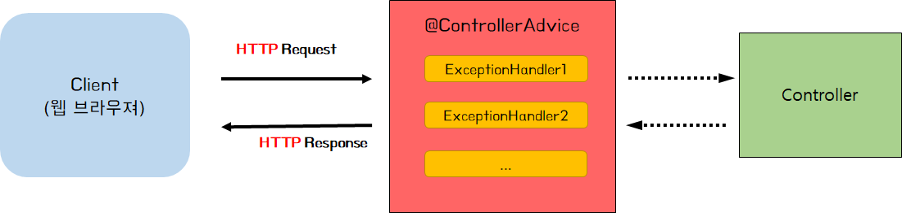

* @ControllerAdvice 사용
* @RestControllerAdvice
  + @ControllerAdvice + @ResponseBody

2. ErrorCode 선언

* 서비스 전체에 사용할 에러코드들 (**ErrorCode**) 을 선언
  + 예외발생 시 서버 및 클라이언트에서 선언한 **ErrorCode** 사용
* 에러코드
  1. httpStatus: HTTP 상태코드
  2. errorCode: 에러 코드
     1. 에러 종류별로 Unique 한 에러코드를 소유
     2. 국제화에 사용 가능
        1. 클라이언트가 사용하는 언어 (한국어, 영어, 중국어 등) 에 따라 에러메시지를 다르게 보여줌
  3. errorMessage
     1. 대표 에러 메시지

---

## Review

개발을 하면서 느낀 것은 학습은 중요하다.

학습을 하는 방식은 사람마다 다를 수 있지만,

나에게는 토이프로젝트를 통해 배우는 것이 가장 효과적이었다.

이번 Spring 5주차에서는

Spring 심화 주차에서 개념 설명 + 코드 적용을

통해 제대로 배울 수 있었다.
