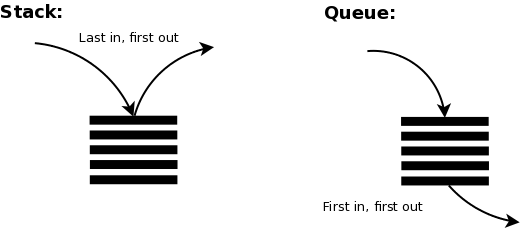
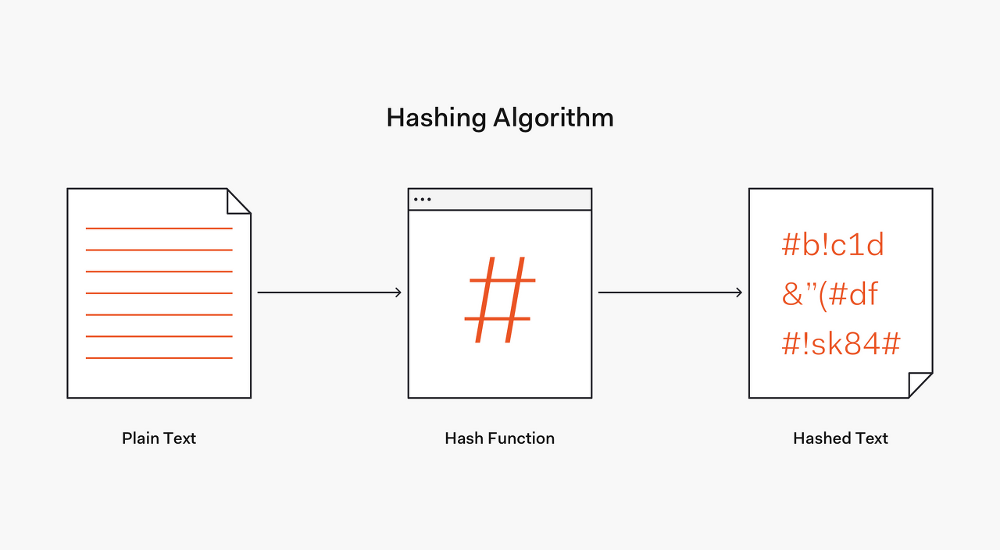
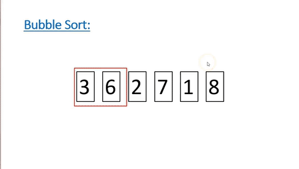
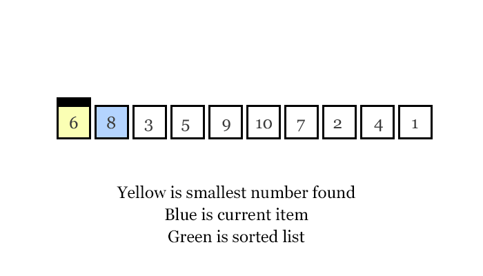
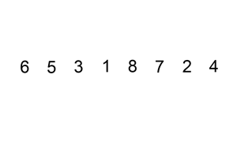

**[수업 목표]**

1. 정렬의 다양한 방법과 구현 방법에 대해 배운다.
2. 스택, 큐의 개념과 활용법에 대해 배운다.
3. 해쉬 개념과 활용법에 대해 배운다.

---

## 01. 3주차 오늘 배울 것

1. 정렬

> 정렬이란 데이터를 순서대로 나열하는 방법을 의미합니다.   
> 책이 꽂혀있을 때, 가나다 순으로 정렬해달라고 했을 때, 어떻게 정렬하는 게 가장 빠를까요?

2. 스택, 큐

> 스택과 큐는 들어가고 나오는 곳이 정해져있는 자료구조입니다! 



3. Hash

> 해쉬 알고리즘을 통해서 문자열을 고정된 길이의 데이터로 만들 수 있습니다!   
>   
> 이걸로 뭘 할 수 있냐구요?   
> 요새 핫한 블록체인이라는 기술에서도 쓰이기도 하고, 효율적인 자료구조인 딕셔너리를 만들때도 사용된답니다!



---

## 02. 정렬

1. 정렬이란

> 컴퓨터 과학과 수학에서 정렬 알고리즘이란 원소들을 번호순이나 사전 순서와 같이 일정한 순서대로 열거하는 알고리즘  
> [[위키백과]](https://ko.wikipedia.org/wiki/%EC%A0%95%EB%A0%AC_%EC%95%8C%EA%B3%A0%EB%A6%AC%EC%A6%98)

2. 버블 정렬

> 버블 정렬은 두 인접한 원소를 검사하여 정렬하는 방법이다.   
> 시간 복잡도가 O(n^{2})로 상당히 느리지만, 코드가 단순하기 때문에 자주 사용  
> [[위키백과]](https://ko.wikipedia.org/wiki/%EA%B1%B0%ED%92%88_%EC%A0%95%EB%A0%AC)



```python
input = [4, 6, 2, 9, 1]


def bubble_sort(array):
    n = len(array)
    for i in range(n):
        for j in range(n - i - 1):
            if array[j] > array[j + 1]:
                array[j], array[j + 1] = array[j + 1], array[j]
    return array

bubble_sort(input)
print(input)

print("정답 = [1, 2, 4, 6, 9] / 현재 풀이 값 = ",bubble_sort([4, 6, 2, 9, 1]))
print("정답 = [-1, 3, 9, 17] / 현재 풀이 값 = ",bubble_sort([3,-1,17,9]))
print("정답 = [-3, 32, 44, 56, 100] / 현재 풀이 값 = ",bubble_sort([100,56,-3,32,44]))
```

3. 선택 정렬

> 선택 정렬은 제자리 정렬 알고리즘의 하나로, 주어진 리스트 중에 최소값을 찾는다.   
> 그 값을 맨 앞에 위치한 값과 교체한다(패스(pass)). 맨 처음 위치를 뺀 나머지 리스트를 같은 방법으로 교체한다.  
> 비교하는 것이 상수 시간에 이루어진다는 가정 아래, n개의 주어진 리스트를 이와 같은 방법으로 정렬하는 데에는 Θ(n2) 만큼의 시간이 걸린다.  
> [[위키백과]](https://ko.wikipedia.org/wiki/%EC%84%A0%ED%83%9D_%EC%A0%95%EB%A0%AC)



```python
input = [4, 6, 2, 9, 1]


def selection_sort(array):
    n = len(array)
    for i in range(n - 1):
        min_index = i
        for j in range(n - i):
            if array[i + j] < array[min_index]:
                min_index = i + j

        array[i], array[min_index] = array[min_index], array[i]
    return array


selection_sort(input)
print(input)

print("정답 = [1, 2, 4, 6, 9] / 현재 풀이 값 = ",selection_sort([4, 6, 2, 9, 1]))
print("정답 = [-1, 3, 9, 17] / 현재 풀이 값 = ",selection_sort([3,-1,17,9]))
print("정답 = [-3, 32, 44, 56, 100] / 현재 풀이 값 = ",selection_sort([100,56,-3,32,44]))
```

4. 삽입 정렬

> 삽입 정렬은 자료 배열의 모든 요소를 앞에서부터 차례대로 이미 정렬된 배열 부분과 비교하여,   
> 자신의 위치를 찾아 삽입함으로써 정렬을 완성하는 알고리즘이다.   
>   
> 배열이 길어질수록 효율이 떨어진다. 다만, 구현이 간단하다는 장점이 있다.  
> 선택 정렬이나 거품 정렬과 같은 O(n2) 알고리즘에 비교하여 빠르며, 안정 정렬이고 in-place 알고리즘



```python
input = [4, 6, 2, 9, 1]


def insertion_sort(array):
    n = len(array)
    for i in range(1, n):
        for j in range(i):
            if array[i - j - 1] > array[i - j]:
                array[i - j - 1], array[i - j] = array[i - j], array[i - j - 1]
            else:
                break
    return array

insertion_sort(input)
print(input)

print("정답 = [4, 5, 7, 7, 8] / 현재 풀이 값 = ",insertion_sort([5,8,4,7,7]))
print("정답 = [-1, 3, 9, 17] / 현재 풀이 값 = ",insertion_sort([3,-1,17,9]))
print("정답 = [-3, 32, 44, 56, 100] / 현재 풀이 값 = ",insertion_sort([100,56,-3,32,44]))
```

5. 병합 정렬(Merge)

> 병합 정렬은 배열의 앞부분과 뒷부분의 두 그룹으로 나누어 각각 정렬한 후 병합하는 작업을 반복하는 알고리즘입니다.  
>   
> 예를 들어서   
> A 라고 하는 배열이 1, 2, 3, 5 로 정렬되어 있고,   
> B 라고 하는 배열이 4, 6, 7, 8 로 정렬되어 있다면   
> 이 두 집합을 합쳐가면서 정렬하는 방법입니다.

```python
[1, 2, 3, 5]  # 정렬된 배열 A
[4, 6, 7, 8]  # 정렬된 배열 B
[] # 두 집합을 합칠 빈 배열 C


        ↓
1단계 : [1, 2, 3, 5] 
        ↓
       [4, 6, 7, 8] 
        1과 4를 비교합니다!
        1 < 4 이므로 1을 C 에 넣습니다.
     C:[1]

           ↓
2단계 : [1, 2, 3, 5] 
        ↓
       [4, 6, 7, 8] 
        2와 4를 비교합니다!
        2 < 4 이므로 2를 C 에 넣습니다.
     C:[1, 2]


              ↓
3단계 : [1, 2, 3, 5] 
        ↓
       [4, 6, 7, 8] 
        3과 4를 비교합니다!
        3 < 4 이므로 3을 C 에 넣습니다.
     C:[1, 2, 3]

                 ↓
3단계 : [1, 2, 3, 5] 
        ↓
       [4, 6, 7, 8] 
        5와 4를 비교합니다!
        5 > 4 이므로 4을 C 에 넣습니다.
     C:[1, 2, 3, 4]

                 ↓
3단계 : [1, 2, 3, 5] 
           ↓
       [4, 6, 7, 8] 
        5와 6을 비교합니다!
        5 < 6 이므로 5을 C 에 넣습니다.
     C:[1, 2, 3, 4, 5]

엇, 이렇게 되면 A 의 모든 원소는 끝났습니다!

그러면 B에서 안 들어간 원소인
       [6, 7, 8] 은 어떡할까요?
하나씩 C 에 추가해주면 됩니다.
     C:[1, 2, 3, 4, 5, 6, 7, 8] 이렇게요!

그러면 A 와 B를 합치면서 정렬할 수 있었습니다.

한 번, 직접 이 로직을 코드로 구현해보겠습니다!
```

```python
array_a = [1, 2, 3, 5]
array_b = [4, 6, 7, 8]


def merge(array1, array2):
    result = []
    array1_index = 0
    array2_index = 0
    while array1_index < len(array1) and array2_index < len(array2):
        if array1[array1_index] < array2[array2_index]:
            result.append(array1[array1_index])
            array1_index += 1
        else:
            result.append(array2[array2_index])
            array2_index += 1

    if array1_index == len(array1):
        while array2_index < len(array2):
            result.append(array2[array2_index])
            array2_index += 1

    if array2_index == len(array2):
        while array1_index < len(array1):
            result.append(array1[array1_index])
            array1_index += 1

    return result


print(merge(array_a, array_b))

print("정답 = [-7, -1, 5, 6, 9, 10, 11, 40] / 현재 풀이 값 = ", merge([-7, -1, 9, 40], [5, 6, 10, 11]))
print("정답 = [-1, 2, 3, 5, 10, 40, 78, 100] / 현재 풀이 값 = ", merge([-1,2,3,5,40], [10,78,100]))
print("정답 = [-1, -1, 0, 1, 6, 9, 10] / 현재 풀이 값 = ", merge([-1,-1,0], [1, 6, 9, 10]))
```

6. 병합 정렬(MergeSort)

> 합병 정렬 또는 병합 정렬(merge sort)은 O(n log n) 비교 기반 정렬 알고리즘  
> 일반적인 방법으로 구현했을 때 안정 절렬에 속하며, 분할 정복 알고리즘의 하나이다  
>   
> 시간 복잡도 : O(nlong n)

```python
def merge_sort(array):
    if len(array) <= 1:
        return array
    mid = len(array) // 2
    left_array = merge_sort(array[:mid])
    right_array = merge_sort(array[mid:])
    return merge(left_array, right_array)

def merge(array1, array2):
    result = []
    array1_index = 0
    array2_index = 0
    while array1_index < len(array1) and array2_index < len(array2):
        if array1[array1_index] < array2[array2_index]:
            result.append(array1[array1_index])
            array1_index += 1
        else:
            result.append(array2[array2_index])
            array2_index += 1

    if array1_index == len(array1):
        while array2_index < len(array2):
            result.append(array2[array2_index])
            array2_index += 1

    if array2_index == len(array2):
        while array1_index < len(array1):
            result.append(array1[array1_index])
            array1_index += 1

    return result


print(merge_sort(array))
```

> [요약]  
>   
> 오름차순 기준으로,   
> 버블 정렬 - 뒤에서부터 정렬된다.  
> 선택 정렬 - 가장 작은 것 부터 정렬된다.  
> 삽입 정렬 - 앞뒤로 비교하여 정렬된 상태  
> 병합 정렬 - 분할 정복!!

---

## 03. 스택

> 스택은 후입선출이다.  
>   
> 스택은 제한적으로 접근할 수 있는 나열 구조이다. 그 접근 방법은 언제나 목록의 끝에서만 일어난다.   
> 스택은 한 쪽 끝에서만 자료를 넣거나 뺄 수 있는 선형 구조(LIFO - Last In First Out)으로 되어 있다

* Stack을 실제 구현해 보는 것은 자료구조를 이해하는데 도움이 된다.

```python
class Node:
    def __init__(self, data):
        self.data = data
        self.next = None


class Stack:
    def __init__(self):
        self.head = None

    def push(self, value):
        new_head = Node(value)
        new_head.next = self.head
        self.head = new_head

    # pop 기능 구현
    def pop(self):
        if self.is_empty():
            return "Stack is Empty"

        delete_head = self.head
        self.head = self.head.next
        return delete_head

    def peek(self):
        if self.is_empty():
            return "Stack is Empty"

        return self.head.data

    # is_empty 기능 구현
    def is_empty(self):
        return self.head is None


stack = Stack()
stack.push(3)
print(stack.peek())     # 3

stack.push(4)
print(stack.peek())     # 4 -> 3

print(stack.pop().data) 

print(stack.peek())     # 3
print(stack.is_empty()) # False
```

* Stack 실전 사용  
  - 실제 코드에서는 파이썬의 list를 이용해서 Stack을 사용한다.
* Stack 문제 - 탑

> Q. 수평 직선에 탑 N대를 세웠습니다. 모든 탑의 꼭대기에는 신호를 송/수신하는 장치를 설치했습니다.   
> 발사한 신호는 신호를 보낸 탑보다 높은 탑에서만 수신합니다. 또한 ,한 번 수신된 신호는 다른 탑으로 송신되지   
> 않습니다. 예를 들어 높이가 6, 9, 5, 7, 4 인 다섯 탑이 왼쪽으로 동시에 레이저 신호를 발사합니다.   
>   
> 그러면, 탑은 다음과 같이 신호를 주고 받습니다.   
> 높이가 4인 다섯 번째 탑에서 발사한 신호는 높이가 7인 네 번째 탑에서 수신하고,   
> 높이가 7인 네 번째 탑의 신호는 높이가 9인 두 번째 탑이,   
> 높이가 5인 세 번째 탑의 신호도 높이가 9인 두 번째 탑이 수신합니다.   
> 높이가 9인 두 번째 탑과 높이가 6인 첫 번째 탑이 보낸 레이저 신호는 어떤 탑에서도 수신할 수 없습니다.   
> 이 때, 맨 왼쪽부터 순서대로 탑의 높이를 담은 배열 heights가 매개변수로 주어질 때 각 탑이 쏜 신호를 어느 탑에서 받았는지 기록한 배열을 반환하시오.

```python
top_heights = [6, 9, 5, 7, 4]


def get_receiver_top_orders(heights):
    result = [0] * len(heights)

    while heights:                                  # O(N)
        height = heights.pop()

        for idx in range(len(heights)-1, 0, -1):    # O(N)
            if heights[idx] > height:
                result[len(heights)] = idx + 1
                break

    return result                                   # O(N^2)


print(get_receiver_top_orders(top_heights))  # [0, 0, 2, 2, 4] 가 반환되어야 한다!

print("정답 = [0, 0, 2, 2, 4] / 현재 풀이 값 = ",get_receiver_top_orders([6,9,5,7,4]))
print("정답 = [0, 0, 0, 3, 3, 3, 6] / 현재 풀이 값 = ",get_receiver_top_orders([3,9,9,3,5,7,2]))
print("정답 = [0, 0, 2, 0, 0, 5, 6] / 현재 풀이 값 = ",get_receiver_top_orders([1,5,3,6,7,6,5]))
```

---

## 04. 큐

> 큐는 선입선출이라고 한다.  
> 먼저 집어 넣은 데이터가 먼저 나오는 FIFO(First In First Out)구조로 저장하는 형식  
> - 데이터 넣고 뽑는 걸 자주하는 자료구조  
> - 스택과 다르게 큐는 끝과 시작의 노드를 전부 가지고 있어야 한다.  
> 예시) 매표소

1. 큐의 기능

> enqueue(data) : 맨 뒤에 데이터 추가하기   
> dequeue() : 맨 앞의 데이터 뽑기   
> peek() : 맨 앞의 데이터 보기   
> isEmpty() : 큐가 비었는지 안 비었는지 여부 반환해주기

```python
class Node:
    def __init__(self, data):
        self.data = data
        self.next = None


class Queue:
    def __init__(self):
        self.head = None
        self.tail = None

    def enqueue(self, value):
        newNode = Node(value)

        if self.is_empty():
            self.head = newNode
            self.tail = newNode
            return

        self.tail.next = newNode
        self.tail = newNode

    def dequeue(self):
        if self.is_empty():
            return "Queue is Empty"

        delete_head = self.head
        self.head = self.head.next
        return delete_head.data

    def peek(self):
        if self.is_empty():
            return "Queue is Empty"

        return self.head.data

    def is_empty(self):
        return self.head is None


queue = Queue()

# INSERT
queue.enqueue(3)        # 3
print(queue.peek())
queue.enqueue(4)        # 3 4
print(queue.peek())
queue.enqueue(5)        # 3 4 5
print(queue.peek())

# DELETE
queue.dequeue()         # 4 5
print(queue.peek())
queue.dequeue()         # 5
print(queue.peek())
```

---

## 05. 해쉬

> 해쉬 테이블이란  
> - 컴퓨팅에서 키를 값에 매핑할 수 있는 구조인, 연관 배열 추가에 사용되는 자료 구조이다.   
> - 해시 테이블은 해시 함수를 사용하여 색인(index)을 버킷(bucket)이나 슬롯(slot)의 배열로 계산한다. 데이터를 다루는 기법 중에 하나로 **데이터의 검색과 저장**이 아주 빠르게 진행된다.  
>   
>  파이썬의 딕셔너리는 해쉬 테이블이라고도 한다.  
> **(딕셔너리는 내부적으로 배열을 사용하고 있다.)**

> "fast" 와 "slow" 의 값인 "빠른"과 "느린" 이 배열 어딘가에 있다고 했을 때,  
> 그럼 그 인덱스를 몇번에 넣어야 하는지, 몇번에서 찾아야 하는지 어떻게 찾아주는 걸까?   
>   
> 해쉬 함수 이용하면 된다.  
> \* 해쉬 함수(Hash Function)는 임의의 길이를 갖는 메시지를 입력하여 고정된 길이의 해쉬값을 출력하는 함수  
> 또는 임의의 길이의 데이터를 고정된 길이의 데이터로 매핑하는 함수라고 한다.

```python
items = [None] * 8
hash("fast") % 8				# 5
items[hash("fast") % 8] = "빠른"
items[hash("slow") % 8] = "느린"

items 						# ['느린', None, None, None, None, '빠른', None, None]
items[hash("fast") % 8] 			#'빠른'
```

> 🔥 **문제 발생** 🔥  
> 동일한 숫자 8로 나눌 경우, hash의 인덱스 값이 동일해질 때가 생긴다.  
> 이 때문에 다른 데이터가 해당 인덱스 값을 덮어 씌우게 되는데 이를 충돌이 발생한다고 표현한다.  
>   
> 해결방법   
> 1. Linked List  
> - 링크드 리스트에 해당 노드를 추가해주면 된다.  
> - 충돌이 나더라도 데이터가 손실될 걱정이 없고 저장을 할 수 있게 된다.  
> - 어떤 키로 저장했는지 알아야하기 때문에 키도 함께 저장해줘야한다.  
>   
> 2. 개방 주소법(Open Addressing)  
> - 만약 items[3]으로 해쉬 값이 동일하다면, 다음 인덱스 또 저장되어있다면 다음 인덱스로 이동하여 비어있는 곳에 저장하는 방법

```
class LinkedTuple:
    def __init__(self):
        self.items = list()

    def add(self, key, value):
        self.items.append((key, value))

    def get(self, key):
        for k, v in self.items:
            if key == k:
                return v


class LinkedDict:
    def __init__(self):
        self.items = []
        for i in range(8):
            self.items.append(LinkedTuple())


    def put(self, key, value):
        index = hash(key) % len(self.items)
        self.items[index].add(key,value)

    def get(self, key):
        index = hash(key) % len(self.items)
        return self.items[index].get(key)
```

> [ 요약🔥 ]  
>   
> **1. 해쉬 테이블(Hash Table)**  
> "키" 와 "데이터"를 저장함으로써 즉각적으로 데이터를 받아오고 업데이트하고 싶을 때 사용하는 자료구조  
>   
> **2. 해쉬 함수(Hash Function)**  
> 임의의 길이를 갖는 메시지를 입력하여 고정된 길이의 해쉬값을 출력하는 함수  
>   
> **3. 해쉬 테이블의 내부 구현**  
> 키를 해쉬 함수를 통해 임의의 값으로 변경한 뒤 배열의 인덱스로 변환하여 해당하는 값에 데이터를 저장하기 때문에 즉각적으로 데이터를 찾고, 추가할 수 있다.  
>   
> 4. 해쉬 충돌 해결방법  
> 1) Chaining  
> 2) 개방 주소법

**Quiz. 출석체크**

* 풀이 방법 1 - 이중 반복문  
  - 이중 반복문을 통해 풀 경우 시간복잡도는 O(N^2)이 되어 비효율적이게 된다.

* 풀이 방법 2 - Hash Table  
  - Hash 테이블은 시간 복잡도는 O(N)으로 줄일 수 있지만, 공간복잡도가 크게 증가하는 것을 볼 수 있다.  
  즉, Hash 테이블은 시간은 극대화하는 만큼 공간을 대신 사용하는 자료구조이다.

```python
all_students = ["나연", "정연", "모모", "사나", "지효", "미나", "다현", "채영", "쯔위"]
present_students = ["정연", "모모", "채영", "쯔위", "사나", "나연", "미나", "다현"]


def get_absent_student(all_array, present_array):
    student_dict = {}

    for key in all_array:               # 모든 학생 삽입 O(N)
        student_dict[key] = True        # 공간 복잡도도 O(N)

    for key in present_array:           # 출석 학생 삭제  O(N)
        del student_dict[key]

    for key in student_dict.keys():
        return key


print(get_absent_student(all_students, present_students))

print("정답 = 예지 / 현재 풀이 값 = ",get_absent_student(["류진","예지","채령","리아","유나"],["리아","류진","채령","유나"]))
print("정답 = RM / 현재 풀이 값 = ",get_absent_student(["정국","진","뷔","슈가","지민","RM"],["뷔","정국","지민","진","슈가"]))
```

---

> 이번에 Hash를 배우면서 새로 알게 된 것이 있었다.  
> 파이썬의 Dictionary는 배열로 이루어져있다는 사실...  
>   
> 사용하기에 급급했지.. Python 자료구조는 어떻게 만들어졌는지에 대해  
> 이해하고 깊게 생각하지 않았던 나의 모습을 되돌아보게 되었다...
