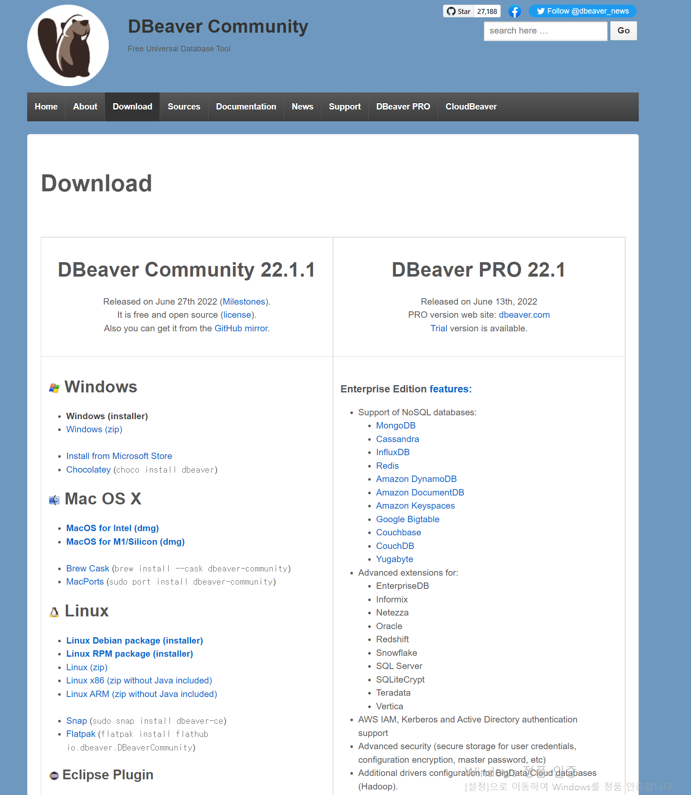

> 오랜만에 강의를 들으려고 스파르타 코딩클럽에 접속!  
>   
> 오늘부터는 SQL 강의를 들으려고 한다.   
>   
> SQL 문제는 많이 풀어보았고   
> 기업 면접 코딩테스트에서도 많이 풀어보았다.   
>   
> 강의에서는 무엇을 가르쳐 주는지   
> 기존에 알고 있던 것과 무엇이 다른지에 대한 초점을 맞춰 진행하려 한다.  
>   
>
> ---

#### 

#### **[수업 목표]**

1. 데이터베이스(DB)와 SQL이 왜 필요한지 이해한다.
2. DB에서 데이터를 가져오는 기초적인 문법인 Select와 Where문을 이해한다.
3. 조금 더 복잡한 분석을 위해 자주 사용되는 유용한 문법을 익힌다.

---

### 01. 오늘 배울 것

> 👉 SQL의 쉬운 개념부터 어려운 개념까지 삽질하며 익히는 강의다.

* 데이터베이스(DB)와 SQL이 왜 필요할까?
  + 데이터베이스는 많은 양의 데이터를 효과적으로 저장/수정/사용하기 위해 필요하다.
  + 데이터베이스의 기능
    - Create
    - Read
    - Update
    - Delete
  + SQL은 데이터베이스에 요청(Query)을 날려서 원하는 데이터를 가져오는 것을 도와주는 언어  
    (데이터베이스와 소통하기 위한 언어)

---

### 

### 02. 필수 프로그램 설치

* [DBeaver](https://dbeaver.io/download/)

---

### 

### 03. Select 쿼리문이란?

1. Select 쿼리문의 개념

> 쿼리(Query)문이란?   
> 쿼리는 질의를 의미하고 데이터베이스에 명령을 내리는 것을 의미합니다.   
> Select 쿼리문은, 데이터베이스에서 '데이터를 선택해서 가져오겠다' 는 의미입니다.

* Select 쿼리문은 1) 어떤 테이블에서 2) 어떤 필드의 데이터를 가져올지 로 구성됩니다.  

  (예시) Select order\_no, created\_at, course\_title, user\_id, payment\_method, email from orders;   

  orders 테이블의  created\_at, course\_title, payment\_method, email 필드를 가져와달라고 요청하는 쿼리문이다

2. 특정 데이터만 가져오기

* where 절의 개념
  + where 절은 Select 쿼리문으로 가져올 데이터에 조건을 걸어주는 것을 의미한다.
    - 예1) orders 테이블에서 결제수단이 카카오페이인 데이터 추출  
      SELECT \* FROM orders o WHERE payment\_method = 'kakaopay'
    - 예2) point\_users 테이블에서 포인트가 5000점 이상인 데이터 추출  
      SELECT \* FROM point\_users pu WHERE point >= 5000
    - 예3) orders 테이블에서 주문한 강의가 앱개발 종합반이면서, 결제수단이 카드인 데이터 추출  
      SELECT \* FROM orders o WHERE course\_title = '앱개발 종합반' AND payment\_method = 'CARD'

3. **퀴즈 1**

* 포인트가 20000점보다 많은 유저  
  SELECT \* FROM point\_users pu WHERE point > 20000
* 성이 황씨인 유저  
  SELECT \* FROM users u WHERE name LIKE '황%'
* 웹개발 종합발이면서 결제수단이 CARD인 주문건만 뽑아보기  
  SELECT \* FROM orders o WHERE course\_title = '웹개발 종합반' AND payment\_method = 'CARD'

---

### 04. 유용한 문법

* Where 절과 자주 쓰이는 문법
  + '같지 않음' 조건 →  **!=**  
    select \* from orders where course\_title != "웹개발 종합반";
  + '범위' 조건 → **between**   
    select \* from orders where created\_at between "2020-07-13" and "2020-07-15";
  + '포함' 조건 → **in**select \* from checkins where week in (1, 3);
  + '패턴'(문자열 규칙) 조건 →   
    (예시) 다음 이메일을 사용하는 유저  
    select \* from users  where email like '%daum.net';  
    - Like의 다양한 사용법
      * where email like 'a%': email 필드값이 a로 시작하는 모든 데이터
      * where email like '%a' email 필드값이 a로 끝나는 모든 데이터
      * where email like '%co%' email 필드값에 co를 포함하는 모든 데이터
      * where email like 'a%o' email 필드값이 a로 시작하고 o로 끝나는 모든 데이터
* **퀴즈 2**
  + 결제수단이 CARD가 아닌 주문데이터만 추출해보기  
    SELECT \* from orders o WHERE payment\_method != 'CARD'
  + 20000~30000 포인트 보유하고 있는 유저만 추출해보기  
    SELECT \* FROM point\_users pu WHERE point BETWEEN 20000 and 30000
  + 이메일이 s로 시작하고 com로 끝나는 유저만 추출해보기  
    SELECT \* FROM users u WHERE email LIKE 's%com'
  + 이메일이 s로 시작하고 com로 끝나면서 성이 이씨인 유저만 추출해보기  
    SELECT \* FROM users u WHERE email LIKE 's%com' and name LIKE '이%'

---

* 유용한 문법
  + 일부 데이터만 가져오기 : Limit  
    SELECT \* FROM orders  WHERE payment\_method = "kakaopay" LIMIT 5;
  + 중복 데이터는 제외하고 가져오기 : Distinct  
    SELECT DISTINCT(payment\_method) FROM orders
  + 몇 개인지 숫자 세보기 : Count  
    SELECT count(\*) FROM orders
  + [응용] Distinct와 Count를 같이 써보기  
    SELECT count(DISTINCT (name)) FROM users u
* 퀴즈 3
  + 성이 남씨인 유저의 이메일만 추출  
    SELECT email FROM users u WHERE name LIKE '남%'
  + Gmail을 사용하는 2020/07/12~13에 가입한 유저를 추출  
    SELECT \* FROM users u   
    WHERE created\_at BETWEEN '2020-07-12' AND '2020-07-14'   
    AND email LIKE '%gmail%'
  + Gmail을 사용하는 2020/07/12~13에 가입한 유저의 수를 세기  
    SELECT COUNT(\*) FROM users u   
    WHERE created\_at BETWEEN '2020-07-12' AND '2020-07-14'   
    AND email LIKE '%gmail%'

---

### 

### 06. 숙제

> 문제 : naver 이메일을 사용하면서, 웹개발 종합반을 신청했고 결제는 kakaopay로 이뤄진 주문데이터 추출하기  
>   
> 정답  
> SELECT \* FROM orders o   
> WHERE email LIKE '%naver%' AND course\_title = '웹개발 종합반' AND payment\_method = 'kakaopay'
