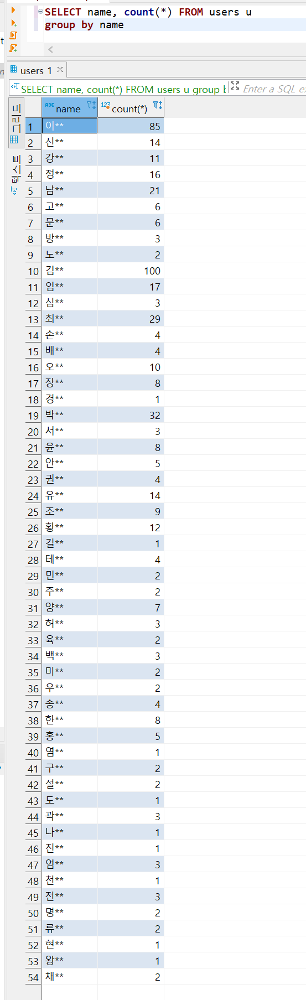

> 1주차가 간단하고 짧아서  
>   
> 2주차까지 이어간다!!  
>   
> 🔥🔥🔥🔥🔥  
>   
>
> ---

### 01. 오늘 배울 것

* 통계: 최대 / 최소 / 평균 / 개수
  + 데이터 분석의 목적: 쌓여있는 날것의 데이터 → 의미를 갖는 '정보'로의 변환
  + 데이터베이스 테이블에 저장된 데이터: 쌓여있는 날것의 데이터
  + 가장 많은 Like를 받은 사람의 이름, 전체 신청자수, 평균 연령: 의미있는 '정보'   
    예) 과목별 신청자 평균 연령, 과목별 신청자 수, 성씨별 회원 수 등
* 통계 구하기: 기존 방법의 한계  
  + 과목별 신청자 수를 구할 수 있지만, 성씨별 회원수를 구하고 싶다면 현재 배운 것으로는 해결 불가능
* 동일한 범주의 데이터를 묶어주는 Group by
  + Group by란?  
    동일한 범주를 갖는 데이터를 하나로 묶어서, 범주별 통계를 내주는 것  

    Group by를 이용하면 1) 같은 성씨의 데이터를 하나로 묶고 2) 각 성씨의 회원수를 구할 수 있다.
* 깔끔하게 데이터를 정렬해보자: Order by

---

### 

### 02. 범주의 통계를 내주는 Group by

* 성씨별로 몇 명이 회원이 있는지 구하려고 where 절을 사용해서 수십개의 쿼리를 작성하는 것은 비효율적입니다.   
  이 문제를 Group by를 사용해서 어떻게 해결할 수 있을까?  

  SELECT name, count(\*) FROM users u   
  group by name

---

### 

### 03. SQL 쿼리가 실행되는 순서

> 원하는 데이터 : 성씨별로 회원 수 구하기  
> select name, count(\*) from users group by name;

* Query 실행되는 순서  
  + From → Group by → Select
  + From users: users 테이블 데이터 전체 요청
  + Group by name: users 테이블 데이터에서 같은 name을 갖는 데이터를 기준으로 그룹을 나눈다.
  + Select name, count(\*): name에 따라 나눠진 그룹에 데이터의 개수를 계산한다.

---

### 

### 04. Group by 기능

> Group by는 동일한 범주를 갖는 데이터를 하나로 묶어서, 범주별 통계를 내주는 것이다.

* 동일한 범주의 개수 구하기  

  예제 : 주차별 '오늘의 다짐' 개수 구하기  
  SELECT week, count(\*) FROM checkins c group by week
* 동일한 범주에서의 최솟값 구하기  

  예제 : 주차별 '오늘의 다짐'의 좋아요 최솟값 구하기  
  SELECT week, min(likes) FROM checkins c group by week
* 동일한 범주에서의 최댓값 구하기  

  예제 : 주차별 '오늘의 다짐'의 좋아요 최댓값 구하기  
  SELECT week, max(likes) FROM checkins c group by week
* 동일한 범주의 평균 구하기  

  예제 : 주차별 '오늘의 다짐'의 좋아요 평균값 구하기  
  SELECT week, avg(likes) FROM checkins c group by week  
  SELECT week, round(avg(likes), 2) FROM checkins group by week   

  round를 사용하여 원하는 소수점 자리까지 출력가능하다.
* 동일한 범주의 합계 구하기  

  예제 : 주차별 '오늘의 다짐'의 좋아요 합계 구하기  
  SELECT week, sum(likes) FROM checkins c group by week

---

### 

### 05. 깔끔한 정렬 Order by

* Order by를 통해 정렬 기준 값과 정렬 기준을 설정할 수 있다.
* 정렬 기준값에 디폴트 값은 오름차순이다.

> 원하는 데이터 : 성씨별 회원수 데이터를 추출하라  
> select name, count(\*) from users group by name;

* 결과의 개수 오름차순으로 정렬  

  SELECT name, count(\*) FROM users u   
  group by name ORDER BY COUNT(\*)
* 결과의 개수 내림차순으로 정렬   

  SELECT name, count(\*) FROM users u   
  group by name ORDER BY COUNT(\*) DESC

* Order by는 모든 SQL 쿼리에 적용될 수 있는 기능입니다.
* 쿼리가 실행되는 순서: from → group by → select → order by  
  + from users: users 테이블 데이터 전체
  + group by name: users 테이블 데이터에서 같은 name을 갖는 데이터를 그룹핑
  + select name, count(\*): name에 따라 그룹별 데이터 개수
  + order by count(\*): 룹핑된 데이터별 개수에 따라 오름차순으로 정렬

---

### 06. Where와 함께 사용

* 원리는 간단하다. Where절로 조건이 하나 추가되고, 그 이후에 Group by, Order by가 실행되는 것!
* 예제 : 웹개발 종합반의 결제수단별 주문건수를 출력하라  

  Query  

  SELECT payment\_method, count(\*) FROM orders   
  WHERE course\_title = '웹개발 종합반'   
  group by payment\_method   
  ORDER BY count(\*)

* 쿼리가 실행되는 순서: from → where → group by → select
  + from users: users 테이블 데이터 전체
  + where course\_title = "웹개발 종합반": 웹개발 종합반 데이터만 추출
  + group by payment\_method: 같은 payment\_method을 갖는 데이터를 그룹핑
  + select payment\_method, count(\*): payment\_method에 따라 그룹별 데이터 개수

---

### 07. Where와 함께 사용

* Order by 연습 문제  
  + 문자열을 기준으로 정렬해보기  

    원하는 데이터 : 이름별 데이터 정렬  
    SELECT \* FROM users Order by name
  + 시간을 기준으로 정렬해보기  

    원하는 데이터 : 가입일자를 기준으로 회원 정렬   
    SELECT \* FROM users Order by created\_at
* Group by 연습 문제
  + 앱개발 종합반의 결제수단별 주문건수 세어보기  

    SELECT payment\_method, count(\*) FROM orders  
    WHERE course\_title = '앱개발 종합반'   
    group by payment\_method   
    order by count(\*)
  + Gmail 을 사용하는 성씨별 회원수 세어보기  

    SELECT name, count(\*) from users   
    where email LIKE '%gmail%'   
    GROUP by name   
    ORDER by count(\*)
  + course\_id별 '오늘의 다짐'에 달린 평균 like 개수 구해보기  

    SELECT course\_id, avg(likes) from checkins   
    group by course\_id;

---

### 

### 08. 이외 유용한 문법

* 별칭 기능: Alias  

  쿼리가 점점 길어지면서 종종 헷갈리는 일이 생길 수 있습니다. 그래서 SQL은 Alias라는 별칭 기능을 지원합니다.  

  select payment\_method, count(\*) as cnt from orders o  
  where o.course\_title = '앱개발 종합반'   
  group by payment\_method

---

### 

### 09. 숙제

* 미션: 네이버 이메일을 사용하여 앱개발 종합반을 신청한 주문의 결제수단별 주문건수 세어보기  

  Query  

  SELECT payment\_method, count(\*)   
  FROM orders  
  WHERE course\_title = '앱개발 종합반' AND email LIKE '%naver%'   
  GROUP by payment\_method   
  ORDER by count(\*)
