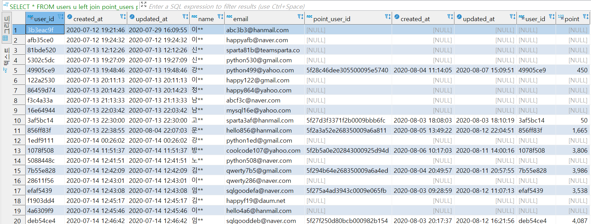
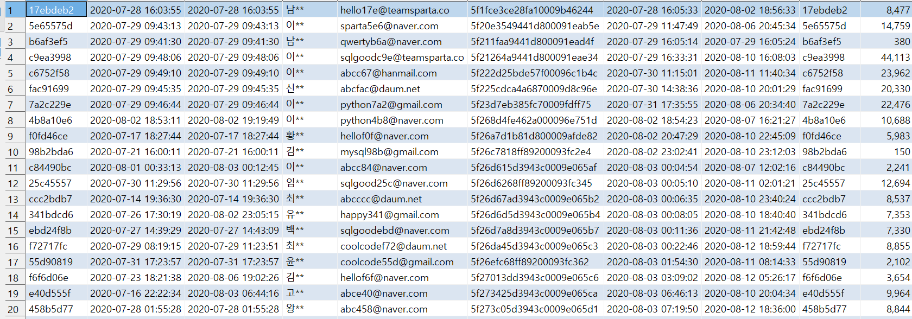
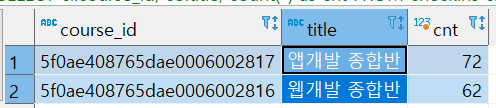
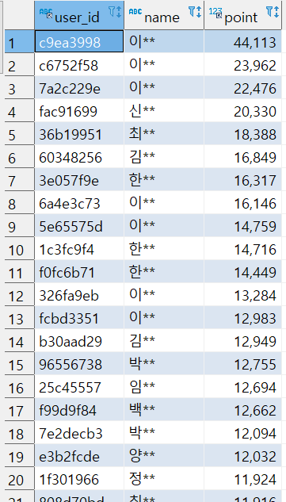
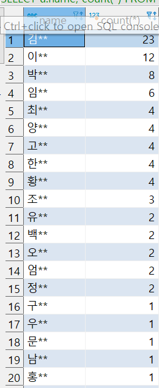
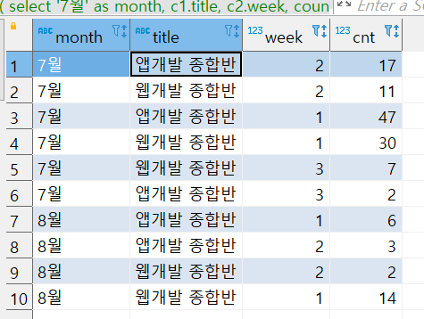
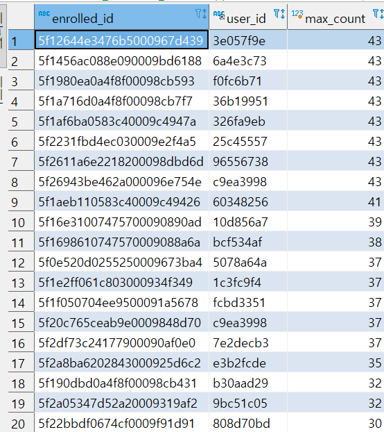

> 오늘은 3주차 SQL 강의를 수강한다.  
>   
> 3주차에는 어려운게 나오겠지??  
>   
>
> ---

### 

### 01. 오늘 배울 것

* '오늘의 다짐'을 남긴 회원의 이름을 알고싶어요

> 오늘의 미션!  
>   
> '오늘의 다짐' 이벤트 당첨자를 선정하여 스타벅스 기프티콘을 지급해야 해요.   
> \*오늘의 다짐 이벤트: 오늘의 다짐을 남겨준 10명 추첨해서 기프티콘 지급하는 이벤트.

* (문제점) 현재 테이블은 관심사항만을 갖고 있다.
* (해결 방법) 테이블과 테이블을 연결하여 원하는 정보를 추출한다.   
  이를 위해 필요한 것은 Join이다.

---

### 

### 02. 여러 테이블을 연결해보자: Join 이란?

* Join 이란?  
  두 테이블의 공통된 정보(Key) 를 기준으로 테이블을 연결해서 한 테이블처럼 보는 것을 의미한다.  

  (예시) users 테이블과 orders 테이블에 공통 필드인 user\_id를 기준으로 연결한다.

* Join의 종류: Left Join, Inner Join  
  + Left Join  
    : 왼쪽 테이블을 중심으로 오른쪽의 테이블을 매치시킨다.  
    (왼쪽 테이블은 무조건 표시하고, 매치되는 레코드가 오른쪽 테이블에 없으면 NULL로 표시)  

    [그림1] SELECT \* FROM users u    
    left join point\_users pu on u.user\_id = pu.user\_id
  + Inner Join  
    : 기본적인 Join은 교집합이다.  

    [그림2] SELECT \* FROM users u    
    inner join point\_users pu on u.user\_id = pu.user\_id

[그림1]



[그림 2]



---

### 03. Join 본격 사용해보기

1. Join 연습문제
   1. orders 테이블에 users 테이블 연결  
      SELECT \* FROM orders o inner join users u on o.user\_id = u.user\_id
   2. checkins 테이블에 users 테이블 연결  
      SELECT \* FROM checkins c inner join users u on c.user\_id = u.user\_id
   3. enrolleds 테이블에 courses 테이블 연결  
      SELECT \* FROM enrolleds e inner join users u on e.user\_id = u.user\_id
2. SQL 쿼리가 실행되는 순서

> select \* from enrolleds e inner join courses c on e.course\_id = c.course\_id;  
> 쿼리가 실행되는 순서: from → join → select

* from enrolleds: enrolleds 테이블 데이터 전체
* inner join courses on e.course\_id = c.course\_id  
  : courses를 enrolleds 테이블에 붙이는데, enrolleds 테이블의 course\_id와 동일한 course\_id를 갖는 courses의 테이블을 붙입니다
* select \* : 붙여진 모든 데이터를 출력

---

### 

### 04. 배웠던 문법을 Join과 함께 사용해보기

1. Join 연습문제
   1. checkins 테이블에 courses 테이블 연결해서 통계치 내보기 [그림 3]  

      \* 문제 : 과목별 오늘의 다짐 갯수 세어보기  

      SELECT ci.course\_id, co.title, count(\*) as cnt FROM checkins ci    
      inner join courses co on ci.course\_id = co.course\_id    
      GROUP BY co.course\_id
   2. point\_users 테이블에 users 테이블 연결해서 순서대로 정렬해보기 [그림 4]  

      \* 문제 : 유저의 포인트 정보가 담긴 테이블에 유저 정보를 연결해서, 많은 포인트를 얻은 순서대로 유저의 데이터를 뽑아보자  

      SELECT pu.user\_id, u.name, pu.`point`  FROM point\_users pu   
      INNER JOIN users u ON pu.user\_id = u.user\_id   
      ORDER BY pu.point DESC
   3. orders 테이블에 users 테이블 연결해서 통계치 내보기  

      \* 문제 : 주문 정보에 유저 정보를 연결해 네이버 이메일을 사용하는 유저 중, 성씨별 주문건수를 세어보자!  

      SELECT u.name, count(\*) FROM orders o   
      INNER JOIN users u ON o.user\_id = u.user\_id   
      WHERE u.email LIKE '%naver%'   
      GROUP BY u.name   
      ORDER BY count(\*) DESC
2. SQL 쿼리가 실행되는 순서

> select u.name, count(u.name) as count\_name from orders o  
> inner join users uon o.user\_id = u.user\_id   
> where u.email like '%naver.com'   
> group by u.name  
>   
> 쿼리가 실행되는 순서: from → join → where → group by → select

[그림 3]



[그림 4]



[그림 5]



---

### 05. 연습 문제

1. **Quiz 1**  
   문제 : 결제 수단 별 유저 포인트의 평균값 구해보기  

   SELECT o.payment\_method, round(AVG(pu.point)) from point\_users pu   
   inner join orders o ON o.user\_id = pu.user\_id   
   group by o.payment\_method;
2. **Quiz 2**  
   문제 : 결제하고 시작하지 않은 유저들을 성씨별로 세어보기  

   SELECT u.name, count(\*) from enrolleds e    
   inner join users u ON e.user\_id = u.user\_id    
   WHERE e.is\_registered = 0    
   GROUP BY u.name    
   ORDER BY count(\*) DESC;
3. **Quiz 3**  
   문제 : 과목 별로 시작하지 않은 유저들을 세어보기  

   SELECT c.course\_id, c.title, count(\*) AS cnt FROM courses c    
   INNER JOIN enrolleds e ON c.course\_id = e.course\_id    
   WHERE e.is\_registered = 0   
   GROUP BY c.course\_id;
4. **Quiz 4**  
   문제 : 웹개발, 앱개발 종합반의 week 별 체크인 수  

   SELECT co.title, ci.week, count(\*) FROM courses co   
   INNER JOIN checkins ci ON co.course\_id = ci.course\_id   
   GROUP BY co.title, ci.week;
5. **Quiz 5**문제 : 연습4번에서, 8월 1일 이후에 구매한 고객들만 발라내어 보세요  

   SELECT co.title, ci.week, count(\*) FROM courses co   
   INNER JOIN checkins ci ON co.course\_id = ci.course\_id   
   INNER JOIN orders o ON ci.user\_id = o.user\_id    
   WHERE o.created\_at >= '2020-08-01'   
   GROUP BY co.title, ci.week   
   order by co.title, ci.week;

---

### 

### 06. Left Join

1. inner join vs left join  
   \* inner join은 교집합, left join은 왼쪽 테이블을 중심으로 오른쪽의 테이블을 매치시킨다.  
   - left join은 어디에 무엇을 붙일 것인지 그리고 순서는 어떻게 할 것인지가 중요하다.
2. Left join은 언제 사용하는가?  

   예를 들면 모든 유저가 포인트를 갖고 있지 않을 수 있다.  
   \* users 테이블과 point users 테이블을 left join  

   SELECT \* FROM users u   
   LEFT JOIN point\_users pu ON u.user\_id = pu.user\_id  

   \* 유저 중에 포인트가 없는 사람의 통계를 구할 수 있다.  

   SELECT name, count(\*) from users u  
   LEFT JOIN point\_users pu on u.user\_id = pu.user\_id  
   where pu.point\_user\_id is NULL  
   group by name  

   or   

   SELECT name, count(\*) from users u  
   LEFT JOIN point\_users pu on u.user\_id = pu.user\_id  
   where pu.point\_user\_id is not NULL  
   group by name
3. Quiz  

   문제 : 7월10일 ~ 7월19일에 가입한 고객 중, 포인트를 가진 고객의 숫자, 그리고 전체 숫자, 그리고 비율 구하라  

   SELECT count(pu.point\_user\_id) AS pnt\_user\_cnt,   
                  count(u.user\_id) AS tot\_user\_cnt,   
                  ROUND(count(pu.point\_user\_id) / count(u.user\_id), 2) AS ratio   
   FROM users u   
   LEFT JOIN point\_users pu ON u.user\_id = pu.user\_id   
   WHERE u.created\_at BETWEEN '2020-07-10' AND '2020-07-20'

---

### 

### 08. Union

* Select를 두 번이 아닌 한번에 모아서 보고싶은 경우

> 조건 : 노란색과 파란색 박스의 필드명이 같아야 한다.


* Union

```sql
(
	select '7월' as month, c1.title, c2.week, count(*) as cnt from courses c1
	inner join checkins c2 on c1.course_id = c2.course_id
	inner join orders o on c2.user_id = o.user_id
	where o.created_at < '2020-08-01'
	group by c1.title, c2.week
	order by c1.title, c2.week
)
UNION ALL
(
	select '8월' as month, c1.title, c2.week, count(*) as cnt from courses c1
	inner join checkins c2 on c1.course_id = c2.course_id
	inner join orders o on c2.user_id = o.user_id
	where o.created_at >= '2020-08-01'
	group by c1.title, c2.week
	order by c1.title, c2.week
)
```



> 💥 문제점!   
> Union 내부에 order by가 작동하지 않는다.  
> 합치기 전에 Order by를 하면 안되고 합친 상태에서 order by를 해주어야 한다.

---

### 

### 09. 숙제

> ⚡ 숙제 ⚡  
> enrolled\_id별 수강완료(done=1)한 강의 갯수를 세어보고, 완료한 강의 수가 많은 순서대로 정렬해보기. user\_id도 같이 출력되어야 한다.

```sql
SELECT e.enrolled_id, e.user_id, count(*) AS max_count FROM enrolleds e 
INNER JOIN enrolleds_detail ed 
ON e.enrolled_id = ed.enrolled_id
WHERE ed.done = 1
GROUP BY e.enrolled_id, e.user_id 
ORDER BY count(*) DESC
```


