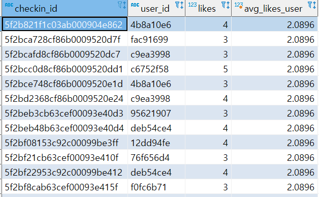

> 오늘은 4주차 SQL 강의까지 수강한다. 

---

### 오늘 배울 것

1. Subquery  
   Subquery : 쿼리 안의 쿼리라는 의미  
   하위 쿼리의 결과를 상위 쿼리에서 사용하면, SQL 쿼리가 훨씬 간단해진다.  

   - Subquery를 사용하지 않아도 원하는 데이터를 얻어낼 수 있겠지만, 더 편하고 간단하게 원하는 데이터를 얻기 위해 사용되는 파워풀한 기능  
   - Subquery에 대한 이해도가 생기면, With구문에 대해 학습
2. 유용한 SQL 문법  
   - 실무 속 날것의 데이터에서도 원하는 데이터를 뽑아낼 수 있는 유용한 기능

---

### Subquery

> Subquery : 하나의 SQL 쿼리 안에 또다른 SQL 쿼리가 있는 것을 의미

* kakaopay로 결제한 유저들의 정보 보기  
  → users와 orders 테이블의 inner join!  

  (서브쿼리 사용 전)  
  SELECT u.user\_id, u.name, u.email FROM users u   
  INNER JOIN orders o   
  ON u.user\_id = o.user\_id    
  WHERE o.payment\_method = 'kakaopay'  

  (서브쿼리 적용)  
  SELECT \* FROM users u   
  where user\_id in (   
  SELECT user\_id FROM orders o    
  where payment\_method = 'kakaopay'   
  )
* 쿼리 실행 순서 : 서브 쿼리 → ... → 더 큰 쿼리

---

### Subquery 사용

* 자주 쓰이는 Subquery 유형  
  - where, select, from 절에서 유용하게 사용될 수 있어요!  

  + Where에 들어가는 Subquery  

    (예시) 카카오페이로 결제한 주문건 유저들만, 유저 테이블에서 출력해주고 싶을 때  

    select \* from users u   
    where u.user\_id in (select o.user\_id from orders o    
    where o.payment\_method = 'kakaopay');  

    - 실행 순서  
    1) from 실행: users 데이터를 가져와줌   
    2) Subquery 실행: 해당되는 user\_id의 추출   
    3) where .. in 절에서 subquery의 결과에 해당되는 'user\_id의 명단' 조건으로 필터링   
    4) 조건에 맞는 결과 출력
  + Select에 들어가는 Subquery  

    (예시) '오늘의 다짐' 좋아요의 수가, 본인이 평소에 받았던 좋아요 수에 비해 얼마나 높고 낮은지  

    SELECT c.checkin\_id,    
           c.user\_id,    
           c.likes,   
           (   
             SELECT AVG(likes)  FROM checkins c   
             WHERE user\_id = c.user\_id    
           ) as avg\_likes\_user   
    FROM checkins c  

    문제점 : 이 동일한 사용자에 대한 정보가 주차별로 나눠져잇어서 동일한 avg 정보가 출력된다(그림1 참조)  

    \* 실행 순서  
    1) 밖의 select \* from 문에서 데이터를 한줄한줄 출력하는 과정에서  
    2) select 안의 subquery가 매 데이터 한줄마다 실행되는데  
    3) 그 데이터 한 줄의 user\_id를 갖는 데이터의 평균 좋아요 값을 subquery에서 계산해서
  + From에 들어가는 Subquery(가장 많이 사용되는 유형)  

    when : Select와 이미 있는 테이블을 Join하고 싶을 때 사용  

    (예시) 유저 별 좋아요 평균을 구하고 유저별 포인트를 구한다  

    select pu.user\_id, a.avg\_like, pu.point from point\_users pu   
    inner join (   
    select user\_id, round(avg(likes),1) as avg\_like from checkins   
    group by user\_id   
    ) a on pu.user\_id = a.user\_id  

    \* 실행 순서  
    1) 먼저 서브쿼리의 select가 실행  
    2) 이것을 테이블처럼 여기고 밖의 select가 실행

[그림 1]

---

### Subquery 연습해보기 (where, select)

1. Where 절에 들어가는 Subquery

* 전체 유저의 포인트의 평균보다 큰 유저들의 데이터  

  select \* from point\_users pu    
  where pu.point > (select avg(pu2.point) from point\_users pu2);
* 이씨 성을 가진 유저의 포인트의 평균보다 큰 유저들의 데이터  

  select \* from point\_users pu    
  where pu.point > (   
    select avg(pu2.point) from point\_users pu2   
   WHERE pu2.user\_id IN (  
      SELECT u.user\_id  FROM users u  WHERE u.name LIKE '이%'   
    )   
  );

2. Select 절에 들어가는 Subquery

* checkins 테이블에 course\_id별 평균 likes수 필드 우측에 붙여보기  

  select checkin\_id, course\_id, user\_id, likes,    
  (select avg(c2.likes) from checkins c2   
  where c.course\_id = c2.course\_id) as course\_avg   
  from checkins c;
* checkins 테이블에 과목명별 평균 likes수 필드 우측에 붙여보기  

  select checkin\_id, c3.title, user\_id, likes,    
  (  
    select round(avg(c2.likes), 1)   
    from checkins c2   
    where c.course\_id = c2.course\_id  
  ) as course\_avg   
    from checkins c   
    inner join courses c3    
    on c.course\_id = c3.course\_id;

---

### Subquery 연습해보기 (from, inner join)

1. From 절에 들어가는 Subquery

* course\_id별 유저의 체크인 개수 구하기  

  SELECT c.course\_id, count(DISTINCT(c.user\_id))   
  FROM checkins c    
  group by c.course\_id;
* course\_id별 인원을 구해보기  

  SELECT o.course\_id, count(\*)    
  FROM orders o   
  group by o.course\_id
* course\_id별 like 개수에 전체 인월 붙이기  

  SELECT a.course\_id, a.cnt\_checkins, b.cnt\_total FROM   
  (   
    SELECT c.course\_id, count(DISTINCT(c.user\_id)) as cnt\_checkins   
    FROM checkins c    
    group by c.course\_id   
  ) a   
  INNER JOIN   
  (   
    SELECT o.course\_id, count(\*) as cnt\_total   
    FROM orders o   
    group by o.course\_id   
  ) b on a.course\_id = b.course\_id
* 퍼센트 나타내기  

  SELECT a.course\_id, a.cnt\_checkins, b.cnt\_total, a.cnt\_checkins / b.cnt\_total as ratio FROM   
  (   
    SELECT c.course\_id, count(DISTINCT(c.user\_id)) as cnt\_checkins   
    FROM checkins c    
    group by c.course\_id   
  ) a   
  INNER JOIN   
  (   
    SELECT o.course\_id, count(\*) as cnt\_total   
    FROM orders o   
    group by o.course\_id   
  ) b on a.course\_id = b.course\_id
* 제목 붙이기  

  SELECT c2.title, a.cnt\_checkins, b.cnt\_total, a.cnt\_checkins / b.cnt\_total as ratio FROM    
  (   
    SELECT c.course\_id, count(DISTINCT(c.user\_id)) as cnt\_checkins   
    FROM checkins c    
    group by c.course\_id   
  ) a   
  INNER JOIN   
  (   
    SELECT o.course\_id, count(\*) as cnt\_total   
    FROM orders o   
    group by o.course\_id   
  ) b on a.course\_id = b.course\_id   
  INNER JOIN courses c2 on a.course\_id = c2.course\_id

---

### with절 연습하기

* with 절로 더 깔끔하게 쿼리문을 정리

[변경 전]

SELECT c2.title, a.cnt\_checkins, b.cnt\_total, a.cnt\_checkins / b.cnt\_total as ratio FROM    
(   
  SELECT c.course\_id, count(DISTINCT(c.user\_id)) as cnt\_checkins   
  FROM checkins c    
  group by c.course\_id   
) a   
INNER JOIN   
(   
  SELECT o.course\_id, count(\*) as cnt\_total   
  FROM orders o   
  group by o.course\_id   
) b on a.course\_id = b.course\_id   
INNER JOIN courses c2 on a.course\_id = c2.course\_id

[변경 후]

with table1 as (   
select course\_id, count(distinct(user\_id)) as cnt\_checkins from checkins   
group by course\_id   
), table2 as (   
select course\_id, count(\*) as cnt\_total from orders   
group by course\_id   
)   

select c.title,   
       a.cnt\_checkins,   
       b.cnt\_total,   
       (a.cnt\_checkins/b.cnt\_total) as ratio   
from table1 a inner join table2 b on a.course\_id = b.course\_id   
inner join courses c on a.course\_id = c.course\_id

---

### 실전에서 유용한 SQL 문법

* 문자열
  + 문자열 분리(SUBSTRING\_INDEX)
    - 이메일에서 아이디만 가져오기  
      SELECT user\_id, email, SUBSTRING\_INDEX(email, '@', 1)  FROM users;
    - 이메일에서 이메일 도메인만 가져오기  
      SELECT user\_id, email, SUBSTRING\_INDEX(email, '@', -1)  FROM users;
  + 문자열 일부만 출력  
    - orders 테이블에서 날짜까지 출력  
      SELECT order\_no, created\_at, SUBSTRING(created\_at , 1, 10) as date  FROM orders o;
    - 일별로 몇 개씩 주문이 일어났는지 살펴보기  
      SELECT SUBSTRING(created\_at , 1, 10) as date, count(\*)   
      FROM orders o   
      GROUP BY date
* CASE  
  + CASE: 경우에 따라 원하는 값을 새 필드에 출력  

    💣 문제 : 10000점보다 높은 포인트를 가지고 있으면 '잘 하고 있어요!', 평균보다 낮으면 '조금 더 달려주세요!' 라고 표시해 주려면 어떻게 해야할까요?  

    SELECT pu.user\_id, pu.point,   
       ( CASE when pu.point > 10000 then '잘하고 있어요!'   
       else '조금만 더 파이팅!' END ) as msg   
    FROM point\_users pu;
  + CASE: 실전을 위한 트릭!  

    SELECT a.lv, count(\*) as cnt FROM (   
      SELECT pu.user\_id, pu.point,   
       (CASE when pu.point > 10000 then '1만 이상'   
              when pu.point > 5000 then '5천 이상'   
       else '5천 미만' END ) as lv   
      FROM point\_users pu   
    ) a    
    GROUP BY a.lv  

    [With 적용]  

    with table1 as (   
      SELECT pu.user\_id, pu.point,   
       (CASE when pu.point > 10000 then '1만 이상'   
              when pu.point > 5000 then '5천 이상'   
       else '5천 미만' END ) as lv   
      FROM point\_users pu   
    )   

    SELECT a.lv, count(\*) as cnt FROM table1 a    
    GROUP BY a.lv

---

### 퀴즈

* 초급
  + 평균 이상 포인트를 가지고 있으면 '잘 하고 있어요' / 낮으면 '열심히 합시다!' 표시하기!  

    with table2 as (   
         SELECT pu.user\_id, pu.point,    
         (CASE when pu.point > (SELECT AVG(pu2.point) FROM point\_users pu2) then '잘 하고 있어요'   
               else '열심히 합시다!' END) as msg   
         FROM point\_users pu   
    )   

    SELECT \* FROM table2 a;
  + 이메일 도메인별 유저의 수 세어보기  
    SELECT SUBSTRING\_INDEX(email, '@', -1) as domain,    
           count(\*) as cnt\_domain   
    FROM users    
    GROUP BY domain;
  + '화이팅'이 포함된 오늘의 다짐만 출력해보기  
    SELECT \* FROM checkins c WHERE c.comment LIKE '%화이팅%';
* 중급  
  + 수강등록정보(enrolled\_id)별 전체 강의 수와 들은 강의의 수 출력해보기  

    [subquery]  
    SELECT ed.enrolled\_id,    
           (SELECT count(\*) FROM enrolleds\_detail ed2 WHERE ed2.done = 1 AND ed2.enrolled\_id = ed.enrolled\_id),   
           count(\*) as total\_cnt    
    FROM enrolleds\_detail ed    
    GROUP BY ed.enrolled\_id;   

    SELECT a.enrolled\_id, done\_cnt, total\_cnt FROM (   
    SELECT ed.enrolled\_id, count(\*) as done\_cnt   
    FROM enrolleds\_detail ed    
    WHERE done = 1   
    GROUP by ed.enrolled\_id   
    ) a    
    INNER JOIN    
    (   
      SELECT ed.enrolled\_id, count(\*) as total\_cnt   
      FROM enrolleds\_detail ed    
      GROUP by ed.enrolled\_id   
    ) b  
    ON a.enrolled\_id = b.enrolled\_id  

    [With 구문]  
    with table1 as (   
    SELECT ed.enrolled\_id, count(\*) as done\_cnt   
    FROM enrolleds\_detail ed    
    WHERE done = 1   
    GROUP by ed.enrolled\_id   
    ), table2 as (   
    SELECT ed.enrolled\_id, count(\*) as total\_cnt   
       FROM enrolleds\_detail ed    
    GROUP by ed.enrolled\_id   
    )   

    SELECT a.enrolled\_id, a.done\_cnt, b.total\_cnt   
    FROM table1 a    
    inner join table2 b on a.enrolled\_id = b.enrolled\_id
  + 수강등록정보(enrolled\_id)별 전체 강의 수와 들은 강의의 수, 그리고 진도율 출력해보기  

    with table1 as (   
    SELECT ed.enrolled\_id, count(\*) as done\_cnt   
    FROM enrolleds\_detail ed    
    WHERE done = 1   
    GROUP by ed.enrolled\_id   
    ), table2 as (   
    SELECT ed.enrolled\_id, count(\*) as total\_cnt   
       FROM enrolleds\_detail ed    
    GROUP by ed.enrolled\_id   
    )   

    SELECT a.enrolled\_id, a.done\_cnt, b.total\_cnt, ROUND((done\_cnt / total\_cnt), 2) as ratio   
    FROM table1 a    
    inner join table2 b on a.enrolled\_id = b.enrolled\_id
  + 더 간단하게 만들 수 있지 않을까!  

    SELECT enrolled\_id, SUM(done) as cnt\_done ,count(\*) as total\_cnt   
    FROM enrolleds\_detail ed   
    GROUP BY ed.enrolled\_id
