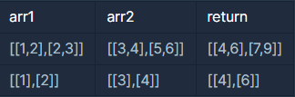

**문제 설명**

행렬의 덧셈은 행과 열의 크기가 같은 두 행렬의 같은 행, 같은 열의 값을 서로 더한 결과가 됩니다. 2개의 행렬 arr1과 arr2를 입력받아, 행렬 덧셈의 결과를 반환하는 함수, solution을 완성해주세요.

**제한 조건**

* 행렬 arr1, arr2의 행과 열의 길이는 500을 넘지 않습니다.

**입출력 예**



**Point : 1**

**풀이 방법 1**

**- 각 행과 열에 값을 순서대로 합해야 한다.**

**- 반복문을 사용한 풀이법**

```java
class Solution {
    public int[][] solution(int[][] arr1, int[][] arr2) {
        int[][] answer = {};

        int len1 = arr1.length;
        int len2 = arr1[0].length;

        answer = new int[len1][len2];

        for(int i=0; i<len1;i++){
			for(int j=0; j<len2; j++){
                answer[i][j] = arr1[i][j] + arr2[i][j];
            }
        }


        return answer;
    }
}
```
