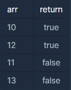

**문제설명**

양의 정수 x가 하샤드 수이려면 x의 자릿수의 합으로 x가 나누어져야 합니다. 예를 들어 18의 자릿수 합은 1+8=9이고, 18은 9로 나누어 떨어지므로 18은 하샤드 수입니다. 자연수 x를 입력받아 x가 하샤드 수인지 아닌지 검사하는 함수, solution을 완성해주세요.

**제한 조건**

* x는 1 이상, 10000 이하인 정수입니다.

**입출력 예**



**풀이**

* 양의 정수 x의 값은 유지한 상태로 값만 다른 변수에 입력받아 하샤드 수인지 판별해야 한다.
* 자리수 구하기(반복문)
* 짝수와 홀수 판별(삼항 연산자)

```java
class Solution {
    public static boolean solution(int x) {

        int sum = 0;
        int num = x;

        while(num != 0){
            sum +=  (num % 10);	 
            num = num/10;
        }

        return x % sum == 0 ? true:false;
    }
}
```

---

**Point : 1**
