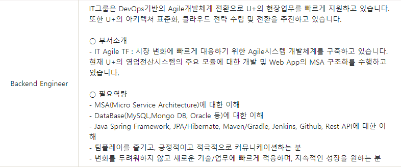
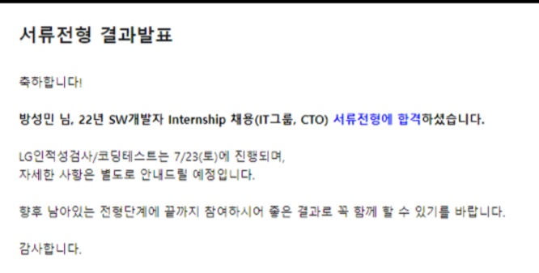

#### 1. 서론

7월 20일, LG U+ 인턴쉽 지원 Backend Engineer로 지원을 하였다.

필자는 필요 역량에서 부족한 부분들이 있지만, 경험을 쌓고 도전해보기 위해 지원을 하였다.

---

#### 2. 도전기

■ 전형절차  
- 서류전형 → LG인적성검사/코딩테스트(7.23) → 1차 실무진면접 → 인턴십(4주) → 2차 임원면접 → 입사

**1단계. 서류 전형**

서류 전형은 가장 힘들어 했던 부분이다. 글쓰는 능력이 가장 부족하기 때문에 쓰고 지우고를 반복하며 마감일까지 계속해서 열심히 수정하며 작성하였다. 질문은 다음과 같은 내용이었다.

1. 직무와 관련해 기울인 노력이나 경험(프로젝트/경진대회/공모전/연구/학습) 등 자신의 강점이 잘 드러나는 사례를 기술하고, 그 강점으로 유플러스에서 달성하고 싶은 목표가 있다면 기술하여 주십시오. (※포함 내용 : 사용한 기술 스택, 본인의 역할/기여도)
2. 목표달성을 위해 스스로 노력하였던 점과 이를 통해 조직과 본인에게 일어난 변화를 구체적으로 기술하여 주십시오.
3. 소속된 조직의 공동과업을 달성하는 과정에서 발생했던 어려움과 그 어려움을 극복하기 위해 기울인 노력에 대해 구체적인 사례를 바탕으로 기술해 주십시오.

많은 회사를 지원했기 때문에 비슷하게 작성할 수 있지만, 그때마다 부족했기 때문에 보완해서 더 좋은 내용을 쓰려고 하다보니 매번 새롭게 작성하게 되었다...

운 좋게 LG U+ 코딩 테스트와 인적성 검사까지 할 수 있는 기회를 얻었다 🥳

---

#### 3. 코딩 테스트 및 인적성 검사

**2-1 단계. 코딩 테스트**

SK 코딩 테스트는 아무런 제약 없이 자유롭게 코딩 테스트를 볼 수 있었던 반면, LG는 엄격하게 관리를 하였다.

화상 어플리케이션을 전부 삭제하고, 듀얼 모니터 사용을 금지하였다. 코딩 테스트를 볼 때에는 웹캠과 휴대폰 카메라 두 대를 동시에 사용하였고, 인적성 검사 때는 감독관도 같이 카메라를 키는 형식으로 감독을 진행하였다.

필자가 생각한 코딩테스트 난이도는 **중상**이다.

총 3문제로 난이도는 풀만했던 것 같은데 생각보다 풀지 못하였다...

(알고리즘 문제 풀이가 너무 부족한 것 같음..)

**2-2 단계. 인적성 검사**

LG 프로그램을 통해 검사가 진행되고, 감독관 카메라도 함께 공유된다.

KT와 SK에서는 경험하지 않은 새로운 경험이었다. 필자는 카메라 화질이 좋지 않기때문에 매번 고생을 한다...

좋은 카메라로 교체할 필요가 있어 보인다...

그래도 좋았던 것은 코딩 테스트와 인적성 검사 간에 시간에 텀이 존재한다.

다른 곳들에 비하면 너무 행복한 휴식시간이었다.

---

#### 4. 결론

앞으로 나아가야할 길은 아직 멀었다... 앞으로 더 달려가고 달라가즈아아아!
