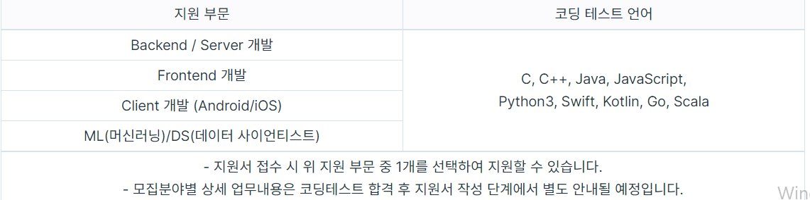

#### 서론

2022년 6월 어느날.. SK 텔레콤 근무형 인턴십에 도전하게 되었다.

일정은 다음과 같다.

- 지원 접수 : 2022. 6. 3(금) 10:00 ~ 6. 10(금) 17:00  
- 코딩 테스트 : 2022. 6. 12(일) 10:00 ~ 13:00  
- 인터뷰 : 2022. 6. 22(수) ~ 6. 23일(목)  
- 합격 발표 : 2022. 6. 28(화)  
- 인턴십 기간 : 2022. 7. 4(월) ~ 8. 26(금)

<https://career.programmers.co.kr/competitions/2594>

[2022 SK텔레콤 T-WorX for Developers 챌린지

career.programmers.co.kr](https://career.programmers.co.kr/competitions/2594)

지원 부문은 당연히 Backend/Server 개발 부분이었다.

SK텔레콤은 코딩테스트에 지정된 언어가 없었고, 자유롭게 원하는 프로그래밍 언어를 선택하여 볼 수 있었다.

가장 나에게 이끌렸던 것은 인턴십 진행 일정이다.

첫번째, 2주간 인턴십 인문 교육을 진행한다.

* AWS Public Cloud 개발자 과정을 비롯해 Docker/Kubernetes 개념 및 기본 사용법 등 실무에서 활용 가능한 역량을 학습합니다.

두번째, 현업 과제 수행 및 개발 프로젝트 참여(6주)

* 교육이 종료되면 소속 팀으로 이동하여 현업 과제를 수행해요.
* 단순히 가볍게 수행할 수 있는 수준의 업무만 할당 받아 수행하는 것이 아니라, 개발 관련 미니 프로젝트에도 참여하는 등 다양한 기회를 경험할 수 있어요.

업무 뿐 아니라 미니 프로젝트에 참여할 수 있고 현업 피드백을 받을 수 있는 좋은 조건이었기 때문에 지원하게 되었다.

또한 혜택도 엄청 많기 떄문에... 곧바로 보자마자 준비하게 되었다.

#### 코딩 테스트

 코딩 테스트는 총 4문제였다.

**난이도는 중상**

모든 문제가 어려운 것은 아니었다.

* 풀수 있는 문제(2개)
* 풀기 애매한 문제(1개)
* 어려운 문제(1개)

필자가 느낀 난이도였다. 사람마다 다르겠지만 필자는 4문제 중 2문제를 풀었고, 애매한 문제를 도전하다가 실패하였다.

문제는 알고리즘 문제는 프로그머스를 통해 풀이하였고, 생각했던 것보다 필자는 잘했다고 생각했다.

알고리즘 문제 풀이 경험을 더 쌓는 것이 필요하였다.

#### 결론

필자는 코딩테스트에서 떨어졌다... (또르륵)

하지만 다음 도전에서는 다른 결과를 만들어낼 것이다!!
