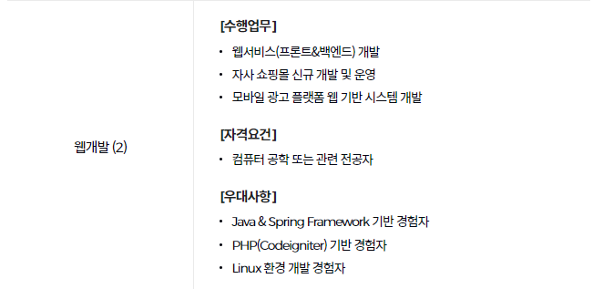
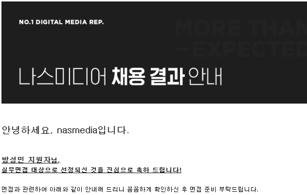
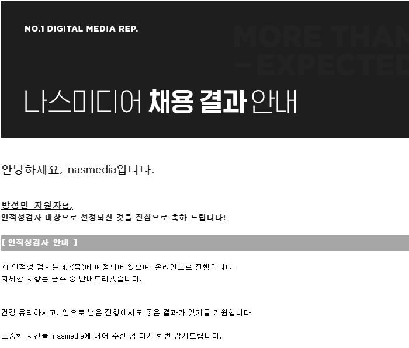
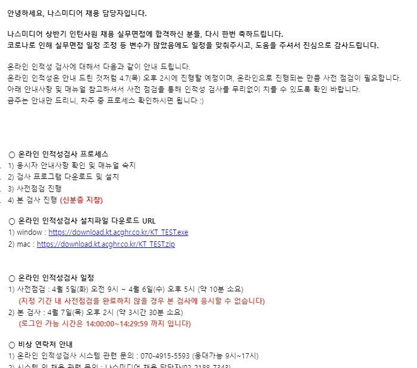
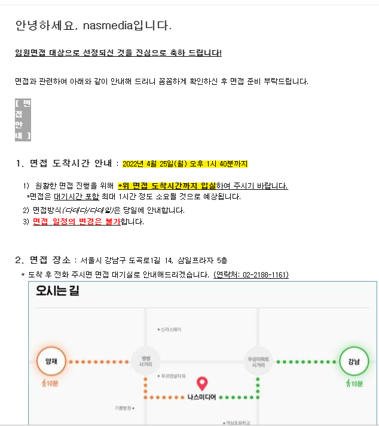
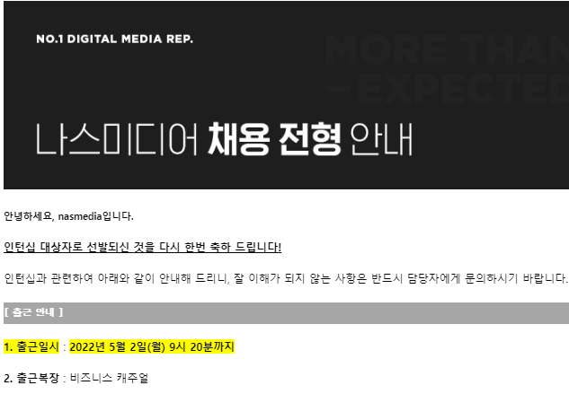

#### **서론**

2022년 3월 어느날..

 KT에서 인턴십을 뽑는다고 해서 찾아보다가 Backend 엔지니어를 뽑는 곳은 나스미디어 밖에 없었다.

지원하기 전에 나스미디어에 대해 알고 있는 지식이 없었기 때문에 나스미디어에 대해 열심히 찾고 공부했다.

[나스미디어](https://www.nasmedia.co.kr/)는 디지털 미디어플래닝 전문 렙사 1위로 국내 최대 규모라고 한다.

채용절차는 지원 → 서류 전형 → 실무 면접 → 인적성 검사 → 임원 면접 → 인턴십 전혀(8주) → 최종 합격으로  진행된다.

내가 지원한 분야는 웹개발2로 풀스택개발자였다.

개발하면서 Linux는 많이 다루었고, PHP는 웹개발 초기에 공부한 경험이 있었기 때문에 우대사항까지 포함되었다는 생각으로 조심스레 지원하게 되었다.

#### **서류 전형**

서류 전형에서는 자기소개로 프로젝트와 관련된 경험 등 4가지 질문지를 작성하는 과정이었다.

이외에도 포토폴리오 등을 제출할 수 있었기 제출하였습니다.

어느날 뚜뚱!! 하고 메시지와 메일이 오게 되었습니다.

#### **실무 면접**

면접 방식은 당일에 안내된다고 되어 있었고 이날을 기다리며 열심히 준비하였습니다.

Java, Spring와 CS 지식 등을 공부하는 시간을 가졌습니다. 매번 면접을 볼때마다 긴장을 너무하기 때문에 만반에 준비를 하고 도전하였다!! 나스미디어는 강남구 양재역과 강남역 중간에 있었다.

면접 시간보다 빠르게 도착하여 근처에서 준비하면서 최대한 빠뜨리지 않고 말할 수 있도록 노력하였다.

필자의 인생에서 최고의 면접관들을 뽑는다면 이곳을 뽑고 싶다.

면접에서 긴장한 필자에게 긴장감을 풀어주시고 응원해주셨기 때문이다. 면접을 보면서 따듯하고 다정하게 말씀해주시는 분들은 첨이었기 때문에 아직까지도 기억에 남는다. 이곳에 면접관분들이 내인생 최고에 면접관들이셨다. 필자가 말하는 면접은 1차 면접이다.

1차 면접에서 필자는 너무나도 긴장했기 때문에 떨어졌을 것이라고 생각했다. 그리고 너무나도 긴장한 나머지 모든 말들을 잊어버렸기 때문이다. 외우고 공부한 내용을 다 까먹었고, 제대로 말한 거라고는 프로젝트 관련 질문들뿐이었다.

하지만.. 두둥!! 결전에 나에게 좋은 일들이 많았다. 그날 결과도 함께 왔다...

이때 어떤 면접 결과보다도 행복하고 기쁜 마음을 느끼게 되었다.

#### **4. 인적성 검사**

인적성 검사는 철저하게 진행된다. KT 프로그램을 통해 미리 사전준비를 마쳐야했고, 신분증과 카메라를 통해 본인인증을 진행해야했고, 화상회의 및 화면공유 관련 프로그램들은 사전에 제거해야했다.

메모 + 계산기는 사용할 수 없고, KT 인적성 검사 프로그램 내에서 제공되는 메모장과 계산기만 사용가능하다.

인적성 검사는 할때마다 긴장되었다... 매번 풀지만 제대로 풀고 있는 것인지 알 수 없었기 때문이다.

인적성 검사를 마치고 제발 제발 간절히 기도했다.

**후기**

아직까지 기억에 남는 것은 카메라 신분증이 제대로 보이지 않아 메시지를 통해 재인증하는 과정을 거치게 되었다.

360도를 돌리면서 방을 보여드리는 작업을 하는데 너무나도 민망했다... 카메라가 화질이 떨어져서 그나마 다행이었을수도 있다..

#### **5. 임원 면접**

두둥... KT 인적성 검사 결과가 나오는날 너무나도 긴장해서 알림들을 꺼두고 있었다. 하지만 눈은 계속 알림을 보고 있었다....

면접에서는 임원들과 면접이기 때문에 어떠한 질문이 나올지 예상할 수 없었다.

그래서 내가 선택한 것은 나스미디어에 대한 정보 + 경쟁사 등을 공부하고 준비하였다.

면접관분들은 나스미디어 대표님, 본부장님(전략, 경영) 2분이셨다.

면접은 3:3 면접으로 진행되었고 긴장되었지만 다행이도 가운데 앉아서 면접을 보게 되었다.

가운데 앉아있기 때문에 질문을 듣고 생각할 수 있는 시간을 갖을 수 있었다. 대표님과 경영 본부장님 그리고 화상회의로 참여하신 전략 본부장님과 눈을 최대한 마주치면서 떨지 않은 척 연기를 하면서 손과 발에 땀을 최대한 줄이면서 노력하였다. 정말 열심히 하고 나왔다. 부족한 것도 많았지만 마음만은 편안했다. 이곳까지 온것만으로 만족했기 때문이다.

나오자마자 면접을 함께한 분들과 많은 이야기를 나누고 1차 면접에 대한 이야기도 정말 많이 나누었다.

그러고 나서 얼마후 메일이 띵똥 하고 나왔다... 면접결과를 얼마나 기다렸는지 모른다..

#### **결론**

도전을 할때는 내가 대기업에 도전하는 것이 맞는것인가 라는 생각하며 도전하지 않으려고 했지만 도전은 도전이기 때문에 열심히 준비하여 도전하였다. 결과는 값진 성과로 얻을 수 있었다.

정말 기쁘고 행복한 결과였다.
