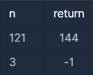

**문제 설명**

임의의 양의 정수 n에 대해, n이 어떤 양의 정수 x의 제곱인지 아닌지 판단하려 합니다.   
n이 양의 정수 x의 제곱이라면 x+1의 제곱을 리턴하고, n이 양의 정수 x의 제곱이 아니라면 -1을 리턴하는 함수를 완성하세요.

**제한 사항**

* n은 1이상, 50000000000000 이하인 양의 정수입니다.

**입출력 예**



**풀이방법**

* Math.srqt() **제곱근** 메소드 활용
* 조건문을 대신한 삼항 연산자를 활용한 간결한 코드

```java
import java.util.*;
class Solution {
    public long solution(long n) {

        Double sqrt = Math.sqrt(n);
        return sqrt == sqrt.intValue() ? (long)Math.pow(sqrt+1, 2) : -1;
    }
}
```
