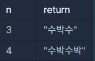

**문제 설명**

길이가 n이고, "수박수박수박수...."와 같은 패턴을 유지하는 문자열을 리턴하는 함수, solution을 완성하세요. 예를들어 n이 4이면 "수박수박"을 리턴하고 3이라면 "수박수"를 리턴하면 됩니다.

**제한 조건**

* n은 길이 10,000이하인 자연수입니다.

**입출력 예**



**문제 풀이(1)**

* StringBuilder 활용(String 단점 제거)
* 홀수와 짝수에 따른 처리
* 시간 복잡도 : O(n)

```java
import java.util.*;

class Solution {
    public String solution(int n) {
        StringBuilder sb = new StringBuilder();

        for(int i=1; i<=n; i++){
            if(i % 2 == 1){
                sb.append("수");
            }else{
                sb.append("박");
            }
        }

        return sb.toString();
    }
}
```

**문제 풀이(2)**

* StringBuilder 활용(String 단점 제거) -- 동일
* 짝수만큼 반복하고 홀수일 경우, 수를 붙여주는 방식 -- 동일
* 시간 복잡도 : O(n)

```java
// 1
import java.util.*;

class Solution {
    public String solution(int n) {
        StringBuilder sb = new StringBuilder();

        for(int i=0; i<(n/2);i++)
            sb.append("수박");

        if(n % 2 == 1) 
            sb.append("수");

        return sb.toString();
    }
}
```
