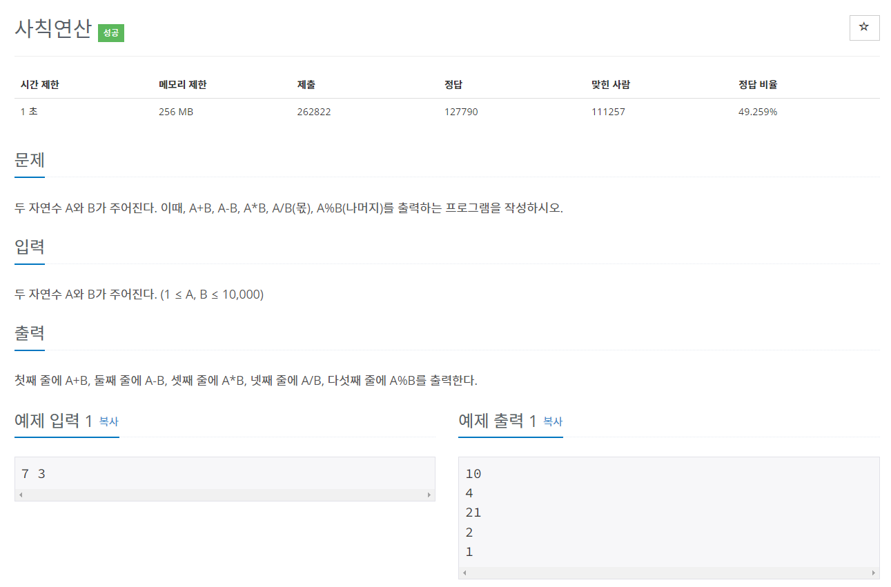
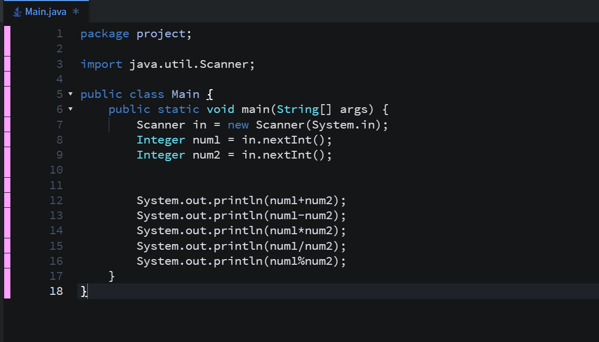
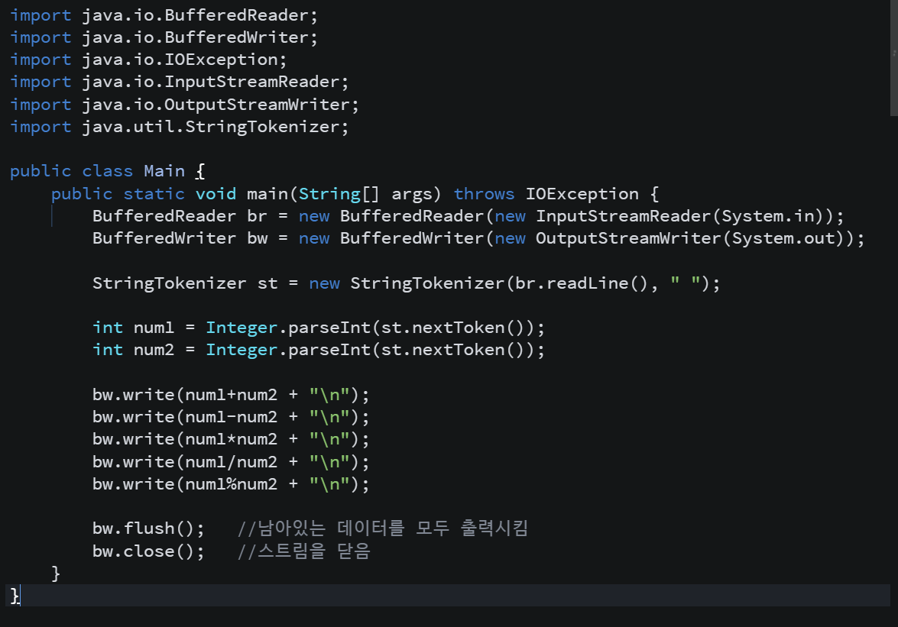
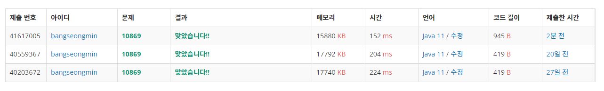

* **문제**

* **간략설명**

**1) Scanner 클래스와 System 클래스를 이용한 방법으로 풀이하였습니다.**

**2) BufferedReader, StringTokenizer, BufferedWriter를 이용하여 풀이하였습니다.**

* **풀이**

**- 방법 1 (Scanner 클래스와 System 클래스)**

**- 방법 2(BufferedReader, StringTokenizer, BufferedWriter)**

**실행 결과 차이를 보여드리기 위해서 새로 작성하여 풀이하였습니다.**

* **정리**

**차이가 약 52ms 있습니다. 코드 길이가 거의 두배 가량인데 성능은 훨씬 앞서는 것 같습니다.**

**다른 분들은 100ms 이하로 나오는 경우가 있는데.. 저는 그렇게 안나오더라고요 ㅠㅠ**
