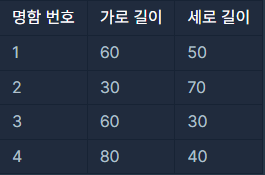
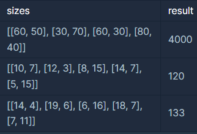

**문제설명**

명함 지갑을 만드는 회사에서 지갑의 크기를 정하려고 합니다. 다양한 모양과 크기의 명함들을 모두 수납할 수 있으면서, 작아서 들고 다니기 편한 지갑을 만들어야 합니다. 이러한 요건을 만족하는 지갑을 만들기 위해 디자인팀은 모든 명함의 가로 길이와 세로 길이를 조사했습니다.

아래 표는 4가지 명함의 가로 길이와 세로 길이를 나타냅니다.



가장 긴 가로 길이와 세로 길이가 각각 80, 70이기 때문에 80(가로) x 70(세로) 크기의 지갑을 만들면 모든 명함들을 수납할 수 있습니다. 하지만 2번 명함을 가로로 눕혀 수납한다면 80(가로) x 50(세로) 크기의 지갑으로 모든 명함들을 수납할 수 있습니다. 이때의 지갑 크기는 4000(=80 x 50)입니다.

모든 명함의 가로 길이와 세로 길이를 나타내는 2차원 배열 sizes가 매개변수로 주어집니다. 모든 명함을 수납할 수 있는 가장 작은 지갑을 만들 때, 지갑의 크기를 return 하도록 solution 함수를 완성해주세요.

**제한사항**

* sizes의 길이는 1 이상 10,000 이하입니다.
  + sizes의 원소는 [w, h] 형식입니다.
  + w는 명함의 가로 길이를 나타냅니다.
  + h는 명함의 세로 길이를 나타냅니다.
  + w와 h는 1 이상 1,000 이하인 자연수입니다.

**입출력 예**



**문제 풀이(1)**

* 1단계 : 1열에 큰 값, 2열에 작은 값으로 분류
* 2단계 : 1열에서 최대값과 2열에서 최대값 구하기
* 반복문을 통해서 행마다 값을 비교하여 큰값과 작은 값의 교환
* 시간 복잡도 : O(n^2)

```java
public int solution(int[][] sizes) {

    int temp = 0;
    for(int i=0; i<sizes.length;i++){
        if(sizes[i][0] < sizes[i][1]){
            temp = sizes[i][0];
            sizes[i][0] = sizes[i][1];
            sizes[i][1] = temp;
        }
    }

    int fmax = sizes[0][0];
    int bmax = sizes[0][1];

    for(int i=1; i<sizes.length; i++){
        if(fmax < sizes[i][0]){
            fmax = sizes[i][0];
        }
        if(bmax < sizes[i][1]){
            bmax = sizes[i][1];
        }
    }

    return fmax * bmax;
}
```

**문제 풀이(2)**

* 최대값 중 가장 큰 값 + 최소값 중 가장 큰 값을 찾는 알고리즘
* 시간 복잡도 : O(n)

```java
public int solution(int[][] sizes){
        int max_v=0;
        int max_h=0;

        for(int i=0;i<sizes.length;i++){
            int v = Math.max(sizes[i][0], sizes[i][1]);
            int h = Math.min(sizes[i][0], sizes[i][1]);

            max_v = Math.max(max_v,v);
            max_h = Math.max(max_h,h);
        }
        return max_v * max_h;
    }
```
