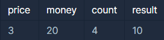

**문제 설명**

새로 생긴 놀이기구는 인기가 매우 많아 줄이 끊이질 않습니다. 이 놀이기구의 원래 이용료는 price원 인데, 놀이기구를 N 번 째 이용한다면 원래 이용료의 N배를 받기로 하였습니다. 즉, 처음 이용료가 100이었다면 2번째에는 200, 3번째에는 300으로 요금이 인상됩니다.   
놀이기구를 count번 타게 되면 현재 자신이 가지고 있는 금액에서 얼마가 모자라는지를 return 하도록 solution 함수를 완성하세요.   
단, 금액이 부족하지 않으면 0을 return 하세요.

**제한 사항**

* 놀이기구의 이용료 price : 1 ≤ price ≤ 2,500, price는 자연수
* 처음 가지고 있던 금액 money : 1 ≤ money ≤ 1,000,000,000, money는 자연수
* 놀이기구의 이용 횟수 count : 1 ≤ count ≤ 2,500, count는 자연수

**입출력 예**



**문제 풀이**

* 등차수열의 합 공식 활용( Sn = n(a+l)/2 )
* 삼항연산자 활용

```java
class Solution {
    public long solution(int price, int money, int count) {
        // 등차수열의 합
        long sum = (long) count * (price + (price*count)) / 2;

        return sum - money >= 0 ? sum - money : 0;
    }
}
```

---

> 획득한 점수는 7 Point  
>   
> 수학 공식을 활용하면  
> 공부도  
> 마음도   
> 든든!!
