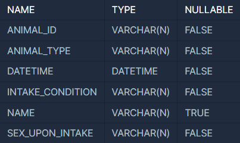
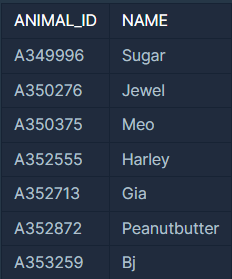
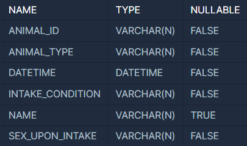
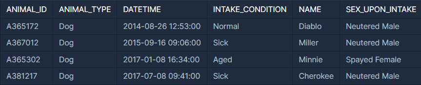
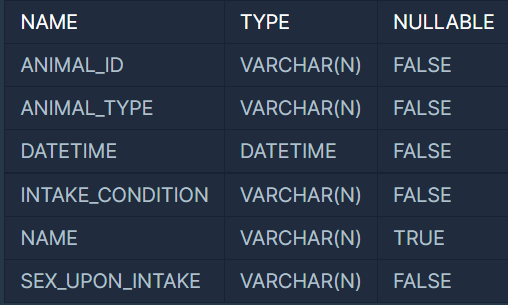
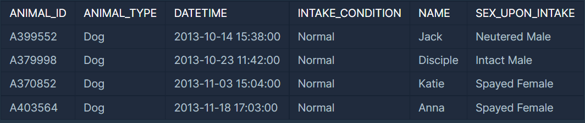
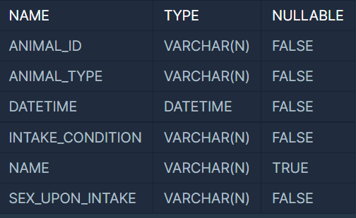
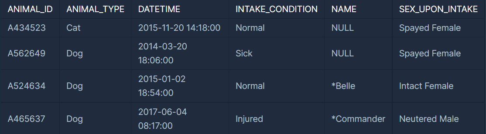

### **1번 문제 : 동물의 아이디와 이름**

**문제 설명**

ANIMAL\_INS 테이블은 동물 보호소에 들어온 동물의 정보를 담은 테이블입니다. ANIMAL\_INS 테이블 구조는 다음과 같으며, ANIMAL\_ID, ANIMAL\_TYPE, DATETIME, INTAKE\_CONDITION, NAME, SEX\_UPON\_INTAKE는 각각 동물의 아이디, 생물 종, 보호 시작일, 보호 시작 시 상태, 이름, 성별 및 중성화 여부를 나타냅니다.



동물 보호소에 들어온 모든 동물의 아이디와 이름을 ANIMAL\_ID순으로 조회하는 SQL문을 작성해주세요. SQL을 실행하면 다음과 같이 출력되어야 합니다.



**문제 풀이**

* ANIMAL\_INS 테이블에 아이디와 이름을 선택하고 ORDER BY를 활용하여 정렬하면 된다.
* ORDER BY를 통한 정렬
* 별칭 활용

```sql
SELECT ani.ANIMAL_ID, ani.NAME
FROM ANIMAL_INS AS ani 
ORDER BY ani.ANIMAL_ID;
```

 (해설)

 1단계 : ANIMAL\_INS 테이블에서 ID와 NAME을 선택  
 2단계 : 순서는 ID를 기준으로

---

### 

### **2번 문제 : 어린 동물 찾기**

**문제 설명**

ANIMAL\_INS 테이블은 동물 보호소에 들어온 동물의 정보를 담은 테이블입니다. ANIMAL\_INS 테이블 구조는 다음과 같으며, ANIMAL\_ID, ANIMAL\_TYPE, DATETIME, INTAKE\_CONDITION, NAME, SEX\_UPON\_INTAKE는 각각 동물의 아이디, 생물 종, 보호 시작일, 보호 시작 시 상태, 이름, 성별 및 중성화 여부를 나타냅니다.



동물 보호소에 들어온 동물 중 젊은 동물의 아이디와 이름을 조회하는 SQL 문을 작성해주세요. 이때 결과는 아이디 순으로 조회해주세요.

예를 들어 ANIMAL\_INS 테이블이 다음과 같다면



이 중 젊은 동물은 Diablo, Miller, Cherokee입니다.

**문제 풀이**

* 아이디와 이름을 선택하고 젊은 동물이 아닌 'Aged'를 제외하고 추출하면 된다.
* 별칭 활용(1번 문제와 동일)
* ID를 기준으로 정렬(1번 문제와 동일)

```sql
SELECT ani.ANIMAL_ID, ani.NAME
FROM ANIMAL_INS AS ani 
WHERE ani.INTAKE_CONDITION != "Aged"
ORDER BY ani.ANIMAL_ID;
```

 (해설)

 1단계 : ANIMAL\_INS 테이블에서 ID와 NAME을 선택  
 2단계 : 현재 상태가 노화가 아닌 강아지(젊은 강아지만)로 제한

 3단계 : 순서는 ID를 기준으로

---

### 

### **3번 문제 : 아픈 동물 찾기**

**문제 설명**

ANIMAL\_INS 테이블은 동물 보호소에 들어온 동물의 정보를 담은 테이블입니다. ANIMAL\_INS 테이블 구조는 다음과 같으며, ANIMAL\_ID, ANIMAL\_TYPE, DATETIME, INTAKE\_CONDITION, NAME, SEX\_UPON\_INTAKE는 각각 동물의 아이디, 생물 종, 보호 시작일, 보호 시작 시 상태, 이름, 성별 및 중성화 여부를 나타냅니다.


동물 보호소에 들어온 동물 중 아픈 동물의 아이디와 이름을 조회하는 SQL 문을 작성해주세요. 이때 결과는 아이디 순으로 조회해주세요. (테이블은  2번과 동일)


**문제 풀이**

* 아이디와 이름을 선택하고 아픈 동물만 추출
* 별칭 활용(1번 문제와 동일)
* ID를 기준으로 정렬(1번, 2번 문제와 동일)

```sql
SELECT ani.ANIMAL_ID, ani.NAME
FROM ANIMAL_INS AS ani 
WHERE ani.INTAKE_CONDITION = "Sick"
ORDER BY ani.ANIMAL_ID;
```

 (해설) 

 1단계 : ANIMAL\_INS 테이블에서 ID와 NAME을 선택  
 2단계 : 현재 상태가 아픈 강아지로 제한

 3단계 : 순서는 ID를 기준으로

---

### 

### **4번 문제 : 상위 n개의 레코드**

**문제 설명**

ANIMAL\_INS 테이블은 동물 보호소에 들어온 동물의 정보를 담은 테이블입니다. ANIMAL\_INS 테이블 구조는 다음과 같으며, ANIMAL\_ID, ANIMAL\_TYPE, DATETIME, INTAKE\_CONDITION, NAME, SEX\_UPON\_INTAKE는 각각 동물의 아이디, 생물 종, 보호 시작일, 보호 시작 시 상태, 이름, 성별 및 중성화 여부를 나타냅니다.



동물 보호소에 가장 먼저 들어온 동물의 이름을 조회하는 SQL 문을 작성해주세요.

예를 들어 ANIMAL\_INS 테이블이 다음과 같다면



이 중 가장 보호소에 먼저 들어온 동물은 Jack입니다.

**문제 풀이**

* 날짜를 기준으로  오름차순 정렬(Order By)
* 별칭 활용(1번 문제와 동일)
* 가장 먼저 → 1개로 제한

```sql
SELECT a.NAME 
FROM ANIMAL_INS AS a 
ORDER BY a.DATETIME ASC 
LIMIT 1;
```

 (해설)

 1단계 : ANIMAL\_INS 테이블에서 NAME만 선택  
 2단계 : 날짜를 기준으로 오름차순으로 정렬

 3단계 : 개수는 1개로 제한

---

### 

### **5번 문제 : 이름이 있는 동물의 아이디**

**문제 설명**

ANIMAL\_INS 테이블은 동물 보호소에 들어온 동물의 정보를 담은 테이블입니다. ANIMAL\_INS 테이블 구조는 다음과 같으며, ANIMAL\_ID, ANIMAL\_TYPE, DATETIME, INTAKE\_CONDITION, NAME, SEX\_UPON\_INTAKE는 각각 동물의 아이디, 생물 종, 보호 시작일, 보호 시작 시 상태, 이름, 성별 및 중성화 여부를 나타냅니다.



동물 보호소에 들어온 동물 중, 이름이 있는 동물의 ID를 조회하는 SQL 문을 작성해주세요. 단, ID는 오름차순 정렬되어야 합니다.

예를 들어 ANIMAL\_INS 테이블이 다음과 같다면



이름이 있는 동물의 ID는 A524634와 A465637입니다.

**문제 풀이**

* ID를 기준으로 오름차순 정렬(Order By)
* 별칭 활용(1번 문제와 동일)
* NULL 구분(IS NULL, IS NOT NULL)

```sql
SELECT ani.ANIMAL_ID
FROM ANIMAL_INS AS ani 
WHERE ani.NAME IS NOT NULL
ORDER BY ani.ANIMAL_ID;
```

 (해설)

 1단계 : ANIMAL\_INS 테이블에서 ID만 선택  
 2단계 : 이름이 NULL이 아닌 경우로 제한(IS NOT NULL 활용)

 3단계 : 정렬은 ID를 기준으로

---

> SQL 문제는 오히려 다른 문제들보다 쉬운 것 같다...  
>   
> 이유는 바로바로 출력해서 결과를 확인할 수 있기 때문이다.  
>   
> 점수도 주지 않는다는 사실~~~
