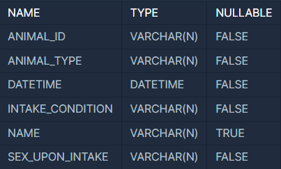
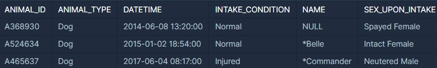
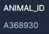
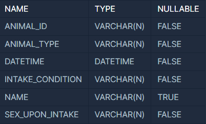
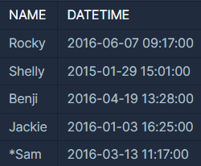
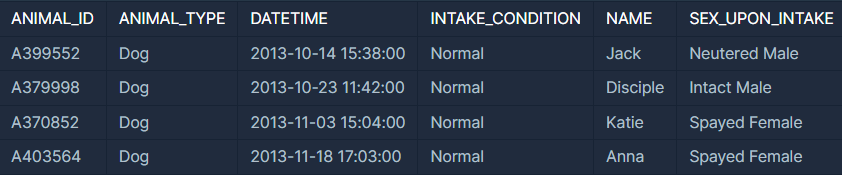
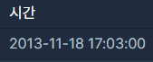
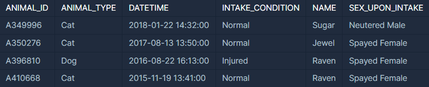
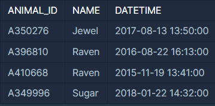
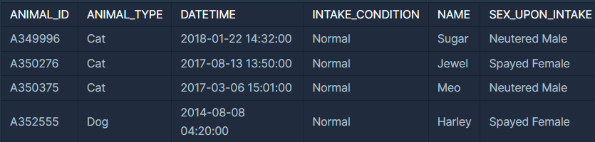

**문제명 : 이름이 없는 동물의 아이디**

**문제 설명**

ANIMAL\_INS 테이블은 동물 보호소에 들어온 동물의 정보를 담은 테이블입니다. ANIMAL\_INS 테이블 구조는 다음과 같으며, ANIMAL\_ID, ANIMAL\_TYPE, DATETIME, INTAKE\_CONDITION, NAME, SEX\_UPON\_INTAKE는 각각 동물의 아이디, 생물 종, 보호 시작일, 보호 시작 시 상태, 이름, 성별 및 중성화 여부를 나타냅니다.



동물 보호소에 들어온 동물 중, 이름이 없는 채로 들어온 동물의 ID를 조회하는 SQL 문을 작성해주세요. 단, ID는 오름차순 정렬되어야 합니다.

**예시**

예를 들어 ANIMAL\_INS 테이블이 다음과 같다면



이름이 없는 채로 들어온 동물의 ID는 A368930입니다. 따라서 SQL을 실행하면 다음과 같이 출력되어야 합니다.



**문제 풀이**

* ANIMAL\_INS 테이블에 아이디를 선택 (Select ANIMAL\_ID WHERE ANIMAL\_INS)
* 이름이 없는 동물(WHERE NAME IS NULL)

```sql
SELECT ANIMAL_INS.ANIMAL_ID 
FROM ANIMAL_INS
WHERE ANIMAL_INS.NAME IS NULL;
```

---

**문제명 : 역순 정렬하기**

**문제 설명**

ANIMAL\_INS 테이블은 동물 보호소에 들어온 동물의 정보를 담은 테이블입니다. ANIMAL\_INS 테이블 구조는 다음과 같으며, ANIMAL\_ID, ANIMAL\_TYPE, DATETIME, INTAKE\_CONDITION, NAME, SEX\_UPON\_INTAKE는 각각 동물의 아이디, 생물 종, 보호 시작일, 보호 시작 시 상태, 이름, 성별 및 중성화 여부를 나타냅니다.



동물 보호소에 들어온 모든 동물의 이름과 보호 시작일을 조회하는 SQL문을 작성해주세요. 이때 결과는 ANIMAL\_ID 역순으로 보여주세요. SQL을 실행하면 다음과 같이 출력되어야 합니다.



**문제 풀이**

* ANIMAL\_INS테이블에서 이름과 날짜 선택  
  ( Select NAME, DATETIME FROM ANIMAL\_INS )
* ANIMAL\_ID를 기준으로 역정렬 (ORDER BY ANIMAL\_ID DESC)

```sql
SELECT ani.NAME, ani.DATETIME
FROM ANIMAL_INS AS ani
ORDER BY ani.ANIMAL_ID DESC;
```

---

**문제명 : 최댓값 구하기**

**문제설명**

ANIMAL\_INS 테이블은 동물 보호소에 들어온 동물의 정보를 담은 테이블입니다. ANIMAL\_INS 테이블 구조는 다음과 같으며, ANIMAL\_ID, ANIMAL\_TYPE, DATETIME, INTAKE\_CONDITION, NAME, SEX\_UPON\_INTAKE는 각각 동물의 아이디, 생물 종, 보호 시작일, 보호 시작 시 상태, 이름, 성별 및 중성화 여부를 나타냅니다.


가장 최근에 들어온 동물은 언제 들어왔는지 조회하는 SQL 문을 작성해주세요.

**예시**

예를 들어 ANIMAL\_INS 테이블이 다음과 같다면



가장 늦게 들어온 동물은 Anna이고, Anna는 2013-11-18 17:03:00에 들어왔습니다. 따라서 SQL문을 실행하면 다음과 같이 나와야 합니다.



**문제 풀이**

* ANIMAL\_INS 테이블에서 날짜를 선택(Select DATETIME FROM ANIMAL\_INS)
* 최신 날짜 순으로 정렬(ORDER BY DATETIME DESC)
* 가장 늦게 → 1개 (LIMIT 1)

```sql
SELECT ani.DATETIME
FROM ANIMAL_INS AS ani
ORDER BY ani.DATETIME DESC
LIMIT 1
```

---

**문제명 :** **여러 기준으로 정렬하기**

**문제설명**

ANIMAL\_INS 테이블은 동물 보호소에 들어온 동물의 정보를 담은 테이블입니다. ANIMAL\_INS 테이블 구조는 다음과 같으며, ANIMAL\_ID, ANIMAL\_TYPE, DATETIME, INTAKE\_CONDITION, NAME, SEX\_UPON\_INTAKE는 각각 동물의 아이디, 생물 종, 보호 시작일, 보호 시작 시 상태, 이름, 성별 및 중성화 여부를 나타냅니다.


동물 보호소에 들어온 모든 동물의 아이디와 이름, 보호 시작일을 이름 순으로 조회하는 SQL문을 작성해주세요. 단, 이름이 같은 동물 중에서는 보호를 나중에 시작한 동물을 먼저 보여줘야 합니다.

**예시**

예를 들어, ANIMAL\_INS 테이블이 다음과 같다면



1. 이름을 사전 순으로 정렬하면 다음과 같으며, 'Jewel', 'Raven', 'Sugar'
2. 'Raven'이라는 이름을 가진 개와 고양이가 있으므로, 이 중에서는 보호를 나중에 시작한 개를 먼저 조회합니다.

따라서 SQL문을 실행하면 다음과 같이 나와야 합니다.



**문제 풀이**

* ANIMAL\_INS 테이블에서 아이디, 이름, 날짜 선택(SELECT ANIMAL\_ID, NAME, DATETIME FROM ANIMAL\_INS)
* 이름을 사전 순으로 정렬(ORDER BY NAME ASC)
* 보호를 받기 시작한 순서 → 날짜 순으로 역정렬(ORDER BY NAME ASC, DATETIME DESC)

```sql
SELECT ani.ANIMAL_ID, ani.NAME, ani.DATETIME
FROM ANIMAL_INS AS ani
ORDER BY ani.NAME ASC, ani.DATETIME DESC
```

---

**문제명 :** **모든 레코드 조회하기**

**문제설명**

ANIMAL\_INS 테이블은 동물 보호소에 들어온 동물의 정보를 담은 테이블입니다. ANIMAL\_INS 테이블 구조는 다음과 같으며, ANIMAL\_ID, ANIMAL\_TYPE, DATETIME, INTAKE\_CONDITION, NAME, SEX\_UPON\_INTAKE는 각각 동물의 아이디, 생물 종, 보호 시작일, 보호 시작 시 상태, 이름, 성별 및 중성화 여부를 나타냅니다.


동물 보호소에 들어온 모든 동물의 정보를 ANIMAL\_ID순으로 조회하는 SQL문을 작성해주세요. SQL을 실행하면 다음과 같이 출력되어야 합니다.



**문제 풀이**

* 테이블에 모든 컬럼 출력(SELECT \* FROM ANIMAL\_INS)
* ANIMAL\_ID를 기준으로 정렬(ORDER BY ANIMAL\_ID)

```sql
SELECT *
FROM ANIMAL_INS
ORDER BY ANIMAL_ID
```
