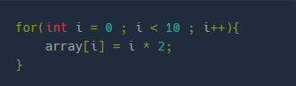
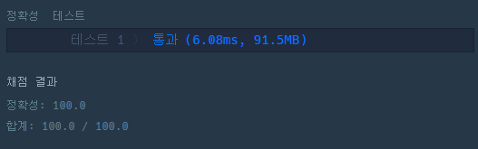

**문제 설명**

array는 길이가 100인 배열입니다. for문을 이용해서 array에 1부터 100까지의 자연수를 순서대로 넣어 보세요.   

힌트: 반복문을 이용하여 배열에 값을 넣어야 합니다.   

다음은 길이 10인 배열에 0부터 2씩 커지는 값을 넣는 코드입니다.   
코드를 실행하면 array의 원소는 차례로 0, 2, 4, 6, 8, ... 입니다.



**문제 풀이**

* 반복문을 통해 1부터 100까지 자연수를 순서대로 입력
* IntStream을 이용해서 해결도 가능

```java
public class ArrayExam {
    public int[] fill100() {
        int[] array = new int[100];
        // array에 순서대로 1부터 100까지 정수를 넣어보세요.
        // solution 1
        for(int i=0; i<100; i++){
            array[i] = i+1;
        }

        // 아래는 결과 평가를 위한 코드입니다. 수정하지 마세요.
        return array;
    }

    // 아래는 실행을 위한 코드입니다. 수정하지 마세요.
    public static void main(String[] args) {
        ArrayExam exam = new ArrayExam();
        int[] arr2 = exam.fill100();
        boolean flag = true;
        for (int i = 0; i < 100; i++) {
            if (arr2[i] != i + 1) {
                System.out.println("array[" + i + "]의 값이 틀립니다.");
                flag = false;
                break;
            }
        }
        if(flag){
            System.out.println("정답입니다.");
        }
    }
}
```



---

> 프로그래머스에서 잘못 눌렀다가  
> 자바 입문 강의를 접하게 되었다...  
>   
> 코딩테스트를 준비하는 사람들에게  
> 복습하고 연습할 수 있는 기회라 생각되어  
> 시작하게 되었다.  
>   
> 한마디로, Good
