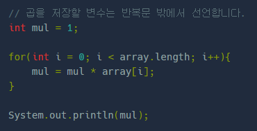

**문제 설명**

array는 길이를 알 수 없는 int형 배열입니다. array의 원소를 모두 합한 값을 sum에 저장하세요.   

힌트: array의 길이를 알 수 없다면 어떻게 해야 할까요?   

array.length를 사용하면 array 배열의 길이를 읽어올 수 있습니다.   
다음은 배열의 원소를 모두 곱한 값을 출력하는 코드입니다.



1. 배열 array를 따로 선언하지 않았는데, array에 값이 들어있네요. 어떻게 된거죠? 1   
   배열 array는 public int sum(int[] array)와 같이 함수의 매개변수로 전달되었습니다. 이에 대한 자세한 설명은 다음 파트의 메소드 강의에 나옵니다. 지금은 "외부에서 배열을 전달받아 쓸 수 있구나!"정도로 생각하시면 됩니다.

**문제 풀이**

* 배열의 길이만큼 반복하여 값을 계산하는 방식

```java
public class ArrayExam {
    public int sum(int[] array) {
        int sum = 0;
        // array는 길이를 알 수 없는 int형 배열입니다.
        // 변수 sum에 array의 모든 값을 더해보세요.

        for(int i=0; i<array.length; i++){
            sum += array[i];
        }

        // 아래는 결과 평가를 위한 코드입니다. 수정하지 마세요.
        return sum;
    }

    // 아래는 실행을 위한 코드입니다. 수정하지 마세요.
    public static void main(String[] args) {
        int[] testcase1 = {1, 2, 3, 4};
        int[] testcase2 = {5, 6, 7};
        ArrayExam exam = new ArrayExam();

        int answer1 = exam.sum(testcase1);        
        int answer2 = exam.sum(testcase2);        
        if (answer1 == 10 && answer2 == 18)
            System.out.println("정답입니다. [제출]을 누르세요.");
        else {
            System.out.println("틀렸습니다.");
            System.out.printf("1, 2, 3, 4를 더했는데 %d가 나왔네요.\n", answer1);
            System.out.printf("5, 6, 7을 더했는데 %d가 나왔네요.\n", answer2);
        }
    }
}
```

**실행 결과**


