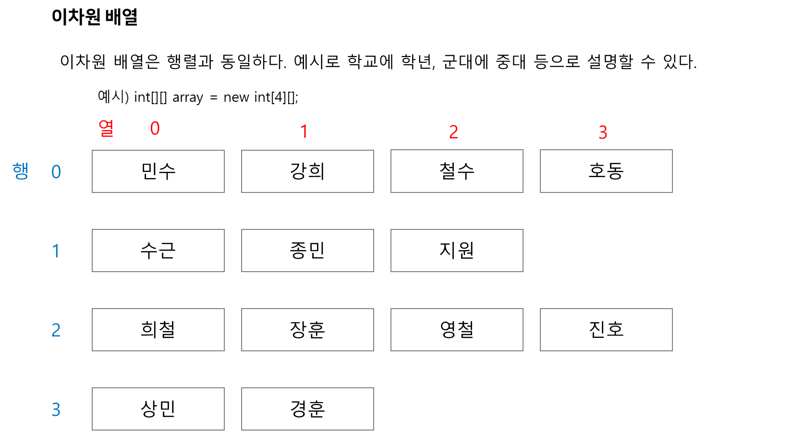

> 2차원 배열 강의를 수강하게 되었다.  
>   
> 자바를 먼저 시작하였다면  
> 필자 또한 이해하기 이해에 어려움을 겪었을 수 있다.  
>   
> 필자는 C 언어를 먼저 시작했기 때문에  
> 이해하기 수월하였다.  
>   
> 
>   
> 배열의 인덱스는 0부터 시작한다는 것을 유의해서 시작해야 한다.  
>   
> 한 학년에 4반이 있다.  
> 한 반에 몇명이 들어갈지 전체 인원에서 균등하게 나눌 수 있지만,  
> 반마다 특성이 있어 축구반, 농구반, 달리기반, 배드민턴반으로 나눌 경우 인원이 다를 수 있다.  
>   
> 이럴때 new int[4][]만 선언하고 각 반에 몇명씩 들어갈지 다르게 설정할 수 있다.  
>   
> new int[0][4] - 0반에 4명  
> new int[1][3] - 1반에 3명  
> new int[2][4] - 2반에 4명  
> new int[3][4] - 3반에 2명  
>   
> 이와 같이 크기를 다르게 지정할 수 있다.  
>   
> 이때 중요한 것은 각 맨 앞에 있는 친구들은 반장이라고 생각하면 된다.  
>   
> 선생님이 매번 다른 사람들을 부르면 힘든 것처럼  
> 배열을 부를때 맨 앞에 값을 기준으로 호출한다.  
>   
> 예시로 array[0]은 반을 의미한다.  
> 반은 해당 위치를 의미한다.   
>   
> 운동회 때 반장이 맨 앞에 서 있는 것처럼   
> 컴퓨터에 배열도 맨앞에 반장이 서있다.   
> 즉, array[0][0]이 array[0]반에 반장이 되는 것이다.  
> array[0][0]의 주소는 array[0]과 동일하다.  
>   
> 반장이 줄지어 반 친구들을 세워두었기 때문에  
> 각 반에 반장을 시작으로 순서대로 호출하면  
> 선생님은 편하게 모든 반을 쉽게 관리할 수 있듯이   
>   
> 배열은 각 행에 시작을 기준으로 편하게 관리할 수 있다.  
>   
>   
> <https://school.programmers.co.kr/learn/courses/5/lessons/135#qna>

[프로그래머스

코드 중심의 개발자 채용. 스택 기반의 포지션 매칭. 프로그래머스의 개발자 맞춤형 프로필을 등록하고, 나와 기술 궁합이 잘 맞는 기업들을 매칭 받으세요.

programmers.co.kr](https://school.programmers.co.kr/learn/courses/5/lessons/135#qna)
