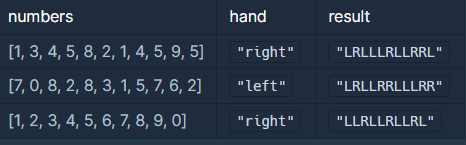
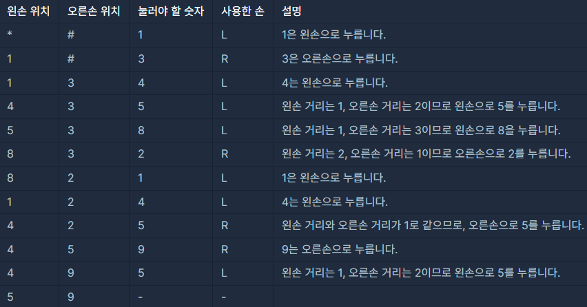

**문제 설명**

스마트폰 전화 키패드의 각 칸에 다음과 같이 숫자들이 적혀 있습니다.

이 전화 키패드에서 왼손과 오른손의 엄지손가락만을 이용해서 숫자만을 입력하려고 합니다.   
맨 처음 왼손 엄지손가락은 \* 키패드에 오른손 엄지손가락은 # 키패드 위치에서 시작하며, 엄지손가락을 사용하는 규칙은 다음과 같습니다.

1. 엄지손가락은 상하좌우 4가지 방향으로만 이동할 수 있으며 키패드 이동 한 칸은 거리로 1에 해당합니다.
2. 왼쪽 열의 3개의 숫자 1, 4, 7을 입력할 때는 왼손 엄지손가락을 사용합니다.
3. 오른쪽 열의 3개의 숫자 3, 6, 9를 입력할 때는 오른손 엄지손가락을 사용합니다.
4. 가운데 열의 4개의 숫자 2, 5, 8, 0을 입력할 때는 두 엄지손가락의 현재 키패드의 위치에서 더 가까운 엄지손가락을 사용합니다.  
   4-1. 만약 두 엄지손가락의 거리가 같다면, 오른손잡이는 오른손 엄지손가락, 왼손잡이는 왼손 엄지손가락을 사용합니다.

순서대로 누를 번호가 담긴 배열 numbers, 왼손잡이인지 오른손잡이인 지를 나타내는 문자열 hand가 매개변수로 주어질 때, 각 번호를 누른 엄지손가락이 왼손인 지 오른손인 지를 나타내는 연속된 문자열 형태로 return 하도록 solution 함수를 완성해주세요.

**제한사항**

* numbers 배열의 크기는 1 이상 1,000 이하입니다.
* numbers 배열 원소의 값은 0 이상 9 이하인 정수입니다.
* hand는 "left" 또는 "right" 입니다.
  + "left"는 왼손잡이, "right"는 오른손잡이를 의미합니다.
* 왼손 엄지손가락을 사용한 경우는 L, 오른손 엄지손가락을 사용한 경우는 R을 순서대로 이어붙여 문자열 형태로 return 해주세요.

**입출력 예**



입출력 예에 대한 설명   
입출력 예 #1   

순서대로 눌러야 할 번호가 [1, 3, 4, 5, 8, 2, 1, 4, 5, 9, 5]이고, 오른손잡이입니다.



따라서 "LRLLLRLLRRL"를 return 합니다.

**문제 풀이**

1. StringBuilder 사용 - String의 단점 보완
2. \*은 10, #은 12으로 설정(0번은 11으로 설정)
3. numbers 배열을 순차탐색
   1. 왼손에 가까운 1, 4, 7번은 3으로 나누었을 때 나머지 1을 갖는 규칙이 있다.  
      L 문자 대입과 현재 왼손에 위치로 설정
   2. 오른손에 가까운 3, 6, 9번은 3으로 나누었을 때 나머지 0을 갖는 규칙이 있다.  
      R 문자 대입과 현재 오른손에 위치로 설정
   3. 이외에 경우  
      1. 숫자 0인경우 11로 간주하고 처리
      2. 현재 숫자가 오른손과 왼손 중에 어느 손이 가까운지 계산  

         (예시) 왼손 : 4 / 오른손 : 3 / 눌러야할 숫자 : 5 / 오른손 잡이  
         Ldist =  (5-4) / 3  + (5-4) % 3 = 1  
         Rdist = (5-3) / 3 + (5-3) % 3 = 2  

         Rdist가 더 크므로 왼손으로 누르면 된다.  

         이는 위아래로 3 칸씩 차이나는 것과 좌우로 1칸씩 차이나는 것을 활용한 것이다.

```java
import java.util.*;
class Solution {
    public String solution(int[] numbers, String hand) {
        StringBuilder answer = new StringBuilder();

        int left = 10;
        int right = 12;

        for(int num : numbers){
            if(num % 3 == 1){
                answer.append("L");
                left = num;
            }else if(num % 3 == 0 && num != 0){
                answer.append("R");
                right = num;
            }else{
                if(num == 0) num = 11;

                int Ldist = Math.abs(num - left) / 3 + Math.abs(num - left) % 3;
                int Rdist = Math.abs(num - right) / 3 + Math.abs(num - right) % 3;

                if(Ldist < Rdist){
                    answer.append("L");
                    left = num;
                }else if(Ldist > Rdist){
                    answer.append("R");
                    right = num;
                }else{
                    if(hand.equals("left")){
                        answer.append("L");
                        left = num;
                    }else{
                        answer.append("R");
                        right = num;
                    }
                }
            }
        }

        return answer.toString();
    }
}
```
