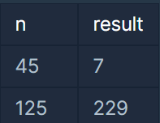
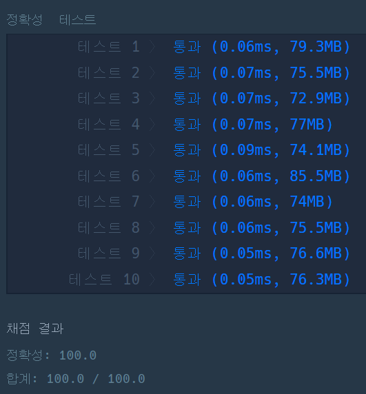

#### **월간 코드 챌린지 시즌 1 - 3집법 뒤집기(1단계)**

**문제 설명**

자연수 n이 매개변수로 주어집니다. n을 3진법 상에서 앞뒤로 뒤집은 후, 이를 다시 10진법으로 표현한 수를 return 하도록 solution 함수를 완성해주세요.

**제한 사항**

* n은 1 이상 100,000,000 이하인 자연수입니다.

**입출력 예**



**문제 풀이**

**십진수**를 **삼진수**로 변환하고, 변환한 **삼진수**를 역순으로 뒤집어서 **십진수**로 변환하는 문제이다.

(예시) 45 → 1200(3) → 0021(3) → 7

1. N을 3진수로 StringBuilder에 저장한다.
2. StringBuilder에 저장한 3진수는 문자열로 순차적으로 역순으로 붙여진다.
3. 저장된 문자열의 값을 이용하기 위해 각 값을 정수로 변환한다.
4. 정수 값은 자리수의 값과 곱하여 더하여준다.

```java
import java.util.*;

class Solution {
    public int solution(int n) {
        int size = 0;
        int temp = n;
        int sum = 0;
        String str = "";
        StringBuilder sb = new StringBuilder();

        // 1. 10진수 -> 3진수
        while(temp > 0){
            sb.append(temp % 3);
            temp = temp / 3;
        }

        str = sb.toString();
        size = str.length();

        for(int i=size-1, digit = 0; i>=0; i--, digit++){
            temp = str.charAt(i) - '0';
            sum += (temp * Math.pow(3, digit));
        }

        return sum;
    }
}
```

**결과**

**Point : 4**


