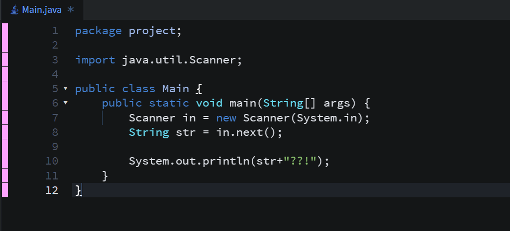
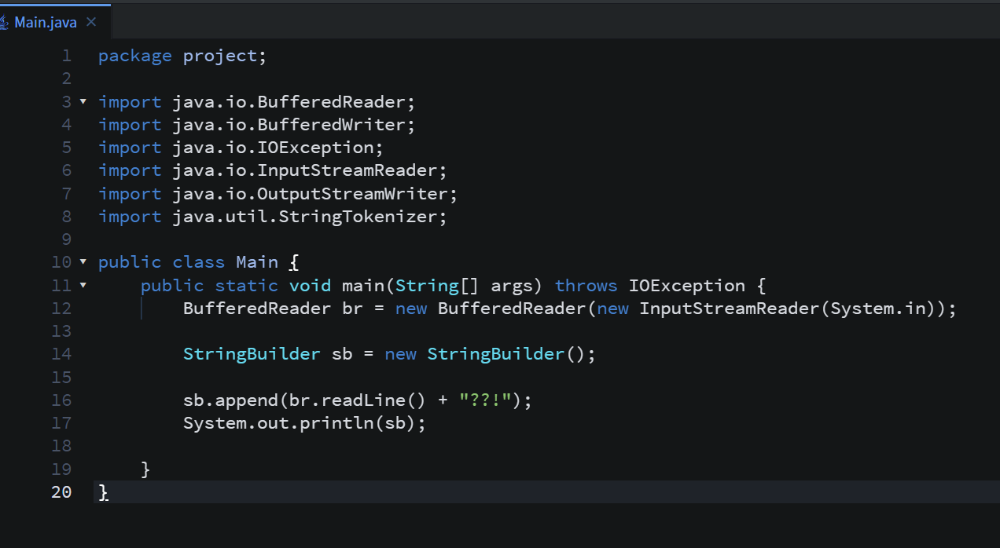
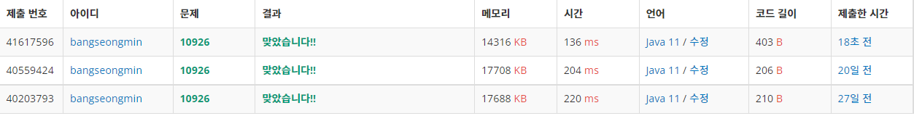
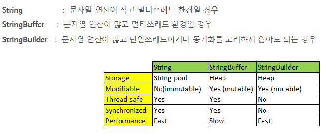

* **문제**

* **간략설명**

**- 입력된 문장에 "??!" 문자열을 연결시키는 문제입니다.**

* **풀이**

**- 방법 1(Scanner 클래스)**

**- 방법2(BufferedReader와 StringBuilder)**

**StringBuilder 을 사용한 이유는 String은 불변의 속성을 갖는다는 점입니다.**

**StringBuilder은 가변으로 값을 할당할 수 있기 때문에 사용하였습니다.**

**아래와 같이 방법1과 방법2는 성능차이가 큰 것을 보실 수 있습니다.**

**방법 1은 204ms**

**방법 2은 136ms**

* **정리**

**모르고 작성하면 모르겠지만 알고 나면 달라지는 코딩 행복합니다!**

* **참고**

**출처 :<https://ifuwanna.tistory.com/221>**
