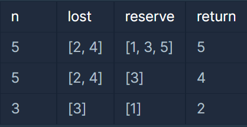
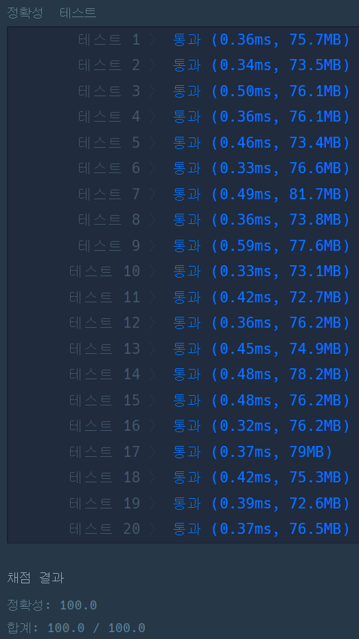

**문제설명**

점심시간에 도둑이 들어, 일부 학생이 체육복을 도난당했습니다. 다행히 여벌 체육복이 있는 학생이 이들에게 체육복을 빌려주려 합니다. 학생들의 번호는 체격 순으로 매겨져 있어, 바로 앞번호의 학생이나 바로 뒷번호의 학생에게만 체육복을 빌려줄 수 있습니다. 예를 들어, 4번 학생은 3번 학생이나 5번 학생에게만 체육복을 빌려줄 수 있습니다. 체육복이 없으면 수업을 들을 수 없기 때문에 체육복을 적절히 빌려 최대한 많은 학생이 체육수업을 들어야 합니다.   

전체 학생의 수 n, 체육복을 도난당한 학생들의 번호가 담긴 배열 lost, 여벌의 체육복을 가져온 학생들의 번호가 담긴 배열 reserve가 매개변수로 주어질 때, 체육수업을 들을 수 있는 학생의 최댓값을 return 하도록 solution 함수를 작성해주세요.

**제한사항**

전체 학생의 수는 2명 이상 30명 이하입니다.   
체육복을 도난당한 학생의 수는 1명 이상 n명 이하이고 중복되는 번호는 없습니다.   
여벌의 체육복을 가져온 학생의 수는 1명 이상 n명 이하이고 중복되는 번호는 없습니다.   
여벌 체육복이 있는 학생만 다른 학생에게 체육복을 빌려줄 수 있습니다.   
여벌 체육복을 가져온 학생이 체육복을 도난당했을 수 있습니다. 이때 이 학생은 체육복을 하나만 도난당했다고 가정하며, 남은 체육복이 하나이기에 다른 학생에게는 체육복을 빌려줄 수 없습니다.

**입출력 예**



**문제 풀이**

체육시간에 체육복을 입고 체육시간에 나갈 수 있는 학생의 최대 수를 구하는 문제이다.

1. 배열의 원소 값을 정렬해준다(lost, reverse)
2. 여벌의 체육복이 있는 사람 중 도난 당한 학생 제외
3. 도난 당한 사람에게 여벌의 체육복이 있는 사람이 빌려주기

```java
import java.util.*;

class Solution {
    public int solution(int n, int[] lost, int[] reserve) {
        int answer = n - (lost.length);

        Arrays.sort(reserve);
        Arrays.sort(lost);

        // 여벌의 체육복이 있는 사람 중 도난 당한 학생 제외
        for (int i=0; i<reserve.length; i++) {
            for (int j=0; j<lost.length; j++) {
                if ( reserve[i] == lost[j] ) {
                    answer += 1;
                    reserve[i] = -1;
                    lost[j] = -1;
                }
            }
        }

        for (int i=0; i<reserve.length; i++) {
            for (int j=0; j<lost.length; j++) {
                if ( (reserve[i] != -1 && lost[j] != -1) )  {		
                // 빌려줄 수 없는 애들 제외
                    if ( reserve[i] - lost[j] == 1 || reserve[i] - lost[j] == -1 ) {
                    // 앞 번호이거나 뒷 번호이다 (== 번호 차이가 1이다) => 빌려줄 수 있다
                        reserve[i] = -1;
                        lost[j] = -1;
                        answer += 1;
                    }
                }
            }
        }

        return answer;
    }
}
```

---


