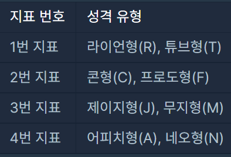
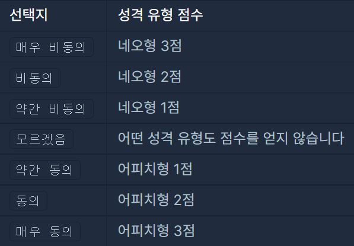
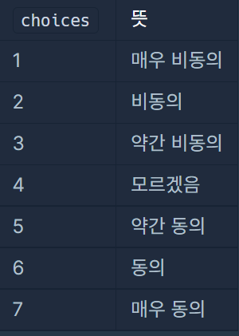
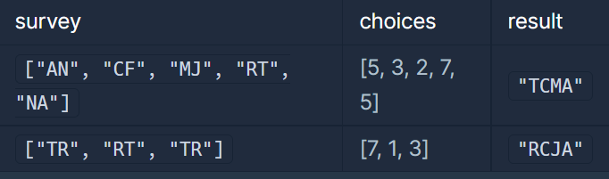

#### **문제 : [KAKAO BLIND RECRUITMENT] 신고 결과 받기**

**문제 설명**

나만의 카카오 성격 유형 검사지를 만들려고 합니다.   
성격 유형 검사는 다음과 같은 4개 지표로 성격 유형을 구분합니다. 성격은 각 지표에서 두 유형 중 하나로 결정됩니다.



4개의 지표가 있으므로 성격 유형은 총 16(=2 x 2 x 2 x 2)가지가 나올 수 있습니다. 예를 들어, "RFMN"이나 "TCMA"와 같은 성격 유형이 있습니다.

검사지에는 총 n개의 질문이 있고, 각 질문에는 아래와 같은 7개의 선택지가 있습니다.

* 매우 비동의
* 비동의
* 약간 비동의
* 모르겠음
* 약간 동의
* 동의
* 매우 동의

각 질문은 1가지 지표로 성격 유형 점수를 판단합니다.

예를 들어, 어떤 한 질문에서 4번 지표로 아래 표처럼 점수를 매길 수 있습니다.



이때 검사자가 질문에서 약간 동의 선택지를 선택할 경우 어피치형(A) 성격 유형 1점을 받게 됩니다. 만약 검사자가 매우 비동의 선택지를 선택할 경우 네오형(N) 성격 유형 3점을 받게 됩니다.

**위 예시처럼 네오형이 비동의, 어피치형이 동의인 경우만 주어지지 않고, 질문에 따라 네오형이 동의, 어피치형이 비동의인 경우도 주어질 수 있습니다.**  
하지만 각 선택지는 고정적인 크기의 점수를 가지고 있습니다.

* 매우 동의나 매우 비동의 선택지를 선택하면 3점을 얻습니다.
* 동의나 비동의 선택지를 선택하면 2점을 얻습니다.
* 약간 동의나 약간 비동의 선택지를 선택하면 1점을 얻습니다.
* 모르겠음 선택지를 선택하면 점수를 얻지 않습니다.

검사 결과는 모든 질문의 성격 유형 점수를 더하여 각 지표에서 더 높은 점수를 받은 성격 유형이 검사자의 성격 유형이라고 판단합니다. 단, 하나의 지표에서 각 성격 유형 점수가 같으면, 두 성격 유형 중 사전 순으로 빠른 성격 유형을 검사자의 성격 유형이라고 판단합니다.

질문마다 판단하는 지표를 담은 1차원 문자열 배열 survey와 검사자가 각 질문마다 선택한 선택지를 담은 1차원 정수 배열 choices가 매개변수로 주어집니다. 이때, 검사자의 성격 유형 검사 결과를 지표 번호 순서대로 return 하도록 solution 함수를 완성해주세요.

**제한사항**

* 1 ≤ survey의 길이 ( = n) ≤ 1,000
  + survey의 원소는 "RT", "TR", "FC", "CF", "MJ", "JM", "AN", "NA" 중 하나입니다.
  + survey[i]의 첫 번째 캐릭터는 i+1번 질문의 비동의 관련 선택지를 선택하면 받는 성격 유형을 의미합니다.
  + survey[i]의 두 번째 캐릭터는 i+1번 질문의 동의 관련 선택지를 선택하면 받는 성격 유형을 의미합니다.
* choices의 길이 = survey의 길이
  + choices[i]는 검사자가 선택한 i+1번째 질문의 선택지를 의미합니다.
  + 1 ≤ choices의 원소 ≤ 7



**입출력 예**



**문제 풀이**

R,T,C,F,J,M,A,N 각각에 대해 점수를 체크하고, R-T, C-F, J-M, A-N의 4쌍을 비교하면서 더 높은 점수를 출력하거나, 동일하다면 사전순으로 앞서는 문자(R, C, J, A)를 출력해주면 되는 문제이다.

 각 문자에 대해 점수를 저장해야 하므로, HashMap<Character, Integer> 형태의 자료구조를 사용하면 되지만, 겹치는 문자가 없고, 각 문자는 아스키코드로 int로 변경할 수 있으므로 'A'~'Z'에 해당하는 26칸 짜리 배열을 만들어서 카운팅해도 된다.

 chocies의 경우에 0 ~ 7로 보면 구간을 나눠줘야하는데 4를 빼주면 된다. 음수일 경우 좌측문자에 영향을 끼치고, 0일 경우엔 무시하고 양수일 경우엔 우측문자에 영향을 끼친다.

```java
import java.util.*;

class Solution {
    private static final String[] INDICATORS = {"RT", "CF", "JM", "AN"};

    public String solution(String[] survey, int[] choices) {
        int[] cnt = new int['Z'-'A'+1];

        for (int i = 0; i < survey.length; i++) {
            char a = survey[i].charAt(0);		// survey[i]의 좌측 문자
            char b = survey[i].charAt(1);		// survey[i]의 우측 문자
            int score = choices[i]-4;

            if (score == 0) continue;
            if (score<0) cnt[a -'A']-=score;	// 음수라면 좌측문자에 영향
            else cnt[b - 'A']+=score;			// 양수라면 우측문자에 영향
        }

        StringBuilder sb = new StringBuilder();
        for (int i = 0; i < INDICATORS.length; i++) {
            char a = INDICATORS[i].charAt(0);
            char b = INDICATORS[i].charAt(1);
            int cntA = cnt[a-'A'];
            int cntB = cnt[b-'A'];
            if (cntA == cntB) sb.append(a);
            else sb.append(cntA>cntB ? a:b);
        }
        return sb.toString();
    }
}
```

---

> 이 문제는 풀이하는데 시간이 너무 오래걸렸다...  
>   
> 해결은 하였지만, 좋은 코드가 아니였기 때문에  
> 다른 분들의 코드를 보고 다시 공부하여 올리게 되었다.  
>   
> 기존 나의 코드는 HashMap을 사용하여 복잡하게 풀이하였지만,  
> 상단의 코드는 간결하고 깔끔하게 풀이하여 명쾌한 해답을 제시한 느낌이 들었다.
