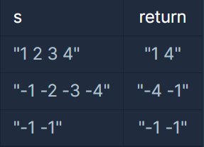

#### **문제 : 최댓값과 최솟값**

**문제설명**

문자열 s에는 공백으로 구분된 숫자들이 저장되어 있습니다. str에 나타나는 숫자 중 최소값과 최대값을 찾아 이를 "(최소값) (최대값)"형태의 문자열을 반환하는 함수, solution을 완성하세요.   
예를들어 s가 "1 2 3 4"라면 "1 4"를 리턴하고, "-1 -2 -3 -4"라면 "-4 -1"을 리턴하면 됩니다.

**제한 조건**

* s에는 둘 이상의 정수가 공백으로 구분되어 있습니다.

**입출력 예**



**문제 풀이**

정수와 공백으로 구성된 문자열에서 최대값과 최솟값을 도출하는 문제이다.

**풀이1**

정수의 개수만큼 배열을 생성하고 배열에 값을 저장하여 오름차순으로 정렬하고 첫번째 인덱스 값과 마지막 인덱스 값을 도출해내는 방법.  
- 단점 : 동일한 반복문을 2번 사용해야 한다.

```java
import java.util.*;

class Solution {
    public String solution(String s) {
        String answer = "";

        // 1. 정수 개수 파악
        int cnt = 0;
        for(int i=0; i< s.length(); i++){
            if(s.charAt(i) != ' ' && s.charAt(i) != '-')
                cnt++;
        }

        // 2. 배열 생성
        int[] arr = new int[cnt];
        int idx = 0;
        for(int i=0; i < s.length(); i++){
            if(s.charAt(i) != ' '){
                if(s.charAt(i) == '-'){                    
                    i++;
                    arr[idx] = (s.charAt(i) - '0') * -1;
                }else{
                    arr[idx] = s.charAt(i) - '0';  
                }
                idx++; 
            }
        }

        // 3. 정렬
        Arrays.sort(arr);

        return arr[0] + " " + arr[cnt-1];
    }
}
```

**풀이2**

split함수를 이용해서 분리하는 작업을 마치고, Stream을 이용해서 문자열 배열을 정수형 배열로 전환한다.

정수형 배열을 오름차순으로 정렬하면 된다.

```java
import java.util.*;

class Solution {
    public String solution(String s) {

        String answer = "";
        String[] str = s.split(" ");

        int[] nums = Arrays.stream(str).mapToInt(Integer::parseInt).toArray();

        Arrays.sort(nums);
        return nums[0] + " " + nums[nums.length-1];
    }
}
```

---

> **Point : 1**  
>   
> 더 효율적인 방법은 무엇일까?
