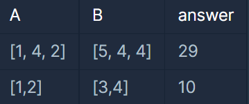
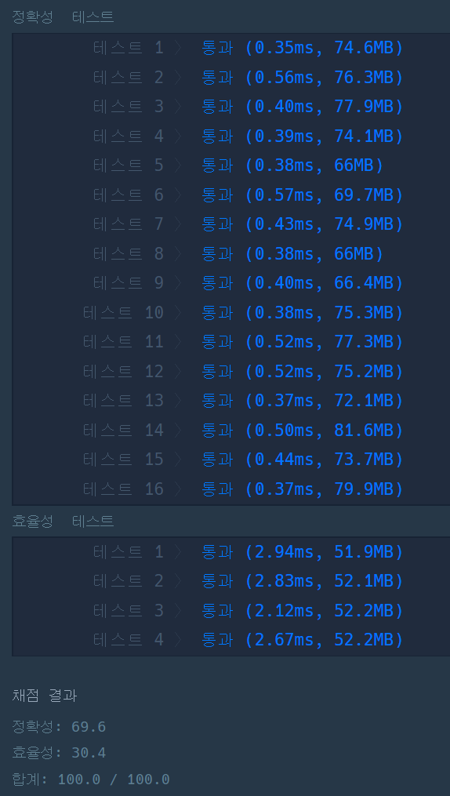

#### **문제 : 최솟값 만들기**

**문제 설명**

길이가 같은 배열 A, B 두개가 있습니다. 각 배열은 자연수로 이루어져 있습니다.  
배열 A, B에서 각각 한 개의 숫자를 뽑아 두 수를 곱합니다. 이러한 과정을 배열의 길이만큼 반복하며, 두 수를 곱한 값을 누적하여 더합니다. 이때 최종적으로 누적된 값이 최소가 되도록 만드는 것이 목표입니다. (단, 각 배열에서 k번째 숫자를 뽑았다면 다음에 k번째 숫자는 다시 뽑을 수 없습니다.)

예를 들어 A = [1, 4, 2] , B = [5, 4, 4] 라면

* A에서 첫번째 숫자인 1, B에서 첫번째 숫자인 5를 뽑아 곱하여 더합니다. (누적된 값 : 0 + 5(1x5) = 5)
* A에서 두번째 숫자인 4, B에서 세번째 숫자인 4를 뽑아 곱하여 더합니다. (누적된 값 : 5 + 16(4x4) = 21)
* A에서 세번째 숫자인 2, B에서 두번째 숫자인 4를 뽑아 곱하여 더합니다. (누적된 값 : 21 + 8(2x4) = 29)

즉, 이 경우가 최소가 되므로 **29**를 return 합니다.

배열 A, B가 주어질 때 최종적으로 누적된 최솟값을 return 하는 solution 함수를 완성해 주세요.

**제한사항**

* 배열 A, B의 크기 : 1,000 이하의 자연수
* 배열 A, B의 원소의 크기 : 1,000 이하의 자연수

**입출력 예**



**문제 풀이**

두 배열의 각각 값을 곱한 값을 더하여 최솟값을 도출해내는 문제이다.

해결방법은 간단하다. A배열을 오름차순 정렬, B배열을 내림차순 정렬하여 순서대로 계산해주면 최솟값이 된다.

하지만 문제는 Arrays.sort()을 내림차순으로 하는 방법을 지원하지 않고 있다.

그래서 B배열을 오름차순으로 정렬하고 마지막 인덱스부터 순차적으로 계산해주었다.

```java
import java.util.Arrays;
import java.util.Collections;

class Solution
{
    public int solution(int []A, int []B)
    {
        int answer = 0;

        Arrays.sort(A);     // 배열 A 오름차순 정렬        
        Arrays.sort(B);     // 배열 B 내림차순 정렬

        for(int i=0; i< A.length; i++){
            answer += (A[i] * B[A.length - i -1]);
        }

        return answer;
    }
}
```

---


