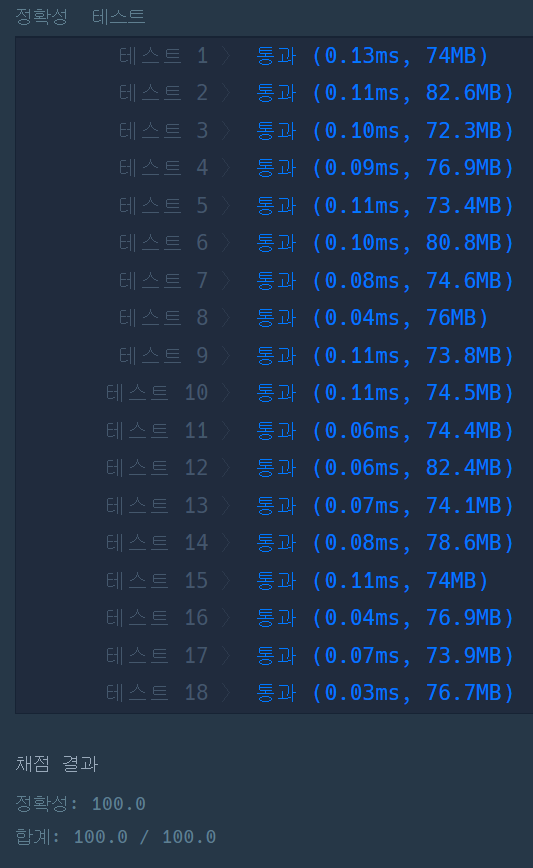

#### **문제 : JadenCase 문자열 만들기**

**문제 설명**

JadenCase란 모든 단어의 첫 문자가 대문자이고, 그 외의 알파벳은 소문자인 문자열입니다. 단, 첫 문자가 알파벳이 아닐 때에는 이어지는 알파벳은 소문자로 쓰면 됩니다. (첫 번째 입출력 예 참고)   
문자열 s가 주어졌을 때, s를 JadenCase로 바꾼 문자열을 리턴하는 함수, solution을 완성해주세요.

**제한 조건**

* s는 길이 1 이상 200 이하인 문자열입니다.
* s는 알파벳과 숫자, 공백문자(" ")로 이루어져 있습니다.
  + 숫자는 단어의 첫 문자로만 나옵니다.
  + 숫자로만 이루어진 단어는 없습니다.
  + 공백문자가 연속해서 나올 수 있습니다.

**입출력 예**


**문제 풀이**

문자열에 각 단어의 첫 단어를 대문자로 하고 나머지는 소문자로 바꾸는 문제이다.

풀이의 시작을 문자열 단위로 나누어서 단어의 첫 단어만 바꾸면 된다는 생각으로 풀이를 시작하였었다.

하지만 이와 같이 풀이할 경우, 테스트 케이스 실패가 발생하였다. 그래서 문자열을 잘게 쪼개서 문자단위로 하는 방법을 선택하였다.

```java
import java.util.*;

class Solution {
    public String solution(String s) {

        boolean space = true;
        StringBuilder sb = new StringBuilder();

        for(char ch : s.toCharArray()){
            sb.append(space ? Character.toUpperCase(ch) : Character.toLowerCase(ch));
            space = ch == ' ' ? true : false;
        }

        return sb.toString();
    }
}
```

---

> **Point : 9**문자 단위로 계산하는 것과 문자열 단위로 계산하는 것에 차이를 이해하지 못하였다.  
> 문자열 단위로 할 경우 반복문 횟수가 크게 줄어드는데 왜 문자 단위로 하는 것이 더 빠를까??


