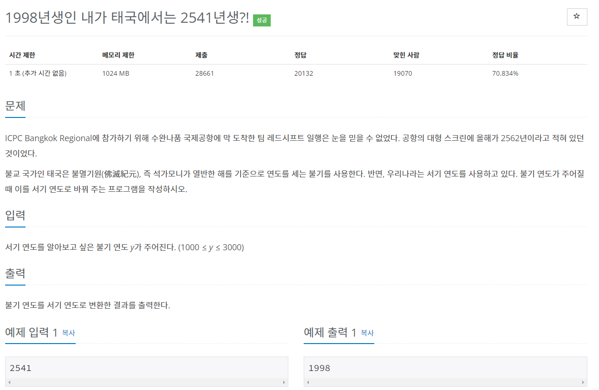
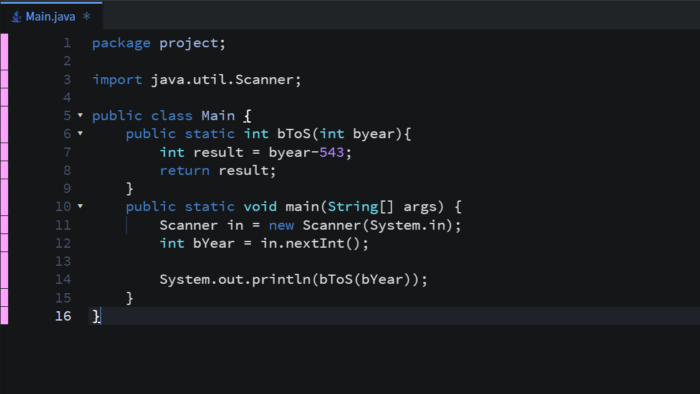
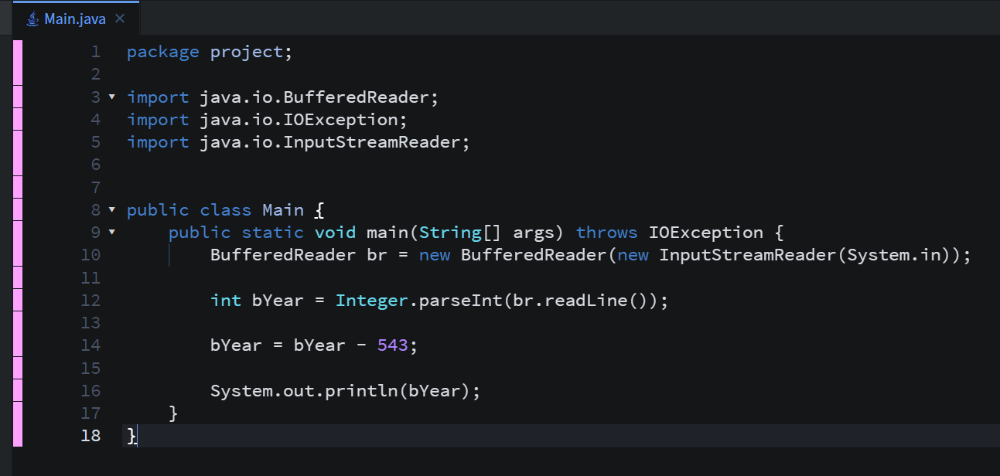
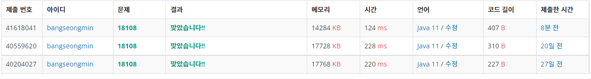

* **문제**

* **간략설명**

**- 이 문제는 서기 연도와 불기 연도의 차이를 파악한 후 풀이하는 문제입니다**

* **풀이**

**- 방법 1(Scanner)**

**Scanner 클래스를 사용하여 입력을 받고, 값을 계산 하기 위한 함수를 생성하여 처리하였습니다.**

**굳이 함수를 만들지 않아도 되지만 함수로 처리하도록 하였습니다.**

   - 방법 2(BufferedReader)

   성능 차이를 보이기 위해 작성한 코드로 함수를 생성하지 않았습니다. 함수를 만들지 않아도 간단한 코드입니다.

* **정리**

  간단한 코드라면 메인에 작성하여도 좋지만, 메소드를 나눠서 관리하는 것이 코드 재사용에도 좋기 때문에 메소드로 관리하는 것을 강추!! 합니다.

