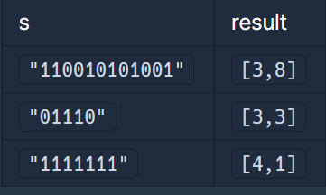

#### **문제 : 월간 코드 챌린지 시즌1 - 이진 변환 반복하기**

**문제 설명**

0과 1로 이루어진 어떤 문자열 x에 대한 이진 변환을 다음과 같이 정의합니다.

1. x의 모든 0을 제거합니다.
2. x의 길이를 c라고 하면, x를 "c를 2진법으로 표현한 문자열"로 바꿉니다.

예를 들어, x = "0111010"이라면, x에 이진 변환을 가하면 x = "0111010" -> "1111" -> "100" 이 됩니다.

0과 1로 이루어진 문자열 s가 매개변수로 주어집니다. s가 "1"이 될 때까지 계속해서 s에 이진 변환을 가했을 때, 이진 변환의 횟수와 변환 과정에서 제거된 모든 0의 개수를 각각 배열에 담아 return 하도록 solution 함수를 완성해주세요.

**제한사항**

* s의 길이는 1 이상 150,000 이하입니다.
* s에는 '1'이 최소 하나 이상 포함되어 있습니다.

**입출력 예**



**문제 풀이**

문자열 x에서 0을 제거하고 남은 문자열의 길이를 다시 2진수로 변환하는 작업을 문자열 길이가 1일때까지 반복하여 제거된 0의 개수와 반복 횟수를 반환하는 문제이다.

```java
class Solution {
    public int[] solution(String s) {
        int[] answer = new int[2];  // 반복횟수, 0의 개수

        // 1. 문자열 길이가 1이 될때까지 반복
        while(s.length() > 1){

            int cnt_one = 0;    // 1의 개수

            // 2. 문자열을 문자 배열로 반복
            for(char ch : s.toCharArray()){
            	// 2-1. 0의 개수 파악
                if(ch == '0') answer[1]++;
                // 2-2. 1의 개수 파악
                else cnt_one++;
            }

            // 3. 1의 개수(= 문자열의 길이)를 이진수로 변환
            s = Integer.toBinaryString(cnt_one);
            // 4. 반복횟수 증가
            answer[0]++;
        }

        return answer;
    }
}
```
