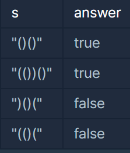
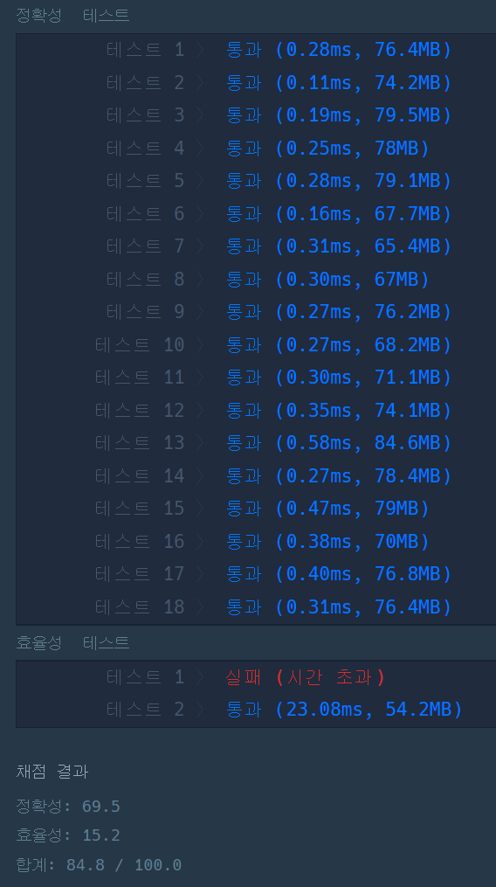

#### **문제 : 스택/큐 - 올바른 괄호**

**문제 설명**

괄호가 바르게 짝지어졌다는 것은 '(' 문자로 열렸으면 반드시 짝지어서 ')' 문자로 닫혀야 한다는 뜻입니다. 예를 들어

* "()()" 또는 "(())()" 는 올바른 괄호입니다.
* ")()(" 또는 "(()(" 는 올바르지 않은 괄호입니다.

'(' 또는 ')' 로만 이루어진 문자열 s가 주어졌을 때, 문자열 s가 올바른 괄호이면 true를 return 하고, 올바르지 않은 괄호이면 false를 return 하는 solution 함수를 완성해 주세요.

**제한사항**

* 문자열 s의 길이 : 100,000 이하의 자연수
* 문자열 s는 '(' 또는 ')' 로만 이루어져 있습니다.

**입출력 예**



**문제 풀이**

**풀이 1**

Character형 stack을 생성하여 '('을 삽입하고 ')'이면 stack에서 1개 삭제하고 이 과정을 반복한다. 반복문이 끝났을 때 stack.empty() == true이면 true 아닐 경우 false를 반환하는 방식이다.

하지만 이 방법은 효율성에서 시간 초과로 실패한 풀이다.

```java
class Solution {
    boolean solution(String s) {
        boolean answer = true;      

        // 1. Character형 Stack 선언
        Stack<Character> stack = new Stack<>();

        // 2. 문자열을 문자 단위로 반복
        for(char c : s.toCharArray()){

            // 3. Stack이 비었을 경우
            if(stack.empty()){
                // 3-1. 비었을 때 반대 가로부터 시작할 경우 
                if(c == ')')
                    return false;
                // 3-2. ( 가로부터 시작한 경우 삽입
                else
                    stack.push(c);
            // 4. 비어있지 않을 경우
            }else{
                // 4-1. Stack안에 '('이 있고 새로운 문자가 ')'이라면 Pop
                if(stack.peek() == '(' && c == ')')
                    stack.pop();
                // 4-2. c가 '('라면 삽입
                else
                    stack.push(c);
            }
        }

        if(!stack.empty())
            answer = false;

        return answer;
    }
}
```



**풀이2**

* stack이라는 자료 구조 대신 '(' 과 ')' 의 개수를 세는 전략으로 변환
* 반복문 내부 조건문에 '(' 삽입하는 과정은 stack이 비었을 때와 있을때와 동일하므로 간략화

이 과정을 통해 시간과 공간을 효율적으로 절약할 수 있었다.

```java
class Solution {
    boolean solution(String s) {
        int cnt = 0;    // '('의 개수를 세기 위한 변수

        // 1. 문자열을 문자 단위로 반복
        for(char c : s.toCharArray()){
            // 2-1. (의 개수가 cnt가 0일때 )가 들어올 때
            if(cnt == 0 && c == ')')             
                return false;
            // 2-2. (의 개수가 하나 이상 있을때 )가 들어온 상황
            else if(cnt >= 1 && c == ')')
                cnt--;
            // 2-3. (가 들어왔을 때
            else
                cnt++;
        }

        // 3. (의 개수와 )의 개수가 동일한가?
        return cnt == 0 ? true : false;
    }
}
```

---

> **Point : 5**자료구조를 먼저 생각했는데,  
> 그것도 좋지만 원리를 먼저 이해하는 것이 가장 중요한 것 같다.
