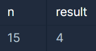
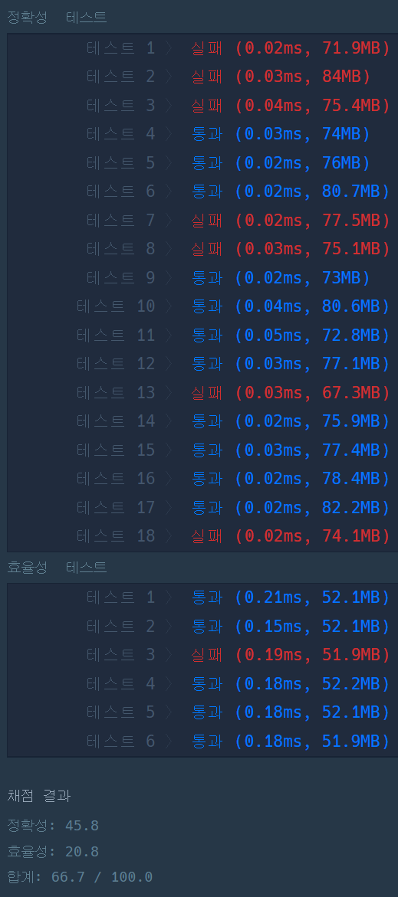
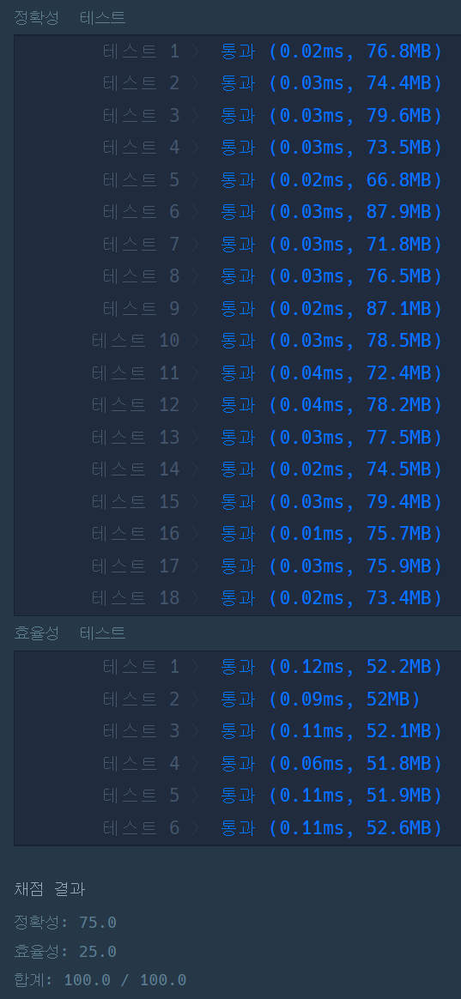

#### **문제 : 숫자의 표현**

**문제 설명**

Finn은 요즘 수학공부에 빠져 있습니다. 수학 공부를 하던 Finn은 자연수 n을 연속한 자연수들로 표현 하는 방법이 여러개라는 사실을 알게 되었습니다. 예를들어 15는 다음과 같이 4가지로 표현 할 수 있습니다.

* 1 + 2 + 3 + 4 + 5 = 15
* 4 + 5 + 6 = 15
* 7 + 8 = 15
* 15 = 15

자연수 n이 매개변수로 주어질 때, 연속된 자연수들로 n을 표현하는 방법의 수를 return하는 solution를 완성해주세요.

제한사항

* n은 10,000 이하의 자연수 입니다.

**입출력 예**



**문제 풀이**

**풀이1**

**15를 기준으로 생각했을 때 4가지가 나온다. 이때 15의 약수의 개수가 나온다는 것을 이용하여 풀이하였다.**

**하지만 알고 있었다. 반례로 4는 3가지, 6는 4가지이지만 3가지 방법이 있다.**

**이것에 대한 해답을 찾던 중 정수론이라는 것을 알게 되었다..**

```java
class Solution {
    public int solution(int n) {
        int answer = 0;

        for(int i=1; i<=n; i++){
            if(n % i == 0)
                answer++;
        }

        return answer;
    }
}
```



**풀이2**

**정수론에 근거하면 "주어진 자연수를 연속된 자연수의 합으로 표현하는 방법의 수는 홀수 약수의 개수와 같다"**

방법은 간단하였다. i++ 을 i+=2 로 변경하여 홀수 약수의 개수를 구하는 것이다.

```java
class Solution {
    public int solution(int n) {
        int answer = 0;

        for(int i=1; i<=n; i+=2){
            if(n % i == 0)
                answer++;
        }

        return answer;
    }
}
```



---

> **Point : 7**이 문제는 풀이하면서 어떨결에 얻어 걸린 문제이다.  
>   
> 수학의 정수론?이라는 것을 처음 알았기 때문이다...ㅎ
