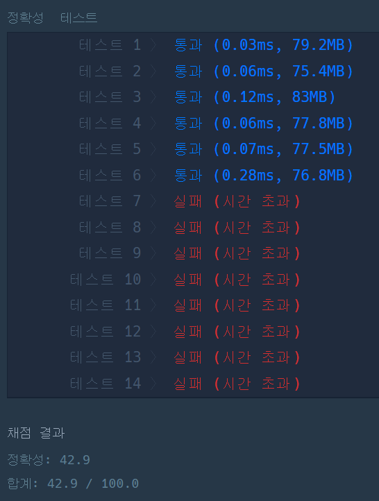

#### **문제 : 피보나치 수**

**문제 설명**

피보나치 수는 F(0) = 0, F(1) = 1일 때, 1 이상의 n에 대하여 F(n) = F(n-1) + F(n-2)가 적용되는 수입니다.

예를 들어

* F(2) = F(0) + F(1) = 0 + 1 = 1
* F(3) = F(1) + F(2) = 1 + 1 = 2
* F(4) = F(2) + F(3) = 1 + 2 = 3
* F(5) = F(3) + F(4) = 2 + 3 = 5

와 같이 이어집니다.

2 이상의 n이 입력되었을 때, n번째 피보나치 수를 1234567로 나눈 나머지를 리턴하는 함수, solution을 완성해 주세요.

**제한 사항**

* n은 2 이상 100,000 이하인 자연수입니다.

**입출력 예**


**문제 풀이**

**풀이1**

피보나치 수는 재귀 함수의 가장 간단한 예시이다.

F(2) = F(0) + F(1)

F(3) = F(1) + F(2)

문제는 시간 초과가 발생하였다.

```java
class Solution {
    public int solution(int n) {

        return Fibo(n);
    }

    public int Fibo(int n){
    	// Fibo(0) = 0
        if(n == 0)
            return 0;
        // Fibo(1) = 1
        else if(n == 1)
            return 1;
        else
            return Fibo(n-1) + Fibo(n-2);
    }
}
```



**풀이 2**

**F(0)과 F(1)은 n으로 동일하게 반환된다는 것을 이용하였더니 시간은 조금은 줄었지만...**

**탈락!**

```java
class Solution {
    public int solution(int n) {
        return Fibo(n);
    }

    public int Fibo(int n){
        if(n == 0 || n == 1)
            return n;
        else
            return Fibo(n-1) + Fibo(n-2);
    }
}
```

> **오답 원인**  
> **1. 재귀 함수의 특징은 단순한 로직이지만 반복할수록 메모리를 많이 차지해 연산이 느려진다는 단점이 있다.**  
> **그러므로 반복이 많다면 재귀 함수보다는 반복문이 성능이 더 뛰어나다.**  
>   
> **2. 피보나치 수의 합을 구하다 보면 int의 범위를 벗어나게 되므로 정확한 값을 반환하지 못한다.**

**풀이 3**

**문제 설명에 있는 것처럼 n번째 피보나치 수를 1234567로 나눈 나머지를 리턴하는 것이 문제이다.**

```java
class Solution {
    public int solution(int n) {
        int answer = 0;
        int num1 = 0;
        int num2 = 1;

        if(n == 0 || n == 1)
            return n;
        else{
            for(int i=2;i<=n; i++){
                answer = (num1 + num2) % 1234567;
                num1 = num2;        // F(n-2)
                num2 = answer;      // F(n-1)
            }
            return answer;
        }
    }
}
```

---

> **Point : 7**  
>   
> 문제 설명을 읽지도 않고 피보나치의 수를 풀고 있는  
> 필자처럼 풀지 않기를 바랍니다.
